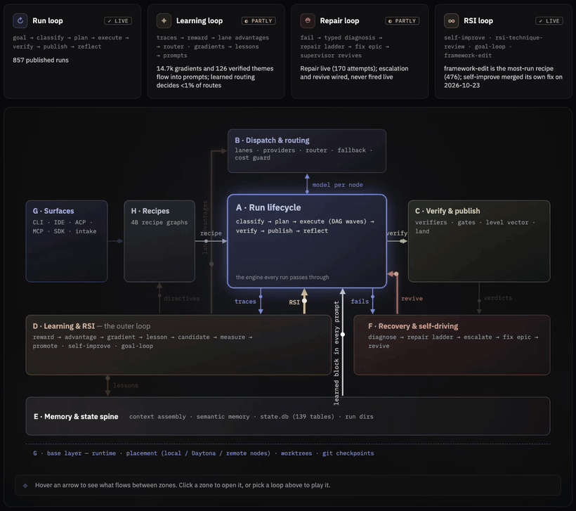

<h1 align="center">mini-ork</h1>

  <strong>Un système d'exploitation de tâches pour agents IA — qui les oblige à prouver leur travail.</strong>

  
  
  
  

<a href="README.md">English</a> | <a href="README.zh-CN.md">简体中文</a> | <a href="README.ja.md">日本語</a> | <a href="README.ko.md">한국어</a> | <a href="README.es.md">Español</a> | <a href="README.pt-BR.md">Português (Brasil)</a> | <a href="README.de.md">Deutsch</a> | Français | <a href="README.ru.md">Русский</a> | <a href="README.hi.md">हिन्दी</a> | <a href="README.it.md">Italiano</a> | <a href="README.tr.md">Türkçe</a> | <a href="README.id.md">Bahasa Indonesia</a>

  

Une exécution <code>code-fix</code> dans l'IDE mini-ork : classification → planification → implémentation → vérification → trois angles de revue confiés à trois familles de modèles → publication, puis chaque fichier modifié attend un Keep ou un Reject. Exécution d'exemple tirée de la <a href="https://miniork.dev/">visite guidée</a> · <a href="https://miniork.dev/media/mini-ork-demo.mp4">vidéo en pleine qualité</a>.

mini-ork transforme un objectif en une exécution planifiée, menée à bien et **vérifiée** sur une
flotte de modèles : **classification → planification → exécution → vérification → réflexion → amélioration**.
Chaque verdict repose sur ce que le code a réellement fait à l'exécution — tests, vérification
des types, schémas, exécution dans un bac à sable isolé — et non sur l'avis d'un modèle quant à
sa propre production.

Cette page est le guide d'installation. Pour comprendre la raison d'être du projet, lisez
[Pourquoi mini-ork existe](docs/WHY.md).

## Démarrage rapide

macOS, Linux ou WSL :

~~~bash
curl -fsSL https://raw.githubusercontent.com/SourceShift/mini-ork/main/install.sh | sh
~~~

L'installateur :

- clone mini-ork dans `~/.local/share/mini-ork` (modifiable via `MINI_ORK_INSTALL_DIR`) ;
- crée un `.venv` propre au dépôt cloné et installe le profil Python complet
  (CLI, sidecar web local, Crucible) ;
- place `mini-ork` dans votre PATH via `~/.local/bin` ;
- propose l'assistant de premier lancement s'il s'exécute dans un terminal.

Depuis un dépôt déjà cloné, la même installation :

~~~bash
git clone --recurse-submodules https://github.com/SourceShift/mini-ork.git
cd mini-ork
make install
mini-ork version        # open a new terminal if PATH changed
~~~

`--recurse-submodules` récupère `ui/`, la crate de l'IDE
([`SourceShift/mini-ork-ui`](https://github.com/SourceShift/mini-ork-ui)). Le runtime Python
n'en a pas besoin ; pour compiler l'IDE, consultez [docs/UI.md](docs/UI.md).

## Premier lancement : `mini-ork onboard`

Une seule commande fait passer une machine vierge à un espace de travail prêt à exécuter une
recette. Elle n'appelle jamais de modèle et ne dépense jamais d'argent : chaque étape est une
vérification ou une compilation locale.

~~~bash
cd ~/my-project
mini-ork onboard
~~~

| Étape | Ce qui se passe |
|---|---|
| prérequis | Vérifie Python ≥ 3.11 et git ; signale `sqlite3` / `jq` s'ils sont présents |
| espace de travail | Crée `.mini-ork/` dans le répertoire courant (lance `git init` si nécessaire) |
| lanes de fournisseurs | Indique si des identifiants sont enregistrés, ou donne la commande qui les ajoute |
| contextnest | *Facultatif :* clone et compile le service de mémoire locale, puis amorce sa configuration |
| zed | *Facultatif :* branche l'agent et les serveurs MCP de mini-ork dans le `settings.json` de Zed |

Les composants facultatifs ne sont proposés que si leur chaîne d'outils est présente (`cargo`,
`zed`), et chacun peut être choisi explicitement :

~~~bash
mini-ork onboard --with contextnest,zed      # force both
mini-ork onboard --no-contextnest --no-zed   # core only
mini-ork onboard --dry-run                   # print the plan, change nothing
mini-ork onboard -y                          # accept defaults (scripts, CI)
mini-ork onboard --json                      # machine-readable step results
mini-ork onboard --help                      # every flag
~~~

Codes de sortie : `0` terminé (les composants ignorés ne posent pas problème), `1` un composant
sélectionné a échoué sous `--strict`, `2` erreur d'utilisation. Une exécution non interactive ne
pose aucune question : `-y` accepte toutes les valeurs par défaut.

### ContextNest — substrat de mémoire locale

Un service HTTP en Rust qui garde la trace de ce que les sessions précédentes ont décidé, raté,
vérifié et livré. L'assistant amorce `config/contextnest.yaml` au niveau **simple** ; avec
`--secure`, il n'écrit rien et exige `CN_TOKEN` avant que le service ne démarre.

~~~bash
mini-ork onboard --with contextnest     # clone + cargo build --release + seed config
mini-ork cn status                      # tier, endpoint, reachability, latency
~~~

À la main : `git clone https://github.com/SourceShift/ContextNest.git`, puis
`make cn-serve` (écoute sur `127.0.0.1:28080`). Nécessite Rust 1.80+. Détails :
[docs/CONTEXTNEST-INTEGRATION.md](docs/CONTEXTNEST-INTEGRATION.md).

### Zed — intégration à l'éditeur

Branche `mini-ork acp` (agent externe) et `mini-ork mcp-context` (contexte en lecture seule sur
les exécutions, l'apprentissage et les coûts) dans Zed. Chaque écriture dans `settings.json` est
précédée d'une sauvegarde horodatée.

~~~bash
mini-ork onboard --with zed     # or at any time:
mini-ork zed setup
mini-ork zed status
mini-ork zed uninstall
~~~

Voir [docs/ZED.md](docs/ZED.md) et [docs/UI.md](docs/UI.md).

## Votre premier workflow vérifié

~~~bash
cd ~/my-project
mini-ork onboard                      # initialize the project
mini-ork providers configure <lane>   # hidden prompt; keys never touch argv
mini-ork doctor                       # dependencies, environment, provider preflight

cp ~/.local/share/mini-ork/examples/01-hello-world/kickoff.md ./kickoff.md

# Check the wiring first: no model calls, no spend.
MINI_ORK_DRY_RUN=1 mini-ork run code-fix ./kickoff.md
mini-ork validate

# Then run it for real.
mini-ork run code-fix ./kickoff.md
~~~

Un kickoff précise le dépôt cible, les fichiers autorisés, l'artefact attendu, ainsi que la
commande ou la règle qui prouve le succès. Les artefacts d'exécution sont écrits dans
`.mini-ork/runs/`, l'état enregistré dans `.mini-ork/state.db`. Pour choisir quelle lane tient
quel rôle, consultez `.mini-ork/config/agents.yaml`.

### Prouver un correctif en une commande

`mini-ork certify` prend une modification et le bug qu'elle prétend corriger, reproduit le bug
sur votre code, génère des entrées pour lesquelles la modification n'a pas été écrite, exécute le
tout dans un bac à sable Docker et rend un verdict, preuves à l'appui :

~~~text
$ mini-ork certify --base base --head fix-cheat \
    --issue "median([1, 2, 3, 4]) returns 3, should return 2.5"
REFUTED  the fix does not generalise — only 0% of 4 invariants hold,
         which is the signature of a patch that special-cases the reported input
exit code: 1
~~~

Codes de sortie : `0` PROVEN, `1` REFUTED, `2` UNVERIFIED — la commande s'abstient plutôt que de
deviner, si bien que la CI peut s'en servir comme garde-fou. Nécessite Docker et une lane de modèle.
Essayez `bash examples/certify-demo/demo.sh`.

## Vérification, apprentissage et auto-amélioration

  

Quatre boucles autour d'un même moteur, extraites de la <a href="https://miniork.dev/">visite guidée</a> (données d'exemple) · <a href="https://miniork.dev/media/mini-ork-loops.mp4">vidéo en pleine qualité</a>.

Le GIF en haut de cette page montre la boucle d'exécution. Trois autres couches l'entourent.

### Une vérification qu'aucun agent ne peut contourner par le discours

Chaque verdict repose sur des preuves d'exécution. Les vérificateurs d'une recette lancent une
garde anti-falsification, la suite de tests, un rejeu sur la base (le test doit échouer sur
l'ancien code) et un contrôle d'adéquation par mutation. Avant que l'implémenteur ne commence,
une seconde lane de modèle écrit à l'aveugle, à partir du kickoff, des tests de spécification que
l'implémenteur ne peut pas modifier. La chaîne de contrôles de publication refuse tout ce qui n'a
pas réussi, et un modèle relecteur peut opposer son veto à un résultat, mais jamais fabriquer un
succès. `certify` applique la même logique à une modification unique et répond PROVEN ou
REFUTED, ou UNVERIFIED lorsqu'il ne peut trancher ni dans un sens ni dans l'autre. Sur un corpus
SWE-bench adversarial, 21 verdicts PROVEN sur 21 étaient corrects, avec 0 tâche faussement
déclarée terminée ; la méthode et ses limites sont décrites dans
[docs/RESULTS.md](docs/RESULTS.md), les mécanismes dans
[docs/architecture/verification-stack.md](docs/architecture/verification-stack.md).

### Un apprentissage qui ne retient que ce qui a été vérifié

Après chaque exécution, les traces deviennent une récompense de processus par nœud, et toute
récompense positive doit s'appuyer sur une preuve fournie par le vérificateur. La boucle se
ramifie ensuite : des avantages par lane dont le routeur apprend (GRPO), des gradients textuels
que l'étape de réflexion transforme en leçons, et un contrôle de conflits avant l'écriture de
toute leçon. Seules les leçons vérifiées atteignent un prompt, chaque prompt embarque le bloc
appris, et un registre d'injection consigne exactement ce que chaque nœud a reçu, de sorte que le
mérite remonte à la leçon qui l'a gagné. Aujourd'hui, les gradients et les thèmes vérifiés
alimentent bien les prompts, tandis que le routage appris ne décide encore qu'une petite minorité
des routes. Cycle de vie et état d'avancement :
[docs/LEARNING-LOOP-LIFECYCLE.md](docs/LEARNING-LOOP-LIFECYCLE.md).

### Une auto-amélioration sous contrôle

mini-ork modifie mini-ork via le même graphe de recettes : `framework-edit` (auto-modifications
vérifiées, avec tests de spécification à l'aveugle), `self-improve` (analyse, angles d'analyse,
synthèse, implémentation, contrôles), `rsi-technique-review` (lit la littérature et propose des
techniques à implémenter) et `goal-loop`. Une modification apprise doit passer un audit
anti-contournement et un audit du vérificateur, puis un contrôle de non-régression sur des sondes
figées face à un bras témoin réexécuté à l'aveugle ; chaque version promue conserve un pointeur
de restauration. La boucle d'application qui réécrit les prompts sans supervision est livrée
**désactivée par défaut** (voir l'avertissement ci-dessous). `framework-edit` est la recette la
plus utilisée, et `self-improve` a trouvé et fusionné son propre correctif le 2026-10-23. Détails :
[docs/RECURSIVE-SELF-IMPROVE.md](docs/RECURSIVE-SELF-IMPROVE.md),
[docs/SAFETY.md](docs/SAFETY.md), [docs/ECOSYSTEM.md](docs/ECOSYSTEM.md).

## Commandes courantes

| Commande | Rôle |
|---|---|
| `mini-ork run <recipe> <kickoff.md>` | Exécute une recette de bout en bout |
| `mini-ork doctor` | Vérifie les dépendances, l'environnement et le pré-contrôle des fournisseurs |
| `mini-ork validate` | Contrôles statiques avant exécution, avec des indications `Fix:` |
| `mini-ork providers status <lane>` | Indique la présence et la source des identifiants (jamais leurs valeurs) |
| `mini-ork serve` | Interface web locale et API sur `127.0.0.1:7090` |
| `mini-ork garden` | Détection de dérive : collisions, orphelins, exécutions périmées |
| `mini-ork recover` / `resume` | Relance une exécution échouée ou interrompue |
| `mini-ork mcp` / `vault` | Registre des serveurs MCP ; chaîne de backends du coffre à secrets |
| `mini-ork zed setup` / `cn status` | Branchement de l'éditeur ; niveau et joignabilité de ContextNest |

Recettes pour démarrer : `code-fix`, `docs`, `refactor-audit`, `bug-audit-cmgk`,
`research-synthesis`, `spec-driven-delivery`. Voir [recipes/](recipes/) et le
[guide d'extension](docs/EXTENSION.md).

## Mise à jour

Relancez l'installateur ou, depuis un dépôt cloné, lancez `make install` : la commande peut être
relancée sans risque. Elle réutilise `.venv`, met à jour le paquet éditable, répare la commande
gérée et vérifie les outils système. Ensuite, `mini-ork update` applique les migrations de base
de données en attente et signale toute dérive de configuration.

## Désinstallation

~~~bash
mini-ork zed uninstall                     # remove the Zed entries
mini-ork automations scheduler uninstall   # only if you installed the OS tick
rm -rf ~/.local/share/mini-ork ~/.local/bin/mini-ork
~~~

L'état de chaque projet réside dans son `.mini-ork/` ; supprimez-le là où vous n'en voulez plus.
Vos dépôts sources et votre historique git ne sont jamais modifiés.

## Configuration requise

| | |
|---|---|
| OS | macOS, Linux, WSL. Windows natif : installez Python 3.11, Git, jq, yq et SQLite avec `winget`, puis lancez `py -3 .\scripts\full_install.py` |
| Python | 3.11 ou 3.12 |
| Git | requis |
| Docker | uniquement pour la vérification en bac à sable (`certify`, Crucible) |
| Rust 1.80+ | uniquement pour ContextNest et la crate de l'IDE |
| Accès aux modèles | une lane de fournisseur configurée pour les exécutions réelles ; aucune pour les exécutions à blanc |

## Pour aller plus loin

| | |
|---|---|
| [docs/WHY.md](docs/WHY.md) | Pourquoi le projet existe ; mesures ; ce qu'il ne prétend pas faire |
| [docs/SAFETY.md](docs/SAFETY.md) | Posture face à l'auto-modification et garde-fous qui tiennent |
| [docs/ARCHITECTURE.md](docs/ARCHITECTURE.md) | Conception du système et diagrammes des composants |
| [docs/operator](docs/operator) | Exploiter mini-ork : variables d'environnement, dépannage |
| [docs/PYTHON-SDK.md](docs/PYTHON-SDK.md) | Intégrer mini-ork dans votre propre application |
| [docs/RESULTS.md](docs/RESULTS.md) | Méthodes et tailles d'échantillon derrière les chiffres |
| [ROADMAP.md](ROADMAP.md) | La direction que prend le projet |

> [!WARNING]
> mini-ork contient une boucle d'application capable de réécrire ses propres prompts et workflows
> et de promouvoir la modification sans relecture humaine. Elle est **désactivée par défaut** (il
> faut que `MO_APPLY_ENABLED` et `MO_AUTO_APPLY` valent tous deux `1`), et son rayon d'impact, ses
> plafonds et ses mécanismes de restauration sont documentés dans [docs/WHY.md](docs/WHY.md#warning-this-system-modifies-itself-unattended).

## Contribuer et licence

mini-ork est distribué sous licence **Apache-2.0**, © Amir Khakshour. Le projet est jeune et de
niveau recherche : utilisez un worktree dédié pour toute modification du framework, associez un
vérificateur à chaque affirmation sur un comportement, et lancez les contrôles ciblés sur la
surface que vous modifiez. Consultez [AGENTS.md](AGENTS.md) pour le processus de contribution et
[GOVERNANCE.md](GOVERNANCE.md) pour la direction du projet.
