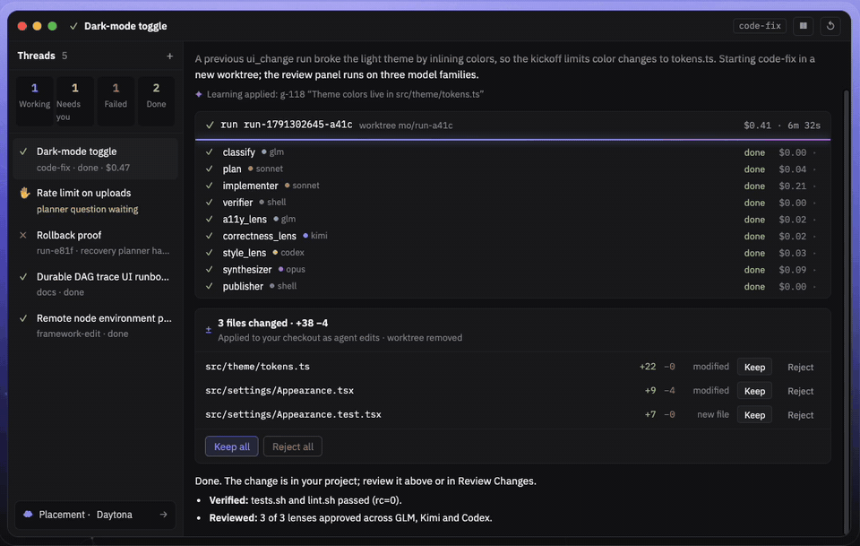
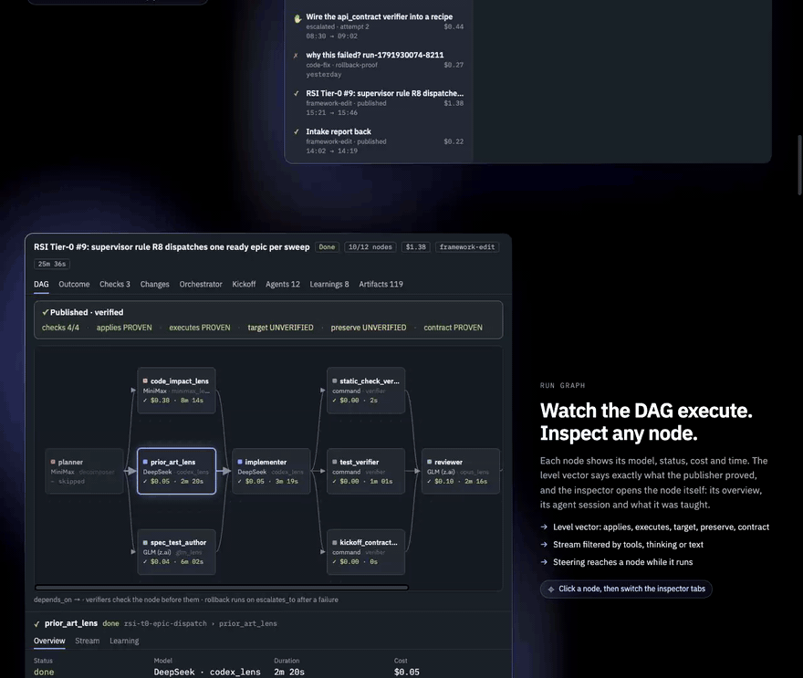
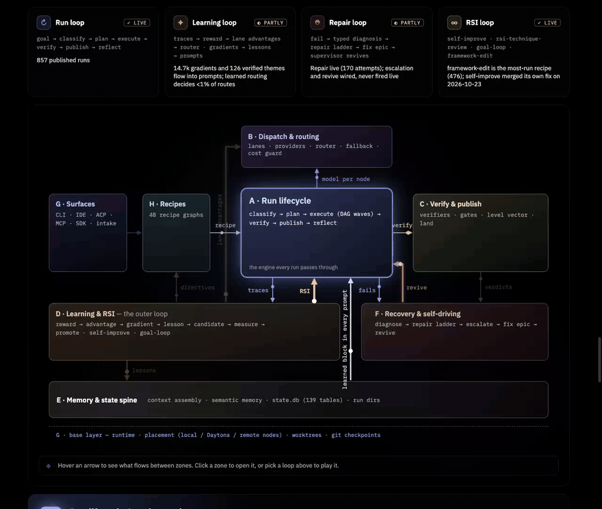
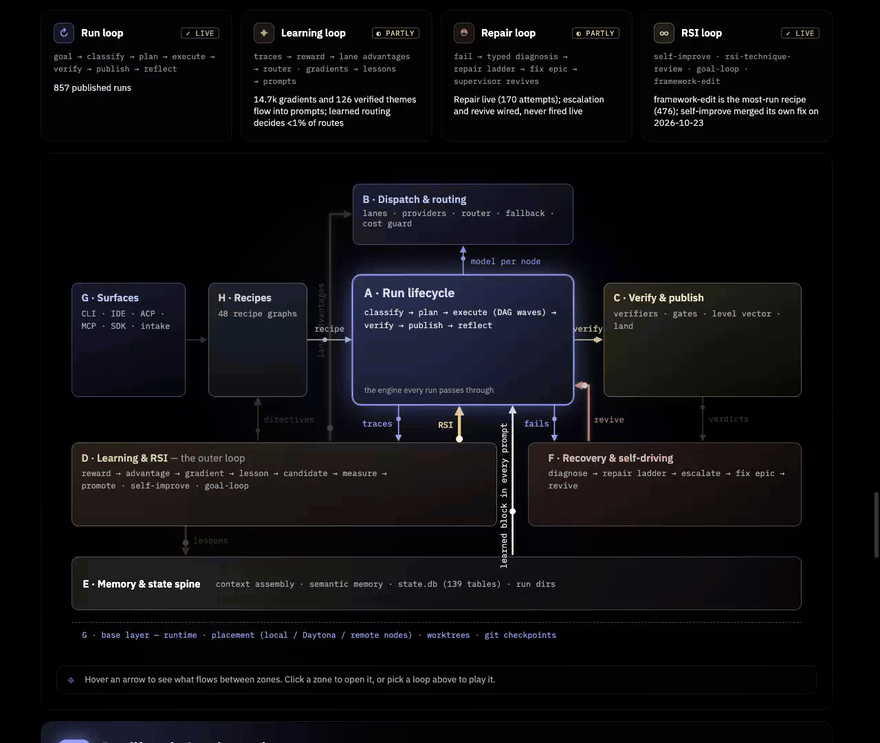

  

<h1 align="center">mini-ork</h1>

  <strong>面向 AI agent 的任务操作系统 —— 它要求 agent 证明自己做的工作。</strong>

  
  
  
  

  <a href="README.md">English</a> | 简体中文

> [!NOTE]
> 本页尚未同步到以安装为主的新版结构。安装步骤、`mini-ork onboard` 首次运行向导，以及
> ContextNest / Zed 组件说明，请以 [英文 README](README.md) 为准。

  

mini-ork IDE 中的一次 <code>code-fix</code> 运行：分类 → 规划 → 实现 → 验证 → 来自三个模型家族的三个评审视角 → 发布，随后每个改动文件等待 Keep 或 Reject。示例运行，来自 <a href="https://miniork.dev/">miniork.dev</a> 的演示 · <a href="https://miniork.dev/media/mini-ork-demo.mp4">完整视频</a>。

mini-ork 把一个目标变成一次经过规划、执行、并被**验证**的运行，背后由一组不同的模型协同完成：**分类 → 规划 → 执行 → 验证 → 反思 → 改进**。对每一次改动的裁决，依据的是代码**在真实运行时实际做了什么**——测试、类型检查、schema 校验、在隔离沙箱中的真实执行——而不是某个模型对自己输出的看法。

它是为这样的团队准备的:希望 agent 真正完成工作,而不是把流畅的输出、一个看起来是绿色的 diff,或者一组相互附和的模型,当作证据。

## ✅ 一条命令证明一次修复

把 `mini-ork certify` 指向一次改动以及它声称修复的 bug。它会在你仓库自己的代码上复现这个 bug,生成这次改动未曾针对过的额外输入,把所有东西都放进 Docker 沙箱里运行,并返回带证据的裁决:

~~~text
$ bash examples/certify-demo/demo.sh          # paths shortened
$ mini-ork certify --base base --head fix-correct --issue "median([1, 2, 3, 4]) returns 3, …should return 2.5."
PROVEN  the fix holds across 100% of 4 perturbed inputs (supermajority)
  change  1 file · sha256 506d0947   claim  "median([1, 2, 3, 4]) returns 3, but the median of an even…"
  proof   .mini-ork/certificates/88f4ff0d-….json   cost $0.03 · 129s
exit code: 0

$ mini-ork certify --base base --head fix-cheat --issue "median([1, 2, 3, 4]) returns 3, …should return 2.5."
REFUTED  the fix does not generalise — only 0% of 4 invariants hold, which is the signature of a patch that special-cases the reported input
  change  1 file · sha256 aeaffdf3   claim  "median([1, 2, 3, 4]) returns 3, but the median of an even…"
  proof   .mini-ork/certificates/c575f369-….json   cost $0.03 · 89s
exit code: 1
~~~

两次改动都能让 bug 报告里的例子通过。但第二次改动只是特判了 `[1, 2, 3, 4]` 这一种输入:普通的复现测试在它上面能通过,但生成出来的不变量(invariant)全部失败。退出码分别是 `0` 表示 PROVEN(已证实)、`1` 表示 REFUTED(已反驳)、`2` 表示 UNVERIFIED(无法判定)——宁可放弃判断也不瞎猜——因此 CI 可以直接用它做门槛。每次运行都会写出一份 `mini-ork.certificate/v1` JSON,里面包含复现探针、各个不变量、改动与声明的哈希值,以及一个摘要值(digest)。

试一下: `bash examples/certify-demo/demo.sh` (需要 Docker 和至少一个可用的模型 lane)。

## 🔍 验证、学习与自我改进

顶部的动图是运行循环。围绕它还有三层。下面的片段来自 [miniork.dev](https://miniork.dev/) 上的演示（示例数据）。

### 验证：agent 无法靠措辞蒙混过关

  

每一个裁决都来自执行证据：篡改守卫、测试套件、基线回放（测试必须在旧代码上失败）、变异充分性检查；另一个模型通道在实现者开工之前仅凭 kickoff 写出盲测，实现者不能改动它们。审阅模型可以否决一个结果，但永远不能凭空制造通过。`certify` 对单个改动给出 PROVEN、REFUTED，或在无法证明时给出 UNVERIFIED。方法与局限见 [docs/RESULTS.md](docs/RESULTS.md)，机制见 [docs/architecture/verification-stack.md](docs/architecture/verification-stack.md)。

### 学习：只保留经过验证的东西

  

每次运行之后，轨迹变成每个节点的过程奖励，正向奖励必须有验证器证据配对；路由器从各通道的优势中学习（GRPO），反思步骤从文本梯度中提炼经验，写入前先做冲突检查。只有经过验证的经验才会进入提示词，注入账本记录每个节点收到了什么，功劳才能回流。生命周期与现状见 [docs/LEARNING-LOOP-LIFECYCLE.md](docs/LEARNING-LOOP-LIFECYCLE.md)。

### 自我改进：带闸门

  

mini-ork 通过同一套配方图修改自己：`framework-edit`、`self-improve`、`rsi-technique-review`、`goal-loop`。每一项学到的改动都要通过可攻击性审计与验证器审计，再通过基于冻结探针、带盲重跑对照组的非回归闸门，每个被晋升的版本都保留回滚指针。无人值守改写提示词的 apply 循环**默认关闭**。详见 [docs/RECURSIVE-SELF-IMPROVE.md](docs/RECURSIVE-SELF-IMPROVE.md)、[docs/SAFETY.md](docs/SAFETY.md)。

## 📊 数字是测出来的,不是喊出来的

- **真实仓库。** 三个外部 Python 库(marshmallow、pyparsing、toolz),每个都有上游的正确修复和一个看起来合理但实际错误的修复:**6 个裁决中 5 个正确,1 个放弃判断,0 个错误。** 放弃判断的是 pyparsing 的正确修复:生成的测试假设了这个库并不具备的行为,现在 oracle 在这种情况下返回 UNVERIFIED,而不是瞎猜。更早的版本在这个仓库上两个方向都判错了。
- **对抗性 SWE-bench 数据集。** 21 个 PROVEN 裁决全部是正确修复,误判通过(false completion)为 0。第一版曾放过一个针对特定输入特判的补丁(29 个里对 28 个);现在的不变量生成器就是为了堵住这个漏洞而改的。
- **从本仓库自身历史中挖出的留出任务。** 40 个任务解决了 22 个(55%),由求解器从未见过的隐藏测试评分;使用开源权重模型(MiniMax-M3 负责实现,GLM-5.3 负责评审),真实 API 花费为**每个任务 $0.42**。
- **一份证书**按标价计算大约 **$0.03**,耗时 1–3 分钟。

方法、样本量,以及每个数字**没有**说明的部分,都写在 [docs/RESULTS.md](docs/RESULTS.md) 里。

> [!IMPORTANT]
> mini-ork 还包含一个可以改写自己提示词(prompt)和工作流、并且不经人工审核就直接推送改动的循环。它**默认是关闭的**。打开它之前,请先读完[这段警告](README.md#warning-this-system-modifies-itself-unattended)。

  

## 🚀 从这里开始

`make install` 会安装受支持的本地运行环境:所需的 OS 工具、一个仅属于该 checkout 的 `.venv`、`.[full]` 这个 Python profile(CLI、本地 web 旁路服务,以及 Crucible),以及按用户安装的 `mini-ork` 命令。Dry run 不会调用任何模型 provider;真实运行则还需要你的 lane 所指定的 provider CLI 或 provider 配置。

一行命令(macOS、Linux 或 WSL):

~~~bash
curl -fsSL https://raw.githubusercontent.com/SourceShift/mini-ork/main/install.sh | sh
~~~

它会克隆到 `~/.local/share/mini-ork`(可以设置 `MINI_ORK_INSTALL_DIR` 来改变这个路径),并执行和 `make install` 相同的完整安装流程。或者从一个已有的 checkout 开始:

~~~bash
# 获取 mini-ork,并安装完整运行环境(macOS、Linux 或 WSL)。
git clone https://github.com/SourceShift/mini-ork.git
cd mini-ork
make install

# 如果安装程序改动了 PATH,打开一个新终端,然后确认它使用的是 .venv。
mini-ork version
~~~

## 📚 更多文档

更详细的文档都是英文的,见以下链接:完整英文 README([README.md](README.md))、测量方法与结果([docs/RESULTS.md](docs/RESULTS.md))、安全模型([docs/SAFETY.md](docs/SAFETY.md))、架构([docs/ARCHITECTURE.md](docs/ARCHITECTURE.md))、功能列表([docs/FEATURES.md](docs/FEATURES.md))、以及 Python SDK([docs/PYTHON-SDK.md](docs/PYTHON-SDK.md))。

## 许可证

mini-ork 使用 **Apache-2.0** 许可证。
