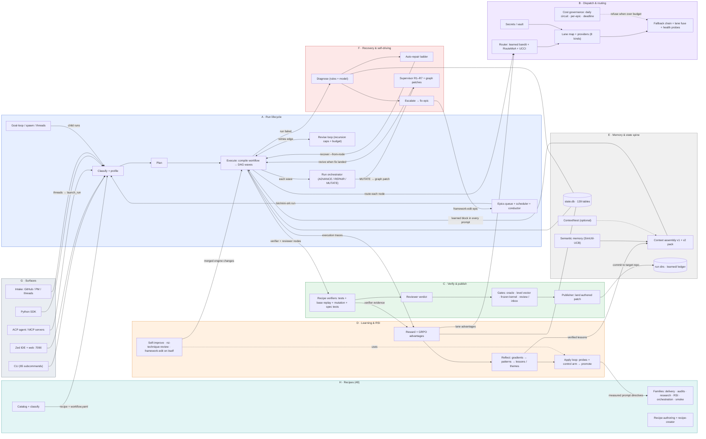

# The mini-ork ecosystem, on one page

*2026-10-23 · built from a code-level analysis of all 36 packages (~265k lines of
Python), 65 subcommands, 48 recipes and 85 migrations, cross-checked against the live
`state.db`. Every component names the code that implements it; statuses are what the
code does today, not what a doc promises.*

mini-ork is a task operating system for AI agents: you hand it a goal, it picks a
**recipe** (a graph of agent nodes), runs every node on a chosen **model lane**,
**verifies** the result with checks the agents cannot game, **publishes** only what
passed, **recovers** what failed, and **learns** from every run so the next one is
cheaper and better — including improving its own code (**RSI**).

---

## 1. The picture

Seven zones around one spine. Draw them in this arrangement:

```
                 ┌──────────────── B  DISPATCH & ROUTING ────────────────┐
                 │  lanes · providers · router · fallback · cost guard   │
                 └───────────────────────▲───────────────────────────────┘
                                         │ model per node
 ┌─ G  SURFACES ─┐   ┌─ H RECIPES ─┐   ┌─┴──────── A  RUN LIFECYCLE ───────────┐   ┌─ C  VERIFY & PUBLISH ─┐
 │ CLI · IDE ·   │──►│ 48 recipe   │──►│ classify → plan → execute (DAG waves) │──►│ verifiers · gates ·   │
 │ ACP · MCP ·   │   │ graphs      │   │ → verify → publish → reflect          │   │ level vector · land   │
 │ SDK · intake  │   └─────────────┘   └───┬───────────────────────────┬───────┘   └──────────┬────────────┘
 └───────────────┘                         │ traces, outcomes          │ failed runs           │ verdicts
                                           ▼                           ▼                       │
 ┌───────────── D  LEARNING & RSI (the outer loop) ─────────────┐   ┌─ F  RECOVERY & SELF-DRIVING ─┐
 │ reward → advantage → gradient → lesson → candidate → measure │   │ diagnose → repair ladder →    │
 │ → promote · self-improve · goal-loop · technique review      │   │ escalate → fix epic → revive  │
 └──────────┬───────────────────────────────────┬───────────────┘   └───────────────┬───────────────┘
            │ advantages to B                    │ lessons to E                       │ fix epics to A
 ┌──────────▼────────────────────────────────────▼───────────────────────────────────▼──────────────┐
 │  E  MEMORY & STATE SPINE — context assembly · semantic memory · state.db (139 tables) · run dirs │
 └──────────────────────────────────────────────────────────────────────────────────────────────────┘
   G (base layer): runtime · placement (local / Daytona / remote nodes) · worktrees · git checkpoints
```

The same picture as a renderable diagram (pre-rendered with zone colours in
[`ECOSYSTEM.png`](ECOSYSTEM.png)):



How to read it: **A** is the engine every run passes through. **B** and **C** are the
two services A calls for every node (who runs it, and is the output real). **E** is
the memory every zone reads and writes. **D** and **F** are the two feedback loops
that close around A: D makes future runs better, F rescues failed ones. **G** is the
way in and the ground everything runs on. **H** is the library of graphs A executes.

---

## 2. The four loops (the story the picture tells)

| Loop | Path | Owners | Live today? |
|---|---|---|---|
| **1. Run loop** | goal → classify → profile → plan → execute (waves of nodes, each routed to a lane) → verifier & reviewer nodes → publisher lands the patch → post-run verify → detached reflect | `cli/main.py:_run_lifecycle_impl`, `cli/execute.py`, `cli/publisher.py` | yes — 857 published runs |
| **2. Learning loop** | traces → reward (PRM, verifier, eval) → GRPO lane advantages → router picks better lanes · reflect → textual gradients → patterns → lessons/themes → injected into the next prompts · apply loop measures a directive on frozen probes against a blind-rerun control arm before it may enter a prompt | `learning/writeback.py`, `lane_router.py`, `learning/reflection_pipeline.py`, `learning/themes.py`, `cli/apply.py`, `learning/probe_scorer.py` | partly — gradients (14.7k), lessons (126 verified themes, 51 approved patterns) flow into prompts; the apply loop has no live promotion; learned routing decides <1% of routes |
| **3. Repair loop** | run fails → typed diagnosis (rules, then a model for unclassified) → repair ladder (lane swap, infra retry, re-verify, revise) → if the engine is at fault: bug → framework-edit fix epic, run parked `waiting_on_fix` → supervisor revives it once the fix is on `origin/main`, labels the diagnosis, supersedes delivered-elsewhere failures, applies proposed graph patches | `recovery/diagnose.py`, `recovery/auto_repair.py`, `recovery/escalation.py`, `recovery/supervisor.py`, `recovery/graph_patch.py` | repair yes (170 attempts); escalation/revive wired but never fired live; supervisor runs every 5 min (launchd) |
| **4. RSI loop** | mini-ork improves mini-ork: `self-improve` (scan → 4-family lenses → synthesis → implement → gates → branch), `rsi-technique-review` (2,000 papers → techniques to build), `goal-loop` (waves of fix children toward a goal), `framework-edit` (verified self-edits with blind spec tests) | `cli/self_improve.py`, `recipes/recursive-self-improve`, `recipes/rsi-technique-review`, `recipes/goal-loop`, `recipes/framework-edit` | yes — framework-edit is the most-run recipe (476); self-improve found and merged its own fix on 2026-10-23 |

---

## 3. Zone by zone

Status legend: **on** = runs by default · **opt-in** = needs a flag or command ·
**dormant** = wired but has no data or never triggers · **dead** = no production caller.

### A · Run lifecycle & orchestration
| Feature | What it does | Code | Status |
|---|---|---|---|
| Run driver | Flags, guards, classify → profile → plan → execute → repair handoff → verify → reflect → teardown | `cli/main.py:1680` | on |
| Classify + profile | Keyword scorer over recipes' `task_class.yaml` (no LLM); `run_profile.json` with lanes, roots, scope, questions | `cli/classify.py`, `cli/main.py:682` | on |
| Planner | LLM plan with repair loop and a profile gate that refuses under-specified kickoffs | `cli/plan.py`, `planning/` | on |
| Workflow compiler | Typed node/edge graph, artifact ports, `retries` repair edges, `recursion:` block | `workflow/compiler.py`, `workflow/recursion.py` | on |
| DAG wave dispatcher | Runs nodes in readiness waves; serial / parallel / partitioned; node handler registry | `cli/execute.py`, `cli/execute_handlers.py` | on |
| Revise loop | A failing check sends findings back to its target node (≤2 rounds; a `recursion:` block's `max_iterations` and `budget_cap_total_usd` apply to its repair edges) | `cli/execute.py` (`_round_cap`) | on |
| Run orchestrator | At each wave boundary: ADVANCE / REPAIR / MUTATE (proposes a graph patch); a watcher sends steering hints | `orchestration/runner_orchestrator.py` | on |
| Durable resume | Node checkpoints → `recover --from-node`; completion ledger → `run --resume`; git ref per node | `stores/checkpoints.py`, `checkpoints/`, `vcs/node_checkpoint.py` | on |
| Epics + scheduler + conductor | Roadmap → epics with dependencies; pool dispatch with budgets, retries, hooks; conductor picks topology | `cli/epics.py`, `scheduler.py`, `orchestration/conductor.py` | opt-in |
| Goal-loop, spawn, threads | Goal-driven waves of child runs; bounded recursive spawn; chat/intake threads that launch or steer runs | `recipes/goal-loop`, `cli/spawn.py`, `threads/` | opt-in |

### B · Dispatch, routing & cost
| Feature | What it does | Code | Status |
|---|---|---|---|
| Lane map | Role/alias → lane; run snapshot > home > repo, personal overlay on top | `dispatch/agents_config.py` | on |
| Providers | 8 provider kinds (Anthropic native/compat, OpenAI compat/chat, Codex, OpenCode, UHP, executable) | `dispatch/providers.py` | on |
| Router | Learned bandit over lane advantages (region → domain → global), EquiRouter, EntroRouter, RouteMoA dominance screen, UCCI calibrated escalation, ε-exploration | `dispatch/routing.py`, `steering/decision_service.py`, `lane_router.py`, `dispatch/screening.py`, `dispatch/calibration.py` | on (recipe-pinned lanes bypass it) |
| Fallback chain + fuse | Lead lane plus a role tail; shape check for planner JSON; a lane that fails the same way is fused off | `dispatch/llm_dispatch.py` | on |
| Lane health | Key check + cached 1-token probe; run-level preflight refuses a dead lead lane | `dispatch/providers.py`, `cli/lane_preflight.py` | on |
| Cost governance | Rolling 24 h daily circuit, per-epic budget, deadline-capped node timeouts, per-run pause sentinel, cost ledger | `cost_ledger.py`, `scheduler.py`, `dispatch/deadline_budget.py`, `dispatch/cost_pause.py` | on (pause stops new dispatches; `resume` restarts) |
| Secrets / vault | Simple tier: env + 0600 file; secure tier: sops / command / OpenBao | `dispatch/secrets.py`, `dispatch/vault.py` | on |
| Operator steering | Queued guidance per role, injected once into the next prompt | `steering/operator_steering.py` | on |

### C · Verification, gates & publish
| Feature | What it does | Code | Status |
|---|---|---|---|
| Recipe verifiers | code-fix: tamper guard → suite → **base replay** (the test must fail on the old code) → suite adequacy (mutation). framework-edit: static check, test on a patched copy, kickoff contract (measure blocks), **blind spec tests** written by another lane | `recipes/code-fix/verifiers/test.py`, `recipes/framework-edit/verifiers/*`, `gates/suite_adequacy.py` | on |
| Reviewer verdict | Last `{"verdict": …}` in the reply; unknown fails the node | `lib/extract_verdict.py` | on |
| Publisher gate chain | Oracle gates → publish-truth → verified-diff pin → abstention → **level vector** (applies / executes / target / preserve / contract) → artifact contract | `cli/publisher.py:560`, `verify/levels.py` | on |
| Authored-patch landing | Rebuilds the run's own patch, refuses frozen-kernel paths, commits through a private index | `cli/publisher_authored_patch.py`, `config/kernel-frozen.yaml` | on |
| Promotion gates | Hackability audit, verifier audit (hack probe + collapse detector + gate fuzzer) before a learned change is promoted | `gates/promotion_gate.py`, `gates/hackability.py`, `learning/verifier_audit.py` | on (promote path) |
| Oversight inbox | Notifications and review items; human review gates (park after a node, approve before merge) | `gates/oversight_inbox.py`, `gates/node_review.py`, `gates/merge_approval.py` | inbox on; review gates opt-in |
| Certify oracle | PoC, delta, invariants, relations, differential, hidden checks | `certify/oracle.py` | opt-in (`mini-ork certify`) |

### D · Learning & RSI
| Feature | What it does | Code | Status |
|---|---|---|---|
| Rewards | Process reward per node, verifier-backed stamp, rubric fill, eval node; positive rewards must be paired with verifier evidence | `learning/process_reward.py`, `learning/writeback.py`, `learning/reward_audit.py`, `learning/eval_judge.py` | on |
| GRPO advantages | Per-lane advantage per task class, region and domain slices — what the router learns from | `learning/writeback.py`, `lane_router.recompute_advantages`, `learning/advantage_store.py` | on |
| Reflection | Detached after each run: harvest code findings, extract textual gradients (LLM), mine patterns, induce lessons, verify them, group themes | `cli/reflect.py`, `learning/reflection_pipeline.py`, `learning/gradient_extractor.py`, `learning/pattern_induction.py`, `learning/themes.py`, `learning/code_findings.py` | on |
| Lesson safety | Trace2Skill conflict check before a lesson is written; only verified lessons in prompt files | `learning/lesson_conflict.py`, `learning/prompt_directives.py` | on |
| Apply loop | Candidate directive → frozen probes with a blind-rerun control arm → non-regression gate → versioned prompt edit with rollback | `cli/apply.py`, `learning/probe_scorer.py`, `registries/version_registry.py` | opt-in |
| Measurement suite | Collapse detector (feeds the circuit breaker), calibration backtest, harness contrast, hack probe, `metric-anchor` CLI, active eval | `learning/collapse_detector.py`, `learning/calibration_backtest.py`, `learning/harness_contrast.py`, … | on / opt-in CLIs |
| Self-improvement | `self-improve` outer loop; `rsi-technique-review`; `goal-loop`; GEPA adapters; TraceOtter export | `cli/self_improve.py`, recipes, `gepa/`, `cli/traceotter.py` | opt-in |

### E · Memory, context & the state spine
| Feature | What it does | Code | Status |
|---|---|---|---|
| Context v2 pack | Per run: kickoff contract, findings for the files in scope (staleness- and landing-aware), prior attempts, verified themes; holdout arm for measurement | `context_v2.py` | on in this home (code default shadow) |
| Learned block | Every researcher/implementer/reviewer prompt gets: rules → v2 block → failure modes → steering | `cli/execute.py:4041`, `context_assembler.py` | on |
| Semantic memory | Utility-ranked lessons (similarity + win rate + exploration), retrieval credited by run outcome | `memory/semantic.py` | on |
| Injection ledger | Exact text and sources each node received (`learned/<node>.json`) — what the learning loop credits | `cli/execute_handlers.py:419`, `learning/ledger.py` | on |
| Rules & retirement | Operator / learned rules scoped by task class or path; reversible retirement | `memory/preferences.py`, `memory/retirement.py` | on (empty) |
| ContextNest | Optional cross-session memory service: capsules, retrieval, coordination | `cn_client.py`, `orchestration/concord.py` | opt-in |
| State spine | `state.db` (139 tables: runs, traces, learning signal, memory, routing, durability, gates), run dirs, home config | `db/migrations/`, `stores/`, `trace_store.py` | on |

### F · Recovery & self-driving
| Feature | What it does | Code | Status |
|---|---|---|---|
| Diagnosis | Typed layer (change / model / provider / environment / engine / kickoff / user) with cited evidence; model diagnoser for the unclassified | `recovery/diagnose.py`, `recovery/diagnoser_llm.py` | on |
| Repair ladder | lane swap → infra → re-verify → prove → revise → escalate → human; ≤2 attempts, $10 | `recovery/auto_repair.py`, `recovery/retry_hint.py` | on |
| Escalation | Engine fault → bug → framework-edit fix epic; frozen policy, daily cap, calibrated confidence bar | `recovery/escalation.py`, `recovery/escalation_policy.py`, `stores/diagnosis_ledger.py` | on; refusing correctly (no rule-detected engine fault yet) |
| Supervisor | R1 revive · R2 label · R3 orphans · R4 supersede · R5 back-link · R6 apply graph patch · R7 close split | `recovery/supervisor.py`, `cli/supervise.py` | on (launchd, 5 min) |
| Graph patches | Typed immutable edits (rerun, swap lane, insert, replace, replan, split) applied through `recover --workflow`, credited against a blind rerun | `recovery/graph_patch.py` | on (first live patches 2026-10-25) |
| Recover / resume | Reuse finished nodes, rerun the failed one and its descendants, resume the agent session | `recovery/planner.py`, `recovery/resume_prep.py` | on |
| Guards | Liveness circuit breaker (with collapse halt), frozen kernel, run reaper, watchdog | `recovery/circuit_breaker.py`, `vcs/repo_integrity_guard.py`, `orchestration/run_reaper.py` | on / reaper lazy / watchdog manual |
| Observability | Node/run events, heartbeat, bug reports, usage report, automations (cron/launchd) | `observability/`, `automations.py` | on / opt-in |

### G · Runtime, placement & surfaces
| Feature | What it does | Code | Status |
|---|---|---|---|
| Placement | Local or remote per run; remote nodes via a node agent (static, Daytona, E2B, Modal); tree sync by git bundles; per-lane secret scoping | `runtime/`, `remote/`, `remote/node_agent/` | on (Daytona default here) |
| Sandboxes | One workspace protocol: local, docker, microVM, remote | `runtime/sandbox.py`, `runtime/backends/` | opt-in |
| Worktrees & git | Task worktrees, per-node git checkpoints, repo integrity guard, dev worktree driver with file claims and a green gate | `workspaces.py`, `vcs/`, `scripts/mini_ork_worktree.py`, `.githooks/` | on |
| Surfaces | CLI · web server + IDE pages for the Zed fork · ACP agent (Zed) · MCP context server · Python SDK | `cli/`, `web/`, `ide_pages/`, `acp/`, `mcp_context/`, `client.py` | on / opt-in |
| Intake & PM | GitHub/Linear/Jira/local issues → triggers → threads → runs | `intake/`, `pm/`, `threads/` | opt-in |
| Install path | `install.sh` → `onboard` → `doctor` → `providers configure` | `install.sh`, `cli/onboard.py`, `scripts/full_install.py` | on |

### H · Recipes
| Family | Recipes (examples) | Shape | Live runs |
|---|---|---|---|
| Delivery / code change | framework-edit, code-fix, docs, self-migrate, post-mvp-delivery | planner → lenses → implementer → verifiers → reviewer → publisher (+ rollback, revise) | 476 + 284 + 24 |
| Orchestration / meta | epic-runner, goal-loop, spec-driven-delivery, doc-to-features-loop, recipe-creator | dispatcher fans out child runs → aggregator → verifier | 49 + 25 + 16 |
| RSI | recursive-self-improve, recursive-validate-impl, prompt-graph-loop, registry-audit | 4–5 lenses → synthesis → implement → gates → critic | 58 |
| Audits & judge panels | refactor-audit, bug-audit-*, feature-inventory, judge panels, session-task-judge | N heterogeneous lenses → anonymize → synthesis → completeness check | ~50 |
| Research | frontier-llm-research, rsi-/verification-/coord-technique-review, research-synthesis | collect → shard → 10–24 lenses → roll up → assemble | ~40 |
| Writing, domain, smoke | blog-*, ops-runbook, chapter-review (researcher overlay), obs-smoke, orch-smoke | lenses → synthesis → publisher | chapter-review 140, obs-smoke 56 |

A recipe is three files — `task_class.yaml` (how it is recognized), `workflow.yaml`
(nodes of 10 types: planner, researcher, transform, implementer, reviewer, verifier,
eval, reflector, publisher, rollback; edges `depends_on`, `retries` and
`escalates_to` — five older names are deprecated aliases of `depends_on`; optional
`recursion:` with `max_iterations` and `budget_cap_total_usd`), `artifact_contract.yaml` (what counts as
done, where it is published) — plus prompts, verifier scripts and probes.

---

## 4. The arrows (what flows between zones)

| From | To | What flows | Where |
|---|---|---|---|
| G surfaces | A | a goal / kickoff becomes a run | `web/control.launch_run`, `cli/main.py` |
| H recipes | A | the recipe graph and contract | `cli/classify.py`, `workflow/compiler.py` |
| A execute | B | "which model runs this node?" | `cli/execute_handlers.py:646` |
| B | A | the lane, its fallback chain, the spend | `dispatch/llm_dispatch.py` |
| A execute | C | verifier, reviewer and publisher nodes | `cli/execute_handlers.py:2409,2521` |
| C | target repo | the authored patch, committed | `cli/publisher_authored_patch.py` |
| C | F | finish reasons (refuted, abstained, withheld) | `recovery/diagnose.py:159` |
| A | F | the failed run | `cli/main.py:2165` |
| F | A | `recover --from-node`, revived runs | `recovery/planner.py`, `recovery/supervisor.py` |
| F | A scheduler | framework-edit fix epics | `recovery/escalation.py`, `scheduler.py` |
| A orchestrator | F | MUTATE → proposed graph patch | `cli/execute.py:5438` |
| A + C | D | execution traces, verifier evidence | `trace_store.py`, `learning/reward_audit.py` |
| D | B | lane advantages (the router's training data) | `lane_router.preferred_lane_detail` |
| D | E | verified lessons, themes, findings | `context_assembler.py`, `context_v2.py` |
| E | A | the learned block in every prompt | `cli/execute.py:4041`, `cli/plan.py:794` |
| E | D | the injection ledger, retrieval outcomes (credit) | `learning/ledger.py`, `memory/semantic.py` |
| D apply | H | measured prompt directives (versioned, revertible) | `cli/apply.py` |
| D RSI | the engine | merged improvements to mini-ork itself | `recipes/framework-edit`, `cli/self_improve.py` |
| D collapse | F breaker | halt a degrading loop | `recovery/circuit_breaker.py` |
| C promotion gates | D | refuse a promotion a gate could be gamed into | `gates/promotion_gate.py` |
| G placement | B | local vs remote workspace per lane | `dispatch/providers.py:1463` |
| everything | E state.db | rows in 139 tables | `db/migrations/` |

---

## 5. The data spine (draw as the bottom band)

| Family | Main tables / files | Written by → read by |
|---|---|---|
| Runs | `task_runs`, `run_events`, `epics`, `epic_attempts`, threads | A, F → board, IDE, scheduler |
| Traces & spend | `execution_traces`, `llm_calls`, `verifier_results` | A, B, C → D, B cost guard |
| Learning signal | `gradient_records`, `pattern_records`, `emergent_patterns`, `lesson_themes`, `code_findings` | D reflect → E context |
| Memory & injection | `semantic_memory(_uses)`, `lesson_injections`, `context_item_utility`, `operator_steering` | E, D → E, D |
| Routing & evolution | `lane_*_advantage`, `agent_performance_memory`, `promotion_records`, `version_registry`, `apply_attempts` | D → B, D |
| Durability | `node_checkpoints`, `run_leases`, `diagnosis_ledger`, `circuit_breaker_state`, `collapse_history` | A, F → F |
| Gates | `mo_inbox_gates`, `gate_registry` | C, F, D → operator |
| Files | `runs/<id>/` (profile, plan, `learned/`, verdicts, `repair.json`, `graph-patches/`), `.mini-ork/config/`, `config/kernel-frozen.yaml` | all zones |

---

## 6. Greyed-out on the picture (wired but not live)

On 2026-10-25 every item that used to be listed here was either removed or made
live; the evidence and per-item decision are in
[docs/plans/2026-10-25-ecosystem-section6.md](plans/2026-10-25-ecosystem-section6.md).
In short:

- **Removed** (no reader, or could never act): `improve` / `eval` / `promote`,
  `group_evolver`, the CoBa revise stop, the abstain and conformal gate
  evaluators, the verifier audit's metric-anchor arm, per-node `gates:` and node
  `max_cost_usd`, three unread `recursion:` keys, the healer / cleaner / finalize
  chain, `cache.py`, epic auto-merge / PR, the in-process OTel buffer and the
  Langfuse score mapper. Five edge types became deprecated aliases of
  `depends_on`.
- **Made live:** OTel / Langfuse export after every run (keys through the vault),
  the chat transports (`mini-ork threads serve` and `POST /api/v1/chat/<transport>`
  with a mandatory channel allowlist), declared recursion caps and budgets, and a
  RouteMoA screen that reads each slice's own outcomes.
- **Fixed:** the cost pause stops new dispatches and `resume` restarts the run;
  ContextNest context the engine injects is persisted so outcomes are credited;
  a verify that fails after publish marks the run `ESCALATE` with an inbox item;
  web stop / kill / answers refuse a foreign `Origin`; `validate` checks the
  workflow schema and task-class uniqueness; `epics archive` closes epics that
  will never run.

Still dashed, by design:

- **Apply loop** (opt-in): its probe sets hold 2–3 probes, so a live sweep can
  only quarantine; it goes live after the probe harvest (epic rsi-e2).
- **Escalation** (on, refusing): no rule-detected engine fault yet; the model
  diagnoser's engine calls sit below the 0.85 bar. Before it may act alone, the
  files that feed its frozen policy should join the frozen kernel (epic rsi-e8).
- **Supervisor epic dispatch (R8)** (opt-in): it starts paid runs; enable it with
  an allow-list once rsi-e8 is scoped.
- **Waiting for traffic:** collapse history (fed per promotion), lesson conflicts
  (a guard on new lessons), the diagnosis ledger (writer fixed).
- **`MINI_ORK_ON_EVENT` is live:** every node/run/child event plus
  `run_finished` fires the configured hook command (argv, no shell),
  non-blocking with a 5 s kill.

## 7. Drawing guide

- **Layout:** A in the centre; B above it; C to its right; G and H to its left; D as
  a wide arc below-left that curves back up to B and E; F below-right curving back to
  A; E as a full-width band at the bottom; G's runtime as the ground line beneath E.
- **Colour per zone:** A blue (engine), B violet (models), C green (truth), D orange
  (learning), E grey (memory), F red (recovery), G slate (infra), H teal (library).
- **Emphasize three arrows:** D → B ("lane advantages"), D → E → A ("lessons into
  prompts"), F → A ("revive"). They are what makes it a loop rather than a pipeline.
- **Show the RSI arrow last and boldest:** D → the engine itself ("mini-ork edits
  mini-ork through framework-edit"), looping back into A.
- **Numbers worth printing on the picture:** 48 recipes · 65 subcommands · 8 provider
  kinds · 139 tables · 857 published runs · 14.7k learned gradients · 126 verified
  lessons.
