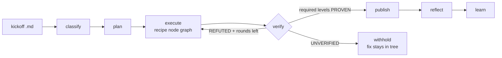
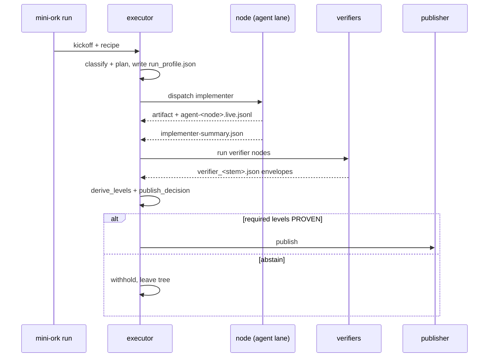

# mini-ork internals: a newcomer's map

For someone who has just cloned the repo and needs to change it without breaking
the thing that makes it worth using.

The short version: mini-ork is a task operating system. A recipe names a graph of
nodes; the framework runs that graph, checks the result with deterministic
instruments, and either publishes or withholds. Everything unusual about the
codebase follows from one decision — **a check that did not measure anything must
never read as a pass** — so the verification layer gets a third of this page and
most of the design.

Read this once top to bottom, then keep [verification-stack.md](architecture/verification-stack.md)
open beside it: that page is the per-instrument reference, pinned to the code by
`tests/unit/test_verification_stack_doc_py.py`, and it is the one to trust when
the two disagree.

---

## 1. The shape in one picture



Six stages, one loop. The pipeline opinions live in `recipes/` and are user-land;
the framework ships the loop, the primitives, and the interfaces.

Two properties of this picture surprise people:

- **UNVERIFIED is not the same branch as REFUTED.** A refutation goes back to the
  implementer; an abstention withholds the publish and leaves the edit in place.
  Nothing rolls back. That asymmetry is deliberate (§4.2).
- **The reflection and learning stages do not gate publication.** They run after
  the verdict is written. A run that publishes is never blocked by its own
  post-mortem.

---

## 2. Where the code lives

| Path | What it owns | Change it when |
|---|---|---|
| `mini_ork/context.py` | The `RunContext` env contract (`MINI_ORK_ROOT`, `MINI_ORK_HOME`, `MINI_ORK_DB`, run dirs). Mutate env only through `apply_env_overrides` / `scoped_environ`. | a new env var needs a home |
| `mini_ork/cli/` | The subcommand surface and the executor. `main.py` routes; `execute.py` runs a node; `execute_handlers.py` owns node-type handlers. | adding a subcommand or node type |
| `mini_ork/workflow/` | Compiler + retry/escalation semantics. `compile_workflow` turns `workflow.yaml` into a graph. | edge or retry behaviour |
| `mini_ork/verify/` | The verification layer: `levels.py`, `probe_validity.py`, `behavioral.py`, `equivalence.py`, `gaming_scan.py`, `authorship_separation.py`, … | a new check, or a change to the verdict contract |
| `mini_ork/gates/` | Pre-publish gates: `suite_adequacy.py`, `hackability.py`, `oracle_integrity.py`, `judge_validity.py`, `verifier_mutation.py`, `promotion_gate.py`. | a new gate, or a new threshold |
| `mini_ork/certify/` | The heavier proof path (`mini-ork certify`): oracle, relations, differential, discrimination, hidden checks. | oracle or assay work |
| `mini_ork/dispatch/` | Provider kinds, transports, routing policies (`MO_ROUTING_POLICY`). | a new provider or lane policy |
| `mini_ork/learning/` | GRPO writeback, rubric and pattern channels, reward↔evidence pairing. | the learning loop |
| `mini_ork/stores/` | SQLite stores. `checkpoints.py` writes `node_attempts`; `migrate.py` applies migrations. | ledger or schema work |
| `db/migrations/` | Numbered SQL, guarded and additive. | any schema change |
| `recipes/<name>/` | `task_class.yaml`, `workflow.yaml`, `artifact_contract.yaml`, `prompts/`, `verifiers/`. | anything recipe-specific |
| `schemas/` | JSON schemas for task classes, workflows, artifact contracts. | contract shape |
| `tests/` | `unit/` (hermetic) and e2e. | everywhere |

Extension seams — the registries that let new behaviour land without editing a
core module — are listed in the project `CLAUDE.md` under "Python runtime
registries". They are the first thing to reach for: `register_node_handler`,
`register_subcommand`, `register_gate_evaluator`, `register_policy`,
`register_provider_kind`, `register_embedder_provider`.

---

## 3. Anatomy of a run



A run leaves two trails, and you need both.

**On disk**, under the run dir (`$MINI_ORK_RUN_DIR`):

| File | Written by | Read it for |
|---|---|---|
| `run_profile.json` | the runner | which recipe, base ref, kickoff path, budget |
| `agent-<node>.live.jsonl` | the dispatch harness | every tool call the agent made, one JSON object per line |
| `implementer-summary.json` | git-derived | `status`, `files_changed` — feeds the `applies` level |
| `verifier_test.json`, `verifier_behavioral.json`, `verifier_<stem>.json` | verifier nodes | the envelopes the level vector reads |
| `verdict.json` | the verdict path | the publish decision and its reasons |
| `certify_terms.json` | the certify shadow | what the veto terms measured (if they ran) |
| `evidence/` | verifiers | logs, junit XML, diffs — the receipt behind each envelope |

**In SQLite** (`$MINI_ORK_DB`, default `.mini-ork/state.db`): `task_runs`,
`node_attempts`, `llm_calls`, `verifier_results`, `execution_traces`,
`inbox`/gate rows, and the learning tables. `node_attempts` is the ledger you
will touch most: one row per attempt, with `result`, `failure_class`,
`checkpoint_used`, `cost_usd`, and (migration 0093) `move_kind`.

`move_kind` answers "what kind of attempt was this?" —
`initial | retry | revise | recover | explore`. Four are inferred at the single
INSERT both writers share (`_insert_node_attempt` in `mini_ork/stores/checkpoints.py`);
`explore` is declared by the caller only, never inferred, because only the
dispatcher knows it deliberately tried a different idea.
Inspect the distribution with `mini-ork metrics explore`.

**Migrations apply on `mini-ork update`, not on merge.** A merged feature backed
by a new column is inert on a local install until that command runs — and it
degrades honestly rather than lying (§4.2). If a shipped feature looks dead,
check `schema_migrations` before reading the code.

---

## 4. Verification, which is the part that matters

### 4.1 One bit cannot say "I don't know"

A boolean verdict forces every non-pass into the failure branch, so a missing
toolchain, an unreachable provider, or a probe that never ran all read as "the
code is wrong". That is the error that costs the most here, because it is the one
that gets charged to an implementer who was right.

So every verdict has three values, plus a fourth for a level that could not apply:

| Verdict | Meaning | What the run does |
|---|---|---|
| `PROVEN` | the evidence establishes it | the level counts toward publication |
| `REFUTED` | the evidence contradicts it, and the evidence is attached | revision round, or withhold |
| `UNVERIFIED` | nothing could be established | **abstention**: withhold, never pass, never charge the implementer |
| `n/a` | the recipe never had that instrument | excluded from the required set |

`UNVERIFIED` is the load-bearing one. It is the difference between "we looked and
found a problem" and "we did not look", and the system must never confuse them —
not in the verdict, not in the commit record, not in the gate that publishes.

### 4.2 The abstention is decided on the envelope, not the exit code

This is the single most important implementation detail in the verification
layer, and the one people get wrong when they add a verifier.

A verifier emits a JSON envelope. The executor classifies that envelope:

| What the verifier writes | What the executor does |
|---|---|
| `failure_kind: toolchain` (with `pass: false`) | abstain |
| `status: unverified` or `status: abstain` | abstain, **whatever the exit code is** |
| `status: skipped` | not an abstention — the verifier had no subject; its `pass` bit is the answer |
| no `pass` field, or no JSON | the exit code stands, unchanged |

The envelope decides, never the rc. Both shipped abstainers happen to exit 0
today, and the rule exists so that nobody has to rely on that. The behavioural
engine deliberately exits non-zero on UNVERIFIED, and only a wrapper keeps that
from turning into a failed node — read the rc instead of the envelope and the
same abstention becomes a code failure the moment the wrapper is bypassed.

There is also an operational form of abstention worth knowing: a verifier that
shells out to `pnpm`, `psql`, `stryker`, `playwright` or `pytest` must report a
missing tool as `failure_kind: toolchain`, not as a failure. One npm refusal on a
pnpm repo was once read as a code failure and cascaded into ten failed nodes plus
a rollback of a correct implementation.

Guards are layered because one layer is never enough: the verdict path in
`mini_ork/cli/verify.py`, the dispatch path in `cli/execute_handlers.py`
(`_is_vacuous_command`), and the pre-publish gate `mini_ork/verify/probe_validity.py`
(each a separate question, each able to say "this measured nothing").

### 4.3 The level vector: five questions, answered separately

`mini_ork/verify/levels.py` asks five non-nested questions about a tree change
and answers each on its own evidence:

| Level | The question | Fed by |
|---|---|---|
| `applies` | did anything change the tree? | `implementer-summary.json` (`implemented` with a real `files_changed` list; `no_changes` is REFUTED) |
| `executes` | does it run at all? | `verifier_test.json` post-command |
| `target` | does it do the thing that was asked? | the proven fail→pass test, or a recipe verifier's evidence |
| `preserve` | did it keep everything that already worked? | suite outcome + differential |
| `contract` | does it meet the declared artifact contract? | the recipe's own verifier |

Non-nested matters: `preserve` being PROVEN says nothing about `target`, so a
patch that keeps all old behaviour while implementing none of the new one cannot
launder one level into another.

Each task class declares which levels it must prove — `REQUIRED_LEVELS` is the
only place that declaration lives:

| Task class | Required |
|---|---|
| `code_fix` | `applies`, `executes`, `target`, `preserve` |
| `framework_edit` | `executes` |
| `verified_artifact` | `contract` |

`publish_decision(vector, required=…)` then does one thing: if any required
level is not PROVEN, it withholds. That is the whole policy, and it is why
"abstain" costs a publish instead of a rollback.

The `n/a` value exists so that "this recipe never had that instrument" is not
mistaken for "the instrument failed to prove". Conflating them withholds every
publish from every non-code recipe — it has happened, which is why the
distinction is written into `levels.py` in comments above the constants.

### 4.4 Instruments that grade the apparatus

The idea that separates this stack from a test runner: most instruments do not
ask "is the code correct?", they ask **"was the check capable of failing?"**.

| Instrument | The question it answers | Where it runs |
|---|---|---|
| Suite adequacy | can the suite kill its own mutants? `killed/(killed+survived)`; INADEQUATE downgrades a green to UNVERIFIED | every code-fix run |
| Probe validity | was this probe already green on the untouched base? did it cover one criterion, not several? | pre-publish gate (`MO_PROBE_VALIDITY`, default off) |
| Gate hackability | can a registered gate be passed by inputs carrying no evidence? five hollow inputs + a mandatory control | promotion, `mini-ork gate-fuzz` |
| Verifier mutation | does a verifier's verdict move when its own input is mutated six ways? | certificate scoring |
| Oracle integrity | does the judge reject injected defects and accept known-good controls? | promotion gate (producer) |
| Judge validity | does a reviewer lane's approval history agree with execution evidence? | promotion, shadow by default |
| Reward↔evidence pairing | does a run's reward agree with its verifier results? | GRPO writeback |
| Metamorphic relations / differential | does a patched behaviour hold under relations, and differ from base only where intended? | `mini-ork certify`; shadow in code-fix |
| Authorship separation | is the probe author a different model family from the implementer? | shadow, default off |

Three things about this table that are easy to miss:

- **Every one of them can abstain.** An UNVERIFIED variant of a verifier counts
  as abstained, never as a kill. A relation that cannot execute does not "hold".
  An audit that cannot run reports an error and blocks nothing.
- **The audits have their own controls.** Gate hackability runs five hollow
  probes *and* one evaluator that always answers pass, which must score 1.0 —
  otherwise the zeros prove the operators are broken, not the gates clean.
- **Shadow is a real mode, not a soft launch.** A shadow instrument records
  `would_block` and changes nothing. Flipping it to gate is a separate decision
  with its own evidence requirement (§4.5).

### 4.5 What is enforced versus what is merely measured

Newcomers assume everything in `mini_ork/verify/` is on the critical path. Most
of it is not, and the difference is tracked deliberately.

- **Enforced on every code-fix run**: suite adequacy and the level vector.
- **Enforced at promotion / `mini-ork certify`**: hackability, oracle integrity,
  discrimination, hidden checks, the equivalence operator.
- **Shadow (records, never blocks)**: metamorphic relations and differential in
  code-fix (`MO_CODEFIX_CERTIFY`), judge validity, suite strengthening,
  authorship separation.
- **Off by default behind an A/B**: probe validity (`MO_PROBE_VALIDITY=1`).

The canonical table lives in `verification-stack.md` under "Where each instrument
runs today", and a test asserts the doc and the code agree. Change a default and
that test is what tells you the doc is now lying.

The reason for the asymmetry is the same reason you do not add a gate that fires
on a correct fix: a wrong veto is worse than no veto, because it teaches people
to override the gate. The rule written into the certify shadow is worth quoting:
flip the default **only after shadow evidence shows no veto on a run whose fix
was confirmed correct**.

### 4.6 Adding a check without weakening the contract

The order that keeps the stack honest:

1. Decide which value an inconclusive run returns. If you cannot say, it is
   UNVERIFIED and it withholds.
2. Return the envelope, not a code. `status: unverified` or
   `failure_kind: toolchain`; never a bare non-zero exit as the only signal.
3. Make it abstain when its own inputs are missing — no base tree, no diff, no
   toolchain, no kickoff. An instrument that cannot run must not report "bad".
4. If it will ever block a publish, land it in shadow first and record
   `would_block` next to `verdict`. Give yourself the data to decide.
5. Register it: `register_gate_evaluator` for a gate, a new file under
   `mini_ork/verify/` for an instrument, a `verifier_ref` in the recipe for a
   node.
6. Write the test that proves abstention is not a pass. That test is the
   feature; the happy path is the easy half.

---

## 5. When a run says no: reading the evidence

Work outward from the verdict, and stop at the first thing that explains it.

```bash
mini-ork why <run_id>            # the verdict and its reasons
cat <run_dir>/verdict.json       # which levels, which reasons
jq . <run_dir>/verifier_test.json   # the envelope behind `executes`/`target`
ls <run_dir>/evidence/           # the logs the envelope summarises
sqlite3 "$MINI_ORK_DB" \
  "SELECT node_id, attempt_no, result, failure_class, move_kind, cost_usd \
     FROM node_attempts WHERE run_id='<run_id>' ORDER BY attempt_no;"
```

Three questions in order, in practice: did the instrument run, did it abstain, or
did it refute? An envelope with `status: unverified` and a run that failed is a
toolchain problem, not a code problem. An envelope with `pass: false` and no
`failure_class` is a refutation. A missing envelope is neither — the node never
wrote one, which is itself a bug in the node.

For cost and attempt shape across runs, `mini-ork metrics explore` groups
attempts by task class and `move_kind`, and reports share of cost per kind. It
says `unclassified` for rows written before migration 0093, and says the column
is unavailable rather than printing zeros when the migration has not run.

---

## 6. The learning loop, briefly

After the verdict, three channels write back: rubric scores, textual gradients,
and patterns. None of it is allowed to be the reason a run published —
`reward_evidence_pairing` drops a positive reward that execution contradicts,
because a reward that disagrees with the evidence is the most expensive thing to
learn from.

Deferred learning exists for long runs: dispatch with `MO_POST_RUN_LEARNING=0`
and run `mini-ork settle <run_id>` afterwards. The full lifecycle is
[LEARNING-LOOP-LIFECYCLE.md](LEARNING-LOOP-LIFECYCLE.md).

---

## 7. Dispatch and lanes

A node names a role, a lane, or a model. Routing policies (`MO_ROUTING_POLICY`,
registered through `dispatch/routing.register_policy`) choose the lane; provider
kinds and transports are registered in `config/providers.yaml` plus
`dispatch/providers.register_provider_kind`.

Two rules that bite:

- **A configured lane is not proof of what served.** `llm_calls.model_id` is the
  authority. This is why authorship separation can only be measured from the
  ledger, not from the config.
- **A lane that hangs is not a lane that failed.** A 401 on a compatibility
  endpoint can hang for the full timeout (`rc=124`), which looks like a slow run
  rather than a broken credential.

Operational detail: [operator/provider-triage.md](operator/provider-triage.md).

---

## 8. The dev loop you must not shortcut

```bash
make worktree SLUG=<slug> OWNS="path/a.py tests/test_a.py"   # branch via worktree
make worktree-merge SLUG=<slug>                              # rebase → green gate → push
make worktree-clean SLUG=<slug>
```

- `main` stays clean. A `reference-transaction` hook blocks direct
  feature-branch creation, so the worktree is not a style preference.
- `--owns` claims a file surface; overlapping claims are refused, which is how
  concurrent agents avoid racing the same file.
- `MINI_ORK_TEST_CMD` is run **as a shell command** — pass
  `python3.11 -m pytest -q -p no:asyncio tests/unit/test_x_py.py`, not a bare path.
- Stage explicit paths. Never `git add -A`; it sweeps other sessions' work into
  your commit. Read `git diff --stat` before committing: unexpected deletions
  mean your base is stale — rebase, do not merge.
- After merging, `git fetch origin main && git merge --ff-only origin/main` in
  the primary. Local `main` is stale until it does.
- High-risk paths (workflows, hooks, migrations, secrets) are refused at merge
  with a patch id; self-approval with a real note is the documented path.

Validation is ordered cheapest-first, and the order is not optional:
`make lint` → `mini-ork validate` → `mini-ork fallbacks` → the changed test file
by path → `make test` before a merge. A bare `-k` filter collects the whole tree
first and is measurably slower than running the file.

---

## 9. Gotchas that cost people a day

1. **Green is not a verdict.** A green test proves the suite passed, not that it
   could have failed. Check suite adequacy before trusting a pass.
2. **A missing migration makes a feature look broken.** `mini-ork update`.
3. **`sqlite3` copies lose the WAL.** Copying `state.db` alone reproduces the
   schema from before the last write; copy `-wal` and `-shm` too, or checkpoint.
4. **A verifier's rc is not its verdict.** Read the envelope.
5. **`status: skipped` is not an abstention.** It means the verifier had no
   subject; its pass bit is a real answer.
6. **Recipe verifiers load from the engine.** Prepending the target repo to
   `sys.path` would let a repository under audit ship its own verifier module.
7. **`python3` on this box is 3.9.** Use `python3.11`; `dataclass(slots=True)`
   raises at import otherwise.
8. **Pyright in a worktree reports false "unknown symbol" errors** from the
   editable install. Runtime imports and tests are the authority.
9. **A pin that names an exact set rots.** Recipe verifier lists, doc claims and
   retry-edge sets all have their own tests; when you add a verifier, find the
   pin and update it in the same commit.
10. **`move_kind` means what wrote it, not what you hope.** `explore` is only
    ever declared; a zero in that row means no dispatcher claimed a different
    idea, not that none was tried.

---

## 10. Glossary

| Term | Meaning |
|---|---|
| kickoff | the markdown task statement a run is dispatched with, including numbered Done-When criteria |
| recipe | a directory with a task class, a node graph, and an artifact contract |
| node | one role in the graph (planner, implementer, verifier, reviewer, …) |
| edge | ordering, retry, or escalation between nodes |
| gate | a checkpoint inside verify; first failure aborts unless configured otherwise |
| envelope | the JSON a verifier writes; the verdict carrier |
| level | one of five independent proof questions about a tree change |
| abstention | UNVERIFIED: nothing was established; withholds, never passes |
| shadow | an instrument that records what it would block and blocks nothing |
| certify | the heavier proof path: oracle, relations, differential, discrimination |
| lane | the model route a node dispatches to |

---

## 11. Where the older pages lag

`docs/ARCHITECTURE.md` predates the 2026-07 bash removal and the three-valued
verdict, so it still says `lib/gate_registry.sh`, "17 migrations", and a binary
pass/fail verifier. Read it for the node and edge tables; take the verification
and schema sections from this page and `verification-stack.md`.

If you are about to edit an architecture page, check whether a test pins it
first (`grep -r "docs/.*\.md" tests/unit | head`). A pinned doc is a contract:
change the code and the doc in the same commit, or the test will say so.
