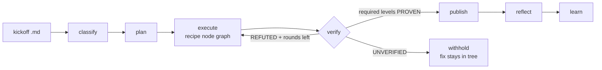
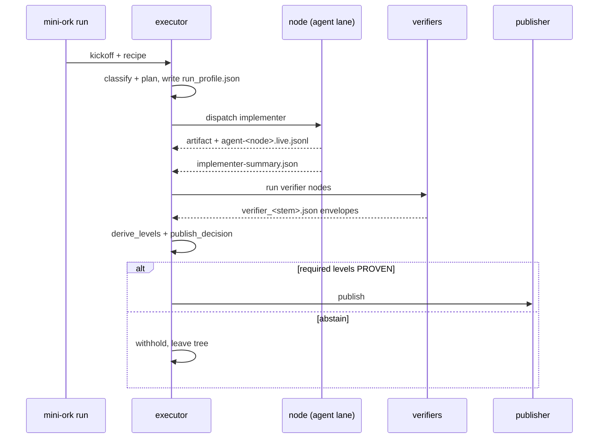
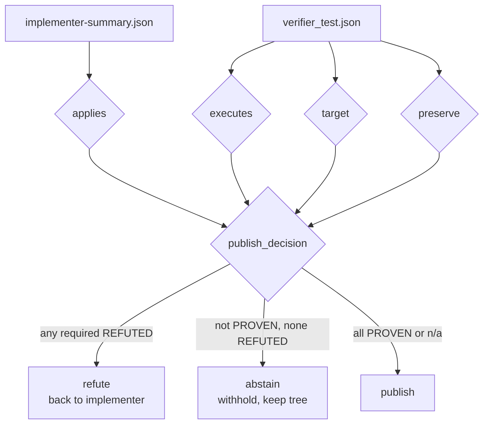

# mini-ork internals: a newcomer's map

For someone who has just cloned the repo and needs to change it without breaking
the thing that makes it worth using.

The short version: mini-ork is a task operating system. A recipe names a graph of
nodes; the framework runs that graph, checks the result with deterministic
instruments, and either publishes or withholds. Everything unusual about the
codebase follows from one decision — **a check that did not measure anything must
never read as a pass** — so the verification layer gets a third of this page and
most of the design.

Read this once top to bottom, then keep [verification-stack.md](architecture/verification-stack.md)
open beside it: that page is the per-instrument reference, pinned to the code by
`tests/unit/test_verification_stack_doc_py.py`, and it is the one to trust when
the two disagree.

---

## 1. The shape in one picture



Six stages, one loop. The pipeline opinions live in `recipes/` and are user-land;
the framework ships the loop, the primitives, and the interfaces.

Two properties of this picture surprise people:

- **UNVERIFIED is not the same branch as REFUTED.** A refutation fails the run
  and the rollback discards the edit, sending it back to the implementer; an
  abstention withholds the publish and leaves the edit in place. Only the refute
  branch rolls back. That asymmetry is deliberate (§4.2).
- **The reflection and learning stages do not gate publication.** They run after
  the verdict is written. A run that publishes is never blocked by its own
  post-mortem.

---

## 2. Where the code lives

| Path | What it owns | Change it when |
|---|---|---|
| `mini_ork/context.py` | The `RunContext` env contract (`MINI_ORK_ROOT`, `MINI_ORK_HOME`, `MINI_ORK_DB`, run dirs). Mutate env only through `apply_env_overrides` / `scoped_environ`. | a new env var needs a home |
| `mini_ork/cli/` | The subcommand surface and the executor. `main.py` routes; `execute.py` runs a node; `execute_handlers.py` owns node-type handlers. | adding a subcommand or node type |
| `mini_ork/workflow/` | Compiler + retry/escalation semantics. `compile_workflow` turns `workflow.yaml` into a graph. | edge or retry behaviour |
| `mini_ork/verify/` | The verification layer: `levels.py`, `probe_validity.py`, `behavioral.py`, `equivalence.py`, `gaming_scan.py`, `authorship_separation.py`, … | a new check, or a change to the verdict contract |
| `mini_ork/gates/` | Pre-publish gates: `suite_adequacy.py`, `hackability.py`, `oracle_integrity.py`, `judge_validity.py`, `verifier_mutation.py`, `promotion_gate.py`. | a new gate, or a new threshold |
| `mini_ork/certify/` | The heavier proof path (`mini-ork certify`): oracle, relations, differential, discrimination, hidden checks. | oracle or assay work |
| `mini_ork/dispatch/` | Provider kinds, transports, routing policies (`MO_ROUTING_POLICY`). | a new provider or lane policy |
| `mini_ork/learning/` | GRPO writeback, rubric and pattern channels, reward↔evidence pairing. | the learning loop |
| `mini_ork/stores/` | SQLite stores. `checkpoints.py` writes `node_attempts`; `migrate.py` applies migrations. | ledger or schema work |
| `db/migrations/` | Numbered SQL, guarded and additive. | any schema change |
| `recipes/<name>/` | `task_class.yaml`, `workflow.yaml`, `artifact_contract.yaml`, `prompts/`, `verifiers/`. | anything recipe-specific |
| `schemas/` | JSON schemas for task classes, workflows, artifact contracts. | contract shape |
| `tests/` | `unit/` (hermetic) and e2e. | everywhere |

Extension seams — the registries that let new behaviour land without editing a
core module — are listed in the project `CLAUDE.md` under "Python runtime
registries". They are the first thing to reach for: `register_node_handler`,
`register_subcommand`, `register_gate_evaluator`, `register_policy`,
`register_provider_kind`, `register_embedder_provider`.

---

## 3. Anatomy of a run



A run leaves two trails, and you need both.

**On disk**, under the run dir (`$MINI_ORK_RUN_DIR`):

| File | Written by | Read it for |
|---|---|---|
| `run_profile.json` | the runner | which recipe, base ref, kickoff path, budget |
| `agent-<node>.live.jsonl` | the dispatch harness | every tool call the agent made, one JSON object per line |
| `implementer-summary.json` | git-derived | `status`, `files_changed` — feeds the `applies` level |
| `verifier_test.json`, `verifier_behavioral.json`, `verifier_<stem>.json` | verifier nodes | the envelopes the level vector reads |
| `verdict.json` | the verdict path | the publish decision and its reasons |
| `certify_terms.json` | the certify shadow | what the veto terms measured (if they ran) |
| `evidence/` | verifiers | logs, junit XML, diffs — the receipt behind each envelope |

**In SQLite** (`$MINI_ORK_DB`, default `.mini-ork/state.db`): `task_runs`,
`node_attempts`, `llm_calls`, `verifier_results`, `execution_traces`,
`inbox`/gate rows, and the learning tables. `node_attempts` is the ledger you
will touch most: one row per attempt, with `result`, `failure_class`,
`checkpoint_used`, `cost_usd`, and (migration 0093) `move_kind`.

`move_kind` answers "what kind of attempt was this?" —
`initial | retry | revise | recover | explore`. Four are inferred at the single
INSERT both writers share (`_insert_node_attempt` in `mini_ork/stores/checkpoints.py`);
`explore` is declared by the caller only, never inferred, because only the
dispatcher knows it deliberately tried a different idea.
Inspect the distribution with `mini-ork metrics explore`.

**Migrations apply on `mini-ork update`, not on merge.** A merged feature backed
by a new column is inert on a local install until that command runs — and it
degrades honestly rather than lying (§4.2). If a shipped feature looks dead,
check `schema_migrations` before reading the code.

---

## 4. Verification, which is the part that matters

### What "verification" means here

**Verification is the step that turns an executed change into one of three
claims you are allowed to make about it — it holds, it does not hold, or nobody
established that it holds — from evidence the change did not produce for itself.**

It is not the tests. A test suite answers *"does the code pass?"* Verification
asks *"what did we measure, with which instrument, and does that measurement
prove this particular claim?"* Tests are one evidence source among several.

Three rules make the difference concrete:

1. **The evidence is produced by named, deterministic files** —
   `implementer-summary.json`, `verifier_test.json`, `verifier_behavioral.json`,
   `verifier_<stem>.json`. A reviewer's prose opinion, a panel vote, or a rubric
   score never feeds the decision. A model cannot grade its own homework here
   because its homework is not an input.
2. **Each required level maps to specific evidence**, and a level that no
   instrument covered is `n/a`, not "failed" (§4.3).
3. **One policy decides**: any required level REFUTED → `refute` (fail the run,
   roll the edit back, return it to the implementer); otherwise any required
   level not PROVEN → `abstain` (withhold, leave the tree); otherwise →
   `publish`.

That is the entire mechanism. The rest of this section is why each rule exists
and what can go wrong with it.

### A real run, traced end to end

Three runs from one experiment (`.mini-ork/runs/` on a working install) make the
above concrete. All three used `task_class=code_fix`, so the required levels are
`applies, executes, target, preserve`. `contract` is only *required* for
`verified_artifact`; carried by a behavioral verifier it can still be PROVEN or
REFUTED for any class. None of these three runs had one, so it reports `n/a` and
is skipped — never counted as a failure.

**1. The normal case — everything PROVEN, publish.**

```
$ cat .mini-ork/runs/vt6-strong-20261005212743/verifier_test.json | jq -c .
{"verifier":"test","pass":true,"post_rc":0,
 "error_summary":"post-patch suite green; replay: tests exercise the change; suite adequacy ADEQUATE (score 1.000)",
 "replay":{"base_failed":["tests/test_calc.py::test_add"],
           "overlap":["tests/test_calc.py::test_add"]},
 "suite_adequacy":{"verdict":"ADEQUATE","score":1.0,"killed":12,"survived":0}}
```

```
$ jq -c '{levels, levels_decision}' .mini-ork/runs/vt6-strong-20261005212743/verdict.json
{"levels":{"applies":"PROVEN","executes":"PROVEN","target":"PROVEN",
           "preserve":"PROVEN","contract":"n/a"},
 "levels_decision":"publish"}
```

Read it as four separate questions, each answered by its own line:
`applies` — `implementer-summary.json: implemented, files_changed=2`;
`executes` — `verifier_test.json: post_rc=0`;
`target` — `verifier_test.json: pass with replay overlap` (a test that failed on
the base and passes now is the shape of "the thing asked for actually works");
`preserve` — `verifier_test.json: post_rc=0` on the whole suite.

**2. The lie catcher — the implementer did nothing.**

```
$ cat .mini-ork/runs/vt6-leak-k1-20261005215711/implementer-summary.json | jq -c '{status, files_changed}'
{"status":"no_changes","files_changed":[]}

$ jq -c '{levels, applies: .levels_reasons.applies, levels_decision}' .mini-ork/runs/vt6-leak-k1-20261005215711/verdict.json
{"levels":{"applies":"REFUTED","executes":"UNVERIFIED","target":"UNVERIFIED",
           "preserve":"UNVERIFIED","contract":"n/a"},
 "applies":"implementer-summary.json: no_changes",
 "levels_decision":"refute"}
```

A plausible-sounding completion that edited no file is REFUTED before any test
runs, and `refute` fails the run and rolls the empty edit back rather than
publishing a no-op. The other three levels are UNVERIFIED because there was
nothing to run them against — they are not counted as failures against the
implementer — and `contract` is `n/a` because no behavioral verifier ran.

**3. The case a test runner cannot express — tests green, run abstains.**

```
$ jq -c '{pass, post_rc, suite_adequacy}' .mini-ork/runs/vt6-weak-20261005212743/verifier_test.json
{"pass":false,"post_rc":0,
 "suite_adequacy":{"verdict":"INADEQUATE","score":0.167,"killed":2,"survived":10}}

$ jq -c '{levels, levels_decision}' .mini-ork/runs/vt6-weak-20261005212743/verdict.json
{"levels":{"applies":"PROVEN","executes":"PROVEN","target":"UNVERIFIED",
           "preserve":"UNVERIFIED","contract":"n/a"},
 "levels_decision":"abstain"}
```

The suite passed (`post_rc: 0`) and the run still refused to publish, because
the suite killed only 2 of 12 injected mutants: a green suite that cannot fail
is not evidence that the change is correct. This is the whole thesis in one
line — *green is a measurement, not a verdict* — and it is why suite adequacy
runs on every code-fix publish (§4.4).



Reproduce any of this on a local install: `jq -c '{levels,levels_reasons,levels_decision}'
.mini-ork/runs/<run>/verdict.json`. The publisher does not read this JSON — it
recomputes the same vector from the same files when its own gate runs, so the
two can only agree, and a withheld publish is that gate refusing rather than a
reviewer overriding it.

### 4.1 One bit cannot say "I don't know"

A boolean verdict forces every non-pass into the failure branch, so a missing
toolchain, an unreachable provider, or a probe that never ran all read as "the
code is wrong". That is the error that costs the most here, because it is the one
that gets charged to an implementer who was right.

So every verdict has three values, plus a fourth for a level that could not apply:

| Verdict | Meaning | What the run does |
|---|---|---|
| `PROVEN` | the evidence establishes it | the level counts toward publication |
| `REFUTED` | the evidence contradicts it, and the evidence is attached | revision round, or withhold |
| `UNVERIFIED` | nothing could be established | **abstention**: withhold, never pass, never charge the implementer |
| `n/a` | the recipe never had that instrument | excluded from the required set |

`UNVERIFIED` is the load-bearing one. It is the difference between "we looked and
found a problem" and "we did not look", and the system must never confuse them —
not in the verdict, not in the commit record, not in the gate that publishes.

### 4.2 The abstention is decided on the envelope, not the exit code

This is the single most important implementation detail in the verification
layer, and the one people get wrong when they add a verifier.

A verifier emits a JSON envelope. The executor classifies that envelope:

| What the verifier writes | What the executor does |
|---|---|
| `failure_kind: toolchain` (with `pass: false`) | abstain |
| `status: unverified` or `status: abstain` | abstain, **whatever the exit code is** |
| `status: skipped` | not an abstention — the verifier had no subject; its `pass` bit is the answer |
| no `pass` field, or no JSON | the exit code stands, unchanged |

The envelope decides, never the rc. Every shipped abstainer happens to arrive at
the executor with exit 0 today — `emit_unverified` in
`recipes/code-fix/verifiers/test.py` says so in its contract, as do
`fallback_guard` and `typecheck` — and the rule exists so that nobody has to
rely on that. The behavioural engine deliberately exits non-zero
on UNVERIFIED, and only a wrapper keeps that from turning into a failed node —
read the rc instead of the envelope and the same abstention becomes a code
failure the moment the wrapper is bypassed.

There is also an operational form of abstention worth knowing: a verifier that
shells out to `pnpm`, `psql`, `stryker`, `playwright` or `pytest` must report a
missing tool as `failure_kind: toolchain`, not as a failure. One npm refusal on a
pnpm repo was once read as a code failure and cascaded into ten failed nodes plus
a rollback of a correct implementation.

Guards are layered because one layer is never enough: the verdict path in
`mini_ork/cli/verify.py`, the dispatch path in `cli/execute_handlers.py`
(`_is_vacuous_command`), and the pre-publish gate `mini_ork/verify/probe_validity.py`
(each a separate question, each able to say "this measured nothing").

### 4.3 The level vector: five questions, answered separately

`mini_ork/verify/levels.py` asks five non-nested questions about a tree change
and answers each on its own evidence:

| Level | The question | Fed by |
|---|---|---|
| `applies` | did anything change the tree? | `implementer-summary.json` (`implemented` with a real `files_changed` list; `no_changes` is REFUTED) |
| `executes` | does it run at all? | `verifier_test.json` post-command |
| `target` | does it do the thing that was asked? | the proven fail→pass test, or a recipe verifier's evidence |
| `preserve` | did it keep everything that already worked? | suite outcome + differential |
| `contract` | does it meet the declared artifact contract? | the recipe's own verifier |

Non-nested matters: `preserve` being PROVEN says nothing about `target`, so a
patch that keeps all old behaviour while implementing none of the new one cannot
launder one level into another.

Each task class declares which levels it must prove — `REQUIRED_LEVELS` is the
only place that declaration lives:

| Task class | Required |
|---|---|
| `code_fix` | `applies`, `executes`, `target`, `preserve` |
| `framework_edit` | `executes` |
| `verified_artifact` | `contract` |

`publish_decision(vector, required=…)` returns one of three answers: `refute`
(any required level REFUTED), `abstain` (any required level neither PROVEN nor
`n/a`), or `publish`. The publisher maps `refute` to a failed run whose rollback
discards the edit, and `abstain` to a withheld publish that keeps it — exit 0,
so no rollback fires. That mapping is the whole policy.

The `n/a` value exists so that "this recipe never had that instrument" is not
mistaken for "the instrument failed to prove". Conflating them withholds every
publish from every non-code recipe — it has happened, which is why the
distinction is written into `levels.py` in comments above the constants.

### 4.4 Instruments that grade the apparatus

The idea that separates this stack from a test runner: most instruments do not
ask "is the code correct?", they ask **"was the check capable of failing?"**.

| Instrument | The question it answers | Where it runs |
|---|---|---|
| Suite adequacy | can the suite kill its own mutants? `killed/(killed+survived)`; INADEQUATE downgrades a green to UNVERIFIED | every code-fix run |
| Probe validity | was this probe already green on the untouched base? did it cover one criterion, not several? | pre-publish gate (`MO_PROBE_VALIDITY`, default off) |
| Gate hackability | can a registered gate be passed by inputs carrying no evidence? five hollow inputs + a mandatory control | promotion gate reads it; records only from a manual `mini-ork gate-fuzz --hackability --gate <id>` |
| Verifier mutation | does a verifier's verdict move when its own input is mutated six ways? | verify catalog reads it; records only from a manual `mini-ork instruments verifier-mutation --observable <observable.json> [--card <card.json>]` |
| Oracle integrity | does the judge reject injected defects and accept known-good controls? | promotion gate (producer) |
| Judge validity | does a reviewer lane's approval history agree with execution evidence? | promotion, shadow by default |
| Reward↔evidence pairing | does a run's reward agree with its verifier results? | GRPO writeback |
| Metamorphic relations / differential | does a patched behaviour hold under relations, and differ from base only where intended? | `mini-ork certify`; shadow in code-fix |
| Authorship separation | is the probe author a different model family from the implementer? | off by default; `shadow` records, `1` refuses |

Three things about this table that are easy to miss:

- **Every one of them can abstain.** An UNVERIFIED variant of a verifier counts
  as abstained, never as a kill. A relation that cannot execute does not "hold".
  An audit that cannot run reports an error and blocks nothing.
- **The audits have their own controls.** Gate hackability runs five hollow
  probes *and* one evaluator that always answers pass, which must score 1.0 —
  otherwise the zeros prove the operators are broken, not the gates clean.
- **Shadow is a real mode, not a soft launch.** A shadow instrument records
  `would_block` and changes nothing. Flipping it to gate is a separate decision
  with its own evidence requirement (§4.5).

### 4.5 What is enforced versus what is merely measured

Newcomers assume everything in `mini_ork/verify/` is on the critical path. Most
of it is not, and the difference is tracked deliberately.

- **Live on every code-fix run**: suite adequacy and the level vector.
- **Live at the promotion gate**: oracle integrity (audits the judge, then
  records and scores that record) and judge validity (in shadow, its default).
- **`mini-ork certify` only**: discrimination (only when candidates are passed)
  and hidden regenerable checks.
- **On inside `mini-ork certify`, shadow during `mini-ork run code-fix`**:
  metamorphic relations and differential (`MO_CODEFIX_CERTIFY`). Judge validity
  is shadow at the promotion gate until set to `1`/`enforce`.
- **Opt-in per recipe**: the equivalence operator and behavioral recomputation,
  for a recipe whose contract declares them.
- **Consumer on, producer manual**: gate hackability (`mini-ork gate-fuzz
  --hackability --gate <id>`) and verifier mutation (`mini-ork instruments
  verifier-mutation --observable <observable.json> [--card <card.json>]`). Both
  read a record nothing writes automatically, so their "no finding" means "no
  record", not "no problem".
- **Off by default**: probe validity behind an A/B (`MO_PROBE_VALIDITY=1`);
  authorship separation, whose `shadow` mode records and `1` refuses the run.

The canonical table lives in `verification-stack.md` under "Where each instrument
runs today". The pin test (`tests/unit/test_verification_stack_doc_py.py`)
checks that every module and knob the doc names still exists and is read by the
runtime — it cannot notice that a default changed under a knob that still
exists. For that, `docs/operator/feature-flags.md` and the module are the
source.

The reason for the asymmetry is the same reason you do not add a gate that fires
on a correct fix: a wrong veto is worse than no veto, because it teaches people
to override the gate. The rule written into the certify shadow is worth quoting:
flip the default **only after shadow evidence shows no veto on a run whose fix
was confirmed correct**.

### 4.6 Adding a check without weakening the contract

The order that keeps the stack honest:

1. Decide which value an inconclusive run returns. If you cannot say, it is
   UNVERIFIED and it withholds.
2. Return the envelope, not a code. `status: unverified` or
   `failure_kind: toolchain`; never a bare non-zero exit as the only signal.
3. Make it abstain when its own inputs are missing — no base tree, no diff, no
   toolchain, no kickoff. An instrument that cannot run must not report "bad".
4. If it will ever block a publish, land it in shadow first and record
   `would_block` next to `verdict`. Give yourself the data to decide.
5. Register it: `register_gate_evaluator` for a gate, a new file under
   `mini_ork/verify/` for an instrument, a `verifier_ref` in the recipe for a
   node.
6. Write the test that proves abstention is not a pass. That test is the
   feature; the happy path is the easy half.

### 4.7 The verifier inventory: what ships and how one works

**How many.** 165 runnable verifier scripts across 54 recipes on a clean
checkout of `main` (snapshot 2026-11). They are 180 tracked scripts under
`recipes/*/verifiers/` minus 14 `_`-prefixed shared helpers (`_stage.py`,
`_lib.py`, `_common.py`, …) and one test file; one more tracked file in those
directories is not a script at all (an `.observable.yaml`), which is how 181
tracked files add up. Count with `git ls-files`, not `find`: a working checkout
that carries untracked recipes or `__pycache__` reports more, and the number you
want is what a clone gets. On the framework side, separately: 27 modules in
`mini_ork/verify/` (`__init__.py` aside), 18 in `mini_ork/certify/`, plus the
gates under `mini_ork/gates/`.

```bash
# runnable verifier scripts, excluding helpers and tests (→ 165)
git ls-files 'recipes/*/verifiers/*' | grep -E '\.(py|sh)$' \
  | grep -v '/_' | grep -v '/tests/' | wc -l
ls recipes/code-fix/verifiers/                    # the nine that gate a fix
```

**How one works**, end to end — the contract every verifier obeys:

1. **Declared in the recipe**, either as a `workflow.yaml` node with
   `type: verifier` + `verifier_ref: verifiers/<name>.py`, or in
   `artifact_contract.yaml`'s `success_verifiers` (code-fix's
   `metamorphic.py` lives there, not as a node). No prompt, no lane: it is a
   process, not a model call.
2. **Invoked with `cwd` = the target worktree**, and env `MINI_ORK_RUN_DIR`,
   `MINI_ORK_PLAN_PATH`, `ARTIFACT_PATH`, and the engine's `PYTHONPATH` put
   first (so a verifier imports the code that dispatched it, not a stale
   checkout). It resolves its own **scope — the run's change surface**, not the
   tree: `MINI_ORK_TOUCHED_FILES` when a caller set it, else
   `mini_ork.verify.touched_files` / the run's dirty set against its base ref.
   A pre-existing problem elsewhere is not this patch's failure.
3. **Runs, then emits one JSON envelope on stdout**: a boolean `pass`, and
   optionally `verdict` (`pass`/`fail`/`abstain`/`vacuous`) and/or `status`.
   Recipes use `status` two ways: as the verdict itself (`pass`, `fail`,
   `skipped`, `error` — `docs` does this) or for the abstain contract
   (`unverified`; `vacuous` when it had nothing to check). Plus `failure_kind`
   (`toolchain`), `evidence_path`, `error_summary`. It writes the log the
   envelope points at. The executor's abstention keys on
   `status: unverified|abstain` and `failure_kind`, never on the exit code;
   `status: skipped` is deliberately not an abstention (§4.2).
4. **Exit code is secondary**: 0 for pass *or* abstain, 1 only for a
   refutation (§4.2).
5. **The result is stored as `verifier_<stem>.json`** in the run dir. Guards
   sit at three different points, and it matters which: the node path marks a
   command it judged a no-op `status: vacuous`; the `mini-ork verify`
   dispatcher (the artifact path) additionally suppresses a **zero-byte
   evidence file with exit 0** as a fail, and records an explicit
   `pass: null` as *unmeasured*, out of both counts, so it cannot lift the
   verdict.
6. **The level vector and the publisher's abstain gate read those files**
   (§4.3, §4.2), and the IDE surface links them from the node. `mini-ork why
   <run> <node>` is a different question — lane provenance, not the verdict.

**The nine code-fix verifiers**, and what each actually establishes:

| Verifier | What it proves | Abstains when |
|---|---|---|
| `test.py` | baseline-relative: the patch does not make the suite worse, a test failed on base and passes now, and the suite can kill mutants | no suite, no interpreter, pre-patch base unavailable |
| `typecheck.py` | the project's type-checker passes over the touched files | no checker installed |
| `fallback_guard.py` | no `except: pass` / `return None` on error was added in touched files (AST walk, cheap) | touched set unresolvable |
| `dep_guard.py` | each *added* import/requirement resolves in the vendored allowlist, has an exact `==` pin, and is not URL/VCS | no allowlist snapshot |
| `security.py` | no committed credentials or dangerous-API additions on the change surface | scanner off/unavailable (`MO_SECURITY_SCANNER=off` abstains, never passes) |
| `security_oracle.py` | an independent exploit test fails on base, passes on head, while the functional command stays green on both | no exploit test supplied (vacuous) |
| `hypothesis.py` | a dangerous-API pattern is a *hypothesis*; it reports a finding only when an executed probe confirms it | no probes produced (vacuous) |
| `deception.py` | classifies the repair base-vs-head: `introduction`, `omission`, `inadequacy`, or `clean` | no named target → `unmeasured` |
| `metamorphic.py` | task-supplied relations hold; a relation fails only with a real counterexample | no spec / relation cannot execute |

**The other families** are shaped differently and mostly not graders: the
technique-review recipes (`rsi-*`, `security-technique-review`, …) run a
shard → collect → pack → assemble pipeline whose scripts *produce artifacts*,
with a final `verify.py` checking completeness; panel recipes ship a
`panel-completeness` check; domain recipes carry one small fixed set — a
completeness check plus a schema check for `chapter-review`, `grep-assert.py`
and `link-verifier.py` for `docs`. Same envelope contract, different job:
producing evidence versus grading it.

**Two rules worth carrying away.** First, a verifier's mandate is the change
surface: the tree-wide sweeps (`mini-ork fallbacks --all`) are ratchets you run
on purpose, not gates. Second, "vacuous" is a first-class outcome — a verifier
with nothing to check says so, and that is never a pass.

---

## 5. When a run says no: reading the evidence

Work outward from the verdict, and stop at the first thing that explains it.

```bash
mini-ork why <run_id> <node>     # which lane served the node, and why
cat <run_dir>/verdict.json       # the verdict: which levels, which reasons
jq . <run_dir>/verifier_test.json   # the envelope behind `executes`/`target`
ls <run_dir>/evidence/           # the logs the envelope summarises
sqlite3 "$MINI_ORK_DB" \
  "SELECT node_id, attempt_no, result, failure_class, move_kind, cost_usd \
     FROM node_attempts WHERE run_id='<run_id>' ORDER BY attempt_no;"
```

Three questions in order, in practice: did the instrument run, did it abstain, or
did it refute? An envelope with `status: unverified` and a run that failed is a
toolchain problem, not a code problem. An envelope with `pass: false` and no
`failure_class` is a refutation. A missing envelope is neither — the node never
wrote one, which is itself a bug in the node.

For cost and attempt shape across runs, `mini-ork metrics explore` groups
attempts by task class and `move_kind`, and reports share of cost per kind. It
says `unclassified` for rows written before migration 0093, and says the column
is unavailable rather than printing zeros when the migration has not run.

---

## 6. The learning loop, briefly

Signals are recorded as the run goes (a PRM score per node, prompt win rates at
reflect). Two end-of-run writers then fold them into the next run: **GRPO
advantages** (a lane's z-score against its task-class peers) and **conductor
outcomes** (did the chosen topology pay off). Those two are gated by
`MO_LEARNING_WRITEBACK` (default `1`; `0` skips those two writers for a run
whose routing evidence you do not want folded in — the per-node PRM scores and
prompt win rates are recorded either way). Three more writers in the same
end-of-run block have their own switches, not this one: artifact rewards
(`MO_ARTIFACT_REWARD`), run-reward grading (`MO_GRADE_RUN_REWARD`), and
`lane_router.recompute_advantages` (`MO_LANE_ROUTER`) — all default `1`, so
turning writeback off does not stop them.

None of it is allowed to be the reason a run published —
`reward_evidence_pairing` drops a positive reward that execution contradicts,
because a reward that disagrees with the evidence is the most expensive thing to
learn from. The full lifecycle is
[LEARNING-LOOP-LIFECYCLE.md](LEARNING-LOOP-LIFECYCLE.md).

---

## 7. Dispatch and lanes

A node names a role, a lane, or a model. Routing policies (`MO_ROUTING_POLICY`,
registered through `dispatch/routing.register_policy`) choose the lane; provider
kinds and transports are registered in `config/providers.yaml` plus
`dispatch/providers.register_provider_kind`.

Two rules that bite:

- **A configured lane is not proof of what served.** `llm_calls.model_id` is the
  authority. This is why authorship separation can only be measured from the
  ledger, not from the config.
- **A lane that hangs is not a lane that failed.** A 401 on a compatibility
  endpoint can hang for the full timeout (`rc=124`), which looks like a slow run
  rather than a broken credential.

Operational detail: [operator/provider-triage.md](operator/provider-triage.md).

---

## 8. The dev loop you must not shortcut

```bash
make worktree SLUG=<slug> OWNS="path/a.py tests/test_a.py"   # branch via worktree
make worktree-merge SLUG=<slug>                              # rebase → green gate → push
make worktree-clean SLUG=<slug>
```

- `main` stays clean. A `reference-transaction` hook blocks direct
  feature-branch creation, so the worktree is not a style preference.
- `--owns` claims a file surface; overlapping claims are refused, which is how
  concurrent agents avoid racing the same file.
- `MINI_ORK_TEST_CMD` is run **as a shell command** — pass
  `python3.11 -m pytest -q -p no:asyncio tests/unit/test_x_py.py`, not a bare path.
- Stage explicit paths. Never `git add -A`; it sweeps other sessions' work into
  your commit. Read `git diff --stat` before committing: unexpected deletions
  mean your base is stale — rebase, do not merge.
- After merging, `git fetch origin main && git merge --ff-only origin/main` in
  the primary. Local `main` is stale until it does.
- High-risk paths (workflows, hooks, migrations, secrets) are refused at merge
  with a patch id; self-approval with a real note is the documented path.

Validation is ordered cheapest-first, and the order is not optional:
`make lint` → `mini-ork validate` → `mini-ork fallbacks` → the changed test file
by path → `make test` before a merge. A bare `-k` filter collects the whole tree
first and is measurably slower than running the file.

---

## 9. Gotchas that cost people a day

1. **Green is not a verdict.** A green test proves the suite passed, not that it
   could have failed. Check suite adequacy before trusting a pass.
2. **A missing migration makes a feature look broken.** `mini-ork update`.
3. **`sqlite3` copies lose the WAL.** Copying `state.db` alone reproduces the
   schema from before the last write; copy `-wal` and `-shm` too, or checkpoint.
4. **A verifier's rc is not its verdict.** Read the envelope.
5. **`status: skipped` is not an abstention.** It means the verifier had no
   subject; its pass bit is a real answer.
6. **Recipe verifiers load from the engine.** Prepending the target repo to
   `sys.path` would let a repository under audit ship its own verifier module.
7. **`python3` on this box is 3.9.** Use `python3.11`; `dataclass(slots=True)`
   raises at import otherwise.
8. **Pyright in a worktree reports false "unknown symbol" errors** from the
   editable install. Runtime imports and tests are the authority.
9. **A pin that names an exact set rots.** Recipe verifier lists, doc claims and
   retry-edge sets all have their own tests; when you add a verifier, find the
   pin and update it in the same commit.
10. **`move_kind` means what wrote it, not what you hope.** `explore` is only
    ever declared; a zero in that row means no dispatcher claimed a different
    idea, not that none was tried.

---

## 10. Glossary

| Term | Meaning |
|---|---|
| kickoff | the markdown task statement a run is dispatched with, including numbered Done-When criteria |
| recipe | a directory with a task class, a node graph, and an artifact contract |
| node | one role in the graph (planner, implementer, verifier, reviewer, …) |
| edge | ordering, retry, or escalation between nodes |
| gate | a checkpoint inside verify; first failure aborts unless configured otherwise |
| envelope | the JSON a verifier writes; the verdict carrier |
| level | one of five independent proof questions about a tree change |
| abstention | UNVERIFIED: nothing was established; withholds, never passes |
| shadow | an instrument that records what it would block and blocks nothing |
| certify | the heavier proof path: oracle, relations, differential, discrimination |
| lane | the model route a node dispatches to |

---

## 11. Where the older pages lag

`docs/ARCHITECTURE.md` predates the 2026-07 bash removal and the three-valued
verdict, so it still says `lib/gate_registry.sh`, "17 migrations", and a binary
pass/fail verifier. Read it for the node and edge tables; take the verification
and schema sections from this page and `verification-stack.md`.

If you are about to edit an architecture page, check whether a test pins it
first (`grep -r "docs/.*\.md" tests/unit | head`). A pinned doc is a contract:
change the code and the doc in the same commit, or the test will say so.
