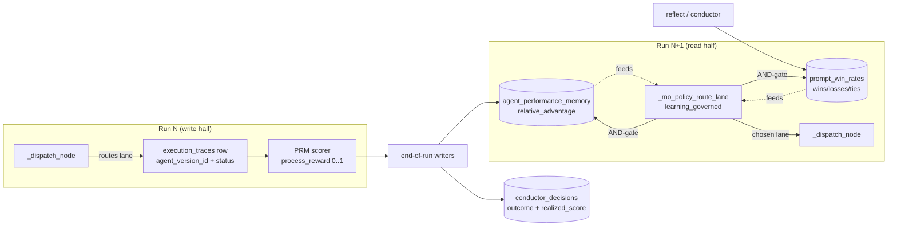
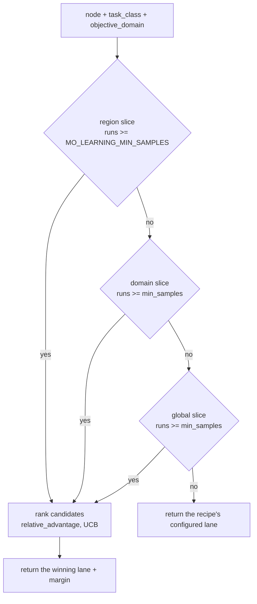

# Learning Loop Lifecycle

How mini-ork records what happened on a run and uses it to route the **next**
run better — the full write → store → read cycle, the five learning signals,
and how to prove the loop is closed.

> **Status (2026-11-02):** Closed and **default-ON** for real runs. The proof is
> `tests/unit/test_learning_loop_closure_py.py`, which runs on a freshly
> migrated database — including the cold-start path — and makes no model call:
>
> ```bash
> python3 -m pytest -q tests/unit/test_learning_loop_closure_py.py
> ```

---

## 1. The one-paragraph version

Every node mini-ork dispatches writes an `execution_traces` row stamped with the
**lane it actually ran on** (`agent_version_id`) and a heuristic quality score
(`process_reward`). At end-of-run, two writers turn those traces into *policy*:
**GRPO** computes each lane's relative advantage per task class, and the
**conductor writeback** marks each topology decision success/failure. On the
*next* run, the dispatcher's routing seam (`learning_governed`, default-ON) reads
those tables and, when there is enough evidence, swaps a node onto the lane the
data says wins. When evidence is thin, it silently falls back to the recipe's
configured lane — so learning is a strict improvement, never a regression.



The critical join: the lane GRPO scores (`agent_version_id`) is the **same**
lane the router chose. Before this was stamped, GRPO keyed on a column the
router never wrote, so the loop was physically open even though every function
existed.

---

## 2. The five learning signals

| Signal | Table | Writer | When | What it captures |
|---|---|---|---|---|
| **PRM** (Process Reward) | `execution_traces.process_reward` | `mini_ork/learning/process_reward.py::score_trace` | inline, per node | heuristic 0–1 quality of one node's work |
| **GRPO** (Group Relative Policy Opt.) | `agent_performance_memory.relative_advantage` | `mo_learning_write_grpo_advantages` (`mini_ork/cli/execute.py`) | end-of-run | which lane beats its peers on a task class |
| **RHO** (prompt win rates) | `prompt_win_rates` | `mini_ork/learning/rho_aggregator.py::aggregate_win_rates` (native and called by the Python reflect entrypoint) | reflect / conductor | which prompt version wins per task class |
| **Conductor writeback** | `conductor_decisions.outcome` / `realized_score` | `mo_learning_update_conductor_outcomes` (`mini_ork/cli/execute.py`) | end-of-run | did the chosen topology/recipe pay off |
| **Grounded rejections** | `grounded_rejections` | _table ready; prod writer = open task #9_ | review/oracle gates | refuted claims + evidence (anti-reward) |

A sixth, longer-horizon loop — **self-improve / gradient** (`gradient_records`,
4597 live rows) — is produced by `mini_ork/learning/reflection_pipeline.py`,
`mini_ork/learning/gradient_extractor.py`, and the scheduler's carry-over
builder. It proposes
prompt/role/recipe *changes* rather than per-run lane routing, and is documented
separately in `docs/RECURSIVE-SELF-IMPROVE.md`.

---

## 3. Write half — how a trace becomes a learning signal

### 3.1 Lane routing + stamping (`_dispatch_node`, `mini_ork/cli/execute.py`)

```bash
local dispatch_lane="${node_model_lane:-$node_type}"          # recipe default
dispatch_lane="$(_mo_policy_route_lane "$node_type" "$dispatch_lane")"  # may override
```

`dispatch_lane` (the lane that *actually* runs) is then passed as the 11th
positional arg to the trace-payload writer in `_trace_write_node_rich`
(`:1079`) and persisted as `agent_version_id` (`:1037`, `:1069`). **This is the
join key** between the write half and the read half.

**Reading the attribution back — `mini-ork why <run> <node>`.** The write half
above is not the only place a lane decision is recorded, and no one store
answers "which model produced this artifact, and why":

| Store | Answers |
|---|---|
| `<run_dir>/.lane-<node>.json` | which lane the node *asked for* and which one *served* it (written by the dispatcher from `selected_model`) |
| `execution_traces` | the routing reason: `route_source` (`policy` / `learned` / `pinned` / `fallback` / `trace_governed`), `route_explore`, `route_score`, `route_margin`, `predicted_error` |
| `llm_calls` | the chain actually walked — every lane tried, its status, tokens, cost and session id |
| `<run_dir>/learned/<node>.json` | the memory ids injected into this node's prompt (`arm`, `attempt`, `sources`) |

`mini-ork why` joins all four, read-only, and prints `not recorded` for a store
that has no row for the node rather than leaving the field out. `--json` emits
the same card for a script. Route `source=pinned` is called out in words,
because a recipe pin beats the router and no learning signal is attributable to
it.

### 3.2 PRM scoring (`mini_ork/learning/process_reward.py`)

Immediately after the trace lands, the trace writer calls
`score_trace` (gated on `MO_PRM_SCORE`, **default 1**). The
heuristic, additive, capped at 1.0:

| Signal | Points |
|---|---|
| `status = success` | +0.40 |
| `tool_calls` non-empty (agent did work) | +0.20 |
| `files_written` or `files_read` non-empty | +0.10 |
| `reviewer_verdict` ∈ {APPROVE, pass, success, ok} | +0.15 |
| `duration_ms` ∈ [1000, 600000] (not too fast/slow) | +0.10 |
| `cost_usd > 0` (real LLM call, not a stub) | +0.05 |

> This is a v1 heuristic. The full PRM literature uses a *learned* reward model;
> the heuristic covers the obvious cases (no files touched, no tool calls,
> vacuous status) and is the score GRPO consumes.

### 3.3 End-of-run writeback (`mini_ork/cli/execute.py`)

```bash
if [ "${MO_LEARNING_WRITEBACK:-1}" = "1" ]; then   # default ON
  mo_learning_update_conductor_outcomes >/dev/null
  mo_learning_write_grpo_advantages   >/dev/null
fi
```

**GRPO** (`:252`) groups every stamped trace by `(node_type, task_class)`,
computes the group mean/std of the reward, then for each `agent_version_id`
writes the mean z-score advantage:

```
relative_advantage = mean over the lane's traces of  (reward - group_mean) / group_std
```

A lane that consistently scores above its task-class peers gets
`relative_advantage > 0`; that is the exact predicate the router gates on.
Rows upsert on `(agent_version_id, task_class)`.

**Conductor writeback** (`:218`) resolves every `conductor_decisions` row whose
`outcome` is still `pending` and whose epic has reached `done` / `escalated`:
`done → success / realized_score=1.0`, else `failure / 0.0`.

---

## 4. Read half — how the next run uses the signal

### 4.1 The routing seam (`policy_route_lane`, `mini_ork/dispatch/routing.py`)

```python
policy = os.environ.get("MO_ROUTING_POLICY") or "learning_governed"   # default ON
```

Policies: `workflow_default` (use recipe lane verbatim), `frontier_only`,
`cheap_only`, `static_hybrid` (cheap implementer / frontier reviewer),
`trace_governed` (escalate after a prefix failure), and **`learning_governed`**
(the default).

### 4.2 `learning_governed` (`lane_router._pick_lane`)

It walks the **narrowest slice with enough evidence** and falls back to the
dispatcher's static lane:



The evidence is `agent_performance_memory.relative_advantage` — the GRPO write
— per `(lane, task_class)` and optionally per `(objective_domain, code_region)`.
`prompt_win_rates` is **not** read on this path: RHO feeds the reflector and the
learning dashboard, not the router. (An earlier revision of this doc claimed a
`prompt_win_rates` precondition; no query ever implemented it, so the claim was
deleted rather than the routing decision changed.)

With no row at or above the sample floor — a **cold or vacuous** learning store
— the configured lane comes back unchanged. That is what makes default-ON safe:
learning can only *add* an override once it has earned the evidence; it never
subtracts one.

---

## 5. Defaults: why "always" is true now

The loop benefits **every** real run with no opt-in, because three gates default
ON in `mini_ork/cli/execute.py`:

| Env var | Default | Effect | Opt-out |
|---|---|---|---|
| `MO_PRM_SCORE` | `1` | score every trace | `MO_PRM_SCORE=0` |
| `MO_ROUTING_POLICY` | `learning_governed` | read learnings to route | `MO_ROUTING_POLICY=workflow_default` |
| `MO_LEARNING_WRITEBACK` | `1` | GRPO + conductor writeback | `MO_LEARNING_WRITEBACK=0` |
| `MO_LEARNING_MIN_SAMPLES` | `3` | evidence floor before override | raise/lower as needed |
| `MO_ROUTE_REGION` | `1` | an unpinned implementer's route consults the region slice first (region = most common top-level dir of `run_profile.json` scope) | `MO_ROUTE_REGION=0` |

---

## 6. Validation

One repeatable check, read-only, no dispatch and no model call:

```bash
python3 -m pytest -q tests/unit/test_learning_loop_closure_py.py
```

It proves **two** evidence classes — neither alone is sufficient:

- `[CODE]` — the source lines that make the policy, PRM scoring and writeback
  fire by default, so "on" is not an opt-in the operator forgot to set.
- `[LIVE]` — the columns and tables the loop needs, asserted on a **freshly
  migrated** database. Cold start is the tested path: the loop must be closed
  on a project that has never run anything, which is the state a new user is
  in.
- Behaviour, where a grep would be weak: PRM separates success from failure,
  the GRPO writer is a no-op (not a crash) on an empty store, and an unset
  `MO_ROUTING_POLICY` really does select `learning_governed`.

A loop is "closed always" only when every class is green: otherwise you have
machinery that could learn but is switched off, or switched on against a DB
that cannot store the outcome.

---

## 7. Live state & known horizons (2026-06-23)

| Table | Rows | Note |
|---|---:|---|
| `execution_traces` | 1295 | all carry `process_reward` (backfilled) |
| `prompt_win_rates` | 64 | RHO populated |
| `agent_performance_memory` | 1 | GRPO; **grows going forward** |
| `conductor_decisions` | 9 | all `pending` (epic not yet `done`) |
| `gradient_records` | 4597 | self-improve loop, very active |
| `grounded_rejections` | 0 | table ready; prod writer is open work |

Two honest caveats:

1. **Stamping benefits future runs only.** Historical traces predate
   `agent_version_id` stamping and have no recoverable lane, so they cannot be
   re-attributed. GRPO's `agent_performance_memory` therefore populates as new
   real runs land — that is why it currently holds a single row.
2. **Grounded rejections** has a live table and passes the smoke proof, but the
   production writer that emits rows from the review/oracle gates is still open
   (tracked as the "wire grounded rejection into 5 oracle gates" task). Until
   then it is an anti-reward channel that is wired but not yet fed by real runs.

---

## 8. File map

| Concern | Location |
|---|---|
| Routing seam + policies | `mini_ork/dispatch/routing.py` (`policy_route_lane`) |
| Learning-governed gate | `mini_ork/lane_router.py` (`_pick_lane`) |
| Lane stamping onto trace | `mini_ork/cli/execute.py` (`extra["agent_version_id"] = lane`) |
| PRM scorer | `mini_ork/learning/process_reward.py` (`score_trace`) |
| GRPO writer | `mini_ork/learning/writeback.py` (`write_grpo_advantages`) |
| Conductor writeback | `mini_ork/learning/writeback.py` (`learning_update_conductor_outcomes`) |
| RHO aggregator | `mini_ork/learning/rho_aggregator.py` (feeds the reflector, not the router) |
| End-of-run writeback callsite | `mini_ork/cli/execute.py` |
| Closure proof | `tests/unit/test_learning_loop_closure_py.py` |
| Schema | `db/migrations/0039_learning_column_repairs.sql`, `0040_grounded_rejections.sql` |
| Self-improve / gradient loop | `docs/RECURSIVE-SELF-IMPROVE.md` |
