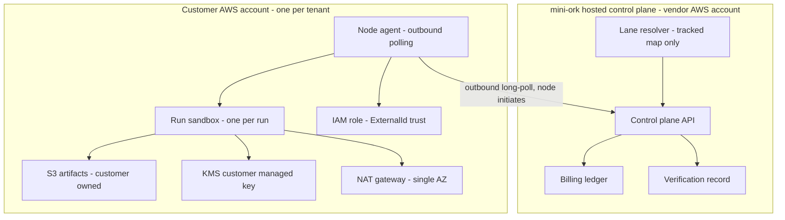
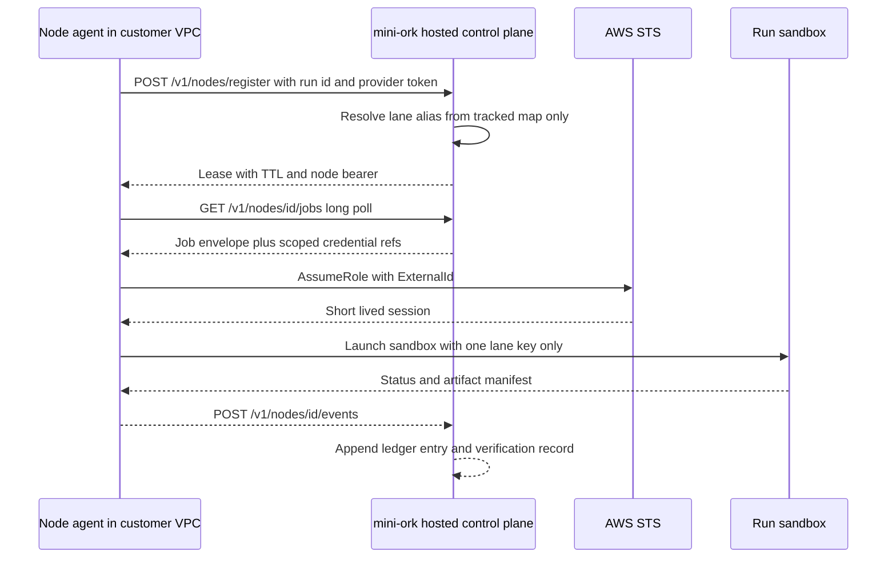
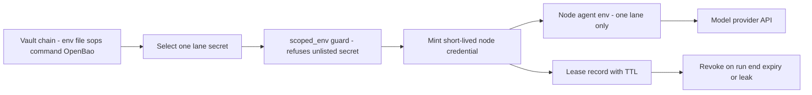
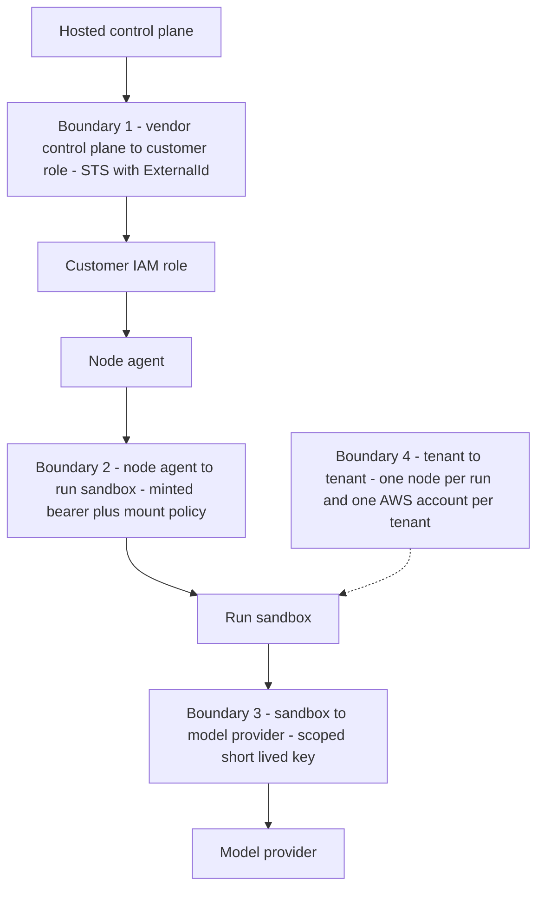

# mini-ork Cloud on the customer's AWS — architecture synthesis

> Status: proposed (2026-11-25). Design document — no code, terraform, or
> pricing page accompanies it. Produced by the `research-synthesis` recipe
> (`recipes/research-synthesis`) as run `run-1795594516-17762` from
> [`kickoffs/cloud-saas-aws-architecture.md`](../../kickoffs/cloud-saas-aws-architecture.md);
> the four lens reports it composes are in that run directory. It extends, and
> does not replace, [`cloud-sandbox-providers.md`](cloud-sandbox-providers.md)
> (the node-provider seam) and [`cloud-swarm.md`](cloud-swarm.md) (fleet
> execution). Prices in §3 are illustrative as of the date above; the
> commission column is a policy input, not a market rate.

Snapshot **2026-11-25**. Synthesis of four independent lens reports — `lens-glm`
(breadth/web), `lens-kimi` (academic), `lens-codex` (code/PRACTICE), `lens-opus`
(narrative/THEORY). Every repo claim cites a file path; every external claim names its
source and date. Consensus is marked ★ (2 lenses) / ★★ (3) / ★★★ (4). Disputes are
reported, not vote-resolved.

---

## Executive Summary

mini-ork Cloud is a **hosted control plane that never owns the customer's compute**: the
customer stands a node agent up inside their own AWS account, that account pays AWS for
the infrastructure, and mini-ork is paid a per-node-hour tier licence from which it keeps a
commission. This inverts the conventional multi-tenant-SaaS default (vendor owns the bill,
per-seat pricing), because the unit of value is no longer a cheap CRUD request but a long,
bursty, attributable agent run whose marginal cost is large and belongs to one customer —
the same cost-attribution argument that makes BYOC a real category (Vercel GA'd the exact
split 2026-10-15; Datadog runs its whole log engine in-customer over an outbound-only
connection) and the same economics the repo already encodes in `config/agents.yaml`
("~$12K-18K/day saved at 100K runs scale"). The design's durable decisions are **not**
"EKS vs Fargate vs EC2" — the repo has already reduced that to a four-verb `NodeProvider`
seam — but five narrower ones: an explicit **isolation hierarchy** (never "microVM =
secure"), an **outbound-only** node-agent direction (the current inbound preview-proxy
shape will fail a customer's security review), a **fail-closed ledger** reused from
`mini_ork/cost/budget.py`, **BYO model keys with a brokered fallback** resolved only
through the tracked lane map, and a **two-tier delivery** where the laptop trial shares the
same vault chain as the cloud deployment. Static node tiers ship first because they make
per-run cost attributable; metered billing is designed now and built last, and the migration
paragraph must state the tail-versus-median tradeoff the customer will feel. The cargo-cult
failure modes to avoid are the ones the lenses name explicitly: treating the artifact graph
as OS isolation, letting an unknown lane alias silently collapse a model family, and
letting the cheapest sandbox tier silently carry a weaker boundary than the price implies.

---

## TL;DR

- **The plane split is real, standard, and must cross outbound-only.**
  Hosted control plane = NIST SP 800-207 Policy Engine + Administrator; the customer-plane
  node agent = Policy Enforcement Point. Access is granted per session and enforced *before*
  the connection opens. (lens-kimi: NIST SP 800-207 §; lens-codex: C1) — confidence **high**.
- **Static node tiers are the correct launch model; metered is a pricing-policy swap, not a
  re-architecture.** Five surveyed schedulers declare resources as a fixed tuple at creation
  and never autoscale per run; Daytona ships exactly three named sizes. (lens-codex: C3, D-10;
  lens-opus §6 rec 7) — confidence **high**.
- **Missing credential or unparseable price ceiling must be a clear error, and every charge
  needs a visible ledger entry.** The repo already implements the ceiling half in
  `mini_ork/cost/budget.py`; ~23% of realistic SaaS pricing models contain at least one error,
  which is why the tier contract must be machine-checked. (lens-codex: Part 0 §6; lens-kimi:
  arXiv:2503.21444) — confidence **high**.
- **BYO model keys primary, brokered fallback, aliases resolved only from the tracked map.**
  Short-lived, node-bound, path-scoped credentials are the direction of the literature; a
  leaked long-lived key is only a bounded event if it can be revoked by lease, not by deleting
  the workload. (lens-kimi: arXiv:2504.14760, arXiv:2507.17655; lens-opus §6 rec 4) —
  confidence **medium-high** (no study measures BYO-vs-brokered blast radius).
- **"Verified delivery" must state its judge and its reliability.** Inter-judge agreement is
  α = 0.042 and each additional lens is worth less than the last (+14.9 → +13.5 → +11.2 pp),
  so a panel's verdict is a measurement of that panel, not of a shared property. (lens-kimi:
  arXiv:2601.05114, arXiv:2511.16708) — confidence **medium** (single studies, not replicated).

---

## 1. What "mini-ork on AWS" is — the reference topology

### 1.1 The shape

One **tenant = one customer AWS account**. Inside it, one small always-on control-plane
fragment (the node agent and its bootstrap), a per-run ephemeral **run sandbox** that is
created, used, and reaped, customer-owned object storage for artifacts, a customer-managed
KMS key, and an IAM role whose trust policy names the mini-ork control-plane principal plus
an `ExternalId`. The **hosted** control plane lives in mini-ork's own account and holds no
infrastructure credentials for the customer's account — it only assumes the customer role via
STS when a dispatch needs it.

This is the shape the repo's provider contract already abstracts: a `NodeProvider` with
`create` / `attach` / `release` / `reap` (`mini_ork/remote/providers/base.py:118-148`), a
`NodeEndpoint` that keeps its `token` and `headers` out of `repr` and out of the on-disk
`locator` (`base.py:87-110`), and per-run acquisition serialized across processes
(`attach_run_node` at `base.py:340`, `release_run_node` at `base.py:350`). The documented
protocol, placements and the `--placement remote --env <profile>` contract are in
`docs/architecture/cloud-sandbox-providers.md`; the live end-to-end proof is recorded there
for Daytona and E2B.

### 1.2 Why not EKS-by-default

- **A per-customer EKS cluster is a fixed tax that recurs forever.** The EKS control plane is
  $0.10/cluster-hour standard and **$0.60/cluster-hour on extended support** after the
  ~14-month window — a 6× multiplier that fires exactly when a tenant lags a version
  (GLM-14, GLM-15; AWS pricing accessed 2026-11-25). Per-tenant clusters multiply that by the
  tenant count for a workload that runs **one node per run**.
- **AWS's own decision guide routes ephemeral container work away from self-managed K8s.**
  Lambda for short event-driven work, Fargate for long-running or batch containers without
  node management (GLM-13). mini-ork's runs are long and quiet, which is the Fargate side of
  that tree, not the "operate a control plane per customer" side.
- **The scheduler is not the durable decision.** The real decisions are the reaper, the TTL,
  and the per-lane secret scope; those survive a provider swap because they sit behind the
  four-verb seam (lens-opus §6 rec 1; `base.py`). Picking EKS first optimizes the one thing
  the architecture can change cheaply.

### 1.3 Why not EC2-by-default either

Cold-start is the argument. The community-measured ladder is EC2 node **1-2 min** → Fargate
~10 s → Lambda 1-2 s (GLM-18, low confidence: a dated `r/aws` thread), while a Firecracker
microVM boots in **125 ms** with <5 MB overhead and up to 150/s per host — peer-reviewed
figures from the substrate's own authors (Agache et al. 2020, NSDI'20). EC2-by-default pays a
minute-plus of warm-up per run to get a boundary no stronger than a microVM's. EC2 remains
the right choice where a customer already operates static nodes — the repo's `static`
provider is exactly for that (`docs/architecture/cloud-sandbox-providers.md`, static-VM
placement).

### 1.4 The recommended default: an isolation hierarchy, not a winner

★ **The lens reports never converge on a single isolation primitive, and the design must
not pretend they do.** (lens-kimi §1.1; lens-glm "Isolation tech dissent") The evidence:

- Firecracker is efficient and peer-reviewed (Agache 2020) **but** its microarchitectural
  exposure is measured and contested: a Medusa variant and a Spectre-PHT variant survived
  AWS-recommended defences and disabled SMT in a third-party study (Weissman et al. 2023,
  arXiv:2311.15999).
- A **container** boundary is not adequate against the actual adversary: an LLM agent with
  shell access discovered and exploited deliberately introduced container vulnerabilities
  (Marchand et al. 2026, arXiv:2603.02277).
- A **software sandbox** edge platform leaked cross-tenant at **120 bit/h** (Schwarzl et al.
  2021, arXiv:2110.04751) — and the defence that fixed it has a **0.61% false-positive rate**,
  i.e. isolation is probabilistic, not binary.

So: **microVM (Firecracker-class) as the default run-node substrate; plain containers only
inside a per-tenant account where blast radius is already account-scoped; and state the
assumed hierarchy explicitly in every tier.** The cheapest tier may not silently carry a
weaker boundary than the tier above it.

### 1.5 Egress and storage

The two line items that dominate surprise bills for chatty multi-AZ fleets are the **NAT
gateway** (~$0.045/GB processed + ~$0.045-0.065/hr per AZ) and **cross-AZ transfer**
($0.01/GB each way) (GLM-20). The classic trap: a NAT gateway in one AZ serving workloads in
another bills *both* the processing fee and the cross-AZ fee (GLM-22). Design rule: **one run
= one AZ**, VPC endpoints for S3 / KMS / STS so routine traffic never traverses NAT. ★
(Codex-C2's two-layer GC and Opus failure mode A agree the run must survive a quiet turn —
which is why `auto_stop_interval` is 0 and `ttl_minutes` is the cap in
`docs/architecture/cloud-sandbox-providers.md` DT4.)

---

## 2. Who runs what — the plane split, the API contract, and visibility

### 2.1 Split in standard vocabulary

★ **The split has a name and a standard shape.** The hosted control plane is the NIST
SP 800-207 **Policy Engine (PE) + Policy Administrator (PA)**; the customer-plane node agent
is the **Policy Enforcement Point (PEP)** (Rose et al. 2020, NIST SP 800-207; extended to
multi-location cloud-native deployments by Chandramouli & Butcher 2023, NIST SP 800-207A).
The important operational consequence: *enforcement happens at the PEP, before the connection
opens*, which is the standards-blessed form of the kickoff's fail-closed rule. (lens-kimi §1.3)

| Who | Runs | Sees | Never sees |
|---|---|---|---|
| mini-ork hosted | control-plane API, lane resolver, ledger, verification record | run metadata, tier, node-hours, verification verdicts, artifact **manifests** | prompts, completions, file contents, model keys, customer AWS credentials |
| customer plane | node agent, one sandbox per run, storage, CMK, IAM role | the run's own inputs and its one lane key | other tenants, the control-plane signing key, the mini-ork billing DB |
| customer's AWS | the infrastructure itself | everything in the account | — |

### 2.2 The API contract (directional)

★ (Codex-C1) **The direction is the contract.** The node agent **dials out and long-polls**;
the control plane never opens an inbound connection into the customer VPC. Four surveyed
implementations do this — GitHub `actions/runner` (`MessageListener.cs:73,233`), Coder
provisioner daemons (`coderd/workspaces.go:707`), kubelet lease renewal
(`kubelet.go:1224`), and the Vault agent pattern — and mini-ork is the single inverted
outlier: today the control plane reaches a loopback-bound node agent **inbound through a
provider preview proxy** at port 7091 (`docs/architecture/cloud-sandbox-providers.md`
DT1/DT2, the `get_preview_link(7091)` call). That shape survives only inside a sandbox
provider that offers a proxy; it will **not** pass a customer's security review for a VPC
with no ingress.

Two borrowed correctness ideas worth adopting: **lease-based liveness** (kubelet renews at
`leaseDuration * 0.25`; a stopped agent is unregistered by expiry, not an explicit delete)
and **provisional-session recovery** (`actions/runner` recovers a session rather than
re-registering). Both belong to the "is the customer node still mine" question that
`NodeEndpoint`'s static bearer cannot answer today.

### 2.3 What the hosted side can and cannot see

This is a **product** boundary, not an implementation detail. The most defensible statement
is negative: the hosted control plane must be able to bill and to verify **without reading
customer content**.

- **Can see:** run id, tenant id, resolved lane alias, tier, node-hour ledger entries, the
  verification verdict (`PROVEN` / `REFUTED` / `UNVERIFIED` per `docs/architecture/verification-stack.md`),
  and artifact **manifests and labels** (the declared-port ledger in
  `docs/architecture/artifact-graph.md`).
- **Cannot see:** prompt text, model completions, file bytes, the lane key, the customer's
  IAM role secret, other tenants' anything.
- **The one honest caveat:** if the control plane ever runs a `system_only` transform on
  customer artifacts, it sees that artifact's bytes. The design must keep such transforms
  inside the customer plane wherever possible; `docs/architecture/artifact-graph.md:118-128`
  says plainly that the ledger is "an application-level capability boundary, not OS
  isolation" — a hosted transform is where that boundary thins.

★ **The trust asymmetry is the product risk** (lens-opus §3; lens-glm gap 3: the API
contract and its visibility limits are exactly what no public BYOC vendor publishes). A
hosted synthesizer that can read every prompt is a liability, not a telemetry asset.

### 2.4 Failure modes on this boundary

- **Silent family collapse.** The repo lived this on 2026-10-25: an alias that existed only in
  an operator overlay caused the lens to fall back to a different provider — "a detected
  family collapse that was really a missing alias" (`config/agents.yaml:60-65`). In the cloud
  this becomes a customer-visible quality regression with no error. Control: resolve every
  alias from the tracked map, raise on unknown, never default.
- **The bill that surprises.** Marketplace metering settles after the fact; a customer charged
  for usage they cannot see in a ledger has a legitimate dispute (lens-opus failure mode D).
  This is why the ledger entry is a precondition of the charge, not a receipt after it.

---

## 3. Node pricing — static tiers with a commission

### 3.1 What the money means

The customer's AWS account pays AWS for the compute the tier provisions — that is the
headline of the product. Separately, the customer pays mini-ork a **per-node-hour tier
licence**; mini-ork's **commission** is the share of that licence it retains after
pass-through cost (control-plane amortization, support, the verification record). If the tier
is instead sold through AWS Marketplace (SaaS listing or CPPO), AWS deducts its fee from the
disbursement *before* mini-ork sees it — **3% public SaaS; 3% / 2% / 1.5% tiered private
offers by TCV; +0.5% for CPPO**, computed on pre-tax TCV (GLM-1, GLM-2, Kimi §5; AWS
Marketplace docs accessed 2026-11-25). **The 3% marketplace fee is a cost of the rail, not
the commission; the two must not be conflated.** No located source documents a product that
commissions *infrastructure the customer buys from AWS directly* (GLM gap 2) — that is
mini-ork's novel commercial surface, and the numbers below are illustrative, not derived.

### 3.2 The tier table

All prices **illustrative, snapshot 2026-11-25, labelled as such in any customer-facing
copy.** The "run gets" note reflects Nomad's `NodeReservedResources` lesson (Codex-7):
reserve the node agent and engine headroom explicitly instead of selling vCPU the run cannot
use.

| Tier | vCPU | Memory | Disk | Customer price (licence, per node-hour) | mini-ork commission (retained share) | Customer AWS compute (their bill, illustrative) | Run gets after node-agent reserve |
|---|---|---|---|---|---|---|---|
| nano | 2 | 4 GiB | 20 GiB | $0.06 | 60% = $0.036 | ~$0.09 (`m7g.large` class) | ~1.6 vCPU / 3.2 GiB |
| small | 4 | 8 GiB | 40 GiB | $0.11 | 55% = $0.060 | ~$0.17 (`m7g.xlarge`) | ~3.4 vCPU / 6.8 GiB |
| medium | 8 | 16 GiB | 80 GiB | $0.20 | 50% = $0.100 | ~$0.34 (`m7g.2xlarge`) | ~7.2 vCPU / 14 GiB |
| large | 16 | 32 GiB | 160 GiB | $0.36 | 45% = $0.162 | ~$0.67 (`m7g.4xlarge`) | ~14.8 vCPU / 30 GiB |

The commission percentage declines with tier because control-plane cost is roughly flat per
run while the infrastructure value rises. The **deployment-method** choice moves the
*marketplace* fee by 17 points — 3% for a SaaS offering vs 20% for a container/AMI/ML server
product (Kimi §5) — so whether the tier is sold as SaaS or as a container is a commission
decision, not packaging.

### 3.3 How a node registers

1. The customer's bootstrap (CloudFormation/Terraform, out of scope to write) creates the IAM
   role with an `ExternalId` and the network path; the node agent starts and **dials out**.
2. `POST /v1/nodes/register` carries the run id and the provider token; the control plane
   resolves the lane from the tracked map, mints a node bearer **bound to one sandbox**, and
   returns a **lease** with a TTL — renewal, not re-registration, keeps it alive.
3. The node's identity is the lease, so a killed control plane cannot resurrect a node and a
   killed node cannot be double-billed: `acquire_run_node` / `release_run_node` already
   serialize this per-run across processes (`mini_ork/remote/providers/base.py`), and the
   reaper is a label/age sweep (`reap_node_providers`, `base.py:395`) *plus* a server-side
   TTL (the two-layer GC in `docs/architecture/cloud-sandbox-providers.md` DT4). ★ Five
   surveyed implementations use the two-layer pattern; nobody relies on one (Codex-C2).

### 3.4 How usage is metered

Node-minutes per tier, written to the ledger as they accrue, idempotent on a client token —
the same shape as AWS Marketplace `MeterUsage` (`UsageDimension`, `UsageQuantity`,
`Timestamp`, hourly aggregation, `ClientToken` idempotency; Codex-9,
`aws-sdk-go-v2 service/marketplacemetering/api_op_MeterUsage.go`). ★ (GLM-4: the vendor's
metering ledger is the billing source of truth; Codex-D3: `ResolveCustomer` is what proves
*which account* owes — mini-ork has no equivalent today and must add one before it claims
"the bill lands on the customer's account").

### 3.5 What breaks when tiers become metered

★ (lens-kimi arXiv:2611.24071; lens-opus §6 rec 7) Metering is a **pricing-policy swap, not a
scheduling change**: resources are still declared at creation, so only the *reporting*
changes. But two things break:

- **The tail/median tradeoff.** Calibrated simulation shows revenue-matched nonlinear tariffs
  cut the **99th-percentile session charge by 31-42% while raising the median charge** (Lu et
  al. 2026, arXiv:2611.24071). The migration paragraph must say this: a customer with a
  steady workload pays *more* under the metered model that saves the bursty customer. It is
  not a free upgrade.
- **Pricing-model correctness.** ~**23% of realistic SaaS pricing models** (35 of 150+)
  contained at least one error under automated analysis (García-Fernández et al. 2025,
  arXiv:2503.21444). The tier contract and its metered successor must be **machine-checked
  against the contract**, not hand-authored and reviewed. `mini_ork/cost/budget.py`'s
  `register_budget_policy` seam (`budget.py:208`) is where the meter plugs in without
  touching call sites.

And one hard epistemic bound: a commission may be computed from **metered quantity only**,
never from an asserted customer benefit — arXiv:2611.24071's authors explicitly decline to
validate utility, and arXiv:2309.11312 shows pricing is a strategic variable, not a constant
(lens-kimi §1.4).

---

## 4. Lanes and credentials — "should the customer set their lanes?"

### 4.1 The direct answer

**Yes — the customer sets their lanes, BYO keys primary, brokered keys as the fallback, and
every alias resolves only from the tracked map.**

Rationale, agreed ★★ by lens-kimi (§Goal 4), lens-opus (§6 rec 4), and lens-codex (§Part 0):

- The customer's own model key is the one credential whose blast radius the customer already
  understands and controls. BYO keeps the vendor **out of the prompt path** and puts model
  choice where the cost lands.
- The literature's direction is one-way: retire long-lived static secrets in favour of
  **short-lived, node-bound, attestation-backed identity** (Avirneni 2025, arXiv:2504.14760;
  OIDC federation / SPIFFE). But the trust anchor is **not** the HSM — cloud incidents come
  from cloud-native weaknesses, not broken crypto (Shaikh & Fernandes e Fizardo 2025,
  arXiv:2507.17655), so the custody story must rest on short-lived + path-scoped + revocable +
  never-on-disk, which is what the repo already implements.
- Brokered (vendor-holds-the-key) is offered as a fallback for customers who cannot mint a
  provider key — but it is **never the default**, because it re-introduces exactly the
  visibility the plane split exists to remove.

The non-negotiable control on "the customer sets their lanes": **no alias may resolve to a
provider that the tracked map does not declare, and an unknown alias is a clear error.**
`config/agents.yaml:60-65` records the 2026-10-25 incident where exactly this failed open —
an overlay-only alias silently fell back to another provider.

### 4.2 A repo-grounded caveat the run must not hide

The plan assumed lanes resolve `glm=zai, kimi=minimax, codex=deepseek, opus=anthropic`. The
tracked working tree does not say that: `config/agents.yaml:47` maps **`kimi_lens:
deepseek_flash`** and `config/agents.yaml:48` maps **`codex_lens: codex`**, with a separate
`deepseek_lens: deepseek_flash` at `:66`. That means two lens lanes currently alias the same
backend family while the plan believed they were distinct. This is a live demonstration of
the design point: **the tracked map is authoritative *and* it is only as good as its
content** — a cloud control plane that lets customers name lanes must validate *family
distinctness* at plan time, not merely "the alias exists." (Reported as observed; not a
judgment on the operators.)

### 4.3 The credential path, store to dispatch

1. **Store.** The two-tier vault chain is the reference: env → 0600 file → sops → command
   (`pass`/`op`/`infisical`) → **OpenBao**, the only backend whose *server* enforces which
   paths an identity may read (`config/vault.example.yaml:17-59`, especially the OpenBao note
   at :44-47). The simple tier uses the 0600 file; the secure tier uses OpenBao with a
   short-lived, path-scoped token. `mini-ork vault which NAME` prints a name and a location,
   never a value, so it is safe in a shared terminal.
2. **Scope.** `scoped_env()` returns exactly one lane's secrets and raises
   `SecretNotPermittedError` at `mini_ork/remote/secrets_scope.py:130` **before any network
   call**; `mini_ork/dispatch/providers.py:2278` turns that into an `rc=2` dispatch refusal,
   including a specific refusal for an anthropic-native lane whose local login cannot travel
   (`providers.py:2280-2294`). This is the enforcement point.
3. **Dispatch.** The node agent receives only the one lane key, through the sandbox's env,
   never baked into the image; the provider API key, the preview/proxy token and the node
   bearer are three distinct layers, none on local disk (Layer-3 contract in
   `docs/architecture/cloud-sandbox-providers.md`). `NodeEndpoint` keeps `token` and
   `headers` out of `repr` and out of `locator()` (`base.py:87-110`).
4. **Rotation.** Rotate at the vault (env first — "a shell `export` must be able to rotate one
   credential for one invocation", `config/vault.example.yaml` comment block) or at the
   provider console; the next dispatch re-reads through the chain. Because the key is never
   persisted in mini-ork, rotation needs no vault rewrite of a stored copy.
5. **Revocation.** This is the half the repo is **missing** for BYO keys. Everyone else's
   pattern is "delete the workload, the credential dies with it" — sound only when the
   credential's lifetime equals the workload's, *unsound* for a long-lived BYO model key that
   outlives the node. Copy **Vault's expiration manager**: every issued credential is a lease
   with a durable `pendingInfo` record, and expiry revokes through the **same path** as
   explicit revocation (`hashicorp/vault vault/expiration.go:109,135-138,273-275`; Codex-D2).
   A leaked key then triggers: revoke the lease → invalidate the node bearer → rotate at the
   provider → ledger the incident. Residual: a partitioned store cannot revoke on time; the
   lease outlives the failure.

**Blast radius.** A leaked lane key under BYO reaches one provider account, for the rotation
window, with no access to other tenants and no access to mini-ork's plane. A leaked
*brokered* key reaches every tenant that lane serves until revocation — strictly worse, which
is the second reason BYO is primary. No published study measures this BYO-vs-brokered
difference (lens-opus §5) — the conclusion is architectural, not empirical.

---

## 5. Trust boundaries and threat model

### 5.1 Boundaries

The cross-account boundary is AWS's own documented pattern: a customer-created IAM role whose
trust policy is scoped to the vendor principal **plus an `ExternalId`** to prevent the
confused-deputy problem, and explicitly *not* IAM users with long-lived keys (AWS Security
Blog 2023-11, GLM-23; Datadog Security Labs 2024-09, GLM-24). The operational gotcha is that
"technically correct" trust policies still leak in four catalogued ways (Token Security
2025-04, GLM-25) and trust-policy principal-listing does not scale (Caylent, GLM-25).

### 5.2 Threats, controls, and residual risk

★ The literature supplies the uncomfortable residual-risk language, and the design must
carry it (lens-kimi §2 Goal 5; lens-opus §4).

- **T1 — Customer-supplied code touches mini-ork credentials.** *Control:* the run sandbox
  never receives a mini-ork-plane credential at all — only one lane key, injected through
  `scoped_env` (`mini_ork/remote/secrets_scope.py:130`) and the sandbox env; `NodeEndpoint`
  excludes secrets from `repr`/locator (`mini_ork/remote/providers/base.py:87-110`).
  *Residual:* a sandbox with shell access can read any env the dispatch injects, so the
  guarantee is "no plane credentials in the run," not "no credentials in the run." The only
  true fix is scoping each injected value to one provider and one run's lifetime.
- **T2 — A compromised node agent.** *Control:* short-lived node bearer bound to one sandbox,
  lease-based liveness, outbound-only direction, and Vault-style lease revocation on run end
  (`vault/expiration.go`; Codex-D2). *Residual:* for its lifetime a compromised agent can act
  as the node for its run — it can exfiltrate the lane key it legitimately holds and burn that
  run's budget. Bounded to one run, one lane, one tier ceiling; not eliminated. This is a
  weaker version of Marchand et al.'s adversary (an LLM with shell access), so assume it is
  reachable.
- **T3 — A tenant escaping into another tenant.** *Control:* one node per run (no binpacking;
  Codex-D1), **one customer AWS account per tenant** (the "dedicated sub-account" onboarding
  convention, GLM-12 bitdrift), and a microVM substrate by default. *Residual:* isolation is
  probabilistic — a software sandbox leaked 120 bit/h cross-tenant (Schwarzl 2021,
  arXiv:2110.04751) and Firecracker's microarchitectural exposure is contested (Weissman
  2023, arXiv:2311.15999). Separate accounts make escape an account-boundary problem, not a
  kernel problem, which is the strongest residual reduction available.
- **T4 — A model provider reading prompts.** *Control:* BYO keys keep the *vendor* out of the
  prompt path; lane choice and no-log routing limit provider retention; the plane split means
  mini-ork never stores prompt text. *Residual:* the provider itself still sees prompts — out
  of mini-ork's control — and the sharper, under-appreciated variant is **indirect prompt
  injection**: content the model reads can rewrite its instructions and determine which APIs
  it calls (Greshake et al. 2023, arXiv:2302.12173). The control for that is taint-tracked
  artifacts plus capability-scoped credentials, not a privacy policy. Honest baseline: the
  agent may fail the task anyway — AgentDojo found leading LLMs often fail ordinary tasks
  *even without attacks* (Debenedetti et al. 2024, arXiv:2406.13352, 97 tasks / 629 cases).
- **T5 — Billing tampering.** *Control:* every charge is a ledger entry written before the
  charge is billable; the tier contract is machine-checked (arXiv:2503.21444); metering is
  idempotent on `ClientToken` (`api_op_MeterUsage.go`); the per-run ceiling fails closed
  (`mini_ork/cost/budget.py`). *Residual:* settlement latency means a dropped metering record
  under-bills (customer-favourable) and a duplicated one over-bills; the ledger is mini-ork's
  record, not a third-party attestation, so a compromised control plane could still mis-state
  it. A customer-side reconciliation tool against their own AWS Cost Explorer is the check.
- **T6 — Confused deputy on the cross-account role.** *Control:* `ExternalId` + a trust
  policy scoped to the mini-ork principal, no long-lived access keys (GLM-23, GLM-24).
  *Residual:* a customer who misconfigures the trust policy (principal-listing, wildcard
  condition) reintroduces the deputy (GLM-25, Token Security four misconceptions).
- **T7 — Egress and NAT cost abuse.** *Control:* one run = one AZ, VPC endpoints for
  S3/KMS/STS, and an egress line in the per-run ceiling. *Residual:* a chatty run can still
  run up NAT cost up to its tier's ceiling — the ceiling bounds the loss, it does not prevent
  it (GLM-20, GLM-22).

### 5.3 Fail-closed rules (stated explicitly)

These are hard constraints, not preferences:

1. **A missing credential is a clear error that names the key and where to put it — never an empty string, never a silent skip.** The repo already behaves this way: the vault chain
   fails closed, and `scoped_env` raises `SecretNotPermittedError` rather than dispatching
   with a partial env.
2. **A missing or unparseable price ceiling is a refusal, never "unlimited".**
   `mini_ork/cost/budget.py` converts a present-but-unparseable ceiling to `exhausted=True`
   (`budget.py:90-106`) and `verdict()` never raises but always returns
   `exhausted=True` on policy failure (`budget.py:221-241`); a run parked by a ceiling that
   later disappears stays parked.
3. **Nothing mini-ork runs may charge the customer's account outside the agreed tiers without
   a visible ledger entry.** The ledger entry is a precondition of the charge, not a receipt
   after it. `mini_ork/cost/budget.py` is the template: a declared ceiling plus a visible,
   append-only record.
4. **Secrets never sit in plaintext in a database, a log, or a node's env longer than the
   dispatch needs** — and never in `repr` or an on-disk locator (`NodeEndpoint` enforces the
   last two).

---

## 6. Delivery shape — two tiers in this repo

The repo already documents the two-tier pattern three times (Codex "What this lens hands the
synthesizer"); the cloud design reuses it rather than inventing a third variant. ★ The
simple tier's failure mode — one machine, a local file, one operator — is the same class the
literature names as the dominant exposure of shared automation with static credentials
(arXiv:2504.14760), which is why the **security property must not be dropped** when the
simple tier is used.

| | Simple tier: laptop, five minutes | Secure tier: shared / cloud |
|---|---|---|
| Where the node runs | `--placement local` or a single static node | customer AWS account, outbound-polling node agent |
| Secret store | `$MINI_ORK_HOME/config/secrets.local.sh` (0600) | OpenBao, short-lived path-scoped token (`config/vault.example.yaml`) |
| Cross-account access | none (same machine) | IAM role + `ExternalId` + STS, short-lived |
| Ledger | local file, pre-run ceiling | hosted ledger, one entry per node-minute, visible before charge |
| Billing | none — it is your own machine | tier licence + commission, marketplace or direct |
| Isolation | OS process (documented as *not* isolation) | microVM per run, one AWS account per tenant |
| Fail-closed | missing key = named error | missing key / unparsable ceiling = refusal |

Both tiers share **one config file** and the **same fail-closed vault chain**: the customer
starts on the 0600 file, switches one backend to OpenBao, and no call site changes — exactly
the shape `config/vault.example.yaml` promises and `mini_ork vault status` reports. The
env contract every node sees is single-sourced through `mini_ork/context.py`'s `RunContext`,
mutated only via `apply_env_overrides` / `run_context_scope`; a hosted dispatcher that forks
two tenants in one process must use the contextvar layer, never `os.environ`.

---

## 7. Consensus findings (cross-lens)

- **★★★ The plane split is correct and must be least-privilege, per-session, and
  outbound-only.** GLM (Vercel BYOC §A, Datadog reverse-connection §B), Kimi (NIST PE/PA/PEP),
  Codex (C1 actions-runner direction), Opus (BYOC school §3) all converge. The one inverted
  outlier is mini-ork's own current inbound preview-proxy shape.
- **★★★ Fail-closed on missing credential or unusable ceiling, with a visible ledger.** Kimi
  (ZTA enforce-before-access), Codex (`budget.py` + `scoped_env`), Opus (§6 rec 3), GLM
  (metering ledger is the source of truth) converge.
- **★★ One node per run; no binpacking.** Codex (D1, five vendors give each run its own
  machine), Opus (per-tenant attribution), Kimi (blast radius) converge.
- **★★ Static tiers are a legitimate launch model; metered is a reporting change.** Codex
  (C3, Daytona's three named sizes), Kimi (isolation as a tier dimension; machine-checked
  tiers), Opus (§6 rec 7) converge. GLM dissents only on *precedent* (it found no public
  static-tier-with-commission product), not on the shape.
- **★★ Aliases resolve from the tracked map, and an unknown alias is an error.** Codex
  (`config/agents.yaml:60-65`), Opus (failure mode B), Kimi (Goal 4) converge.
- **★ "The artifact graph is not isolation" must be stated, not implied.** Codex
  (`docs/architecture/artifact-graph.md:125-128`), Opus (failure mode C) converge — and the
  repo says it verbatim.
- **★ Metering's tail/median tradeoff.** Kimi (arXiv:2611.24071) quantifies it; Opus (§6 rec 7)
  confirms metered is last, not first.
- **★ The marketplace `ResolveCustomer` token is the only thing that proves which account
  owes.** GLM-4 (vendor ledger is billing truth) and Codex-D3 (marketplace token resolves the
  account) converge; mini-ork has no equivalent today.

---

## 8. Disputed findings (reported, not vote-resolved)

**D-A. "Is BYOC good business?"** GLM-10 (Vanlightly: classic single-tenant BYOC is
operationally ruinous, loses multi-tenant efficiency, only the *stateless-agent Warpstream
pattern* works) vs GLM-11 + Opus §3 (the BYOC school: cost attribution makes it the winning
commercial shape). *Why they disagree:* different money. Vanlightly measures operating cost
for stateful single-tenant deployments; the BYOC school measures willingness-to-pay for
account-resident execution. mini-ork's run node is stateless and ephemeral — the Warpstream
shape, not classic BYOC — so both can be right: the *architecture* of BYOC decides, not the
category. *What would resolve it:* the Opus §5 elasticity experiment — instrument 200-500 real
runs, regress vendor margin under hosted billing against the price premium accepted under
BYOC. If the premium on the top duration decile exceeds the vendor's marginal cost there, BYOC
wins decisively.

**D-B. "EKS/ECS/serverless vs static EC2 vs microVM default."** GLM (AWS decision guide →
Fargate/Lambda; EKS tax) vs Opus §6 rec 1 (don't pick the orchestrator at all; pick the
isolation boundary) vs Codex C3 (resources are static tuples, the vendor abstracts compute).
*Why they disagree:* they are answering different questions — GLM "what do you operate,"
Opus "what is durable," Codex "what do the APIs express." *Resolution used here:* the design
picks microVM-as-default-substrate **behind the provider seam**, which satisfies all three;
it is not a rebuttal to any lens. *What would resolve it:* a measured per-provider
cold-start and escape-resistance table for the specific customer instance types — which the
side-channel literature explicitly says does not transfer across hardware (Kimi caveat 3).

**D-C. "Static tiers vs metered."** GLM (no static-tier-with-commission precedent; every
agent-sandbox platform is per-second) vs Codex (Daytona ships three named sizes) vs Kimi
(metered's tail/median tradeoff and machine-checked pricing) vs Opus (tiers are a launch
simplification). *Why they disagree:* time horizon. Codex and Opus describe the launch;
GLM and Kimi describe the destination. *Resolution used here:* static tiers ship first,
metered is designed now and built last; the migration paragraph states the tradeoff so no
customer is surprised by a median increase. *What would resolve it:* observe whether
customers respond more to per-run predictability (static) or to peak-charge reduction
(metered) — measurable only in market.

**D-D. Isolation: Agache 2020 (Firecracker efficient, peer-reviewed) vs Weissman 2023
(microarchitectural exposure survives AWS defences).** *Why they disagree:* scope agreed,
degree disagreed — AWS's own Firecracker threat model includes microarchitectural attacks, so
the parties disagree about how well the defences work, not whether the class exists. Also
partly dated: Weissman tested 2023-era Firecracker. *What would resolve it:* a current-version
replication on the customer's actual instance types, with SMT on and off. Until then: treat
as directional, never as "microVM = secure."

**D-E. "The control plane seeing prompts is a liability vs a telemetry asset."** Opus §3 says
liability; the conventional model (Opus §2) treats telemetry as an iteration advantage. GLM
and Kimi do not settle it; GLM's gap 3 says no public vendor even documents its visibility
limits. *Why they disagree:* different buyer. Opus's buyer is enterprise procurement with a
security team; the conventional buyer accepts vendor-side data. *What would resolve it:* Opus
§5's second question — does "the vendor can read prompts" appear as a blocking objection or a
checkbox in real procurement?

---

## 9. Cross-lens gaps (what no source answers)

- **Untrusted agent code inside the customer's own account.** The BYOC literature is about
  data residency for *trusted vendor code* (GLM-6, GLM-7, GLM-10); the sandbox literature is
  about untrusted code on *vendor* infrastructure (GLM-16, GLM-17). Almost nothing covers
  running untrusted, agent-generated code in the customer's account — where the customer
  needs protection *from the product they bought*. **This trust inversion is mini-ork's novel
  surface** (GLM gap 1).
- **Commission on customer-paid infrastructure.** No documented model; the closest un-swept
  analogs are AWS Billing Conductor / MSP markup (GLM gap 2).
- **The control-plane ↔ customer-plane API contract and its visibility limits.** Vercel and
  Datadog publish *what runs where*, not the API contract or what the vendor can see (GLM gap
  3). This document is the first-pass answer; it has no external validation.
- **Metering failure semantics.** What happens when the metering pipeline drops, double-sends,
  or is tampered with is undesigned in public (GLM gap 4).
- **Static tiers for compute with a commission.** No public template (GLM gap 5); Daytona
  validates named tiers but not the commercial layer.
- **Egress economics for agent workloads.** All published egress anecdotes are big-data-shaped;
  agent traffic (git clones, artifact transfer, model tokens) is unprofiled (GLM gap 6).
- **The marginal cost elasticity of agent runs by duration bucket.** Nobody has measured
  whether long runs are the profit center or the loss center (Opus §5).
- **True blast radius of BYO vs brokered keys under real leak incidents.** Empirical,
  unpublished (Opus §5).
- **A sustainable commission rate for SaaS-on-customer-cloud resale.** No located study
  estimates one; the commission column is illustrative and must be cost-plus justified
  (Kimi caveat 5; Ghasemi 2023 arXiv:2309.11312 is simulation-only, undisclosed parameters).
- **Per-tenant blast radius for a specific cloud topology from an agent benchmark.** AgentDojo
  measures hijacking, SandboxEscapeBench measures container escape — neither yields a number
  for *this* topology (Kimi caveat 4).

---

## 10. Recommendations (falsifiable)

1. **Build the ledger and the fail-closed ceiling first, before any customer-facing surface.**
   *Supports:* all four lenses (synthesis judgment). *Wrong if:* marketplace settlement
   latency makes per-run ledger reconciliation impossible, forcing a prepaid-credit model
   instead (Opus rec 3's condition) — in which case the ceiling moves to prepaid balance.
2. **Invert the node-agent direction to outbound long-poll; do not ship an inbound control
   plane.** *Supports:* Codex-C1 (four implementations), GLM-7 (Datadog outbound-only).
   *Wrong if:* the customer VPC can safely accept the provider's preview proxy **and** the
   added poll latency breaks verification timing — or a provider cannot support outbound.
3. **Ship static tiers with prices labelled illustrative and dated; machine-check the tier
   contract.** *Supports:* Codex-C3, Kimi arXiv:2503.21444. *Wrong if:* more than a small
   fraction of real runs need mid-run resource changes, which static tiers cannot express.
4. **BYO keys primary, brokered fallback; resolve aliases only from the tracked map and raise
   on unknown.** *Supports:* Kimi arXiv:2504.14760, Opus rec 4, Codex Part 0.
   *Wrong if:* brokered custody is shown to have a materially smaller blast radius under real
   leak incidents (Opus rec 4's condition).
5. **State the isolation hierarchy per tier; never print "microVM = secure."** *Supports:*
   Kimi §1.1 (Agache vs Weissman vs Marchand vs Schwarzl). *Wrong if:* a hard tenant boundary
   is independently demonstrated for the chosen substrate on the customer's instance types.
6. **One AWS account per tenant; one node per run; lease-based revocation for every issued
   credential.** *Supports:* GLM-12 (sub-account onboarding), Codex-D1/D2, Kimi blast-radius
   reading. *Wrong if:* a customer's procurement forbids creating a new account per tenant, in
   which case the design needs an in-account tenant-separation fallback.
7. **Design metered now, build it last, and put the tail/median tradeoff in the migration
   paragraph.** *Supports:* Kimi arXiv:2611.24071, Opus rec 7. *Wrong if:* metered requires the
   vendor to see per-token spend, which reopens the visibility boundary and contradicts §2.3.
8. **Publish the judge and the reliability of "verified delivery" — not just the verdict.**
   *Supports:* Kimi arXiv:2601.05114 (α = 0.042), arXiv:2511.16708 (14.9 → 13.5 → 11.2 pp).
   *Wrong if:* customers demonstrably buy on price alone and ignore verification provenance
   (Opus rec 2's condition).

---

## 11. Build plan (ordered)

**Ships first (v1, in this order):**

1. **Ledger + fail-closed ceiling contract.** Reuse `mini_ork/cost/budget.py`'s
   `declared()` / `verdict()` / `register_budget_policy` shape; no customer surface exists
   until a charge cannot happen without a ledger entry. (rec 1; all four lenses)
2. **Outbound-polling node-agent endpoint.** Register → lease → long-poll → events, with the
   existing four-verb `NodeProvider` seam unchanged and release/teardown attach-only so a
   failed kill never *creates* a billed sandbox (`base.py`). (rec 2; Codex-C1)
3. **Tier contract + machine checker.** Three-plus tiers as declared tuples; checker validates
   vCPU/memory/disk/price/commission against the contract before it can be published. (rec 3;
   arXiv:2503.21444)
4. **Cross-account registration.** Customer IAM role + `ExternalId` + STS; per-tenant AWS
   account; lease revocation state machine copied from Vault's expiration manager. (rec 6;
   GLM-23, Codex-D2)
5. **BYO lane dispatch through the tracked map.** `scoped_env` at the dispatch boundary,
   unknown-alias error, three credential layers off disk. (rec 4; `secrets_scope.py:130`)

**Deliberately deferred:**

- **Metered billing** and per-second/per-token granularity — designed (rec 7), not built.
- **Marketplace CPPO / Saas listing integration** — the 3-3.5% fee rail (GLM-1, GLM-2); build
  after direct billing is proven, because it adds a settlement layer to reconcile.
- **Hosted console sign-up / plans / quota / API-key hashing** — greenfield; the repo has no
  `tenant_users` / `tenant_subscriptions` model (verified by grep; Codex Part 0 §11, Opus
  rec 8). Treat as new surface with external prior art, do not pretend a hidden model exists.
- **A second cloud provider** — the customer-plane contract is kept cloud-neutral (a node
  agent, an IAM-equivalent role, object storage, a KMS); AWS is first, not the contract.
- **Binpacking / shared nodes** — a dead end for per-tenant price attribution (Codex-D1).

**Falsifiers (what would prove the design wrong):**

- **F1 — Commercial:** customers refuse a per-node-hour software licence when the
  infrastructure is already on their own bill. This falsifies the BYOC commercial shape, not
  just the price. (D-A)
- **F2 — Tier fit:** a material share of real runs need mid-run resource changes static tiers
  cannot express. This falsifies rec 3 and forces resizable tiers or early metering. (D-C)
- **F3 — Timeout authority:** a provider plan caps continuous runtime below the tier's
  promised maximum, or microVM cold-start plus the outbound poll makes a 6 h run infeasible.
  This falsifies the tier promise under load (Codex-D4; E2B plan-derived timeouts).
- **F4 — Direction:** outbound polling adds latency that breaks verification timing or a
  provider cannot support it. This falsifies rec 2. (Codex-C1)
- **F5 — Reconciliation:** marketplace settlement latency makes per-run ledger reconciliation
  impossible. This falsifies rec 1 and forces prepaid credits. (Opus rec 3)
- **F6 — Isolation:** a hard tenant boundary is demonstrated for a weaker substrate, or the
  chosen substrate is shown to leak on the customer's instance types. This falsifies the
  isolation hierarchy in rec 5. (D-D)

---

## Appendix A — Source manifest

Every URL / arXiv ID / repo path cited across the four lenses and this synthesis, grouped by
lens source. Repo paths are relative to the repository root (working tree,
2026-11-25).

### Repo (mini-ork) — grounded contracts

- `docs/architecture/cloud-sandbox-providers.md` — node-provider protocol, `--placement
  remote --env <profile>`, inbound preview proxy 7091 (DT1/DT2), two-layer GC (DT4), two-tier
  table, live Daytona/E2B proofs.
- `docs/architecture/artifact-graph.md` — declared ports; `system_only` artifacts; "an
  application-level capability boundary, not OS isolation" (:118-128).
- `docs/architecture/verification-stack.md` — `PROVEN`/`REFUTED`/`UNVERIFIED`, vacuous guards,
  level vector, gate hackability, "where each runs".
- `config/vault.example.yaml` — env → 0600 file → sops → command → OpenBao chain; fail-closed;
  names-not-values.
- `config/agents.yaml` — lane map (`:41-66`), family-collapse comment (2026-10-25), Nasser
  α=0.042 cite (`:35-40`), cost argument (~$12K-18K/day at 100K runs).
- `mini_ork/context.py` — `RunContext`, `apply_env_overrides`, `run_context_scope`.
- `mini_ork/cost/budget.py` — `declared()` (:151), fail-closed `verdict()` (:221-241),
  `register_budget_policy` (:208).
- `mini_ork/dispatch/providers.py` — `_remote_lane_secrets` (:2243), refusal (:2278-2294),
  placement classification.
- `mini_ork/remote/secrets_scope.py` — `scoped_env` (:100), `SecretNotPermittedError` (:130).
- `mini_ork/remote/providers/base.py` — `NodeEndpoint` (:87), `NodeProvider` (:118),
  `acquire_run_node`/`release_run_node` (:307/340/350), `reap_node_providers` (:395).
- `mini_ork/cli/vault_cmd.py` — `mini-ork vault which` prints name + location only.

### lens-glm (breadth / web)

- [source-1] AWS Marketplace listing fees — https://docs.aws.amazon.com/marketplace/latest/userguide/listing-fees.html (accessed 2026-11-25)
- [source-2] AWS CPPO private offers — https://docs.aws.amazon.com/marketplace/latest/userguide/channel-partner-offers.html (2026-11-25)
- [source-3] CPPO feature page — https://aws.amazon.com/marketplace/features/cpprivateoffers (2026-11-25)
- [source-4] AWS SaaS metering — https://docs.aws.amazon.com/marketplace/latest/userguide/saas-subscriptions.html , .../metering-for-usage.html , .../saas-integration-metering-and-entitlement-apis.html (2026-11-25)
- [source-5] AWS Marketplace blog, SaaS pricing models — https://aws.amazon.com/blogs/awsmarketplace/saas-subscription-pricing-models-in-aws-marketplace
- [source-6] Vercel BYOC GA — https://vercel.com/changelog/bring-your-own-cloud-on-aws-is-now-generally-available (2026-10-15)
- [source-7] Datadog BYOC Logs — https://docs.datadoghq.com/byoc-logs/install/datadog_operator/ (2026-11-25)
- [source-8] GitLab Dedicated — https://docs.gitlab.com/subscriptions/gitlab_dedicated ; https://aws.amazon.com/marketplace/pp/prodview-twnggj3agf7uq
- [source-9] Tsuga BYOC case study — https://aws.amazon.com/solutions/case-studies/tsuga-case-study
- [source-10] Vanlightly, "BYOC, not the future…" — https://jack-vanlightly.com/blog/2024/9/11/byoc-not-the-future-of-cloud-services-but-a-pillar-of-an-everywhere-platform (2024-09-11)
- [source-11] Encore, "What is BYOC" — https://encore.dev/articles/bring-your-own-cloud
- [source-12] bitdrift BYOC — https://blog.bitdrift.io/post/announcing-byoc (2026-03)
- [source-13] AWS Fargate-or-Lambda guide — https://docs.aws.amazon.com/decision-guides/latest/decision-guides/fargate-or-lambda.html
- [source-14] Amazon EKS pricing — https://aws.amazon.com/eks/pricing/ (2026-11-25)
- [source-15] Encore, ECS vs EKS — https://encore.dev/articles/ecs-vs-eks
- [source-16] Northflank, E2B vs Modal — https://northflank.com/blog/e2b-vs-modal
- [source-17] E2B sandbox survey — https://e2b.dev/resources/best-code-execution-sandboxes-for-ai-agents
- [source-18] r/aws cold-start thread — https://www.reddit.com/r/aws/comments/hum1f4/fargate_eks_and_running_like_a_lambda
- [source-19] r/aws EKS cost thread — https://www.reddit.com/r/aws/comments/1869vxl/why_is_eks_so_expensive
- [source-20] Amazon VPC pricing — https://aws.amazon.com/vpc/pricing/
- [source-21] AWS Architecture Blog, data-transfer costs — https://aws.amazon.com/blogs/architecture/overview-of-data-transfer-costs-for-common-architectures/
- [source-22] Eon, AWS data-transfer pricing — https://www.eon.io/blog/aws-data-transfer-pricing
- [source-23] AWS Security Blog, cross-account access — https://aws.amazon.com/blogs/security/how-to-improve-cross-account-access-for-saas-applications-accessing-customer-accounts (2023-11)
- [source-24] Datadog Security Labs, integrating with customers' AWS — https://securitylabs.datadoghq.com/articles/securely-integrating-with-customers-aws-accounts (2024-09)
- [source-25] Caylent cross-account roles — https://caylent.com/blog/saas-on-top-of-your-customers-aws-accounts-how-we-use-cross-account-iam-roles-to-build-a-multi-tenant-product ; Token Security — https://www.token.security/blog/secure-cross-account-access-is-tricky-four-common-dangerous-misconceptions (2025-04)

### lens-kimi (academic)

- Agache et al. 2020, "Firecracker", NSDI'20 — DOI 10.5555/3388242.3388273 · https://www.usenix.org/conference/nsdi20/presentation/agache
- Wong et al. 2021, container security survey — arXiv:2111.11475
- Marchand et al. 2026, SandboxEscapeBench — arXiv:2603.02277
- Weissman et al. 2023, Firecracker microarchitectural security — arXiv:2311.15999
- Schwarzl et al. 2021, "Dynamic Process Isolation" — arXiv:2110.04751
- Greshake et al. 2023, indirect prompt injection — arXiv:2302.12173
- Debenedetti et al. 2024, AgentDojo — arXiv:2406.13352
- Rose et al. 2020, NIST SP 800-207 — DOI 10.6028/NIST.SP.800-207 · https://nvlpubs.nist.gov/nistpubs/specialpublications/NIST.SP.800-207.pdf
- Chandramouli & Butcher 2023, NIST SP 800-207A — DOI 10.6028/NIST.SP.800-207A
- Gambo & Almulhem 2025, ZTA systematic review — arXiv:2503.11659
- Avirneni 2025, workload identity for zero-trust CI/CD — arXiv:2504.14760
- Shaikh & Fernandes e Fizardo 2025, HSM/TPM failures — arXiv:2507.17655
- García-Fernández et al. 2025, SaaS pricing analysis — arXiv:2503.21444
- Lu et al. 2026, retained-context billing — arXiv:2611.24071
- Ghasemi et al. 2023, competition-based cloud pricing — arXiv:2309.11312
- Nasser 2026, evaluative fingerprints — arXiv:2601.05114
- Rajan 2025, CodeX-Verify — arXiv:2511.16708
- Jarkas et al. 2025, container vulnerability taxonomy — DOI 10.1145/3715001
- AWS Well-Architected SaaS Lens — https://docs.aws.amazon.com/wellarchitected/latest/saas-lens/saas-lens.html ; SaaS Tenant Isolation Strategies — https://d1.awsstatic.com/whitepapers/saas-tenant-isolation-strategies.pdf

### lens-codex (code / practice)

- `kubernetes/kubernetes` — `pkg/kubelet/kubelet.go:1224-1227,2115`
- `kubernetes-sigs/agent-sandbox` — `controllers/sandbox_controller.go:457-468,485-487,894,149`
- `actions/runner` — `src/Runner.Listener/MessageListener.cs:73,233,356,339`
- `coder/coder` — `coderd/workspaces.go:707-711,1756`
- `superfly/flyctl` — `internal/command/machine/run.go:339,406,871`
- `aws/aws-sdk-go-v2` — `service/ecs/api_op_RunTask.go:130,196,216,149`
- `hashicorp/nomad` — `nomad/structs/structs.go:2367,3159,3671`
- `hashicorp/vault` — `vault/expiration.go:109,135-138,273-275`
- `aws/aws-sdk-go-v2` — `service/marketplacemetering/api_op_MeterUsage.go:105,111,43-56` ; `api_op_ResolveCustomer.go:16-19,64`
- `daytonaio/daytona` — https://www.daytona.io/docs/en/sandboxes/ (2026-11-25)
- `e2b-dev/E2B` — https://docs.e2b.dev/sandbox (2026-11-25)

### lens-opus (narrative / theory)

- Andreessen 2011, "Why Software Is Eating the World" — https://a16z.com/why-software-is-eating-the-world/
- Dropbox, "Scaling to Exabytes" — https://dropbox.tech/infrastructure/scaling-to-exabytes-and-beyond
- 37signals, "Cloud exit" — https://basecamp.com/cloud-exit
- AWS SaaS Lens — https://docs.aws.amazon.com/wellarchitected/latest/saas-lens/saas-lens.html
- AWS Marketplace SaaS billing — https://docs.aws.amazon.com/marketplace/latest/userguide/saas-product-billing.html
- GitLab Dedicated admin docs — https://docs.gitlab.com/administration/dedicated/
- NIST SP 800-207 — https://csrc.nist.gov/pubs/sp/800/207/final

### Synthesis-only cross-references

- Nasser 2026 (arXiv:2601.05114) — the recipe's no-vote rule and the α=0.042 judge-reliability
  claim both trace here; cited by `config/agents.yaml:35-40`.
