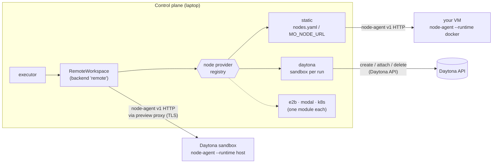
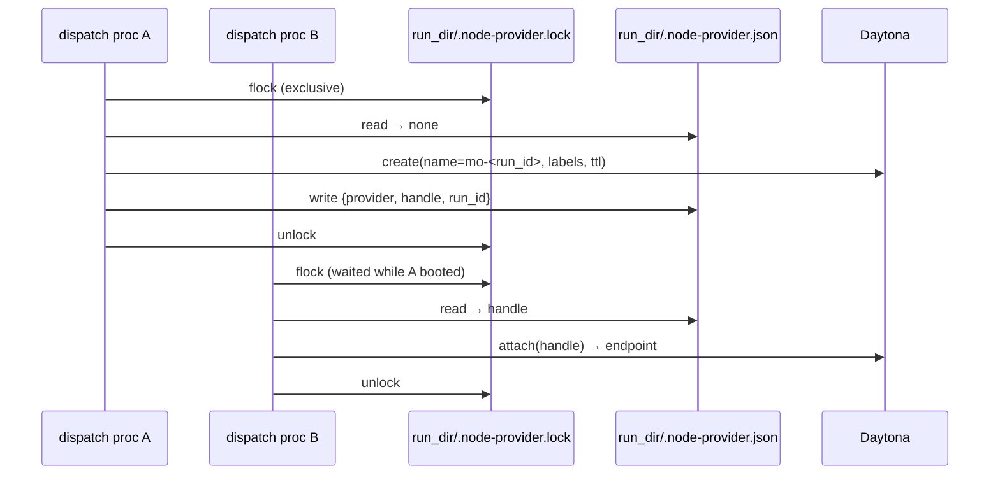
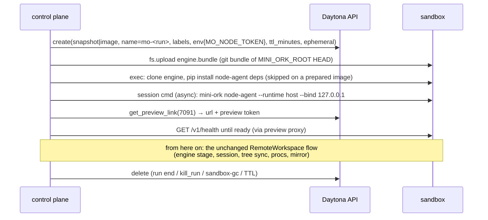

# Cloud sandbox providers — spawning agents on Daytona (and the next cloud)

> Status: accepted (2026-10-13). Extends [`remote-nodes.md`](remote-nodes.md)
> and [`cloud-swarm.md`](cloud-swarm.md) (gap G5, "remote Workspace").
> Contract: `mini_ork/remote/providers/base.py`. First provider: Daytona.

## Goal

`mini-ork run code-fix <kickoff> --placement remote --env daytona` runs the
run's agent nodes in a fresh Daytona sandbox. Nothing is pre-provisioned and no
VM is left running. The diff lands in the local checkout exactly as it would
for a local run. A bare `mini-ork run code-fix <kickoff>` now adopts the
`daytona` profile when one is configured (see [Default
placement](#default-placement)); `--placement local` opts out for a single run.
A laptop or CI checkout with no cloud profile keeps running locally. Adding
E2B, Modal or a Kubernetes pod after that should take one module, without
editing the resolver, the session registry, the reaper or the kill path.

## What exists today (discovery, 2026-10-13)

Two axes are already built, and only one of them knows about the cloud.

| Axis | Selector | Backends | Where it runs |
|---|---|---|---|
| **Workspace backend**: isolate a process *on this host* | `MO_SANDBOX_BACKEND` + `MO_SANDBOX_SCOPE=tool\|agent` | `local`, `docker`, `microvm` (`mini_ork/runtime/backends/`) | the laptop, bind-mounting a shared drive at `/workspace` |
| **Remote placement**: run nodes *on another machine* | `--placement remote --env <profile>` (`MO_PLACEMENT`, `MO_NODE_ENV`); `<profile>` defaults to `MO_DEFAULT_NODE_ENV` (`daytona`) when configured | `remote` = `RemoteWorkspace` → a self-hosted `mini-ork node-agent` | any VM you run the node-agent on (`config/nodes.yaml`) |

The node-agent protocol already handles the hard parts of remote execution:
- git-snapshot tree sync up and down (`mini_ork/remote/tree_sync.py`)
- the run-dir mirror (`run_mirror.py`)
- detached procs that survive a dropped connection and reattach after a restart
- per-lane secret scoping (`secrets_scope.py`)
- engine pinning by git sha (`node_agent/engines.py`)
- setup steps that prepare the image

All of it is transport-agnostic git and file plumbing behind one HTTP API.

### Gaps that block "easy on the cloud"

1. **A node can only be a static URL.** `RemoteWorkspace._factory` resolves
   `MO_NODE_URL` or a `nodes.yaml` entry. Nothing can *create* a node on demand
   or destroy it at run end. So a cloud run means hand-booting a VM, installing
   the node-agent, and remembering to delete it afterwards.
2. **Backend names are hardcoded in six places:**
   - `agent_workspace.py`: two `if backend in ("microvm","docker","remote")` ladders
   - `workspace_session._extract_session_id`
   - `sandbox_reaper.reap_sandboxes`
   - `cli/sandbox_gc.py` (`choices=`)
   - `web/control.py` `kill_run` (a docker branch and a remote branch that rebuilds a `RemoteWorkspace` by hand)

   Every new backend edits all six.
3. **Garbage collection is local-only.** The reaper knows docker labels and
   microVM names. A cloud sandbox leaked by a crashed run would bill until
   someone noticed.

## Design: two axes, one protocol

The split is the one Kubernetes draws. The **kubelet** speaks one protocol on
every node; the **node pool / autoscaler** decides where nodes come from. In
mini-ork the node-agent is the kubelet. A **node provider** is the node pool.



- **Workspace backends** stay what they are: same-host isolation. A
  lazy catalog in `mini_ork/runtime/sandbox.py` lets a backend module be
  selected by name without the resolver naming it (epic A).
- **Node providers** are new: `mini_ork/remote/providers/`. A provider has four
  verbs: `create`, `attach`, `release` and `reap`. Every provider's node speaks
  the unchanged node-agent protocol, so sync, mirror, reattach and secret
  scoping are reused rather than reimplemented.

The provider is chosen by the environment profile:

```yaml
# config/environments/daytona.yaml
provider: daytona            # static (default) | daytona | <plugin>
```

`MO_NODE_PROVIDER` overrides it per invocation. With neither set, the provider
is `static`, which is byte-for-byte today's behavior.

### Default placement

A bare `mini-ork run` adopts a cloud profile when one is configured, so a run
on the operator's laptop lands in a Daytona sandbox without repeating
`--placement remote --env daytona` every time. Resolution follows five rules:

1. An explicit `--placement` / `MO_PLACEMENT` (including `--placement local`)
   and an explicit `--env` / `MO_NODE_ENV` always win — their behavior is
   unchanged.
2. When the run named neither, it adopts `MO_DEFAULT_NODE_ENV` (default
   `daytona`) **iff** a profile file for that name exists in the visible config
   dirs. Adoption is exactly equivalent to passing `--placement remote --env
   <name>`: the same validation, `MO_PLACEMENT` / `MO_NODE_ENV` /
   `MO_REMOTE_SESSION_SCOPE=lifecycle` publishing, node acquisition and
   run-end release all run unchanged.
3. No such profile → nothing is published → the run stays local, exactly as
   today. The committed repo ships only `*.yaml.example` files, which do not
   count as profiles, so a fresh clone and CI stay local automatically.
4. `MO_DEFAULT_NODE_ENV` set to an empty value or one of
   `0|false|no|off|none|local` (case-insensitive) disables the default
   entirely. `--placement local` remains the per-run opt-out.
5. Inside a remote node (`MO_REMOTE_NODE=1`) the default is skipped: a
   sandboxed run must never create a sandbox inside itself.

An existing but invalid default profile fails the run **closed**: it exits 2
with a message naming `MO_DEFAULT_NODE_ENV` and the profile instead of silently
falling back to a host run. A missing provider credential is still reported by
the provider's `ProviderUnavailableError` at node acquisition. Setting
`MO_DEFAULT_NODE_ENV=e2b` selects a different provider profile when
`config/environments/e2b.yaml` exists.

### The provider contract

```python
class NodeProvider(Protocol):
    name: str
    def create(self, *, run_id, profile, env, engine_root) -> NodeEndpoint: ...
    def attach(self, handle, *, env) -> NodeEndpoint | None: ...   # never creates
    def release(self, handle, *, env) -> None: ...                 # idempotent
    def reap(self, *, max_age_s, dry_run, env) -> list[str]: ...   # TTL sweep, fail-open
```

A `NodeEndpoint` carries `url` plus two secrets, both excluded from `repr` and
from the on-disk locator:
- `token`: the node-agent bearer.
- `headers`: provider-level auth such as Daytona's `x-daytona-preview-token`.

`RemoteWorkspace._request` is the single HTTP call site. It adds the headers to
every request, including streams.

### One node per run, across processes

Every dispatch and check of a run is its own OS process with its own
`RemoteWorkspace`. Today they converge because a static node keys sessions by
`run_id`. A naive provider would create **one sandbox per process**.
`acquire_run_node` prevents this:



- **Recorded node gone** (TTL-expired or deleted): a fresh node replaces it,
  and the record notes `replaced`.
- **Teardown** (`kill_run`, run-end release) uses `attach_run_node` and
  `release_run_node`, never `acquire`. Tearing down can therefore never create
  a sandbox.
- **Second line of defense:** the provider names the sandbox `mo-<run_id>`, so
  a lost record still finds the same sandbox.

## The Daytona provider

### Lifecycle



### Decisions

**DT1: the node-agent runs `--runtime host` inside the sandbox.** The sandbox
is the isolation boundary. Nesting docker inside it would buy nothing and costs
a daemon. The host runtime already maps `/workspace/*` and `/opt/mini-ork`
onto its state dir (remote-nodes-15 §3).

**DT2: loopback bind, provider TLS.** The node-agent keeps its safe default
`--bind 127.0.0.1`. Daytona's preview proxy reaches loopback-bound ports
(probe below). No relaxation of `validate_bind` is needed.

**DT3: three auth layers, none of them on local disk.**

| Layer | Secret | Lives |
|---|---|---|
| Daytona API | `DAYTONA_API_KEY` | control plane only, resolved through the vault chain |
| Preview proxy | per-sandbox preview token | returned by `get_preview_link`; held in memory, sent as `x-daytona-preview-token` |
| node-agent | random 32-byte bearer, minted per sandbox | the sandbox's env (set at create), re-read through the Daytona API by `attach`; never written to the run dir or a marker |

The sandboxed agent never sees `DAYTONA_API_KEY`. Remote spawns already drop
`MO_NODE_TOKEN*` from the child env (`isolated_env`).

**DT4: GC in two layers.**
- **Server-side:** `ttl_minutes` (default 360 = `MO_SANDBOX_MAX_AGE`), counted
  as wall-clock time from creation, destroys the sandbox even if the control
  plane is gone. `ephemeral=True` deletes a sandbox as soon as it stops.
- **Client-side:** labels `mo.sandbox=1`, `mo.provider=daytona`, `mo.run=<id>`
  and `mo.created=<epoch>` let `mini-ork sandbox-gc --backend daytona` sweep by
  age.
- **Idle stop:** `auto_stop_interval` defaults to **0 (off)**. Idle-stop fires
  on "no sandbox event", and a long, quiet agent turn must not be stopped
  mid-run. The TTL is the cap instead.

**DT5: profile mapping.** The existing environment profile maps onto Daytona
parameters. No new vocabulary is needed:

| Profile field | Daytona |
|---|---|
| `image` | `CreateSandboxFromImageParams(image=…)` (Daytona builds and caches it) |
| `daytona.snapshot` | `CreateSandboxFromSnapshotParams(snapshot=…)`, the fast path (prebuilt toolchain) |
| `resources: {cpus, memory, disk}` | `Resources(cpu, memory GiB, disk GiB)` (image path only; snapshots carry their own) |
| `network: allowlist` + `allow_domains` | `domain_allow_list` (comma-joined) |
| `env` | sandbox `env_vars` (non-secret, already validated by `environments.py`) |
| `setup` | run once after boot, before the node-agent starts |

The default (no image, no snapshot) is Daytona's default snapshot plus a
bootstrap: `pip install fastapi uvicorn pyyaml jsonschema`. That works after
copying the example profile, at the cost of a slower first boot. A prepared
snapshot (agent CLIs and Python deps baked in) is the production path.

**DT6: the SDK is optional and loudly so.** `daytona` is an extra
(`pip install mini-ork[daytona]`). It is imported inside the provider's
methods, so `static` users never load it. A missing SDK, a missing key, or an
SDK/API model skew (observed: SDK 0.224 rejecting `kvm: null` from one org's
endpoint) raises `ProviderUnavailableError`, which the run reports as
`failure_class=remote_unavailable`.

### Two tiers (CLAUDE.md "feature delivery")

| | Simple tier: a laptop, five minutes | Secure tier: shared or cloud use |
|---|---|---|
| API key | `DAYTONA_API_KEY` in env or `$MINI_ORK_HOME/config/secrets.local.sh` (0600) | the same name served by sops / `pass` / `op` / infisical / OpenBao via `config/vault.yaml` |
| Image | Daytona default snapshot + bootstrap | a prepared snapshot with pinned CLIs (`daytona.snapshot`) |
| Network | full egress | `network: allowlist` → `domain_allow_list` |
| Lifetime | TTL 6 h, ephemeral | the same, plus `sandbox-gc` on a schedule |
| Config | copy `config/environments/daytona.yaml.example` | the same file, with one field changed |

Both tiers fail closed. A missing key is an error that names the key and where
to put it, never an empty string sent to the API.

## Delivery

| Epic | Scope | Path |
|---|---|---|
| **contract** | `mini_ork/remote/providers/base.py`, this doc | direct (new surface only, 26 unit tests) |
| **A**: backend catalog | lazy workspace-backend catalog in `sandbox.py`. Drives the resolver's `agent_workspace.py`, `workspace_session.py`, `sandbox_reaper.py`, `sandbox_gc.py` and `control.kill_run` from the registry instead of name ladders. Default path byte-identical. | framework-edit |
| **B**: provider seam | `RemoteWorkspace` resolves its node through a provider (lazy in `up()`, attach-only in teardown), `_request` sends `NodeEndpoint.headers`, `static` provider = today's `select_node`, profile `provider:` field + schema, run-end and `kill_run` call `release_run_node`, `sandbox-gc` sweeps providers | framework-edit |
| **C**: Daytona provider | `mini_ork/remote/providers/daytona.py`, the `daytona` extra, an example profile, a live e2e smoke | direct (needs live credentials) |

All four shipped on 2026-10-13: contract `bfa9bf7f`, C `8ac86ae9`, A2
`f0f9346f`, A1 `cc01439a`, B `b485f1d0`.

### What the live end-to-end run found

Remote placement had only ever run end to end against docker-runtime nodes. A
Daytona node runs the node-agent on the **host** runtime, and a real
`code-fix` run surfaced eight engine gaps. Each is fixed at the source with a
test:

| Gap | Fix |
|---|---|
| Run roots were pinned only at the implementer, so every remote planner was refused (no path map) | roots pinned right after the profile (`d774d0b6`) |
| Profile `setup` was sent to docker image preparation: HTTP 500 on a host-runtime node | `NodeEndpoint.setup_applied`; the provider runs setup at boot (`cbc5d8fe`) |
| The host runtime mapped canonical → real paths only on the way in, so agents reported `/home/…/runs/<id>/target/…` | output mapped real → canonical (`f6d8f42f`) |
| An anthropic-native lane was spawned without a portable credential, misattributed to the requesting alias, and fused a healthy lane shut | refused before the spawn, as a `config` error |
| Remote checks forwarded the control plane's whole env: your `PATH`/`HOME`, plus every LLM key (breaks D6) | only the caller's delta crosses, and no secret at all |
| A recover of a remote run re-provisioned a node and never released it | recover releases at its end (`bb66260f`) |
| The provider's `pip --user` bootstrap shadowed the system site and broke pytest | node-agent deps go into a system-site venv (`a602d58e`) |
| The live sidecar split stream-json lines, and the replay never mapped sandbox paths, so a verified run abstained from publishing | `_LineTee` + `PathMap.to_host` (`88a3f99e`) |

## Providers

| Provider | Module | Status (2026-10-13) |
|---|---|---|
| `static` | `providers/static.py` | today's `nodes.yaml` / `MO_NODE_URL` behaviour |
| `daytona` | `providers/daytona.py` | full `code-fix` run verified live; smoke 7/7 |
| `e2b` | `providers/e2b.py` | full `code-fix` run verified live; smoke 7/7; doctor 10/10 |
| `modal` | `providers/modal_sandbox.py` | offline-verified (11 fake-SDK tests); live pending a Modal token |
| Vercel Sandbox | — | researched (`vercel-sandbox` 0.9 sync SDK: `create_sandbox(ports=…)`, `run_process`, `routes`). Not built: routes are public URLs (only the node-agent bearer would guard them) and it is unknown whether they reach a loopback-bound port; needs `VERCEL_TOKEN`/`TEAM_ID`/`PROJECT_ID` to probe |
| Kubernetes Agent Sandbox | — | researched (kubernetes-sigs `Sandbox` CRD, `k8s-agent-sandbox` 1.0). Design: reach the node-agent through the sandbox-router (Gateway, or `kubectl port-forward` locally) with `X-Sandbox-ID` / `X-Sandbox-Namespace` / `X-Sandbox-Port: 7091` as `NodeEndpoint.headers`; a `SandboxTemplate` image carrying git, Python and the agent CLI. Needs a cluster to verify |

Shortlist source: the five platforms most teams shortlist in 2026 (E2B,
Daytona, Modal, Cloudflare Sandbox SDK, Vercel Sandbox), plus Kubernetes
Agent Sandbox for self-hosted clusters. Cloudflare's Sandbox SDK runs behind a
deployed Worker and its disk resets after 10 idle minutes, which makes it a
poor host for a run-long node-agent.

Every sandbox cloud shares `providers/sandbox_node.py` (`SandboxNodeProvider`).
A new cloud is a `SandboxHandle` adapter (upload, run, start_background,
endpoint + auth headers, delete) plus four hooks. Use
`scripts/smoke_sandbox_node.py --provider <name>` as its live acceptance test.

## Live probe (2026-10-13, SDK 0.224.0, app.daytona.io)

| Check | Result |
|---|---|
| create (default snapshot `daytonaio/sandbox:0.8.0`) | 1.1 s; Python 3.14, git 2.53, Node 25, x86_64, 1 CPU / 1 GiB / 3 GiB |
| egress | api.anthropic.com, api.openai.com, pypi.org, github.com reachable |
| preview proxy → port bound to **127.0.0.1** | 200; `Authorization` passes through |
| chunked streaming through the proxy | first byte 0.09 s, lines arrive live |
| preview proxy → port bound to 0.0.0.0 (second server, same session) | 502. Loopback is the supported shape |
| `fastapi`/`uvicorn` preinstalled | no, so they need a bootstrap or a prepared snapshot |
| delete | 0.3 s |

## Non-goals (v1)

- A provider-native workspace that skips the node-agent (direct SDK
  `process.exec`). It would duplicate sync, reattach and mirror per cloud.
- Daytona volumes as the shared drive (cloud-swarm S3). The run volume stays on
  the node.
- Warm pools and pre-provisioning across runs. Each run gets its own sandbox.
