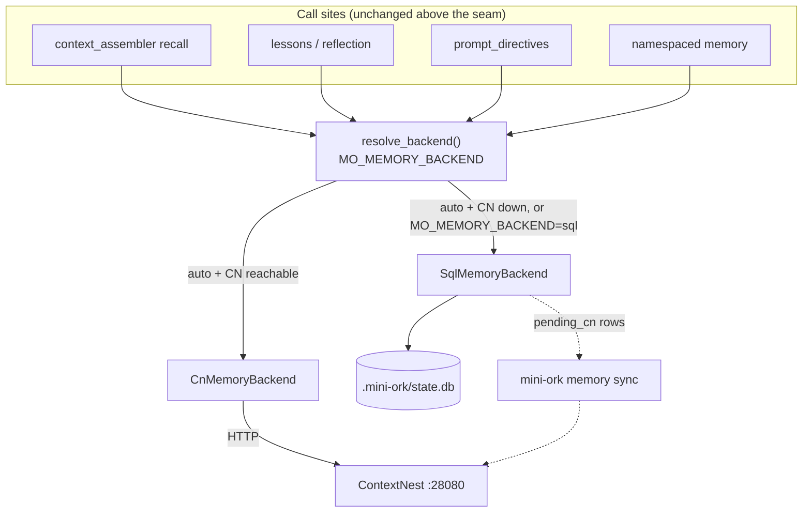

# Memory backend seam — ContextNest primary, SQLite for every install

> Status: proposed (2026-11-25). Trigger: a directive that memory needing
> learning, recall and self-improvement lives in ContextNest, **with a SQLite
> fallback because most installs will not have ContextNest running.** Kickoff:
> `kickoffs/cn-memory-migration.md`.

## 1. The problem this fixes

mini-ork already *reads* ContextNest. What it does not do is *store* there.

| Path | Today |
|---|---|
| recall | CN `capsule` + `retrieve` (`mini_ork/context_assembler.py:1461,1475`; role packs) |
| outcome feedback | CN `POST /api/v1/agent/outcome` (`cn_client.py:727,779`) |
| trace/gradient relations | CN `graph/upsert` (`learning/writeback.py:477-492`) |
| **learned facts** | SQLite `semantic_memory` — 1,203 rows |
| **utility ledger** | SQLite `semantic_memory_uses` — 17,514 rows |
| **lessons** | SQLite `lesson_themes` / `lesson_injections` — 155 / 38,699 |
| **gradients** | SQLite `gradient_records` / `gradient_theme` — 19,065 / 19,635 |
| **patterns** | SQLite `pattern_records` / `emergent_patterns` — 86 / 86 |
| **namespaced memory** | SQLite `task_`, `workflow_`, `agent_performance_`, `failure_`, `recovery_`, `user_preference_`, `artifact_`, `benchmark_memory` |

So a run consults CN for transcript context and SQLite for everything the system
actually learned. Two stores, one of which the vendor ships and the other of
which every user has.

## 2. What the seam is

One protocol, two implementations, selected once per run.

```
MemoryBackend
  recall(scope, query, k)            -> list[Hit]        # facts, lessons, patterns
  record_use(hit_ids, outcome)       -> None             # utility / confidence
  upsert(kind, key, text, meta)      -> str              # facts, lessons, patterns
  list_kind(kind, scope, limit)      -> list[Record]
  retire(ids, reason)                -> None
  namespaced_get/set(table, key)     -> mapping
```

- `CnMemoryBackend` — HTTP to a local or remote ContextNest.
- `SqlMemoryBackend` — the current `.mini-ork/state.db` code path, unchanged in behaviour.
- Selection: `MO_MEMORY_BACKEND=auto|cn|sql` (default `auto`).
  `auto` = CN when `cn_client.available()` is true, else SQL.

Registration follows the existing registry idiom (see the "Python runtime
registries" section of `AGENTS.md`):
`mini_ork.memory.backends.register_backend(name, factory)`.



## 3. Why a seam and not a rewrite

The learned layer is read from roughly forty call sites across `learning/`,
`context_assembler.py`, `web/routes/learning.py` and the IDE pages. Editing
each one to speak HTTP is an unbounded blast radius and cannot be reviewed.

The call sites already funnel through four modules — `memory/semantic.py`,
`memory/store.py`, `stores/pattern_store.py`, `learning/prompt_directives.py`.
Putting the protocol underneath those four is the change; everything above them
keeps its current import and behaviour.

## 4. Mapping, table by table

| SQLite | CN surface | Gap |
|---|---|---|
| `semantic_memory` | `POST /api/v1/tools/store` with `metadata.kind=semantic_memory`, `stable_fragment_id` gives content-hash dedupe for free | listing by kind |
| `semantic_memory_uses` | `POST /api/v1/agent/outcome` (already used; ±0.05 per call, ±1.0 bound) | none — but the UCB exploration term has no CN equivalent and must stay computed by mini-ork from counts |
| `gradient_records`, `gradient_theme` | `graph/upsert` (already projected) + `tools/store` for the text | listing by task class |
| `pattern_records`, `emergent_patterns` | `tools/store` `kind=pattern` + graph edges for cluster membership | listing/approval state |
| `decision_basins` | `GET /api/v1/field/basins` (read exists) | write path |
| `lesson_themes`, `lesson_conflicts` | `tools/store` `kind=lesson` | listing, conflict scan |
| `lesson_injections` (38,699) | **stays local, by decision** | see below |
| namespaced tables | `tools/store` `kind=<table>` with `metadata.namespace` | listing by namespace |

`lesson_injections` is an audit log of "this lesson went into this prompt", not
memory: it is written once per prompt, read for attribution, and 38,699 rows
would become 38,699 HTTP writes. Keep it in SQLite and treat it as telemetry.
If a deployment wants it in CN later, it can be replayed from the local table.

### 4.1 ContextNest-side work this needs

These are ContextNest changes, not mini-ork ones, and that repo is PR-only:

1. **Filtered listing** — `GET /api/v1/memory/list?kind=&namespace=&since=&limit=`.
   `tools/retrieve` ranks by similarity and cannot answer "every active lesson
   for task class code-fix". Without this, `list_kind` has no implementation.
2. **Upsert by natural key** — `tools/store` dedupes on content hash
   (`stable_fragment_id(session, content, metadata)`), which is right for facts
   and wrong for a lesson whose outcome counters change. Needs an update-by-id
   that does not rewrite `content`, or mini-ork keeps counters in the payload
   and accepts a new fragment per state change.
3. **Delete/retire by id** — `tools/discard` exists; confirm it removes from the
   active set rather than only the session view.
4. **Bulk replay ingest** — one call for N records, so `mini-ork memory sync`
   after an offline period is not N round-trips.

## 5. Fallback — the part that must not lie

Most users will not run ContextNest. Two consequences:

1. **`SqlMemoryBackend` is a first-class tier, not a degraded stub.** It is the
   contract all behaviour is written against; CN must match it, not the reverse.
2. **Every run records which backend served its memory.** The run record gets
   `memory_backend: cn|sql` and, on fallback, `memory_fallback_reason`. The
   prompt section that carries recalled memory states it in one line, so a
   memory-poor run is visible rather than mistaken for a memory-less problem.

Writes made while CN is down are marked `pending_cn=1` in the SQLite row. When
CN returns, `mini-ork memory sync` replays them idempotently (content-hash
dedupe means a replay of an already-synced fact is a no-op) and clears the flag.
Nothing is dropped, and nothing pretends to have synced.

`MO_MEMORY_BACKEND=cn` is the strict mode for deployments that must never read
stale local memory: with CN down, recall refuses with a clear error naming the
daemon. It is opt-in precisely because it is the mode that breaks a laptop.

## 6. Contract tests

`tests/unit/test_memory_backend_contract_py.py` — one suite, parametrized over
`SqlMemoryBackend` and a fake `CnMemoryBackend` request recorder:

- upsert is idempotent under repeated identical writes;
- `recall` never returns a retired record;
- `record_use` moves a hit's utility off neutral after one success;
- a fallback write is marked `pending_cn` and survives a restart;
- `list_kind` returns newest-first and respects the namespace filter;
- with CN unreachable and `MO_MEMORY_BACKEND=cn`, recall raises rather than
  returning `[]`.

The last two are the ones that keep the honest-failure property from decaying.

## 7. Staging

| Stage | Change | Why this order |
|---|---|---|
| S1 | seam + `resolve_backend` + `semantic_memory` on CN | smallest store with a real read/write loop; proves the seam |
| S2 | lessons + gradients | the self-improvement loop; needs CN listing (4.1.1) |
| S3 | patterns + decision basins | depends on S2's listing |
| S4 | namespaced tables | mechanical once `list_kind` works |
| S5 | `mini-ork memory status` / `memory sync`, retire dead SQL-only paths | operator surface last, when there is something to operate |

## 8. Falsifiers

- **F1 — Quality.** On the same task set, recall served by CN scores worse than
  SQLite (same lessons injected, worse outcomes). Then the substrate's ranking
  is not equivalent and `auto` must default to SQL, not CN.
- **F2 — Latency.** Recall happens inside plan assembly; if the CN round-trip
  pushes plan p95 past its budget, the seam needs a read-through cache before
  the migration continues.
- **F3 — Fallback is the norm.** If most runs fall back, the CN tier is not a
  tier; the effort belongs in SQLite and the directive is wrong for this user base.
- **F4 — Replay divergence.** If `memory sync` cannot reconcile offline writes
  without duplicates or lost counters, the fallback is data-losing and must be
  replaced with a hard requirement.
