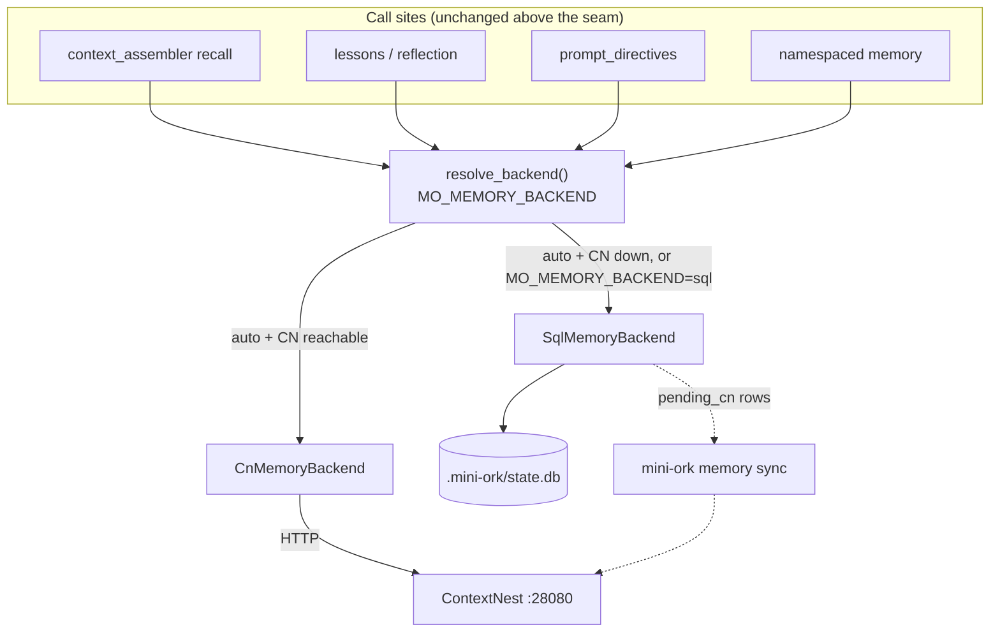

# Memory backend seam — ContextNest primary, SQLite for every install

> Status: proposed (2026-11-25). Trigger: a directive that memory needing
> learning, recall and self-improvement lives in ContextNest, **with a SQLite
> fallback because most installs will not have ContextNest running.** Kickoff:
> `kickoffs/cn-memory-migration.md`.

## 1. The problem this fixes

mini-ork already *reads* ContextNest. What it does not do is *store* there.

| Path | Today |
|---|---|
| recall | CN `capsule` + `retrieve` (`mini_ork/context_assembler.py:1461,1475`; role packs) |
| outcome feedback | CN `POST /api/v1/agent/outcome` (`cn_client.py:727,779`) |
| trace/gradient relations | CN `graph/upsert` (`learning/writeback.py:477-492`) |
| **learned facts** | SQLite `semantic_memory` — 1,203 rows |
| **utility ledger** | SQLite `semantic_memory_uses` — 17,514 rows |
| **lessons** | SQLite `lesson_themes` / `lesson_injections` — 155 / 38,699 |
| **gradients** | SQLite `gradient_records` / `gradient_theme` — 19,065 / 19,635 |
| **patterns** | SQLite `pattern_records` / `emergent_patterns` — 86 / 86 |
| **namespaced memory** | SQLite `task_`, `workflow_`, `agent_performance_`, `failure_`, `recovery_`, `user_preference_`, `artifact_`, `benchmark_memory` |

So a run consults CN for transcript context and SQLite for everything the system
actually learned. Two stores, one of which the vendor ships and the other of
which every user has.

## 2. What the seam is

One protocol, two implementations, selected once per run.

```
MemoryBackend
  recall(scope, query, k)            -> list[Hit]        # facts, lessons, patterns
  record_use(hit_ids, outcome)       -> None             # utility / confidence
  upsert(kind, key, text, meta)      -> str              # facts, lessons, patterns
  list_kind(kind, scope, limit)      -> list[Record]
  retire(ids, reason)                -> None
  namespaced_get/set(table, key)     -> mapping
```

- `CnMemoryBackend` — HTTP to a local or remote ContextNest.
- `SqlMemoryBackend` — the current `.mini-ork/state.db` code path, unchanged in behaviour.
- Selection: `MO_MEMORY_BACKEND=auto|cn|sql` (default `auto`).
  `auto` = CN when `cn_client.available()` is true, else SQL.

Registration follows the existing registry idiom (see the "Python runtime
registries" section of `AGENTS.md`):
`mini_ork.memory.backends.register_backend(name, factory)`.



## 3. Why a seam and not a rewrite

The learned layer is read from roughly forty call sites across `learning/`,
`context_assembler.py`, `web/routes/learning.py` and the IDE pages. Editing
each one to speak HTTP is an unbounded blast radius and cannot be reviewed.

The call sites already funnel through four modules — `memory/semantic.py`,
`memory/store.py`, `stores/pattern_store.py`, `learning/prompt_directives.py`.
Putting the protocol underneath those four is the change; everything above them
keeps its current import and behaviour.

**Except the readers that speak SQL.** Measured 2026-11-25: `web/routes/learning.py`
(three queries plus a count), `ide_pages/context.py:625` and
`ide_pages/learn/memory.py:289` select from `semantic_memory` /
`semantic_memory_uses` directly, bypassing all four modules. They are the
*display* surface — lesson tables, usage counts, the learn page — and they want
exactly what CN cannot answer yet: a filtered listing and aggregate counts
(§4.1.1). So they stay on SQLite until that endpoint exists, and a deployment
whose learned memory lives only in CN will render those pages empty. Say that
out loud rather than discovering it: the seam moves the *decision* path first,
the display path second.

## 4. Mapping, table by table

| SQLite | CN surface | Gap |
|---|---|---|
| `semantic_memory` | `POST /api/v1/tools/store` with `metadata.kind=semantic_memory`, `stable_fragment_id` gives content-hash dedupe for free | listing by kind |
| `semantic_memory_uses` | `POST /api/v1/agent/outcome` (already used; ±0.05 per call, ±1.0 bound) | none — but the UCB exploration term has no CN equivalent and must stay computed by mini-ork from counts |
| `gradient_records`, `gradient_theme` | `graph/upsert` (already projected) + `tools/store` for the text | listing by task class |
| `pattern_records`, `emergent_patterns` | `tools/store` `kind=pattern` + graph edges for cluster membership | listing/approval state |
| `decision_basins` | `GET /api/v1/field/basins` (read exists) | write path |
| `lesson_themes`, `lesson_conflicts` | `tools/store` `kind=lesson` | listing, conflict scan |
| `lesson_injections` (38,699) | **stays local, by decision** | see below |
| namespaced tables | `tools/store` `kind=<table>` with `metadata.namespace` | listing by namespace |

`lesson_injections` is an audit log of "this lesson went into this prompt", not
memory: it is written once per prompt, read for attribution, and 38,699 rows
would become 38,699 HTTP writes. Keep it in SQLite and treat it as telemetry.
If a deployment wants it in CN later, it can be replayed from the local table.

### 4.1 ContextNest-side work this needs

These are ContextNest changes, not mini-ork ones, and that repo is PR-only:

1. **Filtered listing** — `GET /api/v1/memory/list?kind=&namespace=&since=&limit=`.
   `tools/retrieve` ranks by similarity and cannot answer "every active lesson
   for task class code-fix". Without this, `list_kind` has no implementation.
2. **Upsert by natural key** — `tools/store` dedupes on content hash
   (`stable_fragment_id(session, content, metadata)`), which is right for facts
   and wrong for a lesson whose outcome counters change. Needs an update-by-id
   that does not rewrite `content`, or mini-ork keeps counters in the payload
   and accepts a new fragment per state change.
3. **Delete/retire by id** — `tools/discard` exists; confirm it removes from the
   active set rather than only the session view.
4. **Bulk replay ingest** — one call for N records, so `mini-ork memory sync`
   after an offline period is not N round-trips.

### 4.2 Identity: a synced row cannot be found again

`memory sync` stores a pending row's text and receives an atom id back, and then
throws it away: `semantic_memory` has no column holding CN's id (checked
2026-11-25 — the only CN-related column is `pending_cn`). Consequences, in the
order they bite:

- A synced row cannot be retired in CN later — `tools/discard` takes atom ids.
- CN's per-atom utility cannot be written back to the row that earned it, so the
  `uses` / `wins` counters would stay SQLite-only even after a replay.
- A second `memory sync` run re-stores the same text and relies on content-hash
  dedupe to keep it as one atom; the local row and the atom remain unlinked.

So the replay is currently one-way, and lossless only for the *text*. Before the
live path can move, add either `semantic_memory.cn_atom_id TEXT` (nullable,
guarded ALTER like 0094) or a `semantic_memory_cn(local_id, atom_id)` mapping
table. The second is preferable: it keeps the SQLite schema free of another
backend's identifier, and a row can be re-synced without rewriting it.

## 5. Fallback — the part that must not lie

Most users will not run ContextNest. Two consequences:

1. **`SqlMemoryBackend` is a first-class tier, not a degraded stub.** It is the
   contract all behaviour is written against; CN must match it, not the reverse.
2. **Every run records which backend served its memory.** `<run_dir>/memory-backend.json`
   gets `memory_backend: cn|sql` and, on fallback, `memory_fallback_reason`. The
   prompt section that carries recalled memory states it in one line, so a
   memory-poor run is visible rather than mistaken for a memory-less problem.
   It is a sidecar file rather than a `task_runs` column because S1 may not
   migrate that table, and it is written on teardown — a run parked on an
   unanswered ask, or killed before its `finally`, records nothing.
   **It names the store the run actually read, not the one that was asked for:**
   until §9's flip, a declared `MO_MEMORY_BACKEND=cn` records
   `{"memory_backend": "sql", "memory_fallback_reason": "cn_not_wired"}`, because
   a `cn` label on a run that read SQLite is exactly the lie this section exists
   to prevent.

**A reachable daemon is not a working operation.** `available()` answers a
health probe in ~1 s; a `retrieve` embeds the query first. Measured on the
development box on 2026-11-25: `/api/v1/tools/retrieve` took **17.5 s** against
`cn_client`'s 8 s read budget, so a daemon that probes healthy failed every
recall. In `auto`, a failed CN *operation* therefore degrades to SQLite exactly
as an unreachable daemon does — never raises, never returns `[]` — and logs
which store served the answer. Strict `MO_MEMORY_BACKEND=cn` still raises: that
mode exists to refuse a local answer, not to paper over a slow one.

Writes made while CN is down are marked `pending_cn=1` in the SQLite row. When
CN returns, `mini-ork memory sync` replays them idempotently (content-hash
dedupe means a replay of an already-synced fact is a no-op) and clears the flag.
Nothing is dropped, and nothing pretends to have synced.

The queue only drains where CN exists. Today the mark is also set when CN is
*disabled* (`MO_DISABLE_CN=1`), so an install that will never run ContextNest
accumulates `pending_cn` rows with no drain target. That is harmless while the
live path is SQLite — the rows are correct locally — but it would become an
unbounded queue the moment someone syncs once by mistake. Two things are needed
before the flip: mark only when CN is expected (not merely absent), and have
`memory sync` report a permanent-pending state instead of implying progress.

`MO_MEMORY_BACKEND=cn` is the strict mode for deployments that must never read
stale local memory: with CN down, recall refuses with a clear error naming the
daemon. It is opt-in precisely because it is the mode that breaks a laptop.

## 6. Contract tests

`tests/unit/test_memory_backend_contract_py.py` — one suite, parametrized over
`SqlMemoryBackend` and a fake `CnMemoryBackend` request recorder:

- upsert is idempotent under repeated identical writes;
- `recall` never returns a retired record;
- `record_use` moves a hit's utility off neutral after one success;
- a fallback write is marked `pending_cn` and survives a restart;
- `list_kind` returns newest-first and respects the namespace filter;
- with CN unreachable and `MO_MEMORY_BACKEND=cn`, recall raises rather than
  returning `[]`.

The last two are the ones that keep the honest-failure property from decaying.

## 7. Staging

| Stage | Change | Why this order |
|---|---|---|
| S1 | seam + `resolve_backend` + the CN implementation of the semantic store — **done 2026-11-25** (`mini_ork/memory/backends.py`, `mini_ork/cli/memory.py`, migration 0094). The **live assembly path still reads SQLite**: `context_assembler` ranks lessons by a measured prior that CN cannot express yet (§4.1.1), so swapping the read path is S2's job, not S1's | smallest store with a real read/write loop; proves the seam |
| S2 | lessons + gradients | the self-improvement loop; needs CN listing (4.1.1) |
| S3 | patterns + decision basins | depends on S2's listing |
| S4 | namespaced tables | mechanical once `list_kind` works |
| S5 | `mini-ork memory status`, retire dead SQL-only paths | `memory sync` shipped early with S1 (thin enough to build against one store); `status` waits until there is more than one store to report on, and the deletions wait until S2–S4 have moved the reads |

## 8. Falsifiers

- **F1 — Quality.** On the same task set, recall served by CN scores worse than
  SQLite (same lessons injected, worse outcomes). Then the substrate's ranking
  is not equivalent and `auto` must default to SQL, not CN.
- **F2 — Latency — OBSERVED 2026-11-25.** A CN `retrieve` took 17.5 s against
  the 8 s read budget, so `auto` answered from SQLite on every call. The seam
  did its job (no silent empty, no failed run), but S2 must not move the
  lesson store until either the retrieve path is faster or a read-through
  cache exists.
- **F3 — Fallback is the norm.** If most runs fall back, the CN tier is not a
  tier; the effort belongs in SQLite and the directive is wrong for this user base.
- **F4 — Replay divergence.** If `memory sync` cannot reconcile offline writes
  without duplicates or lost counters, the fallback is data-losing and must be
  replaced with a hard requirement.

## 9. Known gap after S1: the seam has no production caller

Measured on the S1 merge (`9fa776ee`): `backends.resolve_backend()` is called
only by its own contract tests. `context_assembler` still calls
`semantic.rank_with_prior`, `semantic.upsert`, `semantic.record_retrievals` and
`semantic.lookup_key` directly, and `memory_backend_statement()` says as much in
its docstring — S1 leaves the live read path on SQLite, so the prompt reports
`sql` truthfully.

The reason is in §4.1: `semantic_lessons_md` does not free-text search. It gates
patterns by a measured prior (`strength_score` = observed frequency) and only
then reorders inside that gate by SimUtil-UCB utility. CN has no
metadata-filtered listing and no per-atom score the prior could read, so recall
from CN today would replace a measured prior with nearest-neighbour similarity —
a silent change to *which* lessons are eligible. That is a correctness
regression, not a latency one, and it is why the flip is S2.

Before the flip:

1. `GET /api/v1/memory/list` (`kind` / `namespace` / `since` / `limit`) and a
   readable per-atom utility (§4.1.1.1–2) on the CN side.
2. `CnMemoryBackend.list_kind` — which today raises `NotImplementedError`
   naming that section — becomes the gate's query.
3. `semantic_lessons_md` takes a backend from `resolve_backend()` and stops
   importing `semantic` for the read path. Its three remaining SQL calls map
   differently and must not be lumped together:
   - `record_outcome` → `record_use` (the `agent/outcome` call) — direct.
   - `record_retrievals` is a *pre-outcome* link: it says "this run saw these
     ids" before the run has finished. CN settles an outcome, it does not hold
     an open retrieval, so this needs either an S2-side notion of a pending
     settlement or a local-only ledger. Not a `record_use` call.
   - `lookup_key` is key → id, which is a metadata filter — it needs §4.1's
     listing/upsert-by-key, not `record_use`.
4. A parity test running the same corpus through both backends and asserting the
   same lesson ordering, so "recall still works" is measured rather than assumed.

Until then `MO_MEMORY_BACKEND=cn` still changes observable behaviour — the prompt
line says `cn`, and strict mode raises for every seam operation, not just recall
(each CN method calls `_require`) — but it cannot change *what a plan reads*,
because no plan-time call site goes through the seam yet. Every teardown writes
`memory-backend.json` so the before/after is measurable from run records alone.
