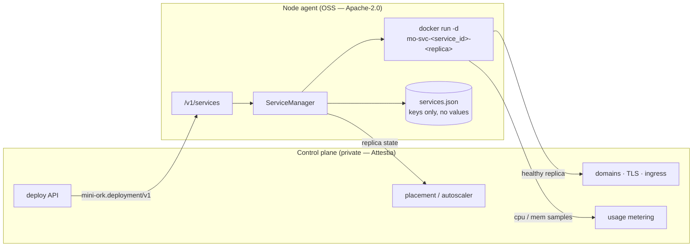
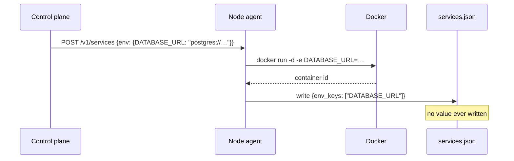
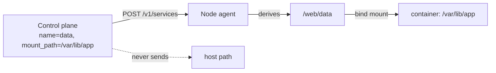
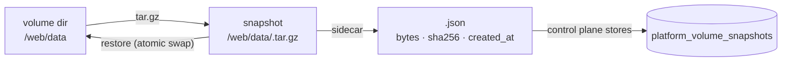
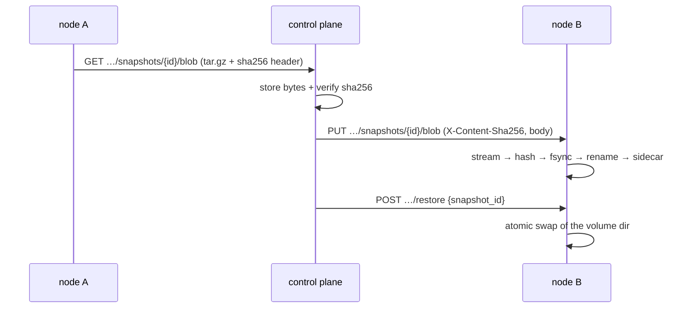
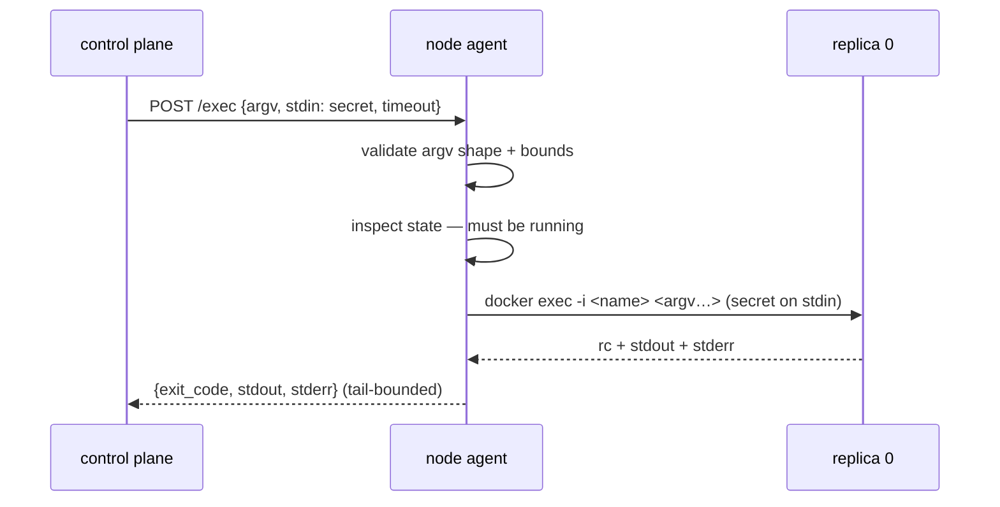
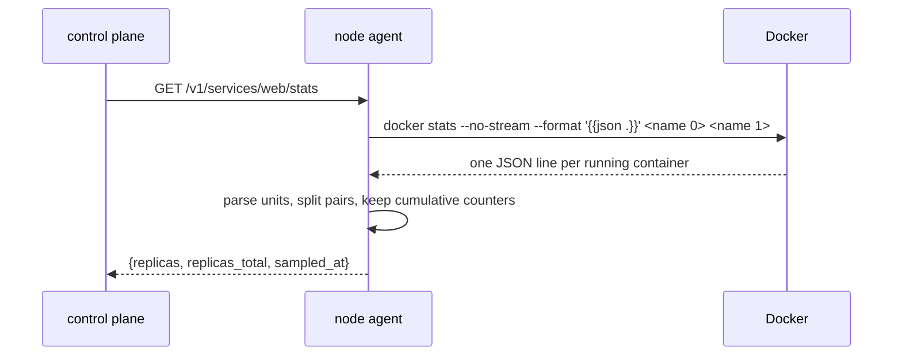
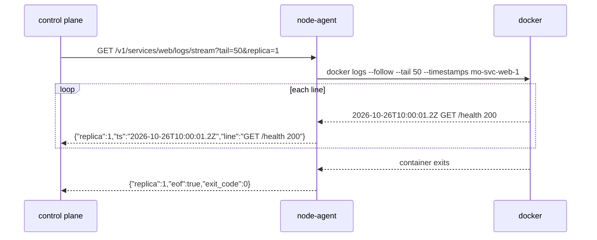

# Service runtime — long-lived containers on a node

> Status: proposed (2026-10-25). Extends [`remote-nodes.md`](remote-nodes.md)
> and [`cloud-sandbox-providers.md`](cloud-sandbox-providers.md).
> Contract: `schemas/deployment.schema.json` (`mini-ork.deployment/v1`).
> Implementation: `mini_ork/remote/node_agent/services.py`.

## Goal

A node-agent already runs **sessions** — one container per agent run, created
and destroyed around that run. It could not run a **service**: a container
that must stay up, publish a port, restart on failure, and outlive the request
that created it.

That missing primitive is the difference between "sandbox for an agent" and
"place to host an app". Every hosted platform (Railway, Fly, Render) is a
control plane over exactly this mechanism. This document defines the
mechanism and stops there: tenancy, DNS, TLS, autoscaling, and billing are
policy, and policy lives outside the OSS repo.



The arrow that matters: the control plane speaks a **versioned document** to
the node and receives replica state back. It never shells into the host, and
the node never learns what a tenant is.

## The contract

`schemas/deployment.schema.json` is the public half. A deployment document
carries `service_id`, `deployment_id`, `image`, `command`, `replicas`,
`ports`, `volumes`, `resources`, `restart_policy`, `healthcheck`, `env`,
`env_keys`, `network`, `user`, and `labels`. `status` is read-only and only
appears in responses.

Validation happens in the node, not in the control plane's type system, so a
self-hosted client written in any language gets the same guarantees. The
checks that matter:

| Rule | Why |
|---|---|
| `service_id` matches `^[a-z0-9][a-z0-9-]{0,62}$` | becomes part of `mo-svc-<id>-<n>`; argv is a list, so this is defence in depth |
| `replicas` ≤ 100 | one request cannot exhaust a shared node |
| `restart_policy` in a fixed set | no free-text policy reaches the daemon |
| ports 1..65535 | Docker rejects the rest with a worse error |
| port `protocol` ∈ {`tcp`, `udp`}; `bind` is an IP literal | rendered as `-p [bind:]host:container[/proto]`; a hostname would bind to whatever DNS resolves at spawn time |
| volume `name` matches `^[a-z0-9][a-z0-9_-]{0,62}$` | it becomes one directory below the node's volume root; no dots means no `..` |
| volume `mount_path` is absolute, no `:` or `..` | relative paths resolve against a per-image WORKDIR; `:` is Docker's `-v` separator |
| one volume per name and per mount path | the same path twice lets one mount shadow the other, silently |
| env names are shell identifiers | a hostile key cannot smuggle flags into `-e` |
| unknown `schema_version` → 400 | a contract change fails loudly, never silently |

A port entry is `{"container": 5432, "host": 20001}` and may add two optional
fields. `protocol: "udp"` publishes `20001:5432/udp` (`tcp` is Docker's
default and never rendered). `bind: "10.0.0.5"` publishes on that one host
interface — `10.0.0.5:20001:5432` — so the control plane can keep an edge-only
port off a node's public interface while another service on the same node is
deliberately public. IPv6 binds are bracketed (`[::1]:20001:5432`). Omitted
fields mean the historic behaviour: all interfaces, TCP. The node persists
only non-default fields, so a state file written before this contract decodes
unchanged.

The *policy* — which ports a tenant may make public, and whether a port is
reachable only through the edge proxy or also directly — belongs to the
control plane. The node executes the bind it is given and nothing more.

## The HTTP surface

Every route except `/v1/health` requires the node bearer token.

| Method | Path | Returns |
|---|---|---|
| `POST` | `/v1/services` | create (or replace) every replica; `200` with status |
| `GET` | `/v1/services` | `{"services": [...]}` |
| `GET` | `/v1/services/{sid}` | one service + per-replica `state` |
| `DELETE` | `/v1/services/{sid}` | `{"deleted": sid}` |
| `DELETE` | `/v1/networks/{name}` | `{"name", "removed"}`; `removed: false` when already gone, `409` while containers hold it |
| `POST` | `/v1/services/{sid}/restart` | status after `docker restart` |
| `GET` | `/v1/services/{sid}/logs?tail=N` | merged logs, `N` clamped to 1..5000 |
| `GET` | `/v1/services/{sid}/logs/stream?tail=N&replica=R` | live NDJSON tail, one frame per line, then an `eof` frame per replica |
| `GET` | `/v1/services/{sid}/stats` | one resource sample per **running** replica (CPU, memory, cumulative I/O, pids) |
| `POST` | `/v1/services/{sid}/exec` | run one command in replica 0; `{argv, stdin, timeout}` in, rc + bounded output out |

`POST /v1/services` is an upsert by default (`replace: true`). A redeploy of
the same `service_id` tears the old replicas down first, which is what a
deploy pipeline wants; passing `replace: false` turns a collision into a
`400` instead.

## Guarantees and failure semantics

1. **All-or-nothing create.** If replica *k* fails to start, replicas
   `0..k-1` are removed and nothing is written to state. A retry starts from
   a clean slate — a half-scaled service is never left billing.
2. **Deterministic names.** `mo-svc-<service_id>-<replica>` lets `delete`
   sweep containers whose ids were never captured (a crash mid-create), and
   makes `docker logs mo-svc-web-0` work for an operator.
3. **Restart does not need the caller.** Env values are used once, at
   `docker run`. `restart` calls `docker restart <name>`, which reuses the
   container's baked environment.
4. **State survives the process.** `services.json` is written atomically
   (`tmp` + `os.replace`), so a node-agent restart re-adopts its services and
   can still report and delete them.
5. **Env values are never persisted.** See below.
6. **No reaper by default.** Services are meant to outlive their creator; the
   control plane owns their lifecycle. The `mo.sandbox=1` label keeps them
   visible to a fleet sweep if a control plane disappears.

## Why values never reach disk

`procs.py` already established the rule for detached child processes (D6):
persist `env_keys`, pass values only in memory. `services.py` follows it.



A leaked `services.json`, a support bundle, or a backup therefore contains
names, not credentials. The trade-off is that an env change requires a
redeploy rather than a restart — which is the desirable behaviour anyway,
because secrets should roll with a deployment, not drift underneath one.

## Volumes — the node owns the host side

A service that keeps state needs a directory that survives a redeploy. The
contract carries only half of that: a `name` (an identity) and a `mount_path`
(where it appears *inside* the container). The node derives the host side
itself:

```
<volume_root>/<service_id>/<name>   →   <mount_path>   (:rw)
```



A host path in the request would be one field away from mounting `/etc`, a
node's Docker socket, or another tenant's directory into a container — and no
amount of path cleaning makes a *shared* node safe against a control plane that
can name any directory. So the field does not exist. `name` cannot contain `/`
or `.`, which is what makes the join above unable to escape `volume_root`.

Two tiers, one env var:

| Tier | Root | Use |
|---|---|---|
| Simple | `<state_dir>/volumes` | a laptop, a single test VM — works after copying an example config |
| Secure | `MO_NODE_VOLUME_ROOT` (absolute path) | a node whose volumes live on a backed-up, encrypted disk |

A *relative* `MO_NODE_VOLUME_ROOT` refuses to start the node-agent. Falling
back would put tenant data where the operator did not choose, and the tenant
would only discover it on a redeploy that came up empty — the exact silent
failure the volume exists to prevent.

Lifecycle rules:

- Directories are created `0700` before `docker run`, so a permission failure
  is attributable to the node instead of looking like an application bug.
  Existing directories are left untouched — an operator may have mounted a disk
  or set a policy there.
- `DELETE /v1/services/{sid}` removes containers and **keeps the volume data**.
  Retention is a platform policy (and a line item); deleting a service is not a
  data-deletion request.
- Renaming a volume starts a new empty one. The name *is* the identity.
- A redeploy reuses the same directories, which is the entire point.

## Snapshots — copying a volume

The node can copy a volume and put it back:

```
POST   /v1/services/{sid}/volumes/{name}/snapshots   {"quiesce": true}
GET    /v1/services/{sid}/volumes/{name}/snapshots
DELETE /v1/services/{sid}/volumes/{name}/snapshots/{snap}
GET    /v1/services/{sid}/volumes/{name}/snapshots/{snap}/blob
PUT    /v1/services/{sid}/volumes/{name}/snapshots/{snap}/blob
POST   /v1/services/{sid}/volumes/{name}/restore   {"snapshot_id": "<32 hex>"}
```

A snapshot is a `tar.gz` of the volume's contents plus a JSON sidecar carrying
the byte count and sha256. The node mints the id (`uuid4().hex`) and derives the
path from identity, never from the request:

```
<snapshot_root>/<service_id>/<name>/<snapshot_id>.tar.gz
<snapshot_root>/<service_id>/<name>/<snapshot_id>.json
```



The snapshot root follows the same two-tier rule as the volume root:

| Tier | Root | Use |
|---|---|---|
| Simple | `<state_dir>/volume-snapshots` | a laptop — a copy beside the volume |
| Secure | `MO_NODE_SNAPSHOT_ROOT` (absolute path) | a disk backed up independently of the volume disk |

A relative `MO_NODE_SNAPSHOT_ROOT` refuses to start the node-agent, for the same
reason a relative volume root does.

Rules the node enforces, each because the alternative loses data quietly:

- **An empty volume is a real snapshot.** "The volume was empty when I copied
  it" is a fact worth keeping. Only a volume that was never materialized on this
  node (no directory) is refused — that returns 404, because an empty archive
  would restore to nothing and look like a successful backup.
- **A snapshot of a running volume is crash-consistent by default.** The bytes
  are read while writers may be mid-transaction. That is right for a file or
  asset volume and wrong for an engine's data directory, so the request can ask
  for more: `{"quiesce": true}` stops every replica Docker reports as holding
  the mount (grace period 10 s), takes the copy, and starts them again. The
  sidecar records `quiesced`, plus `quiesce_stopped` and, if a replica would
  not come back, `quiesce_restart_failed`. The *policy* — when consistency is
  worth the downtime — is the control plane's; the node offers the mechanism.
- **Quiesce fails closed.** If a container will not stop, the replicas already
  stopped are restarted and the request is refused (400) with no archive: a
  crash-consistent copy labelled consistent is worse than no copy. If the copy
  succeeds but a replica will not start, the request errors (500) with the
  snapshot id in the message and the sidecar stays — the backup is real, and
  the service being down must not be reported as success.
- **Quiesce refuses a service this node does not define** (400). A volume whose
  owner was deleted, or that this node never created, has nothing here to stop;
  recording it as quiesced would be a claim the node cannot support.
- **Restore is refused while any container holds the volume** (409). Only
  `missing`, `exited`, and `dead` are safe; an unreadable Docker state counts as
  holding. Replacing the directory under a live process is corruption, not
  recovery.
- **Restore swaps atomically.** Contents are extracted into a sibling staging
  directory, the old directory is moved aside, the staged one is renamed into
  place, and the old copy is only deleted after the swap succeeds. A failed
  extraction leaves the volume exactly as it was.
- **Restore accepts only the minted id shape.** The id is a path component, so
  anything that is not 32 lowercase hex characters is refused before it can name
  a file; archive members are extracted with the interpreter's `data` filter
  (or an explicit regular-file/regular-directory allow-list on older runtimes).
- **The sidecar is written after the archive is durable.** A crash between the
  two leaves an archive that listing ignores and restore refuses — an invisible
  snapshot, never a listed one that cannot be restored.
- **Deleting a service keeps its snapshots.** Like the volume data, retention is
  the platform's decision; the node only deletes when asked.

### Shipping a snapshot off-node

The node can hand the bytes of a snapshot it took to the control plane, and
accept bytes the control plane shipped back under an id it names. That is what
turns a node-local rollback copy into a disaster-recovery copy: the archive can
leave the machine before the machine does, and a restored node — or a different
one — can take it back.



`GET …/blob` repeats the sidecar's `sha256` and byte count in
`X-Content-Sha256` / `X-Content-Bytes` headers, so the shipper verifies the body
it received without a second metadata call that a delete could race. It 404s on
an unknown id and on an archive whose sidecar is missing — that pair is what a
crash between the two writes leaves, and those bytes are not restorable.

`PUT …/blob` is an import, and it is strict on purpose:

- **The digest header is required**, 64 lowercase hex characters. A body
  admitted without one is an archive nothing verified, which would later restore
  as tenant data.
- **Bytes are hashed while streaming** to a temporary file, fsynced, and renamed
  into place only when the digest matches. A mismatch or a dropped connection
  leaves no archive, no sidecar, and no temporary file; the snapshot id stays
  free.
- **Imports are idempotent by content.** Re-delivering the same sha256 returns
  the existing record with `imported: false` — the retry after a dropped
  response is safe. Different bytes for a taken id are `409`: a retry must never
  be able to replace a backup quietly.
- **The body is bounded** by `MO_NODE_SNAPSHOT_MAX_BYTES` (default 16 GiB),
  resolved at startup. A declared `Content-Length` over the cap is refused with
  `413` before a byte is read, and the stream is counted anyway because a
  chunked body can lie about its length. A malformed value refuses to start the
  node, matching the roots.

The node still does not decide *where* off-node bytes live, *how many* copies to
keep, or *when* they expire. It moves bytes and proves their integrity; those
three questions are retention policy and stay in the control plane.

## Exec — one command inside a live replica

Some maintenance cannot be expressed as a new deployment: rotating a managed
database's password must run *inside* the running engine, against its own
`psql`/`redis-cli`, without restarting it or baking a secret into an image. The
node exposes exactly that, and nothing broader:

```http
POST /v1/services/{sid}/exec
{"argv": ["sh", "-c", "IFS= read -r new; …"], "stdin": "<new secret>\n", "timeout": 30}
→ {"service_id": "db", "replica": 0, "exit_code": 0, "stdout": "ALTER ROLE", "stderr": ""}
```



Why the shape is what it is:

- **The secret travels on stdin.** `ps` on the node shows every `docker exec`
  argument, and anything in argv is readable by anyone with a shell on the host
  for as long as the command runs. A password belongs on stdin, which the node
  passes through and never records.
- **The node logs neither argv nor stdin.** It has no logger in this path; the
  control plane's audit records the service, the exit code, and the fact that a
  command ran. That is enough to answer "did something run" and not enough to
  leak what it carried. The same rule as env values: mechanism sees the value,
  state never does.
- **Replica 0 only.** A managed engine runs one replica; fanning out would
  produce answers the caller has no per-replica use for, and make a partial
  failure the normal case.
- **A stopped replica is refused, not started.** Exec is maintenance on a live
  service, not a way to wake one. `400` names the container and its state.
- **Bounds are enforced before Docker runs.** `argv` is a non-empty list of at
  most 64 non-empty strings of at most 4096 bytes each; `stdin` at most 1 MiB;
  `timeout` an integer 1..300. Every refusal happens with zero processes
  spawned, so a malformed request cannot reach a container.
- **A non-zero exit is data, not a transport failure.** The command ran and
  failed; the caller gets `200` with `exit_code` and the tail of stderr, which
  is what it needs to decide whether to retry, roll back, or stop.
- **Timeout is `504`.** A command that outlives its budget is killed by
  `subprocess.run(timeout=…)`; the node says so rather than hanging the request.
- **Output is tail-bounded** (1 MiB per stream, prefixed with `…` when cut). The
  end of an error is what explains the exit; a silent truncation would be worse
  than a stated one.
- **Unknown service is `404`.** An exec names a service the node created; it
  does not reach for a container by name.

The node does not decide *which* commands are allowed. The proprietary layer
picks the argv per engine template, generates the secret, and confirms the new
credential works before recording the rotation. The node runs what it is told
inside a replica the caller already owns — no shell on the host, no image pull,
no new container.

## Stats — one sample, as Docker measures it

A dashboard needs numbers. The node exposes one `docker stats --no-stream`
reading per **running** replica and interprets nothing beyond that:

```http
GET /v1/services/{sid}/stats
→ {
    "service_id": "web",
    "replicas_total": 2,
    "sampled_at": "2026-10-26T18:00:00.000000Z",
    "replicas": [
      {"replica": 0, "name": "mo-svc-web-0", "cpu_pct": 0.15, "mem_pct": 0.004,
       "mem_used_bytes": 67633152, "mem_limit_bytes": 8217346…,
       "net_rx_bytes": 1200, "net_tx_bytes": 3400000,
       "block_read_bytes": 1200000, "block_write_bytes": 3400000, "pids": 3}
    ]
  }
```



Why the shape is what it is:

- **I/O counters stay cumulative.** Docker reports them since container start.
  A rate needs two samples and an interval; the node cannot know the caller's
  polling period, so inventing a rate here would make the answer depend on when
  it happened to be asked. The control plane stores the counters and derives
  deltas from consecutive samples.
- **Units are parsed with their base.** Docker prints I/O in decimal
  (`kB` = 1000 B) and memory in binary (`MiB` = 1024 B). A parser that assumes
  one for both is off by 2.4% at KiB and 7.4% at GiB — plausible-looking and
  wrong. The unit is part of the wire format and is mapped explicitly.
- **An unread field is `null`, never `0`.** "Docker did not print this" and
  "this is zero" are different facts; once both are `0` no graph can tell them
  apart. Percentages and sizes that do not match the expected shape degrade to
  `null` rather than a fabricated number.
- **A stopped replica is absent, not zero.** `docker stats` only measures
  running containers. Reporting zeros would draw a flat line that reads as
  "idle" instead of "not running". `replicas_total` says how many were asked
  for, so the gap is visible.
- **A partial sample is a sample.** Docker exits non-zero when *any* named
  container is not running, but still prints the lines it could measure. The
  node returns those; it raises `500` only when the command failed **and**
  nothing was parseable (daemon down, for example).
- **Unknown service is `404`.** Same rule as every other route here.

The node keeps no history, sets no retention, and decides no sampling interval:
it answers "what is true right now" for one service. Storing, scoping,
aggregating and expiring those answers is the proprietary layer.

## Live tail — follow, one child per replica

`GET /v1/services/{sid}/logs` answers with the last `N` lines and closes. A
deployment platform also needs to *watch*: the moment a deploy starts failing,
an operator wants the next line, not a refresh button.



Wire shape — one JSON object per line, `application/x-ndjson`:

```
{"replica": 0, "ts": "2026-10-26T10:00:01.234567890Z", "line": "GET /health 200"}
{"replica": 0, "eof": true, "exit_code": 0}
```

- **`ts` is Docker's clock, not the node's.** `--timestamps` makes the line
  carry the instant the container wrote it, so a reader merging replicas can
  order by time instead of by arrival. Arrival order is *not* sorted: sorting
  would mean holding output until every replica had spoken, which is the
  opposite of a live view. A line Docker did not prefix keeps its text with
  `ts: null` — losing a log line is worse than not dating it.
- **One child per replica.** `docker logs -f` has no exit condition the node
  can bound, so it runs as a child the node owns. When the reader goes away
  the children are killed: a closed browser tab must not leave a Docker
  process per replica behind.
- **Disconnect is polled, not inferred from a write.** A quiet container
  produces no write that could fail, so the stream loop wakes every 200 ms and
  asks `request.is_disconnected()`. A blocking read would have pinned the
  request and its children until the next line arrived.
- **Validation and spawn happen before the response.** The service and replica
  are checked, and every Docker child is started, before the first byte is
  written. An unknown service is a plain `404`, a replica outside
  `0..replicas-1` and a `docker` that cannot spawn are normal JSON errors — a
  stream that starts and *then* reports the error has already told the client
  it succeeded. If replica 1 fails to spawn, replica 0 is killed before the
  error is returned.
- **A line is emitted when Docker writes its newline.** A partial line (a
  progress bar) waits for one or for exit, which is what `docker logs` shows
  too. A truly empty line is skipped; invalid UTF-8 becomes replacement
  characters rather than ending the tail.
- **Container stderr is part of the stream.** Docker merges it into the same
  output as stdout, so a line cannot be labelled "error" without guessing.
  What the reader *can* trust is the `eof` frame: a non-zero `exit_code` means
  the child did not end cleanly, whether the container crashed or Docker
  itself refused the request.
- **Backpressure is bounded.** The node queues at most a couple of thousand
  frames between the child and the reader and then stops reading, checking a
  close flag while it waits — a reader that stalls cannot make the node grow
  without bound. When the reader closes, the child is killed and the thread
  exits.

The node still decides no retention and no fan-out: it tails the replicas of
one service for one connected reader. Recording, searching, and sharing those
lines remain the control plane's job.

## What is deliberately absent

These are the proprietary layer's job, and every one of them is policy:

- Which tenant owns a service, and which node it lands on (placement).
- Public hostnames, TLS certificates, and HTTP routing to a replica port.
- Health-gated rollout, blue/green, and automatic rollback on `unhealthy`.
- Metrics scraping (`docker stats`) → usage events → invoices.
- The **overlay itself** — swarm membership, WireGuard, or a CNI. This module
  joins a network and creates it on demand; making that one network span hosts
  is infrastructure, and the driver choice below decides whether it does.
- Volume **quotas and retention**. Snapshots, restore, and moving the bytes
  (`…/blob`) are mechanism and live here; *when* to take a snapshot, *how many*
  copies to keep, *where* shipped bytes are stored, and *when* they expire are
  policy. `platform_volumes.size_mb` is recorded but not enforced by the node; a
  node that guessed at retention would be wrong for every tenant at once.
- Managed databases (a separate primitive built on volumes).
- Idle detection, scale-to-zero, and cron-scheduled services.

The node exposes what those need — replica state, logs, the port mapping, the
`mo.deployment` label — and nothing else. That keeps the trust surface small
and lets a self-hoster run the same primitive with a shell script.

## Private networks

Services reach each other by DNS name when they sit on the same Docker
network. A deployment document names that network and the aliases the
container answers to inside it:

```json
"network": "attestia-env-1f2a3b4c",
"network_aliases": ["db", "db-1f2a3b4c.internal"]
```

Rules:

- **The node creates the network if it is missing.** `docker network inspect`
  decides; a second deploy joins what the first created and never re-creates
  it. The caller never runs Docker commands.
- **Removal is explicit and idempotent.** `DELETE /v1/networks/{name}` inspects
  first and answers `removed: false` when the network is already gone — before
  the inspect *or* between the inspect and the `rm`, so two callers tearing
  down one environment cannot turn the loser into a `502`. The control plane
  can retry a teardown after a partial success. Docker refuses to
  remove a network with attached containers; that is `409`, not an outage — the
  caller removes services first and retries. Any other daemon refusal is `502`.
  The node never sweeps: it removes the name it was given and nothing else,
  because which networks belong to which environment is the control plane's
  ledger, and a node that guessed could take a peer's network down.
- **The driver is the node's choice, and a bad one fails closed.**
  `MO_NODE_NETWORK_DRIVER` is `bridge` by default (one host) or `overlay` on a
  Docker swarm (one name across the fleet). An unknown value, or a daemon that
  refuses to create the network, fails the deploy with a 500 — there is no
  fallback to the default bridge, because that would leave peers silently
  unable to resolve each other.
- **An alias without a network is refused.** Docker accepts
  `--network-alias` on the default bridge and ignores it; a caller that sent
  only aliases would believe it had published a name.
- **Aliases are DNS names, not paths.** `[a-z0-9.-]`, no empty label (`a..b`),
  no trailing dot, at most 253 characters, 32 per service. The short label is
  the name peers use (`db`); the FQDN is what the platform shows tenants.
- **Scoping is the platform's job.** The node enforces shape, not tenancy: two
  tenants that send the same network name land on the same network. The
  control plane derives the name from the environment, so a tenant cannot
  choose it.
- **Cross-node reachability is a fleet property.** Bridge networks stop at the
  host boundary; `overlay` crosses swarm nodes. The node reports the truth by
  failing the create when the driver cannot be honoured. A fleet that has not
  joined a swarm must keep one environment on one node — placement is the
  control plane's concern, not this module's.

## Self-host example

No control plane, no daemon, just the node-agent:

```bash
curl -sS "http://127.0.0.1:7091/v1/services" \
  -H "Authorization: Bearer $MO_NODE_TOKEN" \
  -H 'content-type: application/json' \
  -d '{
    "schema_version": "mini-ork.deployment/v1",
    "service_id": "web",
    "deployment_id": "deploy-1",
    "image": "nginx:1.27-alpine",
    "replicas": 1,
    "ports": [{"container": 80, "host": 8080}],
    "network": "attestia-env-1f2a3b4c",
    "network_aliases": ["web", "web-3f2a1b9c.internal"],
    "volumes": [{"name": "site", "mount_path": "/usr/share/nginx/html"}],
    "resources": {"cpus": 0.5, "memory": "256m"},
    "healthcheck": {"cmd": "wget -qO- localhost:80", "interval": "10s"}
  }' | jq '.replicas_state'
```

## Tests

`tests/unit/test_node_agent_services.py` drives the real FastAPI app through
`TestClient` with one fake Docker runner. It asserts the composed argv (not
just the response), the rollback path, the replace path, auth, and the
security property: `services.json` contains `DATABASE_URL` and does not
contain the value that was passed with it. For volumes it asserts the mount
target the node actually composed, that the directory exists `0700`, that
`delete` leaves the data, that the status response never leaks a host path,
that a relative `MO_NODE_VOLUME_ROOT` stops the app from starting, and that
the published schema rejects the same shapes the node does.

For `exec` it asserts the composed argv (`docker exec -i <replica> …`), that the
secret reached the runner on stdin and never appeared in argv, that neither
argv nor stdin landed in `services.json`, that every malformed shape is a `400`
with zero processes spawned, that a stopped replica is refused, that a
non-zero exit is `200` with the code, and that a timeout is `504`.

For `stats` it asserts the composed argv (`--no-stream` plus every replica
name), the field mapping from Docker's humanized strings (decimal I/O,
binary memory), that counters are passed through cumulative across two
samples, that a stopped replica is omitted while `replicas_total` still
reports it, that an unreadable field becomes `null` rather than `0`, that a
non-zero exit keeps the lines it got, that a failure with no parseable line is
a `500`, and that an unknown service is `404`.

For private networks it asserts the created network name and driver, that a
second service joins instead of re-creating, that an unknown driver fails
before any container starts, and — for removal — that an empty network is
removed once, that a second delete answers `removed: false` without calling
`docker network rm`, that attached containers are a `409` and the network
survives, and that a daemon refusal is a `502`.

For the live tail it asserts the composed argv (`--follow`, `--timestamps`,
the clamped `--tail`, one child per requested replica), the NDJSON frames
(replica, Docker timestamp, text) and their `eof` frames, the replica filter,
that an out-of-range replica is `400` with **no** child started, that an
unknown service is `404` before anything spawns, that a spawn failure is `502`
and stops after the first child, that a line without the timestamp prefix
keeps its text with `ts: null`, and that closing the tail kills every child.
