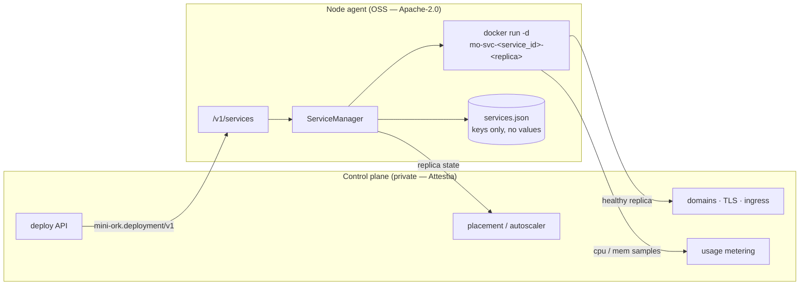
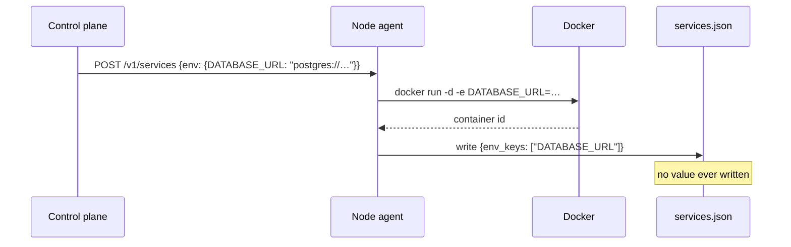
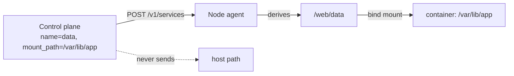
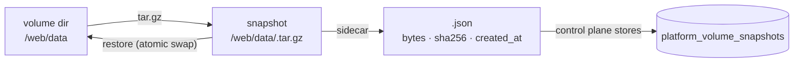

# Service runtime — long-lived containers on a node

> Status: proposed (2026-10-25). Extends [`remote-nodes.md`](remote-nodes.md)
> and [`cloud-sandbox-providers.md`](cloud-sandbox-providers.md).
> Contract: `schemas/deployment.schema.json` (`mini-ork.deployment/v1`).
> Implementation: `mini_ork/remote/node_agent/services.py`.

## Goal

A node-agent already runs **sessions** — one container per agent run, created
and destroyed around that run. It could not run a **service**: a container
that must stay up, publish a port, restart on failure, and outlive the request
that created it.

That missing primitive is the difference between "sandbox for an agent" and
"place to host an app". Every hosted platform (Railway, Fly, Render) is a
control plane over exactly this mechanism. This document defines the
mechanism and stops there: tenancy, DNS, TLS, autoscaling, and billing are
policy, and policy lives outside the OSS repo.



The arrow that matters: the control plane speaks a **versioned document** to
the node and receives replica state back. It never shells into the host, and
the node never learns what a tenant is.

## The contract

`schemas/deployment.schema.json` is the public half. A deployment document
carries `service_id`, `deployment_id`, `image`, `command`, `replicas`,
`ports`, `volumes`, `resources`, `restart_policy`, `healthcheck`, `env`,
`env_keys`, `network`, `user`, and `labels`. `status` is read-only and only
appears in responses.

Validation happens in the node, not in the control plane's type system, so a
self-hosted client written in any language gets the same guarantees. The
checks that matter:

| Rule | Why |
|---|---|
| `service_id` matches `^[a-z0-9][a-z0-9-]{0,62}$` | becomes part of `mo-svc-<id>-<n>`; argv is a list, so this is defence in depth |
| `replicas` ≤ 100 | one request cannot exhaust a shared node |
| `restart_policy` in a fixed set | no free-text policy reaches the daemon |
| ports 1..65535 | Docker rejects the rest with a worse error |
| volume `name` matches `^[a-z0-9][a-z0-9_-]{0,62}$` | it becomes one directory below the node's volume root; no dots means no `..` |
| volume `mount_path` is absolute, no `:` or `..` | relative paths resolve against a per-image WORKDIR; `:` is Docker's `-v` separator |
| one volume per name and per mount path | the same path twice lets one mount shadow the other, silently |
| env names are shell identifiers | a hostile key cannot smuggle flags into `-e` |
| unknown `schema_version` → 400 | a contract change fails loudly, never silently |

## The HTTP surface

Every route except `/v1/health` requires the node bearer token.

| Method | Path | Returns |
|---|---|---|
| `POST` | `/v1/services` | create (or replace) every replica; `200` with status |
| `GET` | `/v1/services` | `{"services": [...]}` |
| `GET` | `/v1/services/{sid}` | one service + per-replica `state` |
| `DELETE` | `/v1/services/{sid}` | `{"deleted": sid}` |
| `POST` | `/v1/services/{sid}/restart` | status after `docker restart` |
| `GET` | `/v1/services/{sid}/logs?tail=N` | merged logs, `N` clamped to 1..5000 |

`POST /v1/services` is an upsert by default (`replace: true`). A redeploy of
the same `service_id` tears the old replicas down first, which is what a
deploy pipeline wants; passing `replace: false` turns a collision into a
`400` instead.

## Guarantees and failure semantics

1. **All-or-nothing create.** If replica *k* fails to start, replicas
   `0..k-1` are removed and nothing is written to state. A retry starts from
   a clean slate — a half-scaled service is never left billing.
2. **Deterministic names.** `mo-svc-<service_id>-<replica>` lets `delete`
   sweep containers whose ids were never captured (a crash mid-create), and
   makes `docker logs mo-svc-web-0` work for an operator.
3. **Restart does not need the caller.** Env values are used once, at
   `docker run`. `restart` calls `docker restart <name>`, which reuses the
   container's baked environment.
4. **State survives the process.** `services.json` is written atomically
   (`tmp` + `os.replace`), so a node-agent restart re-adopts its services and
   can still report and delete them.
5. **Env values are never persisted.** See below.
6. **No reaper by default.** Services are meant to outlive their creator; the
   control plane owns their lifecycle. The `mo.sandbox=1` label keeps them
   visible to a fleet sweep if a control plane disappears.

## Why values never reach disk

`procs.py` already established the rule for detached child processes (D6):
persist `env_keys`, pass values only in memory. `services.py` follows it.



A leaked `services.json`, a support bundle, or a backup therefore contains
names, not credentials. The trade-off is that an env change requires a
redeploy rather than a restart — which is the desirable behaviour anyway,
because secrets should roll with a deployment, not drift underneath one.

## Volumes — the node owns the host side

A service that keeps state needs a directory that survives a redeploy. The
contract carries only half of that: a `name` (an identity) and a `mount_path`
(where it appears *inside* the container). The node derives the host side
itself:

```
<volume_root>/<service_id>/<name>   →   <mount_path>   (:rw)
```



A host path in the request would be one field away from mounting `/etc`, a
node's Docker socket, or another tenant's directory into a container — and no
amount of path cleaning makes a *shared* node safe against a control plane that
can name any directory. So the field does not exist. `name` cannot contain `/`
or `.`, which is what makes the join above unable to escape `volume_root`.

Two tiers, one env var:

| Tier | Root | Use |
|---|---|---|
| Simple | `<state_dir>/volumes` | a laptop, a single test VM — works after copying an example config |
| Secure | `MO_NODE_VOLUME_ROOT` (absolute path) | a node whose volumes live on a backed-up, encrypted disk |

A *relative* `MO_NODE_VOLUME_ROOT` refuses to start the node-agent. Falling
back would put tenant data where the operator did not choose, and the tenant
would only discover it on a redeploy that came up empty — the exact silent
failure the volume exists to prevent.

Lifecycle rules:

- Directories are created `0700` before `docker run`, so a permission failure
  is attributable to the node instead of looking like an application bug.
  Existing directories are left untouched — an operator may have mounted a disk
  or set a policy there.
- `DELETE /v1/services/{sid}` removes containers and **keeps the volume data**.
  Retention is a platform policy (and a line item); deleting a service is not a
  data-deletion request.
- Renaming a volume starts a new empty one. The name *is* the identity.
- A redeploy reuses the same directories, which is the entire point.

## Snapshots — copying a volume

The node can copy a volume and put it back:

```
POST   /v1/services/{sid}/volumes/{name}/snapshots
GET    /v1/services/{sid}/volumes/{name}/snapshots
DELETE /v1/services/{sid}/volumes/{name}/snapshots/{snap}
POST   /v1/services/{sid}/volumes/{name}/restore   {"snapshot_id": "<32 hex>"}
```

A snapshot is a `tar.gz` of the volume's contents plus a JSON sidecar carrying
the byte count and sha256. The node mints the id (`uuid4().hex`) and derives the
path from identity, never from the request:

```
<snapshot_root>/<service_id>/<name>/<snapshot_id>.tar.gz
<snapshot_root>/<service_id>/<name>/<snapshot_id>.json
```



The snapshot root follows the same two-tier rule as the volume root:

| Tier | Root | Use |
|---|---|---|
| Simple | `<state_dir>/volume-snapshots` | a laptop — a copy beside the volume |
| Secure | `MO_NODE_SNAPSHOT_ROOT` (absolute path) | a disk backed up independently of the volume disk |

A relative `MO_NODE_SNAPSHOT_ROOT` refuses to start the node-agent, for the same
reason a relative volume root does.

Rules the node enforces, each because the alternative loses data quietly:

- **An empty volume is a real snapshot.** "The volume was empty when I copied
  it" is a fact worth keeping. Only a volume that was never materialized on this
  node (no directory) is refused — that returns 404, because an empty archive
  would restore to nothing and look like a successful backup.
- **A snapshot of a running volume is crash-consistent.** The caller decides
  whether that is good enough (a database wants a quiesced copy; a static site
  does not).
- **Restore is refused while any container holds the volume** (409). Only
  `missing`, `exited`, and `dead` are safe; an unreadable Docker state counts as
  holding. Replacing the directory under a live process is corruption, not
  recovery.
- **Restore swaps atomically.** Contents are extracted into a sibling staging
  directory, the old directory is moved aside, the staged one is renamed into
  place, and the old copy is only deleted after the swap succeeds. A failed
  extraction leaves the volume exactly as it was.
- **Restore accepts only the minted id shape.** The id is a path component, so
  anything that is not 32 lowercase hex characters is refused before it can name
  a file; archive members are extracted with the interpreter's `data` filter
  (or an explicit regular-file/regular-directory allow-list on older runtimes).
- **The sidecar is written after the archive is durable.** A crash between the
  two leaves an archive that listing ignores and restore refuses — an invisible
  snapshot, never a listed one that cannot be restored.
- **Deleting a service keeps its snapshots.** Like the volume data, retention is
  the platform's decision; the node only deletes when asked.

## What is deliberately absent

These are the proprietary layer's job, and every one of them is policy:

- Which tenant owns a service, and which node it lands on (placement).
- Public hostnames, TLS certificates, and HTTP routing to a replica port.
- Health-gated rollout, blue/green, and automatic rollback on `unhealthy`.
- Metrics scraping (`docker stats`) → usage events → invoices.
- The **overlay itself** — swarm membership, WireGuard, or a CNI. This module
  joins a network and creates it on demand; making that one network span hosts
  is infrastructure, and the driver choice below decides whether it does.
- Volume **quotas, retention, and off-node backup**. Snapshots and restore are
  mechanism and live here; *when* to take one, how long to keep it, and where it
  is shipped afterwards are policy. `platform_volumes.size_mb` is recorded but
  not enforced by the node; a node that guessed at retention would be wrong for
  every tenant at once.
- Managed databases (a separate primitive built on volumes).
- Idle detection, scale-to-zero, and cron-scheduled services.

The node exposes what those need — replica state, logs, the port mapping, the
`mo.deployment` label — and nothing else. That keeps the trust surface small
and lets a self-hoster run the same primitive with a shell script.

## Private networks

Services reach each other by DNS name when they sit on the same Docker
network. A deployment document names that network and the aliases the
container answers to inside it:

```json
"network": "attestia-env-1f2a3b4c",
"network_aliases": ["db", "db-1f2a3b4c.internal"]
```

Rules:

- **The node creates the network if it is missing.** `docker network inspect`
  decides; a second deploy joins what the first created and never re-creates
  it. The caller never runs Docker commands.
- **The driver is the node's choice, and a bad one fails closed.**
  `MO_NODE_NETWORK_DRIVER` is `bridge` by default (one host) or `overlay` on a
  Docker swarm (one name across the fleet). An unknown value, or a daemon that
  refuses to create the network, fails the deploy with a 500 — there is no
  fallback to the default bridge, because that would leave peers silently
  unable to resolve each other.
- **An alias without a network is refused.** Docker accepts
  `--network-alias` on the default bridge and ignores it; a caller that sent
  only aliases would believe it had published a name.
- **Aliases are DNS names, not paths.** `[a-z0-9.-]`, no empty label (`a..b`),
  no trailing dot, at most 253 characters, 32 per service. The short label is
  the name peers use (`db`); the FQDN is what the platform shows tenants.
- **Scoping is the platform's job.** The node enforces shape, not tenancy: two
  tenants that send the same network name land on the same network. The
  control plane derives the name from the environment, so a tenant cannot
  choose it.
- **Cross-node reachability is a fleet property.** Bridge networks stop at the
  host boundary; `overlay` crosses swarm nodes. The node reports the truth by
  failing the create when the driver cannot be honoured. A fleet that has not
  joined a swarm must keep one environment on one node — placement is the
  control plane's concern, not this module's.

## Self-host example

No control plane, no daemon, just the node-agent:

```bash
curl -sS "http://127.0.0.1:7091/v1/services" \
  -H "Authorization: Bearer $MO_NODE_TOKEN" \
  -H 'content-type: application/json' \
  -d '{
    "schema_version": "mini-ork.deployment/v1",
    "service_id": "web",
    "deployment_id": "deploy-1",
    "image": "nginx:1.27-alpine",
    "replicas": 1,
    "ports": [{"container": 80, "host": 8080}],
    "network": "attestia-env-1f2a3b4c",
    "network_aliases": ["web", "web-3f2a1b9c.internal"],
    "volumes": [{"name": "site", "mount_path": "/usr/share/nginx/html"}],
    "resources": {"cpus": 0.5, "memory": "256m"},
    "healthcheck": {"cmd": "wget -qO- localhost:80", "interval": "10s"}
  }' | jq '.replicas_state'
```

## Tests

`tests/unit/test_node_agent_services.py` drives the real FastAPI app through
`TestClient` with one fake Docker runner. It asserts the composed argv (not
just the response), the rollback path, the replace path, auth, and the
security property: `services.json` contains `DATABASE_URL` and does not
contain the value that was passed with it. For volumes it asserts the mount
target the node actually composed, that the directory exists `0700`, that
`delete` leaves the data, that the status response never leaks a host path,
that a relative `MO_NODE_VOLUME_ROOT` stops the app from starting, and that
the published schema rejects the same shapes the node does.
