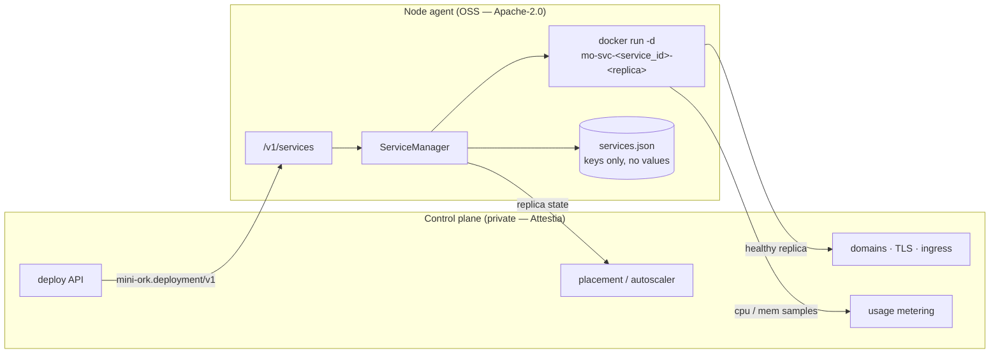
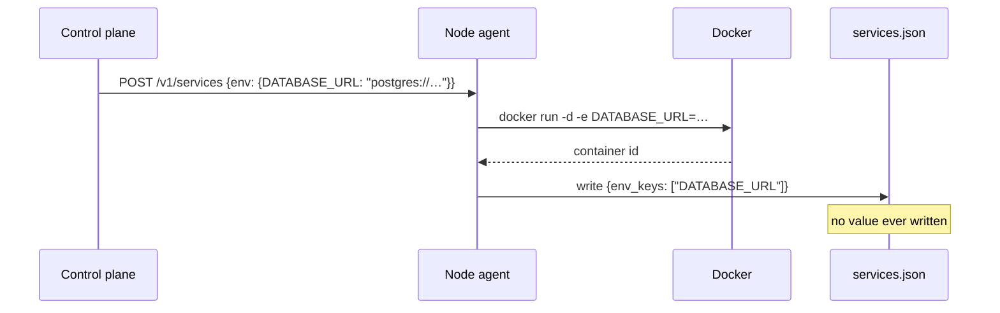

# Service runtime — long-lived containers on a node

> Status: proposed (2026-10-25). Extends [`remote-nodes.md`](remote-nodes.md)
> and [`cloud-sandbox-providers.md`](cloud-sandbox-providers.md).
> Contract: `schemas/deployment.schema.json` (`mini-ork.deployment/v1`).
> Implementation: `mini_ork/remote/node_agent/services.py`.

## Goal

A node-agent already runs **sessions** — one container per agent run, created
and destroyed around that run. It could not run a **service**: a container
that must stay up, publish a port, restart on failure, and outlive the request
that created it.

That missing primitive is the difference between "sandbox for an agent" and
"place to host an app". Every hosted platform (Railway, Fly, Render) is a
control plane over exactly this mechanism. This document defines the
mechanism and stops there: tenancy, DNS, TLS, autoscaling, and billing are
policy, and policy lives outside the OSS repo.



The arrow that matters: the control plane speaks a **versioned document** to
the node and receives replica state back. It never shells into the host, and
the node never learns what a tenant is.

## The contract

`schemas/deployment.schema.json` is the public half. A deployment document
carries `service_id`, `deployment_id`, `image`, `command`, `replicas`,
`ports`, `resources`, `restart_policy`, `healthcheck`, `env`, `env_keys`,
`network`, `user`, and `labels`. `status` is read-only and only appears in
responses.

Validation happens in the node, not in the control plane's type system, so a
self-hosted client written in any language gets the same guarantees. The
checks that matter:

| Rule | Why |
|---|---|
| `service_id` matches `^[a-z0-9][a-z0-9-]{0,62}$` | becomes part of `mo-svc-<id>-<n>`; argv is a list, so this is defence in depth |
| `replicas` ≤ 100 | one request cannot exhaust a shared node |
| `restart_policy` in a fixed set | no free-text policy reaches the daemon |
| ports 1..65535 | Docker rejects the rest with a worse error |
| env names are shell identifiers | a hostile key cannot smuggle flags into `-e` |
| unknown `schema_version` → 400 | a contract change fails loudly, never silently |

## The HTTP surface

Every route except `/v1/health` requires the node bearer token.

| Method | Path | Returns |
|---|---|---|
| `POST` | `/v1/services` | create (or replace) every replica; `200` with status |
| `GET` | `/v1/services` | `{"services": [...]}` |
| `GET` | `/v1/services/{sid}` | one service + per-replica `state` |
| `DELETE` | `/v1/services/{sid}` | `{"deleted": sid}` |
| `POST` | `/v1/services/{sid}/restart` | status after `docker restart` |
| `GET` | `/v1/services/{sid}/logs?tail=N` | merged logs, `N` clamped to 1..5000 |

`POST /v1/services` is an upsert by default (`replace: true`). A redeploy of
the same `service_id` tears the old replicas down first, which is what a
deploy pipeline wants; passing `replace: false` turns a collision into a
`400` instead.

## Guarantees and failure semantics

1. **All-or-nothing create.** If replica *k* fails to start, replicas
   `0..k-1` are removed and nothing is written to state. A retry starts from
   a clean slate — a half-scaled service is never left billing.
2. **Deterministic names.** `mo-svc-<service_id>-<replica>` lets `delete`
   sweep containers whose ids were never captured (a crash mid-create), and
   makes `docker logs mo-svc-web-0` work for an operator.
3. **Restart does not need the caller.** Env values are used once, at
   `docker run`. `restart` calls `docker restart <name>`, which reuses the
   container's baked environment.
4. **State survives the process.** `services.json` is written atomically
   (`tmp` + `os.replace`), so a node-agent restart re-adopts its services and
   can still report and delete them.
5. **Env values are never persisted.** See below.
6. **No reaper by default.** Services are meant to outlive their creator; the
   control plane owns their lifecycle. The `mo.sandbox=1` label keeps them
   visible to a fleet sweep if a control plane disappears.

## Why values never reach disk

`procs.py` already established the rule for detached child processes (D6):
persist `env_keys`, pass values only in memory. `services.py` follows it.



A leaked `services.json`, a support bundle, or a backup therefore contains
names, not credentials. The trade-off is that an env change requires a
redeploy rather than a restart — which is the desirable behaviour anyway,
because secrets should roll with a deployment, not drift underneath one.

## What is deliberately absent

These are the proprietary layer's job, and every one of them is policy:

- Which tenant owns a service, and which node it lands on (placement).
- Public hostnames, TLS certificates, and HTTP routing to a replica port.
- Health-gated rollout, blue/green, and automatic rollback on `unhealthy`.
- Metrics scraping (`docker stats`) → usage events → invoices.
- Private networking between a tenant's services across nodes.
- Persisted volumes and managed databases (a separate primitive).
- Idle detection, scale-to-zero, and cron-scheduled services.

The node exposes what those need — replica state, logs, the port mapping, the
`mo.deployment` label — and nothing else. That keeps the trust surface small
and lets a self-hoster run the same primitive with a shell script.

## The private-network caveat

`--network` joins an existing Docker network by name. On one node that gives
services name-based reachability. **Across nodes it gives nothing** — Docker
networks do not span hosts. Cross-node private networking needs an overlay
(WireGuard, Tailscale, or a CNI), which is infrastructure policy and belongs
with ingress, not with this module. Do not imply multi-node private
networking from this flag.

## Self-host example

No control plane, no daemon, just the node-agent:

```bash
curl -sS "http://127.0.0.1:7091/v1/services" \
  -H "Authorization: Bearer $MO_NODE_TOKEN" \
  -H 'content-type: application/json' \
  -d '{
    "schema_version": "mini-ork.deployment/v1",
    "service_id": "web",
    "deployment_id": "deploy-1",
    "image": "nginx:1.27-alpine",
    "replicas": 1,
    "ports": [{"container": 80, "host": 8080}],
    "resources": {"cpus": 0.5, "memory": "256m"},
    "healthcheck": {"cmd": "wget -qO- localhost:80", "interval": "10s"}
  }' | jq '.replicas_state'
```

## Tests

`tests/unit/test_node_agent_services.py` drives the real FastAPI app through
`TestClient` with one fake Docker runner. It asserts the composed argv (not
just the response), the rollback path, the replace path, auth, and the
security property: `services.json` contains `DATABASE_URL` and does not
contain the value that was passed with it.
