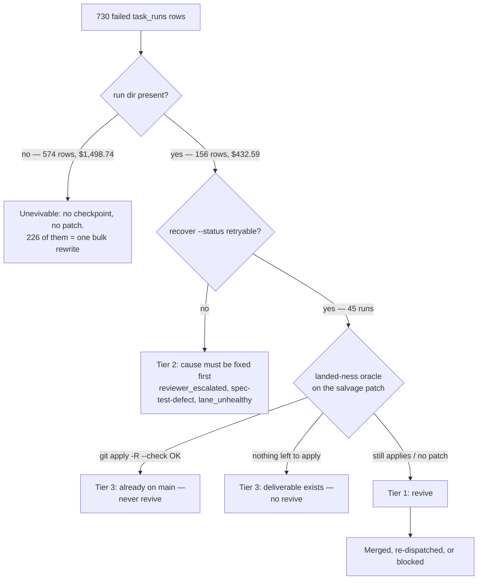

# Failed-run revive batch — 2026-11-06

Every `task_runs` row with `status='failed'` in the repo's `.mini-ork/state.db`
was evaluated with `bin/mini-ork recover <id> --status` (pure Python, no LLM,
no spend) and classified by what it actually left behind. This document records
the inventory, the batch that was revived, and the close-out decisions for the
runs that must **not** be revived.

## Inventory

| Bucket | Runs | Spend |
|---|---:|---:|
| Total failed rows | 730 | $1,931.33 |
| No run dir — unrecoverable | 574 | $1,498.74 |
| Run dir present — evaluable | 156 | $432.59 |
| … with a reusable checkpoint (`reuse > 0`) | 137 | — |
| … with a salvage patch | 29 | — |
| … whose own `verdict.json` says `pass: true` | 36 | — |

Two facts make the 574 worthless rows cheap to dismiss:

- **226 of them share one timestamp**, `2026-10-08 18:47:19`. That is a single
  bulk status rewrite, not 226 individual failures. Their run dirs were swept
  before the rows were written, so no checkpoint or patch survives.
- A row without a run dir has nothing to resume from. `recover` reports `no_patch`
  / `no_target` and can only re-run the whole DAG at full cost. That is a new
  run, not a revive.

## The landed-ness oracle

A salvage patch has exactly three states against today's `main`:

| `git apply --check` | `git apply -R --check` | Meaning |
|---|---|---|
| fails | succeeds | **already on main** — the failed row lies |
| succeeds | fails | **still needed** — a genuine revive |
| fails | fails | base drifted — hand reconciliation required |

Using only the forward check (`recover --status`'s `would_apply`) collapses the
first and third states into `conflict` and makes landed work look like drift.
Always run both directions.

## Tier 1 — revived

| # | Run | Plan | Outcome |
|---|---|---|---|
| 1 | `rsi-t1-kernel-hole-3-freeze-policy-inputs-20261027` | `retryable` refused by a stale retry-hint; the cited success command was re-run instead | **Merged** as `bcc98e10` — *feat(kernel): freeze the self-driving policy's inputs* |
| 3 | `run-1792400538-82050` | `resume` from `implementer`, 4 checkpoints reused | **Superseded** — see below; the resume died on a remote node-agent 502 |
| 4 | `rsi-t0f-r8-hardening-20261027-085038` | `resume` from `code_impact_lens`, 1 checkpoint reused | **Already landed** — see below |

Two of the three dispatches resolved without a merge, and neither because the
work was bad: both because `main` had moved 495 and 10 days respectively, and
the deliverable was already there.

Revive 1 is the instructive one. `recover` refused it with `rc=1` —
"retry-hint refuses this run (strategy='none')" — because the *recorded*
`review-verdict.json` from the October attempt was red. That file is evidence
of what happened then, not of what the branch does now. Running the kickoff's
own success command in the worktree gave **54 passed**, and the frozen-path
consumers gave **219 passed**, so the branch was merged rather than re-run.
`--force` was never used: the hint was audited, not overridden.

## Tier 2 — deferred, cause first

| Gate | Runs | What blocks a revive |
|---|---:|---|
| `reviewer_escalated` | 7 | the reviewer escalated on an unresolved design question; a re-dispatch asks the same question again |
| `spec-test-defect` | 4 | the spec-test author emitted tests the spec cannot satisfy (`feedback_spec_test_author_can_emit_unsatisfiable_tests`); re-running reproduces the defect |
| `lane preflight: lane_unhealthy` | 2 | a lane credential or quota, not the work |

One run — `sde-4-supervisor-20261022-092423` — is blocked on a missing
deliverable rather than a gate: its kickoff
`mini-ork-worktrees/rsi-gaps/kickoffs/auto/sde-4-supervisor.md` went away with
the worktree, and only 5 checkpoints survive. A revive cannot restate the goal
it was never given, so it stays parked until the kickoff is recovered or
rewritten.

One run in this bucket, `w2-sdd-ratify-cli-20261030-174813`, is a
`spec-test-defect` failure whose patch already reverse-applies cleanly — the
defect stopped the run *after* the change was written. It is listed in Tier 3,
not here; the bucket label and the landed-ness oracle disagree, and the oracle
wins.

### Revive 4 — `rsi-t0f-r8-hardening-20261027-085038`: already landed

The kickoff asked for two things: R8 must refuse to dispatch into the engine
checkout, and it must reclaim stale epics *before* counting them against its
cap. `main` has both:

- `mini_ork/recovery/supervisor.py:1296` — `_dispatch_refusal(target_root, engine_root)`,
  called first in `_rule_dispatch_epic`, returns the refusal action instead of a
  dispatch.
- `supervisor.py:1359` — `scheduler.reclaim_stale(db)` runs before the cap count.

`recover --status` still calls the run `retryable` with 1 reusable checkpoint,
because retryability is a property of the *run*, not of the repository. Nothing
in the retry-hint checks whether the deliverable already exists.

### Revive 3 — `run-1792400538-82050`: superseded, both halves settled

The kickoff (oracle evidence-consistency guard + oracle-integrity producer) has
two halves, and `main` has moved 495 commits past the run's base:

- **Evidence-consistency guard — landed.** The three missed injections
  (`apply_fail_masked_as_pass`, `stale_evidence_replay`, `runner_error_as_pass`)
  are closed, and the judge's predicate is pinned by
  `tests/unit/test_certify_evidence_py.py` so the injected defect case must
  decide `UNVERIFIED` rather than `REFUTED`. `oracle_integrity.py`'s docstring
  records that this gap "was real once".
- **Producer — still manual, and documented as such.**
  `docs/architecture/verification-stack.md:104` lists instrument ⑦ as *"consumer
  on, producer manual"*, and `promotion_gate.py:566` still reads
  `oracle_integrity.latest(db_path)`, returning `{"status": "unmeasured"}` when
  no one has run `mini-ork instruments oracle-integrity`. That is a known state
  of the design, not a silent hole — but it does mean the guard cannot fire
  unless an operator runs the producer first.

The revive attempt itself died for an environmental reason, not a work reason:
the run recorded `placement: "remote"`, so the resumed `implementer` was shipped
to a node-agent that answered `HTTP 502: Bad Gateway` on
`/v1/sessions/…/files` three times, and the 6 downstream nodes were skipped as
"blocked by failed parent(s)". The stale worktree
(`mini-ork-worktrees/vt9b-oracle-consistency`, branch `wt/vt9b-oracle-consistency`)
holds 150 uncommitted lines over 4 files against a base 495 commits old; merging
that delta would revert newer work, so it stays untouched.

**Follow-up worth a fresh, small kickoff:** wire the oracle-integrity producer
into the promotion path (the shape `judge_validity.promotion_check` already has),
or schedule `mini-ork instruments oracle-integrity` — until then instrument ⑦
reports `unmeasured` at every promotion.

## Tier 3 — closed, no revive

### Already on main

All four reverse-apply cleanly against `bcc98e10` and fail to apply forward —
their work is in the tree and the `failed` row is stale bookkeeping.

| Run | Files | Proof |
|---|---:|---|
| `w2-sdd-ratify-cli-20261030-174813` | 2 | `git apply -R --check` OK |
| `rsi-build-rsi-i4-collapse-halt-20260929-122018` | 5 | `git apply -R --check` OK |
| `rsi-build-rsi-i4-collapse-halt-20260929-115155` | 2 | `git apply -R --check` OK |
| `rsi-build-rsi-i3-bsg-va-wiring-20260929-131925` | 2 | `git apply -R --check` OK |

### Deliverable exists — `rsi-review-20260929-084403` ($55.11)

An `rsi-technique-review` run that stopped on a cost pause with 20 failed nodes,
but only *after* writing its deliverable: `impact-report.md` (36 KB) plus
`clusters.json`, `groups/`, `group-techniques/`, and `extractions/`. The report
distils 131 techniques and names a build order; it is the survey that produced
the technique-adoption map. Re-running would spend another ~$55 to recompute a
document that already exists and has already been consumed. **Decision: no
revive** — the artifact is the output, the failed nodes were post-processing.

## Ledger caveat

Revived work leaves its `task_runs` row at `status='failed'`. There is no
sanctioned command that corrects a run's status after the fact, so this document
— not the DB — is the record of which failed rows are dead, revived, or landed.
Any future "collect failed runs" pass should read this list first, and re-run the
landed-ness oracle before spending on anything that looks salvageable.
