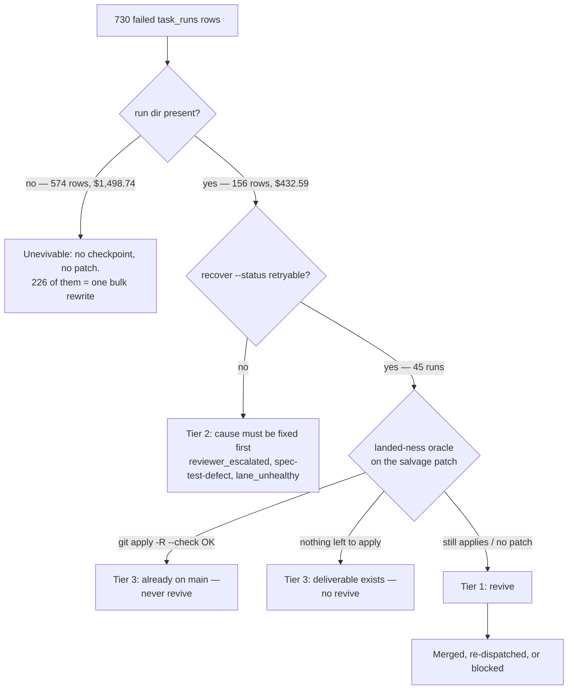

# Failed-run revive batch — 2026-11-06

Every `task_runs` row with `status='failed'` in the repo's `.mini-ork/state.db`
was evaluated with `bin/mini-ork recover <id> --status` (pure Python, no LLM,
no spend) and classified by what it actually left behind. This document records
the inventory, the batch that was revived, and the close-out decisions for the
runs that must **not** be revived.

## Inventory

| Bucket | Runs | Spend |
|---|---:|---:|
| Total failed rows | 730 | $1,931.33 |
| No run dir — unrecoverable | 574 | $1,498.74 |
| Run dir present — evaluable | 156 | $432.59 |
| … with a reusable checkpoint (`reuse > 0`) | 137 | — |
| … with a salvage patch | 29 | — |
| … whose own `verdict.json` says `pass: true` | 36 | — |

Two facts make the 574 worthless rows cheap to dismiss:

- **226 of them share one timestamp**, `2026-10-08 18:47:19`. That is a single
  bulk status rewrite, not 226 individual failures. Their run dirs were swept
  before the rows were written, so no checkpoint or patch survives.
- A row without a run dir has nothing to resume from. `recover` reports `no_patch`
  / `no_target` and can only re-run the whole DAG at full cost. That is a new
  run, not a revive.

## The landed-ness oracle

A salvage patch has exactly three states against today's `main`:

| `git apply --check` | `git apply -R --check` | Meaning |
|---|---|---|
| fails | succeeds | **already on main** — the failed row lies |
| succeeds | fails | **still needed** — a genuine revive |
| fails | fails | base drifted — hand reconciliation required |

Using only the forward check (`recover --status`'s `would_apply`) collapses the
first and third states into `conflict` and makes landed work look like drift.
Always run both directions.

## Tier 1 — revived

| # | Run | Plan | Outcome |
|---|---|---|---|
| 1 | `rsi-t1-kernel-hole-3-freeze-policy-inputs-20261027` | `retryable` refused by a stale retry-hint; the cited success command was re-run instead | **Merged** as `bcc98e10` — *feat(kernel): freeze the self-driving policy's inputs* |
| 3 | `run-1792400538-82050` | `resume` from `implementer`, 4 checkpoints reused | **Superseded** — see below; the resume died on a remote node-agent 502 |
| 4 | `rsi-t0f-r8-hardening-20261027-085038` | `resume` from `code_impact_lens`, 1 checkpoint reused | **Already landed** — see below |
| 5 | `rsi-c1793808348-e4c9d816` (child of `rsi-c1793808348`) | not a `recover` plan — the unmerged commit was found in its worktree | **Merged** as `8e4aeddb` — *split the clustering store out of the lesson store* (RSI rule L6) |
| 6 | `rsi-c1793086961-7396275d` (child of `rsi-c1793086961`) | the killed child's patch applied cleanly to today's `main` | **Merged** as `b812c86f` — *hold out a deterministic slice of every lesson block* (RSI rule L3) |

Two of the first three dispatches resolved without a merge, and neither because
the work was bad: both because `main` had moved 495 and 10 days respectively, and
the deliverable was already there.

Revive 1 is the instructive one. `recover` refused it with `rc=1` —
"retry-hint refuses this run (strategy='none')" — because the *recorded*
`review-verdict.json` from the October attempt was red. That file is evidence
of what happened then, not of what the branch does now. Running the kickoff's
own success command in the worktree gave **54 passed**, and the frozen-path
consumers gave **219 passed**, so the branch was merged rather than re-run.
`--force` was never used: the hint was audited, not overridden.

### Revives 5 and 6 — found in worktrees, not in the run table

Both were `rsi-cycle` children: an `rsi-cycle` run dispatches a `framework-edit`
child in a worktree of its own, and when the driver is killed the child leaves a
published-looking row, a worktree, and an unmerged commit behind. `recover`
never sees this shape — the child's own row can read `published` while its
branch was never pushed — so the landed-ness oracle has to be applied to the
*worktree*, not to the run dir. A sweep of every `rsi-c*` worktree found these
two commits ahead of `main` with real, unlanded work in them.

Revive 5 (`theme_clusters`) also proves the oracle's third case. The patch had
been rebased away from the code it was written against (it was 66 commits
behind), and the live DB already carried its table — created ad hoc months
earlier, with no migration file on `main` and no code referencing it. So the
gap was real (6364 of 6497 `lesson_themes` rows had no lesson text, exactly what
rule L6 measures), the table's presence was not evidence that the work landed,
and a `git apply --check` against `main` was the only thing that settled it.

The pre-push panel blocked the first merge attempt with a defect worth keeping:
copying only the *blank* rows into `theme_clusters` drops the authored themes
from the clustering space, because pre-split **every** `lesson_themes` row was a
cluster candidate. The rest of the patch was sound; the migration and the read
path were fixed in the same worktree (`8e4aeddb`) and merged on the second pass.
That is the panel earning its cost on a patch that had already been read by a
human.

Live outcome after the migration: `theme_clusters` 6513 rows, `lesson_themes`
133 (authored) with **0** blank — `mini-ork rsi-cycle plan` no longer emits L6,
while 7 other gaps from the same harvest still do.

### Revive 7 — `rsi-c1792978180`: `llm_calls` records no lane (R8)

Merged as `a19f1448`. Additive `lane` column (nullable, no default, no backfill),
filled by both writers from the model that actually served the call, guarded
ALTER, renumbered from the patch's `0085` because `0085_review_findings.sql`
already occupies that number. Applied to the live DB: `pragma_table_info('llm_calls')`
has `lane`, `schema_migrations` has the row.

**A trap worth recording, caught while applying it:** the guarded ALTER is
`.read "|sh -c …${MINI_ORK_DB}…"`. Running the file with the `sqlite3` CLI
instead of through `migrate_apply` leaves `MINI_ORK_DB` unset, so the shell
guard emits no ALTER — and the file's own trailing INSERT still records the
migration. The result is a recorded no-op. Repair: delete the
`schema_migrations` row, re-run `migrate_apply` (it exports `MINI_ORK_DB`), then
assert the column exists. Never hand-apply a guarded migration.

### Declined — `rsi-c1793812835`: `learning_record.benchmark_delta` (L9)

The patch applies cleanly to today's `main` and would compose
`AVG(utility_score - baseline_utility_score)` from `benchmark_results` rows
joined on `benchmark_results.candidate_id = learning_record.run_id`. On the
live DB that join matches **nothing**: `benchmark_results` holds 2 rows, its
`candidate_id` values are non-numeric slugs, and no `learning_record.run_id`
equals one. The patch would add a producer that writes nothing and leaves the
rule firing, while reading as fixed. The real blocker is the missing
candidate↔run link (`project_l9_benchmark_delta_has_no_link`), so this stays
declined until the link exists.

## Left in place, deliberately

Twelve `rsi-c*` worktrees still hold a branch that is one commit ahead of
`main`. The landed-ness oracle was re-run **against `main`** (not inside each
worktree, where a delta built off its own merge base trivially re-applies) and
none of them reverse-applies, so none is provably landed and **no worktree was
cleaned** — cleaning deletes the branch. Of the eleven with a non-empty delta,
five apply forward cleanly — revive 7 was one; `benchmark_delta` (L9) is
declined below; three remain (`lesson_conflicts` L10, `execution_traces.
code_region` R1/R3, verifier calibration ground truth V3). The other six are
base-drifted and need a hand-port. They keep their claims until someone lands
or declines each one.

## Tier 2 — deferred, cause first

| Gate | Runs | What blocks a revive |
|---|---:|---|
| `reviewer_escalated` | 7 | the reviewer escalated on an unresolved design question; a re-dispatch asks the same question again |
| `spec-test-defect` | 4 | the spec-test author emitted tests the spec cannot satisfy (`feedback_spec_test_author_can_emit_unsatisfiable_tests`); re-running reproduces the defect |
| `lane preflight: lane_unhealthy` | 2 | a lane credential or quota, not the work |

One run — `sde-4-supervisor-20261022-092423` — is blocked on a missing
deliverable rather than a gate: its kickoff
`mini-ork-worktrees/rsi-gaps/kickoffs/auto/sde-4-supervisor.md` went away with
the worktree, and only 5 checkpoints survive. A revive cannot restate the goal
it was never given, so it stays parked until the kickoff is recovered or
rewritten.

One run in this bucket, `w2-sdd-ratify-cli-20261030-174813`, is a
`spec-test-defect` failure whose patch already reverse-applies cleanly — the
defect stopped the run *after* the change was written. It is listed in Tier 3,
not here; the bucket label and the landed-ness oracle disagree, and the oracle
wins.

### Revive 4 — `rsi-t0f-r8-hardening-20261027-085038`: already landed

The kickoff asked for two things: R8 must refuse to dispatch into the engine
checkout, and it must reclaim stale epics *before* counting them against its
cap. `main` has both:

- `mini_ork/recovery/supervisor.py:1296` — `_dispatch_refusal(target_root, engine_root)`,
  called first in `_rule_dispatch_epic`, returns the refusal action instead of a
  dispatch.
- `supervisor.py:1359` — `scheduler.reclaim_stale(db)` runs before the cap count.

`recover --status` still calls the run `retryable` with 1 reusable checkpoint,
because retryability is a property of the *run*, not of the repository. Nothing
in the retry-hint checks whether the deliverable already exists.

### Revive 3 — `run-1792400538-82050`: superseded, both halves settled

The kickoff (oracle evidence-consistency guard + oracle-integrity producer) has
two halves, and `main` has moved 495 commits past the run's base:

- **Evidence-consistency guard — landed.** The three missed injections
  (`apply_fail_masked_as_pass`, `stale_evidence_replay`, `runner_error_as_pass`)
  are closed, and the judge's predicate is pinned by
  `tests/unit/test_certify_evidence_py.py` so the injected defect case must
  decide `UNVERIFIED` rather than `REFUTED`. `oracle_integrity.py`'s docstring
  records that this gap "was real once".
- **Producer — manual at the time, wired on 2026-11-08 (`693dc18c`).**
  `docs/architecture/verification-stack.md` then listed instrument ⑦ as
  *"consumer on, producer manual"*, and `promotion_gate.py` read
  `oracle_integrity.latest(db_path)`, returning `{"status": "unmeasured"}` when
  no one had run `mini-ork instruments oracle-integrity` — so the guard could
  not fire unless an operator ran the producer first. The promotion gate now
  runs the audit itself; see the close-out below.

The revive attempt itself died for an environmental reason, not a work reason:
the run recorded `placement: "remote"`, so the resumed `implementer` was shipped
to a node-agent that answered `HTTP 502: Bad Gateway` on
`/v1/sessions/…/files` three times, and the 6 downstream nodes were skipped as
"blocked by failed parent(s)". The stale worktree
(`mini-ork-worktrees/vt9b-oracle-consistency`, branch `wt/vt9b-oracle-consistency`)
holds 150 uncommitted lines over 4 files against a base 495 commits old; merging
that delta would revert newer work, so it stays untouched.

**Closed 2026-11-08 (`693dc18c`).** The producer is wired into the promotion path
in the shape this note suggested: `oracle_integrity.promotion_check(db_path)` runs
the hermetic audit (scripted runner and dispatch, ~0.06 s, no network, no model)
for the promotion it is scoring, persists the record, and quarantines on a failed
audit. ⑦ is no longer `unmeasured` by construction, and
`mini-ork instruments oracle-integrity` is now the out-of-band producer rather
than a prerequisite.

## Tier 3 — closed, no revive

### Already on main

All four reverse-apply cleanly against `bcc98e10` and fail to apply forward —
their work is in the tree and the `failed` row is stale bookkeeping.

| Run | Files | Proof |
|---|---:|---|
| `w2-sdd-ratify-cli-20261030-174813` | 2 | `git apply -R --check` OK |
| `rsi-build-rsi-i4-collapse-halt-20260929-122018` | 5 | `git apply -R --check` OK |
| `rsi-build-rsi-i4-collapse-halt-20260929-115155` | 2 | `git apply -R --check` OK |
| `rsi-build-rsi-i3-bsg-va-wiring-20260929-131925` | 2 | `git apply -R --check` OK |

### Deliverable exists — `rsi-review-20260929-084403` ($55.11)

An `rsi-technique-review` run that stopped on a cost pause with 20 failed nodes,
but only *after* writing its deliverable: `impact-report.md` (36 KB) plus
`clusters.json`, `groups/`, `group-techniques/`, and `extractions/`. The report
distils 131 techniques and names a build order; it is the survey that produced
the technique-adoption map. Re-running would spend another ~$55 to recompute a
document that already exists and has already been consumed. **Decision: no
revive** — the artifact is the output, the failed nodes were post-processing.

## Ledger caveat

Revived work leaves its `task_runs` row at `status='failed'`. There is no
sanctioned command that corrects a run's status after the fact, so this document
— not the DB — is the record of which failed rows are dead, revived, or landed.
Any future "collect failed runs" pass should read this list first, and re-run the
landed-ness oracle before spending on anything that looks salvageable.
