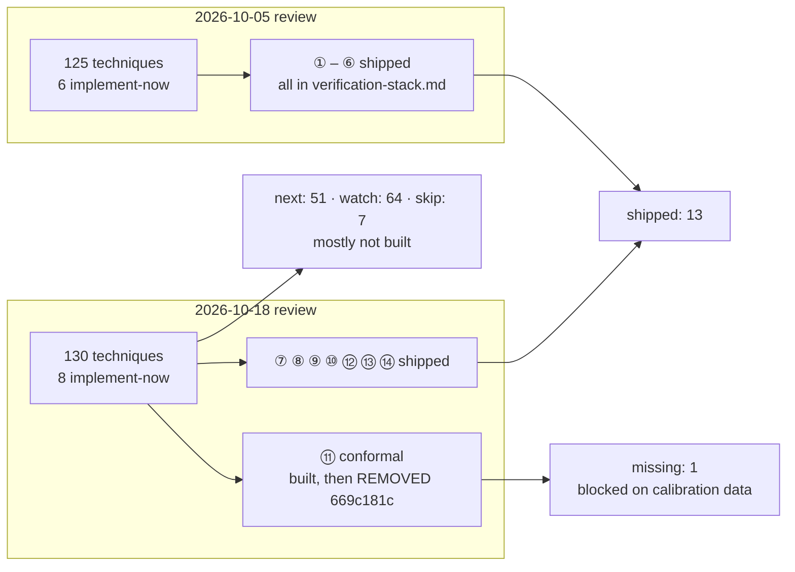

# Verification techniques for agentic AI — what the research runs asked for, what mini-ork ships

**Date:** 2026-11-11 · **Code audited at:** `8f129f90` (origin/main) · **Live DB:** `.mini-ork/state.db`

**Revised the same day** after the §5 fixes landed: §3.2 (verdict kinds), §3.4
(judge-validity default), §3.5 (⑫/⑭ reclassified as input-blocked) and §3.7
(state snapshot) now describe the shipped change; §5 separates what was fixed
from what remains, and §4 groups the unbuilt `next` tier by what it is blocked on.

**Question.** Find every mini-ork run that researched verification methods for
agentic AI, and report which of the resulting techniques are implemented, which
are missing, and which need fixing.

---

## 1. The runs

| Run | Task class | Status | Date | Cost | Output |
|---|---|---|---|---|---|
| `verify-review-20261005-122958` | `verification_technique_review` | published | 2026-10-05 | $9.71 | 2,000 papers → 125 techniques, 6 `implement-now` |
| `verify-agentic-20261018-215339` | `verification_technique_review` | published | 2026-10-18 | $12.13 | 2,000 papers → 1,062 ids → 130 techniques, 8 `implement-now` |

Both are runs of `recipes/verification-technique-review/` and write
`verification-technique-review.md` plus `merged-review.json` into their run dir.
Five earlier `rsi_technique_review` runs (2026-09-29 ×3, 2026-10-09 ×2) failed
before producing a report — the recipe that eventually worked was the
verification-focused clone.

No other run class produced a verification-methods report. `coord-review-20261002-142117`
is a sibling review of coordination techniques, not verification.

**Verdict distribution, 2026-10-18 review:** 8 implement-now · 51 next · 64 watch · 7 skip,
6 reviewer disagreements. The 2026-10-05 review's six implement-now items were all
built; the 2026-10-18 review's eight were built as instruments ⑦–⑭ of
`docs/architecture/verification-stack.md` — with one exception, below.



---

## 2. Implemented — 13 instruments (14 built, 1 removed)

Verified at HEAD by module presence, importers, the env knob, and the last commit
that changed each file. "Runs in" is the call site that actually invokes it.

| # | Technique (review id) | Module | Knob (default) | Runs in | State |
|---|---|---|---|---|---|
| ① | Metamorphic relations (G10-T01'05) | `mini_ork/certify/relations.py` | `MO_ASSAY_RELATIONS` (on) | `certify`; code-fix in shadow | live in certify, shadow in code-fix |
| ② | Differential check (G10-T02'05) | `mini_ork/certify/differential.py` | `MO_ASSAY_DIFFERENTIAL` (on) | `certify`; code-fix in shadow | live in certify, shadow in code-fix |
| ③ | Suite adequacy (G03-T04'05) | `mini_ork/gates/suite_adequacy.py` | `MO_SUITE_ADEQUACY` (on) | every code-fix run | **live** |
| ④ | Level vector (G08-T05'05) | `mini_ork/verify/levels.py` | `MO_LEVEL_VECTOR` (on) | publisher, recipes declaring levels | **live** (code-fix only) |
| ⑤ | Gate hackability (G09-T05'05) | `mini_ork/gates/hackability.py` | `MO_PROMOTION_GATE_HACKABILITY` (on) | promotion gate consumer | consumer live, **producer manual** |
| ⑥ | Equivalence operator (G10-T07'05) | `mini_ork/verify/equivalence.py` | `MO_BEHAV_EQUIVALENCE` | behavioral verifier | opt-in per recipe |
| ⑦ | Oracle integrity audit (G03-T02) | `mini_ork/gates/oracle_integrity.py` | `MO_ORACLE_INTEGRITY` (on) | promotion gate (producer since `693dc18c`, 2026-11-08) | **live**, hermetic ~0.06 s; records `wrong_kind` |
| ⑧ | Judge validity (G10-T03) | `mini_ork/gates/judge_validity.py` | `MO_JUDGE_VALIDITY` (**shadow**) | promotion gate | **live in shadow** (measures, never quarantines) |
| ⑨ | Reward↔evidence pairing (G05-T01) | `mini_ork/learning/reward_audit.py` | `MO_REWARD_EVIDENCE_PAIRING` (on) | every GRPO writeback | **live** |
| ⑩ | Verifier mutation (G05-T03) | `mini_ork/gates/verifier_mutation.py` | `MO_VERIFIER_MUTATION` (on) | verify catalog consumer | consumer on, **producer manual** |
| ⑪ | Conformal abstention (G07-T01) | — | — | — | **REMOVED** `669c181c` |
| ⑫ | Discrimination evidence (G06-T01) | `mini_ork/certify/discrimination.py` | `MO_ASSAY_DISCRIMINATION` (on) | `certify` only | certify only |
| ⑬ | Behavioral recomputation (G02-T02) | `mini_ork/certify/recompute.py` | declared `Observable.recompute` | behavioral verifier | opt-in per recipe |
| ⑭ | Hidden regenerable checks (G02-T08) | `mini_ork/certify/hidden_checks.py` | `MO_ASSAY_HIDDEN` (on), `MO_HIDDEN_CHECK_SECRET` | `certify` only | certify only |

The six Oct-05 instruments and the seven surviving Oct-18 instruments are the
whole of the shrink-wrapped answer to both research runs.

---

## 3. Missing or broken — ordered by consequence

### 3.1 Conformal accept/abstain gate — removed, and the reason is the real gap

`mini_ork/gates/conformal_gate.py` no longer exists. Commit `669c181c`
(2026-10-25) removed both `conformal_gate` and the `abstain_gate` evaluator
because **neither could ever act**:

- the only switch was a recipe's per-node `gates:` list, which the executor never read;
- no verifier writes a confidence or a false-positive label — 1,164
  `verifier_results` rows at the time, 0 carrying either.

Only `abstain_gate.alpha()`, `min_calib()` and `_ltt_min_confidence` survived,
because the self-driving escalation policy uses them to calibrate its bar.

So the technique is not "missing code" — it is missing **calibration data**. The
fix is upstream: have a verifier emit a confidence (or a stability margin) on
runs that also carry an execution-grounded outcome, then split-conformal has
something to calibrate on. Until then, re-adding the gate reproduces the same
dead evaluator.

### 3.2 Oracle integrity scores anything that is not PROVEN as "detected" — fixed 2026-11-11

The audit's docstring stated the caveat: an injected defect is *detected* iff
the decision is anything other than `PROVEN`. `REFUTED` and `UNVERIFIED` were
therefore indistinguishable to the predicate, and an oracle that abstains on
everything scores 10/10 while telling you nothing. A measured case exists in
this repo's history — the judge blamed the patch for the harness's own defect
and still counted as detected.

**What changed.** `audit()` now records every case's verdict in `decisions` and
names the injections whose non-proof verdict differed from `EXPECTED` in
`wrong_kind`. `EXPECTED` is one verdict per defect class: only
`apply_fail_masked_as_pass` is decisively `REFUTED` (the patch did not apply, so
the claim that it fixes the bug is false); the other six are `UNVERIFIED`
because their evidence cannot establish anything.

`wrong_kind` is deliberately a **measurement, not a gate**. `pass` keeps its old
rule — no injection proven, no control missed — because an abstention is a safe
refusal and making verdict-kind a gate would convert a safe abstention into a
quarantine. What changed is that the distinction is no longer invisible.

**The first real measurement** (`run_default_audit()`, 2026-11-11) says the
production judge abstains on all seven injections, including
`apply_fail_masked_as_pass`:

```json
{"apply_fail_masked_as_pass": "UNVERIFIED", "silent_payload_non_delivery": "UNVERIFIED",
 "frozen_result_swap": "UNVERIFIED", "stale_evidence_replay": "UNVERIFIED",
 "runner_error_as_pass": "UNVERIFIED", "test_defect_as_failure": "UNVERIFIED",
 "contract_violating_outcome": "UNVERIFIED",
 "known_good_proven": "PROVEN", "known_bad_refuted": "REFUTED",
 "known_empty_abstains": "UNVERIFIED"}
```

so `wrong_kind == ["apply_fail_masked_as_pass"]` while `pass == true`. Safety is
intact (abstention never proves, so the run cannot be certified), but the oracle
does not *refute* a patch that never applied. That is the next measurement to
act on, not a gate to flip: teaching the judge to return `REFUTED` when the
apply step itself failed makes `wrong_kind` empty and gives the promotion path a
sharper signal.

### 3.3 Two instruments have no producer, so they are dormant by construction

- ⑩ verifier mutation: the promotion consumer reads card sidecars that only
  `mini-ork instruments verifier-mutation --card` writes.
- ⑤ gate hackability: the consumer reads records that only
  `mini-ork gate-fuzz --hackability --gate ID` writes.

Neither runs during a normal `code-fix` or promotion, so in practice the
consumer sees an empty record set. Oracle integrity was in exactly this state
until `693dc18c` made the promotion gate its producer; the same move is available
here (run in shadow, write the record, grade nothing until there is history).

### 3.4 Judge validity was off, so the result was silent rather than unmeasured — fixed 2026-11-11

`MO_JUDGE_VALIDITY` unset meant disabled; a lane needs ≥30 overlapping
reviewer/verifier rows before it can report. Those rows are written by the
runtime (`execution_traces`, `verifier_results`) whether or not the audit runs,
so the data was never missing — the *report* was. Every promotion came back with
no `judge_validity` key, and a lane with 300 overlapping rows read exactly like a
lane with none. The instrument existed; the measurement only happened if an
operator already knew to ask for it.

**What changed.** Unset now means `shadow`: the promotion gate runs the audit,
writes the per-lane envelopes, and never quarantines. `MO_JUDGE_VALIDITY=1`
(or `enforce`) enables the quarantine path; `0`/`off` disables both halves and
restores the pre-guard promotion-result shape.

### 3.5 Discrimination and hidden checks stop at `certify` — and that is deliberate

⑫ and ⑭ run only under `mini-ork certify`; the code-fix verifier imports neither.
An earlier draft of this report called running them in shadow inside code-fix
"the smallest change that puts them in front of real runs". That was wrong, and
the module says why:

`mini_ork/certify/codefix_terms.py` runs relations ① and differential ② inside
the code-fix verifier (shadow-gated by `MO_CODEFIX_CERTIFY`), and its docstring
states the limit explicitly: "Discrimination (needs a pool of known-correct/known-bad
patches) and hidden checks (the PoC is the implementer's own test) are
deliberately left out."

The two exclusions are structural, not scheduling:

- **⑫ discrimination** compares a generated test against a pool of known-good
  and known-bad patches. A code-fix run has neither — it has one candidate
  patch. Running the check there would need a patch pool the run does not own,
  and inventing one from the candidate's own siblings would measure nothing.
- **⑭ hidden checks** regenerate a check the worker cannot see. The code-fix
  run's proof-of-correctness (PoC) *is* the implementer's own test, so any
  "hidden" check derived from it is visible by construction. Real hidden checks
  need a check author independent of the worker, which code-fix does not have.

So the gap is a **missing input**, not a missing call site — the same shape as
⑪'s calibration-data gap in §3.1. The honest next step is to give code-fix a
known-bad patch pool (candidate vs. its base tree is the only one it has) or an
independent check author, and then wire ⑫/⑭ in. Until then, `certify` remains
the only place they can run without measuring noise.

### 3.6 Probe validity is still off by default

`mini_ork/verify/probe_validity.py` (`MO_PROBE_VALIDITY`, default off) blocks
vacuous, aliased and base-green probes. It is the gate against a literal
`true`/`:`/`exit 0` probe. It stays off pending an n ≥ 30 A/B against the K1
frozen baseline — that A/B has not been run.

### 3.7 The recipe's own state snapshot is stale — fixed 2026-11-11

`recipes/verification-technique-review/context/miniork-verification-state.md`
still listed ⑪ conformal as shipped with `mini_ork/gates/conformal_gate.py`, so
any future review run read it as "already shipped" and under-reported the gap.
The snapshot now records ⑪ as **removed** (669c181c) with the reason — no
verifier writes a confidence or false-positive label, so the gate had nothing to
calibrate on — and marks ⑧ as `shadow` by default.

---

## 4. The `next` tier — mostly absent

The 2026-10-18 review ranked 51 further techniques as `next`. They were not
individually deep-audited here; each was probed by its distinctive term in
`mini_ork/`. Top ten:

| Rank | Technique | Status | Evidence |
|---|---|---|---|
| 3 | G10-T01 correlated-error audit of agreement confidence | **partial** | `mini_ork/verify/committee.py` decorrelation guard requires PROVEN from ≥2 distinct families; no confidence-correlation audit |
| 8 | G06-T03 metamorphic relation oracles | **shipped** | ① (`certify/relations.py`) |
| 12 | G10-T09 co-failure correlation audit | **not built** | 0 hits for `co-failure` |
| 13 | G06-T04 decoupled test authorship + assertion-presence audit | **partial** | blind spec tests (`a7caba16`, `23722ba8`); no assertion-presence check |
| 14 | G10-T02 position-/self-preference/family judge calibration | **not built** | 0 hits |
| 15 | G02-T05 verifier validity via matched controls | **not built** | oracle-integrity known-answer controls are adjacent, not matched controls |
| 17 | G02-T01 execution-based verifier with failure-evidence-gated selection | **partial** | execution anchoring is default; selection gating is not |
| 18 | G06-T07 differential equivalence + fault-response preservation | **shipped** | ② (`certify/differential.py`) |
| 19 | G03-T08 similarity-gate / proxy-measurement validity audit | **not built** | 0 hits in `mini_ork/gates` |
| 24 | G03-T03 construct-validity audit of the verdict | **not built** | 0 hits |

Adjacent items worth naming because they are closer than their rank suggests:
**G07-T03** (support / refute / insufficient verdicts) is effectively implemented —
`PROVEN` / `REFUTED` / `UNVERIFIED` is exactly that triple; **G07-T02**
(anytime-valid sequential certificates) has a real test supermartingale with
Ville's inequality in `mini_ork/learning/promotion_certificate.py`; **G07-T05**
(cost-aware escalation) exists at the lane level, not at the oracle level.

### Why the remaining 51 stay unbuilt — four groups, three of them blocked on data

The `next` tier is not 51 equal-sized jobs. Each unbuilt item falls into one of
four groups, and the group determines whether code would help:

| Group | What it needs before code can measure anything | Items |
|---|---|---|
| **Corpus gap** | A pool of known-good/known-bad cases the run does not own | G02-T05 matched controls, G06-T01 discrimination pool (same gap as §3.5) |
| **Signal gap** | A confidence, stability margin, or false-positive label written by a verifier | G10-T01 correlated-error audit, G10-T09 co-failure correlation, G10-T02 judge calibration, conformal (§3.1) |
| **Independence gap** | A second, independent producer of the thing being audited | G03-T03 construct-validity audit, G03-T08 similarity-gate audit |
| **Already shipped / adjacent** | Nothing — the mechanism exists under another name | G07-T03, G07-T02, G07-T05, G06-T03 (①), G06-T07 (②) |

Only the third group is a pure-code job, and it is the least valuable: auditing
the verdict's construct validity from inside the same code path that produces it
is a self-audit, which is exactly the failure mode ⑦ was built to avoid. The
first two groups are the real reason the tier is unbuilt, and they repeat the
lesson of §3.1 and §3.5: **an instrument without an input is a comment.**

---

## 5. What was fixed, and what remains

### Fixed 2026-11-11 (this change)

1. **Oracle-integrity verdict expectations.** `EXPECTED` (one verdict per defect
   class) + `decisions` + `wrong_kind`. Pass rule unchanged; the wrong-kind signal
   is now recorded, and the first measurement shows the production judge abstains
   on the one class it should refute. (§3.2)
2. **Judge validity → `shadow` by default.** Unset now reports instead of
   staying silent, so a measured lane's agreement is visible on every promotion.
   `1`/`enforce` still quarantines; `0`/`off` still restores the pre-guard shape.
   (§3.4)
3. **State snapshot refreshed.** ⑪ removed with its reason; ⑧ documented as
   `shadow` by default. (§3.7)
4. **⑫/⑭ in code-fix reclassified as blocked, not scheduled.** They need an input
   code-fix does not have (a known-bad patch pool / an independent check author),
   and `certify` is the only correct home until that exists. (§3.5)

### Still open, in order of consequence

1. **Producer wiring for ⑤ and ⑩.** Both consumers read records only a manual CLI
   writes, so they see an empty set in production. ⑦ shows the fix: run the check
   in shadow at the consumer and write the record there. (§3.3)
2. **Teach the oracle to refute apply-failure.** The new measurement's only
   wrong-kind hit. It is a judge change (`REFUTED` when the patch did not apply),
   not a gate change. (§3.2)
3. **Code-fix input for ⑫/⑭.** A known-bad patch pool (base tree vs. candidate is
   the only pair a run owns) or an independent check author; only then can the
   two techniques run in a code-fix run. (§3.5)
4. **Confidence writer before conformal.** The gate is dead without calibration
   data; emit a confidence or stability margin on runs that also carry an
   execution-grounded outcome, then restore the gate. (§3.1)
5. **Probe validity A/B.** `MO_PROBE_VALIDITY` stays off until the n ≥ 30 A/B
   against the K1 frozen baseline is run. (§3.6)
6. **The `next` tier.** 51 techniques ranked `next`; ten are assessed in §4, and
   the cheap adjacency wins are G07-T03 (already effectively shipped as
   `PROVEN`/`REFUTED`/`UNVERIFIED`), G07-T02 (already shipped as the promotion
   certificate) and G07-T05 (exists per lane, not per oracle). (§4)

---

## 6. Evidence limits

- Status for ①–⑭ is verified against module presence, importers, knob defaults and
  the last commit touching each file at `8f129f90`; the "runs in" column comes from
  `docs/architecture/verification-stack.md` ("checked 2026-11-11") plus the 2026-11-08
  promotion-gate commit, not from a fresh end-to-end run.
- The `next`/`watch`/`skip` rows are keyword probes, not read-throughs. "Not built"
  means no distinctive term appears in `mini_ork/`; a differently-named partial
  implementation is possible.
- Nobody has measured whether the 13 shipped instruments change outcomes in
  aggregate; the per-instrument evidence is the one-off live A/B recorded in the
  stack doc.
- **The 2026-11-11 fixes are covered by tests, not by a live run:** the
  `wrong_kind` / `decisions` semantics in `tests/unit/test_oracle_integrity_py.py`
  (33 tests), the `shadow` default and its `0`/`off` escape in
  `tests/unit/test_judge_validity_py.py` (52 tests), and the sibling promotion
  suites (`test_promotion_gate_py.py`, `test_gate_hackability.py`,
  `test_verifier_audit_py.py`, 44 tests) for the extra promotion-result key.
  The only behavioural evidence is the one-off `run_default_audit()` measurement
  quoted in §3.2. The cost is one audit per promotion — two when the audit comes
  back unmeasured, because the gate re-runs it to name the reason instead of
  reporting a placeholder: a 200-row sqlite read plus ~0.06 s of hermetic
  judging per run, both wrapped fail-open.
