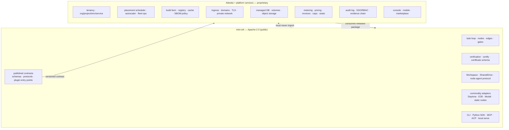

# ADR-2026-10-25 — Open-core boundary: what stays Apache-2.0, what becomes proprietary

> Status: proposed. Supersedes no prior ADR; codifies the rule already recorded
> in the operator's memory ("paid/tenant/secret features live outside the OSS
> repo") and the `ROADMAP.md` "hosted SaaS out of scope" stance.

## Context

The Railway-parity study (`docs/positioning/20261025-railway-parity-platform-gap.md`)
lists ~24 capabilities mini-ork needs to become a hosted platform. The question
is which of those may be built inside this Apache-2.0 repository and which must
be built in a private, proprietary codebase.

Constraints:

- `LICENSE` is Apache-2.0. Every commit already published is irrevocably open.
  A later relicensing cannot claw it back.
- `CONTRIBUTING.md` takes no copyright assignment, but contributors grant a
  **sublicensable** license — so the project can still be dual-licensed, but
  third parties can always fork what is already public.
- `GOVERNANCE.md` limits framework scope to the task loop + primitives;
  pipeline shapes live in recipes.
- `ROADMAP.md` explicitly places a hosted SaaS out of scope for this repo.
- A private control plane already exists: **Attestia**
  (`/Volumes/docker-ssd/ps/attestia`, TypeScript/Node + Postgres), which already
  ingests `mini-ork.certificate/v1` documents, seals them in an Ed25519/Merkle
  evidence chain, and exposes per-tenant runs/certificates/cost.

So the boundary must be drawn by **architecture**, not by license. Apache-2.0
does not stop a competitor from hosting the OSS. The proprietary asset is the
operated service, the private code that composes it, the tenant data and
certificate corpus, and the brand.

## Decision

Adopt a **three-layer open-core split**:



Dependency direction is one-way: **private → OSS**, never OSS → private.
The contract layer is public so third parties can integrate, self-hosters can
extend, and the private layer stays replaceable.

## The boundary test

Before writing a line, answer four questions. Any "yes" on 2–4 sends the
feature to the private repo.

1. **Does it only make sense across a team, over time, or under audit?**
   → private. (Seats, SSO, RBAC, retention, cross-run evidence, billing.)
2. **Is it multi-tenant?** Does it need an org/project/environment boundary,
   per-tenant quotas, or tenant-scoped secrets? → private.
3. **Is it policy rather than mechanism?** A protocol, a runner, or a registry
   is mechanism → OSS. Pricing, quotas, routing preferences, retention tiers,
   approval policy → private.
4. **Would a single developer self-hosting on a laptop get value from it
   without any server?** → OSS. If it only works after infrastructure is stood
   up, it is a hosted feature → private.

Corollary: when the private layer needs a hook in the OSS, upstream the
**generic seam**, never the commercial behavior. `register_workspace_backend`
is OSS; the bin-packing scheduler that uses it is private.

## What must stay OSS

These are the trust surface and the adoption surface. Opening them is what
makes the platform credible; hiding them would make the OSS a demo.

| Area | Why it stays open |
|---|---|
| Task loop, 8 node types, 6 edge types, gate types, memory namespaces | The framework's definition; governance scope |
| Verification engine, gate registry, `mini-ork certify`, `mini-ork.certificate/v1` schema | Proof must be independently checkable or it is marketing |
| `Workspace` / `SharedDrive` / node-agent protocol | The portability contract; third-party backends and self-hosting depend on it |
| Commodity provider adapters (Daytona, E2B, Modal, static nodes) | Integrations are not the moat; open adapters increase reach |
| Local CLI, Python SDK, MCP context server, ACP, local `serve` | Developer adoption and embedding |
| Recipe system, workflow schema, task-class schema | User-land extensibility; the governance model |
| Vault **interface** + generic backends (file, command, sops, OpenBao) | Security primitives must be auditable |
| Budget-guard **mechanism** (`MO_DAILY_BUDGET_USD`, ledger reads) | Cost safety is a trust feature; the pricing catalog is not |
| OTel emission | Standard protocol; the collector/backend is private |
| Plugin/extension registries | The seam the private layer attaches to |

## What must be proprietary

| Area | Why private |
|---|---|
| Org / project / environment / service / deployment model | The commercial product's spine; tenant-scoped by definition |
| Placement scheduler, bin-packing, node-pool autoscaler, fleet reaper aggregation | Operational economics; reveals capacity strategy |
| Build farm: queue, cache, registry credentials, SBOM/signing policy | Cost and security surface; per-tenant |
| Ingress, custom domains, TLS automation, private network, egress IPs | Infrastructure product; no value to a laptop user |
| Managed databases, volumes, object storage provisioning and backups | Operated service; partner contracts |
| Metering, pricing, credits, invoices, hard caps, committed-spend ladder | Business model |
| Audit log, SSO/SAML, RBAC, seats, retention tiers | Enterprise gates |
| Hosted evidence chain, cross-team certificate ingest, external anchoring | Attestia's paid surface |
| Console, mobile app, template marketplace, payouts/kickbacks | Product surface and supply-side economics |
| Fleet-wide observability aggregation and long retention | Per-tenant operational data |
| Learned routing policies / benchmark corpora operated as a service | Data moat; the OSS keeps BYO policies |

## The contract layer (public, versioned)

The private layer may only depend on these. If it needs more, add a contract
to OSS first.

1. **JSON schemas** — `schemas/*.schema.json` (task class, workflow, artifact
   contract, new deployment + verification-policy).
2. **Python protocols** — `Workspace`, `SharedDrive`, `NodeProvider`, gate
   evaluator, routing policy, store.
3. **HTTP surfaces** — the local `serve` API and the node-agent protocol.
4. **Plugin loading** — *add this*: `importlib.metadata.entry_points(group=
   "mini_ork.plugins")`, so a private package can register node handlers,
   gate evaluators, routing policies, workspace backends, and subcommands
   without patching core. Today the registries exist but there is no discovery
   path; the private layer would have to be imported explicitly.
5. **Certificate document** — already public and portable. That is deliberate:
   portability is the product's trust claim; the ingest/audit service is the
   paid layer.

Version the contract with SemVer, publish it in the package metadata, and
run the private repo's CI against the **released** package, not a source
checkout.

## Repo and dependency mechanics

```
mini-ork/                  Apache-2.0, public
  schemas/                 public contract
  mini_ork/plugins.py      entry-point discovery (to add)
  docs/OPEN-CORE.md        this policy, linked from README
  TRADEMARK.md             name/logo policy (to add)

attestia/                  proprietary, private
  server/                  control plane, tenancy, evidence chain
  app/                     console
  infra/                   k8s, charts, secrets
  sdks/                    private client SDKs if needed
```

- Private repo depends on `mini-ork` from PyPI with an exact pin
  (`mini-ork==X.Y.Z`), and vendors *nothing*. Upgrades are deliberate.
- Public examples may show the contract; they must not contain private
  endpoints, tenant identifiers, pricing, or roadmap.
- Public OSS CI must never need the private repo; private CI may clone OSS.
- The existing OSS guard in `scripts/mini_ork_worktree.py` already refuses
  commits containing confidential terms, investor language, and secret shapes.
  Extend its untracked `.mini-ork/oss-guard-terms.txt` with commercial
  identifiers (tenant slugs, billing terms, private package names, partner
  names) so a private concept cannot be merged into public `main` by accident.
- Add a `TRADEMARK.md`: Apache-2.0 grants copyright and patent rights, not
  trademark rights. A fork may use the code; it may not present itself as
  "mini-ork" or use the logo without permission. This is the only lever
  Apache-2.0 leaves, so use it explicitly.
- Keep the current contribution grant (sublicensable, no assignment). It
  preserves the option to dual-license without taking contributors' copyright.

## Mapping the Railway-parity gap register

| Gap | Layer | Note |
|---|---|---|
| R-01 tenancy model | private | Attestia |
| R-02 Postgres state backend | contract in OSS + private implementation | OSS gets a `Store` protocol; the hosted store is private |
| R-03 SSO/RBAC | private | |
| R-04 GitHub App | private | webhook + token handling is tenant-scoped |
| R-05 build plane | private orchestration; builder wrappers may be OSS | Buildpacks/BuildKit are external |
| R-06 service/deploy state machine | **contract in OSS** (schema + interfaces), runtime private | Self-hosters need the contract |
| R-07 placement scheduler | private | Node protocol and providers stay OSS |
| R-08 ingress/TLS | private | |
| R-09 private network | private | |
| R-10 managed data | private | |
| R-11 volumes/object storage | contract (`SharedDrive`) in OSS, backends private | S3 backend may be OSS if generic |
| R-12 metering/billing | private | Ledger reads stay OSS |
| R-13 observability pipeline | emitters OSS, aggregation/retention private | |
| R-14 audit log | private | Evidence chain is Attestia |
| R-15 PR previews | private | Uses OSS worktrees/runs |
| R-16 config as code | **schema in OSS**, service private | |
| R-17 templates marketplace | private | Recipe catalog stays OSS |
| R-18 sandbox API productization | **OSS** | High-leverage open surface; drives adoption |
| R-19 remote MCP | protocol in OSS, hosted auth private | |
| R-20 fleet reaper | protocol/hooks OSS, fleet aggregation private | |
| R-21 TS SDK + CLI deploy verbs | private (SDK), CLI plugin via entry point | |
| R-22 console | private | |
| R-23 BYOC/dedicated | private | Node-agent + cloud-init stay OSS |
| R-24 evidence bundle | **OSS** | The moat made portable; the audit service is paid |

## Moat reality check

Be explicit internally: Apache-2.0 means a competitor may fork the engine and
build the same hosting layer. Code secrecy protects the private repo, not the
market. Durable advantages are:

1. **Operated reliability** — the part customers cannot fork.
2. **Evidence corpus** — certificates, failure modes, benchmark data accumulated
   over time. Publish schemas, keep the corpus.
3. **Economics** — heterogeneous cheap-lane routing + idle reaping + cached
   builds produce a cost structure a naive fork does not have.
4. **Distribution** — IDE, MCP, chat connectors, template marketplace.
5. **Brand and trust** — the trademark, SOC 2 posture, and the "proof" claim.

Therefore: do not distort the OSS boundary to hide mechanisms that are already
open. Put the value in the operation, the data, and the integrations.

## Anti-patterns

- Putting a tenant id, org table, price, or license check in `mini_ork/`.
- A "temporary" private branch inside the public repo.
- OSS importing a private package behind an optional flag.
- Shipping a private feature that requires self-hosters to run a proprietary
  server to get basic value. (Violates the repo's two-tier delivery doctrine.)
- Calling an LLM-judged outcome "PROVEN" to make the paid surface look stronger.
- Adding a private feature without upstreaming the generic seam it needed.

## Consequences

- Every new feature starts with the four-question test; the default for
  business surfaces is private.
- OSS gains a small, generic plugin-discovery module and a published contract;
  that is the only structural change required.
- The private repo (Attestia) becomes the home of the Railway parity build-out:
  tenancy, build, deploy runtime, network, data, billing, console.
- Existing OSS functionality is untouched and cannot be withdrawn.

## Follow-ups

1. ~~Add `mini_ork/plugins.py` (entry-point discovery) + tests.~~ Done
   (`c554c0ad`) — the private package registers nodes, providers and routing
   policies through entry points, so it never imports an OSS internal module.
2. Add `docs/OPEN-CORE.md` and `TRADEMARK.md`; link from README/GOVERNANCE.
3. Extend the OSS guard term list with commercial identifiers.
4. Publish the deployment + verification-policy schemas in `schemas/`.
   (`schemas/deployment.schema.json` shipped in `c554c0ad`.)
5. Make the private repo pin a released `mini-ork` version and add a CI job
   that fails if it imports an OSS internal module not in the contract.
