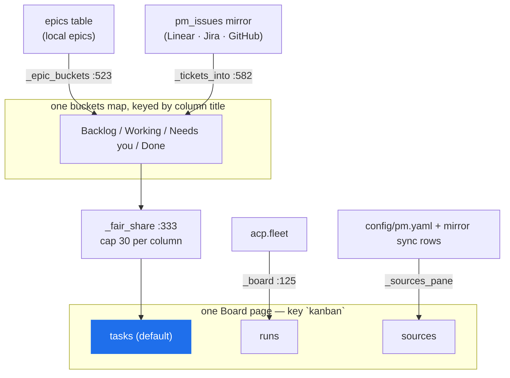

# EPIC — The consolidated board: one Board page over the PM mirror

> **Status: SHIPPED.** This epic is written *after* the fact. The behaviour it describes is on
> `main` today (commits listed in §1); the epic exists because the user asked for it by name and
> nothing in the repo tracked the requirement, so no verifier had a target to point at. Every
> claim below was read out of the running source, not out of an intention.
>
> **The ask, verbatim:** *"one Board page that reads the PM mirror (local epics plus Linear,
> GitHub and Jira tickets) as columns by status, alongside or replacing the runs-only view."*
>
> **The decision on "alongside or replacing": alongside.** The existing Board page keeps its
> runs view and gains a Tasks tab that is the default. One page, one nav entry, three tabs — the
> runs-only view was not deleted, and nothing that read it had to move.

**Goal.** The Board is where a person answers "what is in flight, and what needs me?" Before this
work it answered that only for *runs* (mini-ork's own executions). Work that arrives from the tools
a team already uses — Linear, Jira, GitHub — was mirrored into `state.db` by the PM layer and then
rendered nowhere. The consolidated board closes that loop: the mirror's tickets are drawn on the
same status columns as mini-ork's own epics, so an imported ticket and a local epic are two cards
in one "Working" column, not two screens.

---

## 1. What is shipped

| commit | what it added |
|---|---|
| `d28c2b0f` | board: draw imported tickets beside epics on the Tasks tab |
| `da2d3834` | board: every source gets a share of a capped column; one adapter rule |
| `a172baa5` | pm: register a second repo or team as its own source |
| `f7b45c84` | feat(ide): badge Board cards with the asks and overlaps that name them |
| `4379ff03` `8448f6bc` `19046260` `789a1376` | the Linear, Jira, GitHub and local adapters that fill the mirror |

The single artifact is `mini_ork/ide_pages/kanban.py` (page key `kanban`, title **Board**,
`kanban.py:52` `TABS = [("tasks", "Tasks"), ("runs", "Runs"), ("sources", "Sources")]`).

### 1.1 One `buckets` map, two producers

The load-bearing property. `_tasks_board()` (`kanban.py:622`) builds one
`buckets: dict[str, list[card]]` keyed by **column title** (`kanban.py:648`), then hands it to both
readers:

- `_epic_buckets()` (`kanban.py:523`) — mini-ork's own epics, from the `epics` table.
- `_tickets_into()` (`kanban.py:582`) — mirror tickets, from `mini_ork.pm.store`.

Both append `S.column(title, cards, c=colour)` into the same column dict, so a column is a
*merge*, not a choice. There is no second board for tickets and no configuration that produces one.



### 1.2 Columns, and the "never silently dropped" rule

`_TASK_COLUMNS` (`kanban.py:147`) is `Backlog / Working / Needs you / Done` — the scheduler's own
view of an epic, so the Tasks tab and `mini-ork epics list` cannot disagree about what "Working"
means.

Two mappings feed it, and **both are total**:

- `_task_column_for(status, held)` (`kanban.py:206`) for epics. A status outside the `epics` CHECK
  domain lands in **Needs you**, not in a fifth column and not nowhere (`kanban.py:144`). A
  `blocked` epic carrying a `held_reason` is a scheduler hold for a human and stays out of Backlog.
- `_ticket_column(state)` (`kanban.py:402`) via the closed `_TICKET_STATE` map
  (`kanban.py:159`): `backlog`/`todo` → Backlog · `in_progress` → Working · `blocked`/`in_review`
  → Needs you · `done` → Done. `canceled` is **deliberately absent from the draw path** — it is
  counted and reported in the section note instead, because a canceled ticket is noise, not work.

The rule that makes this safe is the same one the intake epic states as an invariant: *the source's
word is never lost*. `native_state` is drawn on the card (`kanban.py:456`), so a Linear state
mini-ork has no word for still reads as the string Linear used.

### 1.3 Per-source fairness — one flood cannot eat a column

`_fair_share(cards, cap)` (`kanban.py:333`) exists because one shared priority sort let whichever
source had more high-priority cards occupy the whole column. Each source is sorted on its own
(priority, then recency), then the sources **take turns — strongest head first — until the cap**
(`_TASK_CAP = 30`, `kanban.py:153`). One source alone still gets the full cap, so this costs
nothing in the single-source case.

`_card_source(card)` (`kanban.py:327`) is what makes "source" mean source, not provider string:
a second repo or team registered under the same provider is its own source (`a172baa5`).

### 1.4 The reader makes no network call

The Tasks tab reads the mirror **only** — through `mini_ork.pm.store`, with no adapter import and
no HTTP (`kanban.py:11-14`). A slow or broken source can neither slow nor blank the board. This is
what lets the board render at all when the credential is missing: there is nothing to time out on.

Two consequences that are behaviour, not accidents:

- A mirror row whose `provider` is `local` is **skipped** (`kanban.py:601`) — it is already drawn
  from the `epics` table, and drawing it twice would double every epic.
- A ticket whose link carries a `run_id` gets the same attention badges a Runs card would for that
  run (`_run_id_from_links`, `kanban.py:411`) — the lookup keys on the run the ticket points at,
  not on the ticket's own id.

### 1.5 Freshness, empty state, and the source filter

`_freshness_items()` (`kanban.py:462`) draws the list above the columns and **never leaves a blank
board**:

- No external source enabled → one line naming `config/pm.yaml`, `enabled: true`, and the
  `token_env` key (`kanban.py:480`). This is the state the live home is in today (§3).
- A source whose last sync recorded an `error` → a warn line with the source id and that error
  text, **rendered verbatim** because it was already credential-scrubbed at write time by
  `mini_ork/pm/http.py` (`kanban.py:468`). It must never be re-derived from a token here.
- Otherwise → when each source last synced.

Header buttons (`_source_actions`, `kanban.py:499`) filter what is drawn: **All** (epics + every
external ticket), **Epics** (`local`, epics only), or one button per provider id read from the
mirror. A missing mirror table costs the buttons, never the page (`kanban.py:515`).

`Sync tickets` runs `mini-ork intake once --dry-run` — it refreshes the mirror and **starts
nothing** (`kanban.py:1117`). `New task` opens a mini-ork thread (`/task …`), deliberately not a
`cli` action.

### 1.6 The Sources tab

`sources` replaces a status line that could only say "a source is stale" with one row per declared
source: its state, the capabilities it **declares**, its last sync, and any recorded error — plus
the two actions the pane exists for: an explicit `Test` (the only thing on the page that reaches
the network) and an `Add` box for `_ADDABLE = ("linear", "jira")` (`kanban.py:700`).

Adding carries the credential through a **terminal** prompt, never a page payload
(`kanban.py:21-26`): a value in a payload is a value in a log. The pane's section is titled `PM
sources` rather than `Sources` on purpose — the Tasks tab already has a `Sources` list, and a
second section of that name would make every `_section(page, "list", "Sources")` ambiguous rather
than fail.

### 1.7 The two tiers are upstream of this page

The page behaves identically under both tiers (`kanban.py:28-33`): the **simple tier** keeps the
mirror fresh with `mini-ork intake poll` over stdlib HTTP and the key in `secrets.local.sh`; the
**secure tier** keeps it fresh with the signed intake webhook and keys in sops/OpenBao. The board
only reads the mirror, so which tier filled it is not its business. This is the `CLAUDE.md`
two-tier rule satisfied by construction, not by a second code path.

---

## 2. Acceptance criteria

Each is checkable against the shipped source; the paths are the ones a verifier should point at.

- **AC-1 — one page, tickets and epics together.** `build(home, "tasks", args)` returns exactly one
  `columns` section whose columns are `Backlog / Working / Needs you / Done`, containing cards from
  both `_epic_buckets` and `_tickets_into`. *(`kanban.py:622-681`; `tests/unit/test_ide_pages_kanban_tickets.py`.)*
- **AC-2 — the runs-only view survives.** Tab `runs` still produces the four fleet columns
  (`Working / Needs you / Failed / Done`) with a 24-hour Done window (`kanban.py:60-68,125`).
  *(`tests/unit/test_ide_pages_kanban_epics.py`.)*
- **AC-3 — a source flood cannot own a column.** With one source contributing `> cap` cards and
  another contributing one, the second is still drawn. *(`_fair_share`, `kanban.py:333`.)*
- **AC-4 — no unmapped state is dropped.** Every `IssueState` maps to a column, and `canceled` is
  counted into the section note rather than drawn. *(`kanban.py:159-166,604-619,669`.)*
- **AC-5 — the board never blocks on a source.** The page imports no adapter and makes no network
  call; a provider exception lands in `errors["Tickets"]` and the rest of the board still renders.
  *(`kanban.py:11-14,652-657`.)*
- **AC-6 — no secret reaches the page.** Every string comes from `config/pm.yaml` key *names*, the
  registry's labels, or the mirror's already-scrubbed sync rows. The sentinel-grep test asserts
  this rather than trusting it. *(`kanban.py:690-695`; `tests/unit/test_ide_pages_kanban_tickets.py`.)*
- **AC-7 — an empty mirror explains itself.** With no external source enabled the Tasks tab draws
  the `config/pm.yaml` line, not a blank column. *(`kanban.py:479-482`.)*
- **AC-8 — every action on the page resolves.** Every `cli` action the page exposes parses a
  real subcommand. *(`tests/unit/test_ide_pages_actions.py`.)*

---

## 3. What the board cannot show today, and why

**Not a defect in this epic — the mirror is empty on the live home.** Verified 2026-10-16:

```
sqlite3 .mini-ork/state.db "SELECT count(*) FROM pm_issues"   →  0
sqlite3 .mini-ork/state.db "SELECT count(*) FROM threads"     →  3
```

Every external source in `config/pm.yaml` ships `enabled: false` and no source credential exists in
the vault. The board renders its truthful empty state (AC-7). Two operator actions make it
non-empty, and neither is code:

1. Put one credential in place — `LINEAR_API_KEY`, or `JIRA_API_TOKEN` + `JIRA_EMAIL`, or
   `GITHUB_TOKEN` — as a key **name** in `.mini-ork/config/vault.yaml` or
   `secrets.local.sh`, then set that source `enabled: true` in `config/pm.yaml`.
2. Restart the `mini-ork serve` on `:7090`. The IDE reads pages through it before it shells out to
   `board page`, and the running server predates the commits in §1 — so this page is invisible in
   the IDE until it restarts. (Measured 2026-10-16: listener PID 81516, up since Oct 15 14:17.)

Then: **Sync tickets** on the Tasks tab, and confirm a ticket card appears beside the epics in its
status column.

---

## 4. Verification commands

- `bin/mini-ork board page kanban --tab tasks --json`
- `bin/mini-ork board page kanban --tab tasks --json --arg source=local`
- `bin/mini-ork board page kanban --tab sources --json`
- `python3.11 -m pytest -q tests/unit/test_ide_pages_kanban_tickets.py tests/unit/test_ide_pages_kanban_epics.py tests/unit/test_pm_store.py`
- `python3.11 -m pytest -q tests/unit/test_ide_pages_actions.py`

## 5. Done when

The board is loaded in the IDE with at least one external source enabled, and a ticket imported
from that source appears on the same status column as the local epics — with the source's own key
(`ENG-123`) as the card title, its native state on the sub line, and a click opening the ticket's
page.
