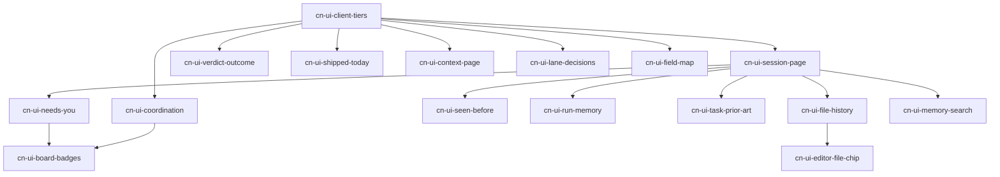

# EPIC — ContextNest in the mini-ork IDE: cross-session memory where the operator works

> Companion roadmap: `docs/epics/roadmap-contextnest-ide.md` (16 dispatchable epics, ids
> `cn-ui-*`, ingestible with `bin/mini-ork epics ingest`). This document is the why and the
> rules; the roadmap is the work.
>
> Built from a five-agent discovery pass on 2026-10-13: ContextNest API inventory, its own
> web UI, an audit of mini-ork's current integration, the IDE crate's rendering
> capabilities, and the operator's jobs-to-be-done, grounded in read-only GETs against a
> live ContextNest (517,804 fragments, 25,569 sessions, 136,911 trajectory atoms).

## 1. The problem

ContextNest (`/Volumes/docker-ssd/ps/ContextNest`, `127.0.0.1:28080`) remembers every agent
session: decisions, failures, verifications, shipped features with replay recipes, open
user actions, which sessions touched which file, and who is editing what right now. mini-ork
already *feeds* that memory to its planner — and almost none of it reaches the operator.
Of the ~20 `cn_client` functions, three are visible in the IDE; the rest only shape prompts.

The operator therefore re-diagnoses failures that were solved last week, cannot see that two
runs are editing the same file, and reads a 500-item inbox in a separate web app.

## 2. What ContextNest offers

| Domain | Routes (all under `/api/v1` unless noted) | Live state 2026-10-13 |
|---|---|---|
| Memory tools | `POST tools/{store,retrieve,update,summarize,discard,reconstruct,resonate}` (`src/api/tools.rs:2445`) | live; `retrieve` reads `top_k` |
| Sessions / forensics | `sessions`, `sessions/attention`, `sessions/by-{file,feature,intent}`, `sessions/:id/{summary,trajectory,active-state,prompt-preview,top-feature}`, `POST sessions/find` (`src/api/sessions.rs:3306`) | live; `by-file` sorts without recency (`sessions.rs:328`) |
| Features feed | `features?since=&layer=&project=` | 91 entries / 24 h, each with `how_to_test` |
| Inbox | `inbox?project=&urgency=` (`src/api/inbox.rs:112`) | mini-ork scope hits the 500-item cap in ~2 days |
| Prompt context | `prompt-context/{atoms,clusters,capsule}` (`src/api/prompt_context.rs`) | deterministic Markdown, no LLM call; **no UI anywhere** |
| Outcome reinforcement | `POST agent/outcome` (`src/api/agent_outcome.rs:228`) | ±0.05 per call on atom confidence |
| Coordination | `coord/{principals,overlaps,freezes,intents,topic-pairs,hot-claims,owns-violations,leases,metrics}` (`coord_*.rs`) | 140 overlaps, 134 open, 1 acked; 31 owns violations |
| Field / graph | `field/basins`, `fragments`, `connections`, `graph/*` | `field/basins`, `fragments`, `substrate/consolidation` **hang** at this scale |
| Substrate / admin | `substrate/{health,config,replay}`, `/llm/v1/cache/stats` | health is cached; replay lag ~12k |
| Multi-tenant v2 | `/api/v2/*`, Bearer-gated (`src/api/tenants.rs:45`) | built, inert unless `CONTEXTNEST_TENANTS_FILE` is set |

The core API has **no authentication** (`src/api/middleware/mod.rs:124`) — a deliberate
v0.1.0 choice that the IDE's secure tier must not inherit (§6).

## 3. What the IDE shows today

| Surface | Source | What it shows |
|---|---|---|
| Header flag | `mini_ork/ide_pages/header.py:99` | ContextNest up/down, 0.5 s ping |
| Context page | `mini_ork/ide_pages/context.py` | reachability chip; newest run's local `context-pack.json`; hook status; a "Cache" panel of **local** sqlite counters |
| Coordination tab | `mini_ork/ide_pages/orch.py:370` | principals, hot claims, owns violations (the only live CN data in the IDE) |

Gaps the discovery found, all of them input to the roadmap:

- `cn_client.retrieve` sends `limit`; ContextNest reads `top_k` (`cn_client.py:123` vs
  `tools.rs:79`) — every caller silently gets the default.
- `sessions_by_feature` has no caller anywhere.
- `docs/CONTEXTNEST-INTEGRATION.md` claims six role packs; `role_pack_md`
  (`mini_ork/steering/context_role_packs.py:165`) implements the planner only.
- The Context page can say "connected" while the planner receives nothing:
  `MO_PLANNER_SHARED_CONTEXT` is off by default and is not shown.
- The "Cache" panel is local reuse counters, not ContextNest's LLM cache.
- `hooks/subagent-stop.sh:115` marks every prefetched atom `success` when a subagent
  finishes — including runs that are later rejected. That poisons the reward signal.
- The 0.5 s timeout reports a slow ContextNest as down; it stalled for ~30 s during probing.

## 4. Operator jobs, ranked by value × frequency

| # | Job | Question | ContextNest answer | IDE placement | Read / write |
|---|---|---|---|---|---|
| 1 | What needs me | Which sessions are blocked on me, and on which run? | `inbox`, `sessions/attention` | Inbox page section; Board "Needs you" badge | R (+resolve, CN-side) |
| 2 | A run failed | Have we hit this before, and what fixed it? | `tools/retrieve` on the error tail; `prompt-context/atoms?kind=failure` | Run outcome + node failure: "Seen before" card | R + W (helped / wrong) |
| 3 | Reviewing a verdict | What did the agents decide or assume? Did earlier sessions break these files? | `sessions/:id/trajectory` per node session; `sessions/by-file` | Run page: decisions list; Changes tab: per-file history | R + W (verdict → outcome) |
| 4 | Concurrent sessions | Is another run editing my files? Who yields? | `coord/overlaps`, `coord/intents`, `coord/topic-pairs`, principals mailbox | Coordination tab: overlaps with Ack, duplicate-work pairs, message composer | R + W (ack, message) |
| 5 | Opening a file | Who touched this file, why, and is anyone in it now? | `sessions/by-file`, `coord/hot-claims` | Editor status chip → file-history page | R |
| 6 | Writing a task | Was this done or tried before? | `sessions/by-feature`, `prompt-context/capsule` | `/task` / `/kickoff` draft card: "Prior art" | R |
| 7 | Start of day | What shipped since yesterday, how do I re-test it? | `features?since=24h` | Inbox header strip, copy `how_to_test` | R |
| 8 | Choosing lanes | What did I already decide for this kind of work? | `prompt-context/capsule?query=lane` | Lanes page "Past decisions" | R |
| 9 | Exploring memory | What does the substrate know about X? | `tools/retrieve`, `by-feature`, `by-file` | Memory search tab | R |

## 5. Design rules (every epic inherits these)

1. **Scope, never global.** ContextNest is global across every project; a 24 h feed pulled
   during discovery contained personal documents. IDE surfaces query by run, by file, or by
   the project's own paths — never an unfiltered feed. The `project` filter matches session
   cwd, not the repo touched, so filter mini-ork work by `files[]` paths.
2. **Slow is not down.** Render the page from mini-ork's own data first; ContextNest
   sections fill from a short-timeout fetch with a last-good cache, labelled "as of HH:MM"
   when stale. Availability and data timeouts are separate settings.
3. **Fail visibly.** When ContextNest is off or unreachable, a section says so in one line
   with how to start it. It never renders empty-as-if-nothing-happened.
4. **Never execute ContextNest text.** `how_to_test` recipes and principals' `kill_recipe`
   lines are untrusted: copy, or run behind a `confirm`, never automatically.
5. **Writes are operator-initiated and confirm-gated** (outcome, ack, message), and only on
   the secure tier's scoped token when that tier is configured.
6. **Rewards come from verdicts, not completion.** Outcome write-backs follow the run's
   verdict (approve/merge → success, reject/rollback → failure) or an explicit operator
   click — never a subagent finishing.
7. **Show the evidence.** Every memory shown carries its score and source session, and
   opens that session. Semantic matches can be wrong; the operator must be able to tell.

## 6. Two tiers — one config chooses

| | Simple (laptop) | Secure (shared / cloud) |
|---|---|---|
| Endpoint | `CN_BASE_URL`, default `http://127.0.0.1:28080` | the v2 tenant API (`/api/v2/*`) behind TLS |
| Credential | none — the local service has no auth | Bearer token resolved **by key name** from the secret store; never in a log, argv or URL |
| Scope | the operator's own sessions | per-principal token; the server enforces scope |
| Writes | allowed, confirm-gated | allowed only with a write-scoped token |
| Failure | missing service → visible "not running" line | missing token → hard error naming the key; never a silent fall back to the unauthenticated tier |

The tier is chosen in one place (`config/contextnest.yaml`, overridable by environment), so a
user starts on the laptop tier and switches without touching any page code.

## 7. Engine-only vs. IDE (Rust) work

The crate renders ~20 data-driven section kinds (table, kv, list, story, markdown, columns,
composer, callout, chips, …; `mini-ork-ui/src/page.rs:809`) and pages can auto-refresh via a
`refresh` field. **Fourteen of the sixteen epics are engine-only** — Python in
`mini_ork/ide_pages/` plus a `PAGES` entry. Two need Rust in the `mini-ork-ui` repo:

- an editor hook that knows which file is open (no hover, gutter or buffer hook exists);
- a non-DAG canvas for the semantic field map (only the run DAG has a canvas).

Rust epics are edited in `/Volumes/docker-ssd/ps/mini-ork-ui` (its own repo), verified with
`cargo test -p mini_ork_ui` inside `/Volumes/docker-ssd/ps/zed-mini-ork`, then pinned in
both superprojects. Never edit a submodule checkout.

## 8. ContextNest-side prerequisites (file these in the ContextNest repo)

These are not mini-ork work and are not in the roadmap; three epics name them as related.

| Change | Why | Blocks |
|---|---|---|
| A resolve/ack route for `user_action` inbox items | they have no status and never leave the inbox (`inbox.rs:410`) | inbox write-back |
| Recency ordering for `sessions/by-file` | today's author sorts last (`sessions.rs:328`) | file history (worked around client-side meanwhile) |
| Unblock `field/basins`, `fragments`, `substrate/consolidation` | they hang at current scale (lock contention suspected) | field map |
| Filter by files touched, not session cwd | `project=ps/mini-ork` returns 0 for mini-ork work | cleaner scoping (worked around via `files[]`) |

## 9. Delivery order

Start with `cn-ui-client-tiers` (every other epic reads through it), then
`cn-ui-session-page` (the drill-down every card opens), then the top four jobs.

## 10. Out of scope

- Changing ContextNest itself (§8 lists what to file there).
- Non-planner role packs at runtime — a runtime parity task, not IDE visibility.
- The LLM proxy and the multi-tenant v2 *server* (the secure tier only consumes it).
- Any auto-execution of commands sourced from ContextNest.
