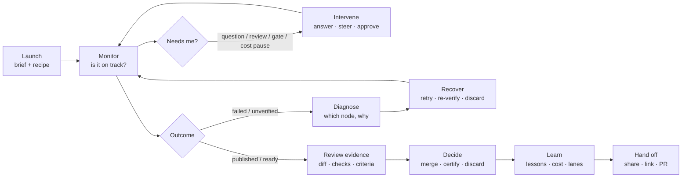

# Run page — Jobs-to-be-Done UX review (2026-10-15)

> **Superseded in one part (2026-10-16).** Every **Buddy** finding below — the
> Story/Graph section, its per-line report feed, and the "drop empty
> *Buddy — 0 reports*" item (C17) — describes a surface that no longer exists.
> The run buddy was removed; one orchestrator per run now narrates each stage
> and takes steering in an agent thread, opened by the run page's
> **Orchestrator** button (`{"thread": "/orchestrator <run>"}`) or
> `/orchestrator` in any thread. The rest of the review — tabs, hero,
> verification badges, the Inspector — stands as written.

Scope: the mini-ork **run main page** in the IDE (Zed fork), i.e. `MiniOrkPage` with `key=run`
(`zed-mini-ork/crates/mini_ork_ui/src/page.rs`, rendered element `#mini-ork-page`, `page.rs:2107-2128`),
fed by the engine's page builder `mini_ork/ide_pages/run.py` (+ `outcome.py`, `run_story.py`,
`node.py`, `run_dock.py`), and the run graph it embeds (`graph.rs`, `flow.rs`, `node_tab.rs`).

The IDE builds every page with `MINI_ORK_IDE_SPEC=2` (`board.rs:194`), so the live page is the **v2**
build (`run.py:_build_v2`): tabs **Story · Graph · Questions · Kickoff · Agents · Learnings · Artifacts**.

## How this review was done

- **Code read** of the renderer and engine builders, with file:line evidence throughout.
- **Live renders.** Five real runs were rendered exactly as the IDE does it, with the same command and env:
  `MINI_ORK_IDE_SPEC=2 mini-ork board page run --tab <t> --arg run=<id>`. Every v2 tab was captured.

  | Run | State |
  |---|---|
  | `run-1792091750-1339` | running, framework-edit |
  | `hr-smoke-d-191036` | failed in DB, retry gate open |
  | `hr-smoke-b-152611` | parked for review |
  | `run-1792047347-71903` | published, on a Daytona sandbox |
  | `run-1792083883-77706` | published |

- **Limitation:** the IDE is a native GPUI app, so there are no screenshots. Layout claims come from the render code, not pixels.

---

## 1. Who hires the run page

| Performer | Hires the page to… | Frequency | Stakes |
|---|---|---|---|
| **Operator** (launched the run, usually also the reviewer) | know if the factory is producing a trustworthy change and what it needs from them | many times per run | wasted spend, bad code landing, blocked work |
| **Reviewer / approver** | decide merge / retry / discard with confidence | once or twice per run | shipping an unverified change |
| **Framework maintainer** | tell "the task was hard" from "mini-ork is broken", and fix the factory | daily | the loop silently degrading |
| **Cost owner** | keep spend inside the cap and know where it went | daily | budget blow-outs |
| **Teammate / stakeholder** | understand what happened without the context | occasionally | trust in agent-made changes |

### Primary job

> **When** I have handed a task to the factory,
> **I want to** know at a glance whether it is producing a change I can trust, and exactly what it needs from me,
> **so I can** ship verified work without babysitting agents or reading logs.

- **Functional:** status, decision, evidence, action.
- **Emotional:** in control, not anxious that something is silently wrong, not tricked by a green badge.
- **Social:** "I shipped a change that was *proven*, and I can show why."

### Job map



Pain clusters, from the evidence below: **Monitor** (stale or contradictory status), **Diagnose/Recover** (misattributed cause, unexplained retry), and **Review** (the diff and the proof are not on the main page).

### What the page really competes with

| Competitor for the job | Why people reach for it | Where it falls short |
|---|---|---|
| Asking Claude Code in chat "what's the status of that run?" | one sentence, names the next action | not shared, not durable, costs tokens |
| `mini-ork board` / `status` / tailing `execute.log` in a terminal | always fresh, never stale | no evidence view, no decisions |
| The right-dock **Run panel** (`view=dock`: Changes · Checks · Agents · Cost · Learned) | it has the diff and the checks | 380 px, secondary, no DAG |
| The **web UI** at :7090 | linkable | a different home and a different code copy (see the researcher re-vendor) |
| The GitHub PR page | the familiar place to review and merge | knows nothing about the verification level vector |
| Non-consumption: wait for the toast | zero effort | toasts don't say why, and no OS notification |

**Implication:** the run page wins only if it answers the "status + next action" question faster than asking Claude, and shows the proof the PR page cannot.

---

## 2. What is on screen today

Top to bottom on every run tab (`page.rs:2062-2104`):

1. **DAG strip.** About 280 px, strip-only mode (`page.rs:2083-2092`, `graph.rs:58`).
   - It sits **above** the title.
   - It is built one frame late, so the layout jumps (`page.rs:2077-2087`).
   - Clicking a node opens a **separate node tab** (`page.rs:1784-1798`).
2. **Header** (`page.rs:584-654`):
   - title (kickoff heading);
   - chips: state, cost, elapsed, plus ✋ questions and `remote · <env>` when present;
   - the run id with a Copy button, then desc (up to N lines), then sub (`recipe · branch · id`).
   - Under v2 the header **actions are empty** (`run.py:2701`).
3. **Tab bar.** Seven tabs, no counts, no badges (`page.rs:656-685`).
4. **Sections** for the tab, in a two-column grid (`page.rs:689-795`).

What each tab carries (live renders):

| Tab | Sections today |
|---|---|
| **Story** | triage (state text, counts, verification badges, actions + ghost menu) · hero "What this run is for" · Decisions and assumptions · What happened (one row per node) · Buddy — N reports · Steer composer (running only) |
| **Graph** | dag · Agent roster table · Run totals · inspector (hidden once the strip owns the canvas) · Coalition pills · Buddy |
| **Questions** | open asks with answer composers, or a "No open questions" callout |
| **Kickoff** | the brief as markdown |
| **Agents** | Agent roster (same table as Graph) · Cost by stage |
| **Learnings** | produced · available · constraints · verified lessons · contract · injected per node |
| **Artifacts** | one flat table (67 rows on a small code-fix run) |

---

## 3. Twenty-five user journeys and how the page serves them

Grades: ✅ served well · ⚠️ partly served · ❌ broken or missing. The "Fix" column points at changes in §5.

| # | Journey (When → I want → so I can) | Stage | Today | Grade | Fix |
|---|---|---|---|---|---|
| J1 | **Opening the run** → see state, progress and whether it's on track → decide if I can look away | Monitor | The canvas sits above the title. The chip shows raw engine words (`needs_you`, `done`). There is no "updated at", and a revisited tab can be stale (§4 F2). | ⚠️ | C3 C6 C7 C27 |
| J2 | **The run needs me** → know exactly what it needs and act in one place → unblock it fast | Intervene | A parked run shows **two** "Waiting for your review" blocks, and only one has buttons. Retry-gate callouts can have **empty text** (`hr-smoke-d`). Actions exist only on the Story tab. | ❌ | C4 C5 C6 |
| J3 | **An agent asked a question** → answer it inline → resume the run | Intervene | The header ✋ chip and the Questions tab composer work. The tab label has no count, and every run shows the tab even with no questions. | ⚠️ | C12 |
| J4 | **It's drifting** → steer the running agent → avoid a wasted run | Intervene | The Story tab has a composer. Send clears the box, then a generic toast `mini-ork board steer …: Done.`. There is no receipt saying which node got it. The composer is also offered on parked runs (`_running` treats `reviewing` as running). | ⚠️ | C14 |
| J5 | **Runaway cost or time** → stop or kill now → cap the damage | Intervene | Off the Story tab there is **no** Stop or Kill: the v2 header is empty. The node inspector's **Kill fires with no confirm** (`graph.rs:867-877` calls `store::perform`, which ignores `confirm`; the engine asks for one at `node.py:634`). | ❌ | C1 C6 |
| J6 | **Watching a node work** → see live output and the DAG advance → trust progress | Monitor | The node tab Stream polls every 1.5 s, which is good. The page is not re-read mid-node (the board doesn't change), and a node tab's DAG **never updates** (no model subscription). | ⚠️ | C2 |
| J7 | **It failed** → see which node failed and why, in one line → decide fix vs retry | Diagnose | On `hr-smoke-d` the triage says **"The typecheck check could not reach something it needs"**, but the story shows typecheck *done* and **reviewer failed**. The real reason is in `retry-hint.json`: "Not published: target, contract unverified". The canvas shows only ✗. | ❌ | C3 C13 |
| J8 | **Retry offered** → know what the retry will do, from where, and at what cost → approve with confidence | Recover | "Approve retry" / "Leave it" appear with **no explanation** when `fix_steps` returns nothing (`outcome.py:400-437`). The plan (`recover --strategy verify --from-node test`) is in the hint but not shown. Node tabs have no Retry. | ❌ | C4 |
| J9 | **Before merging** → read the diff → know what will land | Review | The diff is in the right-dock Run panel ("Changes") or per-node Changes. The main page has no Changes tab. | ⚠️ | C8 |
| J10 | **It says verified** → see what was *proven*, by which check → not be fooled by green | Review | The verification badges (`applies/executes/target/preserve/contract PROVEN/UNVERIFIED`) are mini-ork's core trust signal, but they have no tooltip and no click-through (`sections.rs` has 0 tooltips). A "Published · verified" headline sits next to a yellow "contract UNVERIFIED". | ⚠️ | C9 |
| J11 | **Ready** → approve, merge or discard safely → land or drop the change | Decide | Page-level confirm prompts are good (`page.rs:521-547`). Merge appears only with a worktree. Actions hide off Story. Toasts show raw argv. | ⚠️ | C5 C6 C15 |
| J12 | **I want a certificate** → certify a finished change → attach proof to the PR | Decide | "Certify this change" is in the menu even while the run is **running**. | ⚠️ | C6 |
| J13 | **What was it asked to do?** → read the brief and criteria → judge the outcome against intent | Review | The Kickoff tab and the hero show goal and criteria. | ✅ | — |
| J14 | **Did it meet the criteria?** → see each criterion met / unmet / unknown with evidence → accept or push back | Review | Criteria are listed in the hero but **not checked** against any evidence. | ❌ | C10 |
| J15 | **Spend** → see cost so far, per node, and against the cap → keep budget | Learn | There is a cost chip and "Cost by stage" on Agents. No budget-remaining or projection on the page; the cost-pause state is only text. | ⚠️ | C16 |
| J16 | **Who did what** → see which model or lane ran each node, and any fallback → trust and tune routing | Learn | The roster table and coalition pills exist. A fallback or reroute isn't flagged. The roster is duplicated on Graph and Agents. | ⚠️ | C17 |
| J17 | **Where did it run?** → see placement (local or sandbox), worktree, branch; open files → reproduce or inspect | Monitor | The `remote · daytona` chip (new) and branch in the sub. The v2 sub dropped the worktree path; "Open run folder" is in the menu. | ⚠️ | C18 |
| J18 | **Related runs** → jump to the parent epic, retries or recoveries, and children → follow the whole story | Diagnose | No breadcrumbs or links; the node tab's run id is plain text (`graph.rs:917`). | ❌ | C18 |
| J19 | **Coming back later** → find the run among tabs and trust it's current → resume where I was | Monitor | The tab label is `run-71903` (`page.rs:82-94`). Re-opening an open tab doesn't reload (`page.rs:2241-2250`). Missed updates are consumed (`page.rs:1891-1904`). Run tabs are **lost on restart** (no serializable-item support). | ❌ | C2 C11 C20 |
| J20 | **Hand off** → copy a one-paragraph summary with a link → put it in the PR or chat | Hand off | Copy run id and "Open in web UI" exist. There is no summary export. | ⚠️ | C21 |
| J21 | **Find an artifact** → get to the verdict, diff, evidence and logs fast → audit | Diagnose | One flat 67-row table with no grouping or search. | ⚠️ | C22 |
| J22 | **What did it learn and use?** → audit injected vs produced lessons; promote or reject → improve the loop | Learn | Rich read-only lists with no actions. | ⚠️ | C23 |
| J23 | **Replay** → watch the run unfold → explain it to someone | Learn | Flow map replay with speeds is good. The ticker re-renders the page every 50 ms (`flow.rs:1565-1587`). | ✅ | C24 |
| J24 | **Is this a mini-ork bug?** → tell a factory fault from a task fault and open a triage → fix at the source | Diagnose | "Open run folder" only; no attribution. | ⚠️ | C25 |
| J25 | **Pull me back** → be told when a run needs me or finishes while I'm elsewhere → no polling | Monitor | Toasts fire when a run leaves `working`; there are no OS notifications. The status bar's "need you" and the title bar's "need you" open **different** pages (`status.rs:173-181` vs `title_bar.rs:189-202`). | ⚠️ | C26 |

Score: **3 ✅ · 15 ⚠️ · 7 ❌.** The ❌ journeys are the ones that decide trust: intervene (J2, J5), diagnose and recover (J7, J8), review against criteria (J14), related runs (J18), and coming back (J19).

---

## 4. Cross-cutting findings (ranked)

- **F1 — Status signals contradict each other.** On one page (`hr-smoke-d-191036`):
  - DB status: `failed`
  - header chip: `needs_you` (raw word)
  - triage: blames **typecheck**
  - story: typecheck ✓, **reviewer ✗**
  - counts: `checks 2/2` green
  - verdict notes: "Diff is exactly the planned fix"

  A user can't tell what happened. This is the single biggest trust leak; it undercuts the verification story the page exists to tell.
- **F2 — The page can be stale without saying so.**
  - Updates are dropped inside the 2 s throttle with no trailing reload (`page.rs:389-391, 1902`).
  - A background tab consumes the board generation without reloading, and activation never reloads (`page.rs:1891-1904, 2241-2250`).
  - Node tabs never get a new model.
  - A failed refresh **replaces** good content with an error and offers no retry (`page.rs:488, 2057-2061`).
  - There is no "updated at".
- **F3 — Destructive actions bypass confirmation** from the node inspector (`graph.rs:867-877`, `store.rs:476-486`). One click kills the whole run.
- **F4 — The next action is not anchored.** Under v2 the header carries no actions (`run.py:2701`), so Stop, Kill, Approve and Merge exist only in the Story triage. The page's most important button moves or disappears with the tab.
- **F5 — The proof is hidden.**
  - The verification level vector is unexplained and not clickable.
  - Criteria are never checked.
  - The diff lives in a side panel.
- **F6 — Duplication and noise crowd out the signal:**
  - two review blocks on a parked run;
  - the roster on two tabs;
  - Buddy on two tabs;
  - "Buddy — 0 reports" rendered as a section;
  - an empty Questions tab on every run.
- **F7 — Identity is weak.**
  - The tab label is the id's suffix.
  - Opening via `open_page` or `MINI_ORK_IDE_OPEN` passes an empty title, so even the tooltip is the bare id.
  - Node tabs use a third id scheme.
- **F8 — No keyboard path.** No actions are registered in `page.rs`. The graph key context has no bindings, and the ↑/↓ node buttons are mouse-only (`graph.rs:1602-1603`).
- **F9 — Action feedback is raw.**
  - The toast is `mini-ork <argv>: Done.`, with one shared toast id, so concurrent actions overwrite each other (`store.rs:658-676`).
  - Clicked buttons show no pending state.
  - The subprocess path has **no timeout** (`board.rs:196-201`).

---

## 5. Proposed changes

Each change says where it lands: **E** = engine (`mini_ork/ide_pages/*.py`), **I** = IDE (`crates/mini_ork_ui`).

### P0 — trust and safety (do first)

| # | Change | Layer | Serves | Acceptance |
|---|---|---|---|---|
| **C1** | Honour `confirm` in `store::perform`, so every action path asks (node inspector, flow markers, composers where configured) | I `store.rs` | J5, J11 | Node-tab Kill shows the same Yes/Cancel prompt as the page; a unit test on `perform` with a `confirm` action |
| **C2** | Never stale. Queue a trailing reload when `may_reload` refuses; reload on tab activation when `seen_board` moved since the last load; push the model into open node tabs; keep the last good content on a failed refresh and show "stale since hh:mm · Retry" | I `page.rs`, `node_tab.rs` | J1, J6, J19 | A run finishing while its tab is in the background reads "done" within 2 s of activation; a node tab's DAG advances |
| **C3** | One truthful status. Triage names the **actual** failing or blocking node and the real reason (fall back to `retry-hint.notes`, never a node that passed); chips use human words; DB status, chip and triage agree | E `outcome.py`, `run.py` | J1, J7 | Golden test: for every fixture run, the triage node equals the first failed or blocking story step; no snake_case chip text |
| **C4** | Every decision explains itself. A retry or gate callout always shows what will happen (strategy, from-node, the exact command, estimated cost), built from `retry-hint.json` when `fix_steps` is empty. No callout ships with empty text. | E `outcome.py:_gate_needs_you` | J2, J8 | `hr-smoke-d` shows "Re-verify from `test`: target and contract are unverified; publishes when every level is PROVEN" |
| **C5** | One attention block. Merge the parked-review callout, gate callout, cost pause, merge approval and open questions into a single "Needs you" lane at the top, each item with its own buttons | E `run.py:build` + `outcome.py` | J2, J3, J11 | A parked run shows exactly one review block with Approve / Request changes |
| **C6** | A sticky run bar on every tab: title · state · progress · cost · elapsed · **the one primary action**. State-aware: Stop/Kill when running; Approve/Answer when needs-you; Re-verify/Retry when failed; Merge/Certify when done. The secondary menu stays a ▾. Certify is hidden while running. | E `_build_v2` (header `actions` again) + I `page.rs` sticky header | J1, J5, J11, J12 | On the Agents tab of a running run, Stop is one click away |
| **C7** | Timeouts and errors. Add a subprocess timeout for page reads and actions; error state keeps content | I `board.rs`, `page.rs` | J19 | A hung CLI shows "timed out · Retry" after 20 s |

### P1 — make the core jobs fast

| # | Change | Layer | Serves |
|---|---|---|---|
| **C8** | A **Changes** tab on the main page (diff stat, files, per-file open, "Open as patch"), reusing the dock's changes builder | E `run.py` V2_TABS + `run_dock` | J9 |
| **C9** | A **Checks** tab, with verification badges that explain themselves: a tooltip in plain words ("target PROVEN = the failing test now passes at the true base") and a click-through to the evidence file or check row | E + I `sections.rs` triage counts get `tip` + `do` | J10 |
| **C10** | A criteria checklist: each success criterion marked met / unmet / unknown, linked to the check or evidence that decided it | E `run.py` story hero + verdict | J14 |
| **C11** | Tab label = short task title + state glyph; the id moves to the tooltip. Always pass the title on every open path. | I `page.rs:label`, `open_page`, `MINI_ORK_IDE_OPEN` | J19 |
| **C12** | Tab badges: `Questions · 2`, `Checks · 1 ✗`, `Changes · 3 files`. Collapse empty tabs into a quiet state rather than a full callout. | E tab labels/counts + I `render_tabs` | J3, J1 |
| **C13** | Failure on the canvas: the strip opens on the **failing or blocking** node (not "last ran"), and a failed node shows a one-line reason plus a tooltip | E `_graph` node fields + I `graph.rs` | J7 |
| **C14** | Steering receipt: "Sent to `implementer` at 14:02 · delivered", the composer disabled while sending, and a correct label on parked runs | I `sections.rs` + E steer ack | J4 |
| **C15** | Action feedback: a pending spinner on the clicked button, human toasts ("Run stopped"), one toast id per action | I `store.rs`, `components.rs` | J5, J11 |
| **C16** | Cost against the cap: run spend vs per-run and daily cap, per-node cost on the canvas, and a cost-pause callout with Resume | E + I | J15 |
| **C17** | De-duplicate: the roster lives only on Agents; Buddy only on Story; drop empty "Buddy — 0 reports"; flag fallback or reroute nodes in the roster | E `run.py` | J16, J1 |
| **C18** | Breadcrumbs and relations: `epic › run › retry #2` in the header; links to parent, children and recoveries; clickable run id in node tabs; the worktree path back in the sub | E header `crumbs` + I `render_header`, `graph.rs:917` | J17, J18 |

### P2 — polish and power use

| # | Change | Layer | Serves |
|---|---|---|---|
| **C19** | Keyboard: ⌘1…⌘7 tabs, `j`/`k` nodes, `Enter` opens, `.` runs the primary action, `Esc` closes. Register bindings for the `MiniOrkRunGraph` context. | I `page.rs`, `graph.rs`, keymaps | all |
| **C20** | Restore run and node tabs after restart (serializable-item support) | I | J19 |
| **C21** | "Copy summary" as markdown (goal, outcome, verification vector, diff stat, cost, link) for a PR or chat | E + I | J20 |
| **C22** | Artifacts grouped by node and kind; key artifacts (diff, verdict, evidence) pinned on top; a filter box | E `_artifacts_tab` | J21 |
| **C23** | Learnings actions: promote or reject a produced lesson; show which injected lessons were actually used | E + I | J22 |
| **C24** | Throttle the replay ticker the same way as the other animations | I `flow.rs` | J23 |
| **C25** | Fault attribution in the failure triage: "looks like a mini-ork fault (harness, lane, env) → open triage epic" vs "task fault → retry" | E `outcome.py` + recovery blame | J24 |
| **C26** | Notifications and coherence: OS notification on needs-you or failed; one "need you" destination across status bar and title bar; the status-bar "failed" applies the filter | I `status.rs`, `title_bar.rs` | J25 |
| **C27** | Layout: header and run bar first, the strip compact and collapsible below it, no frame-late jump (reserve the strip's height). Node text has a minimum readable size; the filter matches the words on screen; tooltips on truncated labels. | I `page.rs`, `graph.rs` | J1, accessibility |

### Target layout

```
┌──────────────────────────────────────────────────────────────────────────────┐
│ Fix add() in calc.py                    ● failed · re-verify ready   [Re-verify ▸] ▾ │  ← sticky run bar (C6)
│ epic-42 › run-…71903 › retry #1 · code-fix · remote · daytona · $0.43 · 8m 42s      │  ← breadcrumbs (C18)
├──────────────────────────────────────────────────────────────────────────────┤
│ NEEDS YOU (1)                                                                 │  ← one attention lane (C5)
│  ? Retry gate — re-verify from `test`: target + contract unverified.          │
│    Runs: mini-ork recover … --strategy verify --from-node test (~$0.10)       │  ← self-explaining (C4)
│    [Approve re-verify]  [Leave it]                                            │
├──────────────────────────────────────────────────────────────────────────────┤
│ planner ─ implementer ✓ ─ typecheck ✓ ─ test ✓ ─ reviewer ✗ "contract unverified" ─ … │  ← compact strip, failing node focused (C13)
├──────────────────────────────────────────────────────────────────────────────┤
│ Story │ Changes·1 │ Checks·2✗ │ Graph │ Questions │ Agents │ Learnings │ Artifacts │ Kickoff │  ← badges (C12)
└──────────────────────────────────────────────────────────────────────────────┘
```

---

## 6. Desired-outcome metrics (how we'll know)

| Outcome | Measure | Today | Target |
|---|---|---|---|
| Time to truth | Seconds from opening a run tab until state + next action are readable, with no scrolling | strip first, then header; raw words | first paint, 0 scroll |
| No contradictions | Fixture runs where the triage node ≠ the first failed or blocking step | ≥1 of 5 rendered (`hr-smoke-d`) | 0 (golden test) |
| Unexplained decisions | Decision callouts with empty text | ≥1 (`hr-smoke-d`) | 0 (test) |
| Unconfirmed destructive actions | Paths to Kill/Discard/Merge without a prompt | node inspector | 0 |
| Staleness | Page state ≠ board state for more than 2 s while in front or after activation | possible indefinitely | 0 |
| Clicks to diff | From opening the run to reading the diff | dock or node tab | 1 |
| Clicks to the primary action | From any tab | Story only | 1, every tab |
| Duplicate sections | The same section on two tabs | roster, Buddy | 0 |

## 7. Suggested sequencing

1. **Week 1 — trust:** C1, C2, C3, C4, C5, C7. Engine changes get fixture-run golden tests; IDE changes get unit tests on `perform` and reload.
2. **Week 2 — anchor + proof:** C6 sticky run bar, C8 Changes tab, C9 explainable badges, C13 failure on the canvas.
3. **Week 3 — speed:** C10, C11, C12, C14–C18.
4. **Later:** P2.

Two rules carry through every step:
- **Engine first.** Most fixes are page-JSON changes, and every IDE renders the JSON, so the web UI benefits too.
- **The IDE only renders what the engine decides.** No status logic in Rust; that is how F1 is kept from coming back.
