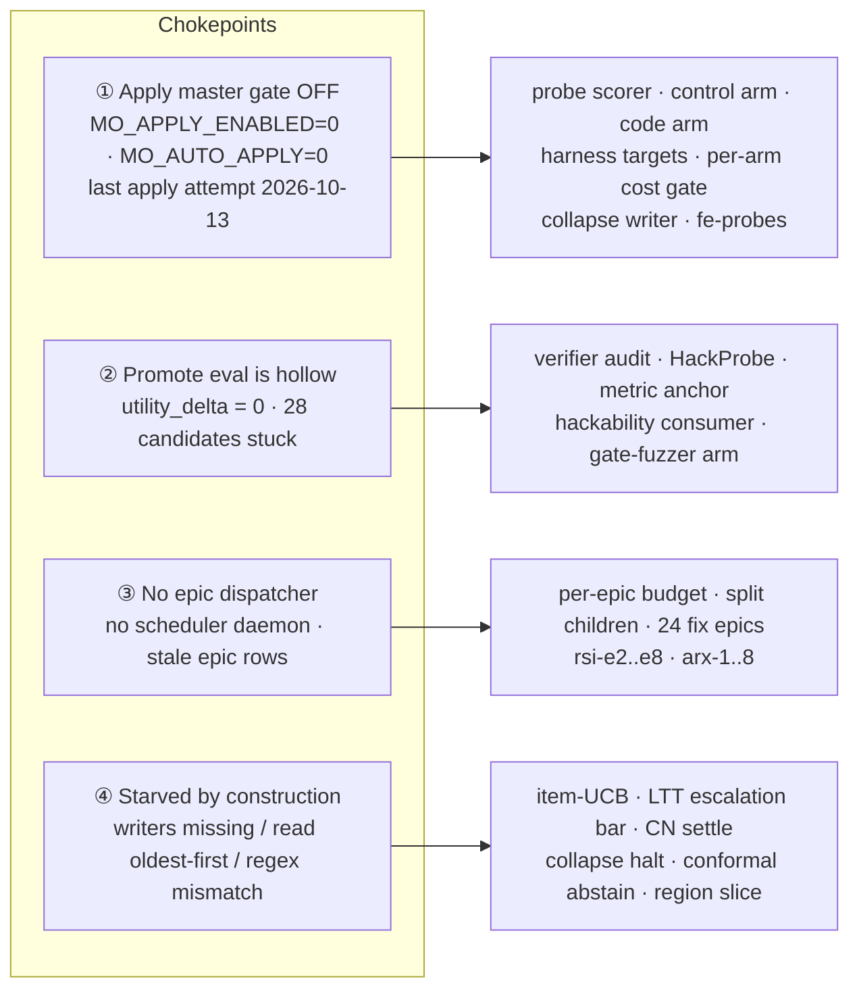

# RSI technique status — every planned technique, checked against code (2026-10-24)

**Question.** Which RSI / self-improvement techniques did we plan for mini-ork,
which ones actually work today, and what is missing?

**Method.** Three read-only audits, run in parallel, each checking claims against
code, `git log` on `origin/main` (7eb3d216) and live rows in the primary
`.mini-ork/state.db`:

1. **Surveys:** the 2026-09-12 survey (352 papers), 2026-09-17 (1,812 papers,
   68 techniques), the TOP-20 TRUE-RSI list with epics E1–E8, the 09-19
   meta-diagnosis, the 09-29 review (2,000 papers → 131 techniques), SIA (07-17),
   the cost survey (07-12) and the two verification-supply docs (10-05).
2. **Kickoff programs:** `rsi-e*`, `rsi-g*`, `rsi-h*`, `rsi-i*`, `rsi-gap-*`,
   `sde-*`, `arx-*`, `vt*`, and `roadmap-recursive-self-improve.md` (HOT-A..J).
3. **Plans and architecture docs:** `techniques-compendium.md`,
   RECURSIVE-SELF-IMPROVE, RECURSIVE-MULTI-EPIC-LEARNING, LEARNING-LOOP-LIFECYCLE,
   verification-stack, arbor, the 10-07 / 10-15 learning plans, rsi-gaps (10-22)
   and rsi-cycle (10-23).

The primary DB's last trace is **2026-10-22 11:52**, so nothing merged on 10-22
or later has seen live traffic there. RSI-home evidence is called out where it
differs.

## Status legend

| Status | Meaning |
|---|---|
| **LIVE** | On by default and producing data that changes behaviour |
| **THIN** | Live, but decides rarely (under ~1% of the cases it is meant for) |
| **DORMANT** | Built and on by default, but it has never fired or has too little data to act |
| **OPT-IN** | Built, off by default |
| **REPORT** | A measurement CLI only; nothing acts on its output |
| **PARTIAL** | Part of the technique is built; the named half is missing |
| **NOT BUILT** | No code |
| **NOT LAUNCHED** | Has a kickoff, but no run ever built it |
| **DROPPED** | Rejected on purpose, with a recorded reason |

## Headline

The three source families dedupe to **117 planned techniques** (the rows of the
full matrix below):

| Status | Rows | Share |
|---|---:|---:|
| LIVE | 23 | 20% |
| THIN | 2 | 2% |
| DORMANT | 24 | 21% |
| OPT-IN | 12 | 10% |
| REPORT | 8 | 7% |
| PARTIAL | 24 | 21% |
| NOT BUILT | 14 | 12% |
| NOT LAUNCHED | 8 | 7% |
| DROPPED | 2 (+ a list) | 2% |

So **25 of 117 work** (LIVE + THIN). **44 are built but never act** (DORMANT +
OPT-IN + REPORT). 24 are half-built, and 22 have no code.

**The headline finding.** Most of the RSI code that exists has never acted on a
real candidate. The techniques that are LIVE sit at the *front* of the loop:
traces, rewards, routing advantages, reflection, lessons and verification at
publish time. The techniques that are supposed to *decide* sit at the *back*:
apply, promotion, the collapse halt, escalation and graph patches. Almost all
of those are dormant.

Four chokepoints explain most of that, and they sit upstream of the techniques,
not inside them:

## Chokepoints (fix these first: each one unlocks techniques that are already built)

### ① The apply loop is off, and its scorer is too small to trust

- **The gate.** `mini_ork/cli/apply.py:729` reads `MO_APPLY_ENABLED` with
  default `"0"`. The post-run sweep also needs `MO_AUTO_APPLY`.
- **The history.** The last of 43 `apply_attempts` rows is from 2026-10-13. The
  19 "promotions" on 09-12 were scored by a mock and reverted on 10-07. There
  has never been a measured promotion.
- **What it gates:** GRASP probe scorer, AutoSaddler sweep, matched-attempt
  control arm (I1), code-arm scorer (E1), harness targets and the per-arm cost
  gate (E6/I5), the collapse-history writer (I4b) and the framework-edit probe
  set.
- **Do not just flip it on.** Each probe set holds 2–3 probes, so every accept
  decision is "theater" in the TOP-20 doc's own word. Unblock it together with
  **E2 (probe harvest)** and **E3 (anytime-valid certificate)**, below.

### ② improve → eval → promote never promotes anything

- **The fault.** Eval returns `utility_delta = 0`, so 28 `workflow_candidates`
  are stuck and nothing reaches `promotion_gate`.
- **What sits behind it:** the verifier-validity audit (I2/I2b), HackProbe (H2),
  metric anchor (H5), the gate-hackability consumer (vt2) and the gate-fuzzer
  arm (G3). None of them has ever seen a real candidate (0 of 47
  `promotion_records` cite the audit).
- **Options.** Score promote with the probe scorer, the only non-fabricating
  scorer (`FABRICATING_SCORERS` guard). Or retire this path and route every
  promotion through apply.

### ③ No dispatcher picks up epics, and the epic table is stale

- **The fault.** The automations tick logs `fired: []`; there is no scheduler
  daemon. The supervisor revives and supersedes runs, but it never dispatches an
  epic.
- **What it blocks:** the SDE-4c per-epic budget, SDE-6b split children, 24
  `not started` fix epics, and the whole `rsi-e*` / `arx-*` queue.
- **The table is wrong.**
  - `rsi-e1-code-arm` reads `not started` although 9a698e04 merged. Every
    E2–E8 epic has a hard dependency edge on it, so all of them stay `blocked`.
  - `arx-0-scout` reads `done` although its only run produced no diff and was
    rolled back.

### ④ Starved by construction: small bugs keep a technique at zero rows

| Technique | Why it never gets data | Anchor |
|---|---|---|
| SimUtil-UCB item rerank (v2) | `resolve_finished` tallies the **oldest** runs first, 200 per call, so it never reaches the v2 runs. `context_item_utility` = 0. | `mini_ork/learning/item_utility.py:31` |
| Calibrated escalation bar (SDE-3b2) | The diagnosis ledger is written only *on* escalation, and escalation never fires below the bar, so the bar can never calibrate. Circular. `diagnosis_ledger` = 0. | `mini_ork/recovery/escalation.py` |
| ContextNest outcome settle | The settle regex is `cn-[a-f0-9]{8,40}` but the injected ids are `sess=…`, so 0 outcome files were written in the last 400 runs. | `mini_ork/cli/execute.py:392` |
| Collapse halt (G7/I4a) | Only the opt-in apply sweep writes `collapse_history` (2 rows); the halt needs 4. | `mini_ork/cli/apply.py:1292` |
| Metric anchor (H5) | It checks held-out/agreement columns that `collapse_history` doesn't have, so it is always `intact=None`. | `mini_ork/learning/verifier_audit.py:202-219` |
| Conformal abstain + LTT saturation (I6/I6b) | Nothing writes a confidence: 1,116 `verifier_results`, 0 with a confidence or a label. | `gates/abstain_gate.py`, `gates/conformal_gate.py` |
| Region slice + defect penalty | `decide()` gets no segment, so `code_region = ""`. The 102 region rows are never read; `defect_attributions` has no producer. | `mini_ork/dispatch/routing.py:184` |
| RouteMoA screen | The screened set is never saved, so its effect can't be measured. | `mini_ork/dispatch/screening.py` |
| Item / CoBa / Trace2Skill generally | They are live but need traffic on the post-10-22 engine: `revise_rounds` 2 of 20, `lesson_conflicts` 0. | — |

## Prioritised gap list

### Tier 0: unblock what is built (small, high leverage)

1. **Fix the four starvation bugs above:**
   - newest-first item tally;
   - write the diagnosis ledger on *every* model diagnosis, not only on escalation;
   - make the CN settle id shape match;
   - write `collapse_history` outside the apply sweep, with held-out columns.
2. **Repair the epic table:** mark `rsi-e1` done and `arx-0` failed. Then
   either add a dispatcher (the supervisor dispatching `not started` epics
   under the per-epic cap) or close the queue explicitly.
3. **Fix the RSI-loop defects D1–D5** from `docs/plans/2026-10-23-rsi-cycle.md`:
   - D5: `self_improve.py:516-520` passes no `--deadline`;
   - D1: reflect reads raw-template lanes and a deleted cwd, so the RSI home
     has 0 gradients and reflect fails 13/13;
   - D2: the no-regression check is vacuous on Python repos;
   - D3: the scope parser inverts "leave … untouched";
   - D4: `learning_record` never resolves.
   The outer loop cannot learn until these land.
4. **Run real traffic on the post-10-22 engine** (an ops step, no code), so
   SDE-5/6 graph patches, RouteMoA, CoBa and Trace2Skill get their first data.

#### Tier 0 progress (landed 2026-10-24)

Nine framework-edit runs, one per kickoff (`kickoffs/auto/rsi-t0-*.md`, 75c9974e).
Each was reviewed, checked by its kickoff suite and an importer gate (the tests
importing each changed module, capped at 60 files), and merged:

| Item | Commit | Notes |
|---|---|---|
| Item-utility tally reads the newest runs first | a8ea463b | `resolve_finished` `ORDER BY created_at DESC, id DESC` |
| Diagnosis ledger gets rows from normal repairs, and R2 labels them | ff28c65d | See the correction below. Review fix: `superseded` / `not_needed` outcomes are not labelled |
| ContextNest atom ids rendered in the prefetch file | 1aeeec09 | `render_atoms_md` writes `id=cn-…` |
| `mini-ork epics status <id> <status> --note` | 35bc52d1 | `done` runs `epic_graph.on_done`. Used on `rsi-e1-code-arm`, which unblocked E2, E4, E5, E7 and E8 |
| D1: reflect gets a durable cwd and the effective lane | c3ed7c08, b7d93921 | Primary home reflector stays `glm`; the RSI home moves `codex` → `glm` |
| D2: RSI gates check Python, and the test step has a timeout | b0b37c92 | Salvaged: its only red check was a vanished-`tmp_path` race (below) |
| D3: a negative clause in an allow section denies its paths | 0663ea35 | 54 of 470 kickoffs now parse differently; the sampled ones are all "Do NOT touch X" lines that the old parser had *allowed* |
| D4 + D5: runner `--deadline`, and the `learning_record` lifecycle | 28e9c0b2 | Also un-backticks the branch name in the kickoff template |
| R8: supervisor dispatches one ready epic per sweep | e15d8f42 | Off by default (`dispatch_epics.enabled: false`) because it starts paid runs |

**Full suite on b7d93921** (all of Tier 0 except R8, which has its own
1,180-test gate): 12,314 passed and 2 failed. Neither failure comes from Tier 0:

- `test_migrate_py.py::test_dot_command_once_read_shell` also fails on the
  pre-Tier-0 base 7eb3d216. It depends on sqlite3 `.shell` behaviour in this
  environment.
- `test_evidence_ledger.py::test_gate_claimed_implementation_with_real_change_is_ok`
  passes on its own on both commits and fails only in the full run, so it
  depends on test order. It imports none of the changed modules.

Corrections to the Tier 0 list above:

- **Collapse history is not a starvation bug.** Its rows are score-vs-anchor
  per *promotion* iteration, and the metric anchor is fail-open by design. Both
  fill once apply (①) or the RSI cycle (Tier 1 #11) runs.
- **The diagnosis ledger already recorded escalation refusals.** The real gaps
  were elsewhere: only `escalate`-routed diagnoses reached the ledger at all,
  and only supervisor-revived runs were labelled.
- **`arx-0-scout` stays `done`.** The trigger `trg_epics_no_revert_done` blocks
  any done → non-done change by design. Its dependency edges were resolved in
  June, so the wrong status blocks nothing.

Follow-ups found while landing Tier 0 (corrected 2026-10-27):

- ~~Concurrent framework-edit runs delete each other's pytest `tmp_path`.~~
  **Refuted.** A direct repro ran 6 concurrent pytest 9.1.1 sessions, each
  holding a `tmp_path` while new sessions started, and none lost its dir:
  pytest's `.lock` files protect live dirs. The gates-python spec-test failure
  has no known cause. The salvage stands (23 of 23 spec tests pass alone).
- ~~`mini-ork epics show` lists no outgoing dependencies.~~ **Not a bug.** The
  output had been piped through `head -12`, which cut the section off.
- **R8's cap counts `in progress` epics**, and R8 spawned the scheduler in the
  engine checkout. Both are addressed by `kickoffs/auto/rsi-t0f-r8-hardening.md`:
  it requires a `target_root` distinct from the engine checkout, and it
  reclaims stale epics with the scheduler's own rules.

### Changes on main since this audit (2026-10-25 / 10-26, other sessions)

- **The eco6 program** (`docs/plans/2026-10-25-ecosystem-section6.md`):
  - removed improve/eval/promote, CoBa, per-node `gates:`, the metric-anchor
    arm and the abstain/conformal evaluators;
  - fixed the cost-pause halt, the RouteMoA screen and the CN outcome ids
    (1aeeec09 was incomplete; 7950699e);
  - archived 18 epics and the arx queue.

  Its routing finding corrects Tier 1 #10 below: the lane keys were fine, and
  learned-route starvation was operational (`MO_ROUTING_POLICY=workflow_default`
  launches, and framework-edit pinning every node).
- **The RSI cycle C1–C5 is built** (83bb253a … 785e91f7) and has run 20+
  cycles, so Tier 1 #11 below is done. It has had no cadence while the minimax
  lane is quota-dead (until about Nov 8).

### Tier 1: build the missing load-bearing techniques

| # | Gap | Why it matters (the source's own words) | Source |
|---|---|---|---|
| 1 | **Artifact-grounded node reward.** Node reward is still `reward_from_status` (`execute.py:4402`); `verifier@v1` averages 0.973 since 10-16, so rewards are saturated | "a wrong S1 poisons all learning" | LLIF S1 |
| 2 | **Anytime-valid certificate + α ledger** (E3: SGM e-values, SEA, PACE). The promotion gate is still a point estimate plus McNemar | "single highest-leverage change… without it the other bands produce faster motion in the wrong direction" | TOP-20 #1–2, S12 #5 |
| 3 | **Probe harvest from clustered failures** (E2). Grow each probe set from 2–3 to ≥12. E2a pre-state capture is already LIVE (483 fixture dirs) | "any accept decision taken on n=2 is theater" | TOP-20 #13, EPIC E2 |
| 4 | **Close the frozen-kernel hole.** `escalation.py`, `diagnose.py`, `supervisor.py` and `graph_patch.py` decide what the self-driving loop may change, yet they are not in `config/kernel-frozen.yaml` (only `escalation_policy.py` is). Refusals are not logged (`safety_events` = 0) | an unfireable kernel is the safety precondition for self-editing | TOP-20 #18, E8, SDE-2 |
| 5 | **Layer routing into writeback** (E7). The layer taxonomy exists in `diagnose.py`; writeback ignores it | "converts the taxonomy from a note into an enforced routing decision" | TOP-20 #11 |
| 6 | **MGM contrastive lane mining** | "cheapest high-signal source in the whole survey — zero new infrastructure" | S12 #4 |
| 7 | **Harness evolution beyond prompt files** (E6): node order and tool grants in `workflow.yaml` | "pointing it there is the whole change" | TOP-20 #5 |
| 8 | **Wire certify into the code-fix path**: relations, differential and hidden checks (vt1/vt4). Today they run only under `mini-ork certify` | the doc claims they are "all ON by default" | VS ①②⑫⑭ |
| 9 | **SWE-ABS test strengthening**: suite adequacy is LIVE (18 reports, 3 INADEQUATE), but nothing strengthens a weak suite | "directly attacks mini-ork's known worst weakness" | S17 #2 |
| 10 | **Learned routing coverage.** It decides 97 of 11,188 routes. *(2026-10-27: eco6 found the lane keys fine and the starvation operational; RouteMoA fixed in 13fe4e81. Only the never-passed region segment may remain.)* | the router is the most-cited learning surface | S17 #1/3/4 |
| 11 | **RSI cycle graph C1–C5**: harvest + `rsi_cycles`, `recipes/rsi-cycle/`, driver, LEARN, cadence. **Built 2026-10-25/26 by another session** (83bb253a … 785e91f7) | the find→suggest→implement→validate→learn loop itself | RSIC |
| 12 | **Diversity / pass@k floor** for collapse, and a **GEPA anti-bloat guard** (append mode grows prompts) | "collapse is the default trajectory"; GEPA "bloats prompts 3× with no gain" | R2K, S17 |

### Tier 2: the survey tail (no kickoff exists yet)

- Directive schema / refine-in-place (S12 #7)
- Counterfactual-dropout audit (S12 #6)
- Gate-diversity rule (TOP-20 #20)
- Pre-registered falsifiable gates (TOP-20 #3, PARTIAL)
- Co-evolving evaluator (#16)
- Reconstruct-issue-from-patch verifier (#15)
- The hacker-fixer *fixer* half (#14)
- Counterfactual replay attribution (#12)
- Compositional certificates (#4)
- HGM clade scoring, AgentPRM, a constrained bandit with budget inside routing, reward chains for untestable recipes
- The S17 tail: MPO, AgentHER, LifeMem, SWE-Edit, SWE-Adept, DEAR, Trade-R1, a PRPO A/B
- From the cost survey: partial-trajectory routing, SWE-Pruner, one-sample RLVR

### Tier 3: re-scope or close

- **arx-1..8:** every kickoff targets bash files removed in the 2026-07 bash
  removal. Rewrite against the Python runtime, or close them.
- **H6–H8:** never existed (the numbering skips from H5 to H9). Nothing to do.
- **`docs/todos/2026-10-09-kickoff-triage.md:87`:** lists G1–G4 and H1–H9 as
  NEVER_LAUNCHED. Their code *is* merged; only their `task_runs` rows are
  missing. Correct the triage.

## Measurement without action

These shipped the measuring half; the acting half was deferred.

| Technique | Measures | Missing action |
|---|---|---|
| G1 cascade blind-spot backtest | `predicted_error` (15 traces) | no threshold changes routing |
| G2 goal-loop null verdict | `reproduced` | `MO_GOAL_CONFIRM_RUNS` defaults to 1, so it is inert |
| G3 gate fuzzer / H9 active eval | blind spots, coverage ranking | fuzz failures never become gates; the ranking drives no probe selection |
| G4 memory retirement | suppression at read time | no automatic retirement (0 of 1,159 retired) |
| G5/E5 harness contrast, H1 typed operator | harness-vs-model attribution, outcome scores | never picks or promotes the next edit; cancelled-but-passing credit not built |
| G6 oversight inbox | fatigue calibration | the verdict retunes no gate |
| H3 harness-tampering audit | tamper verdict | no gate or rollback |
| H4 collapse precursors | precursor warnings | never reach the breaker |
| SDE-1 / 3b1 diagnosis | 36 diagnoses, 9 by the model | escalation to a fix epic has never fired |
| vt3 equivalence operator | per-task operator | no recipe declares one |
| Pattern mining | 71 patterns, all `observed` | the promotion gate never reads them |
| TraceOtter | 284 SFT examples (07-11) | no trained adapter becomes a lane |
| decide() outputs | `coalition_ok`, `reward_estimate`, `recursion_hint` | computed, then discarded |

## Full matrix

**Sources:**
- **S12 / S17:** the 09-12 and 09-17 surveys.
- **T20:** the TOP-20 TRUE-RSI list.
- **R2K:** the 09-29 2,000-paper review.
- **VS:** the verification stack.
- **comp:** `techniques-compendium.md`.
- **LLF / LLIF / LMP:** the learning plans.
- **RSIG / RSIC:** rsi-gaps (10-22) and rsi-cycle (10-23).

Commits are on `origin/main`.

### A. Signal and reward

| Technique | Source | Built | Status | Live evidence | Gap |
|---|---|---|---|---|---|
| Trace + `llm_calls` writers (HOT-A/H) | roadmap-RSI | 2001a0f2, 918546dd | LIVE | 11,188 traces · 15,845 llm_calls | — |
| reward_g, verifiable-first shaping | comp A4 | `trace_store.py`, `writeback.py` dfc9736b | LIVE | 8,490 reward_g | the same-family check zeroes most verdict deltas |
| PRM + Goodhart cap | comp A4 | `process_reward.py` 578b5d92 | LIVE | 6,304 process_reward | code weights ≠ compendium:107 |
| Online rubric → reward_g | comp A1/A4 | `rubric_prescreen.py` 8ce6cdb8 | PARTIAL | 426 rows, none since 10-12 | fill-only; verifier@v1 writes first |
| Artifact-grounded node reward | LLIF S1 | — | NOT BUILT | rewards saturate (0.973) | Tier 1 #1 |
| AgentPRM per-node Q/V · PRPO A/B | S12 #14, S17 #8 | — | NOT BUILT | — | Tier 2 |
| Reward chains for untestable recipes | S12 #10 | chain-veto anchor only | PARTIAL | — | no predicate rewards for docs/book recipes |
| Reward↔evidence pairing + dedupe | VS ⑨, RSIG | `reward_audit.py` f11ad3b1 | PARTIAL | 98 rows = 14 keys × 7 | stale-engine copies; re-run `dedupe` |
| Strict rubric / empty-memory writers (HOT-C/I) | roadmap-RSI | — | NOT LAUNCHED | — | — |
| Verdict enum, fail closed (HOT-B) | roadmap-RSI | `extract_verdict` → `unknown` | PARTIAL | — | no hard fail |

### B. Routing

| Technique | Source | Built | Status | Live evidence | Gap |
|---|---|---|---|---|---|
| GRPO slice advantages | comp A3 | `lane_router.py` 4a160f3f | LIVE | 186 domain rows, updated 10-22 | learns over alias/chain strings |
| UCB · EquiRouter · EntroRouter · UCCI | S17 #1/3/4 | 7d29e0a7, be28e95f | THIN | `learned` 97 of 11,188 · `calibrated_escalation` 3 | Tier 1 #10 |
| ε-explore | comp A5 | `decision_service.py` | THIN | 14 explore routes | ignores node role |
| NeuralUCB | slice B | `lane_router.py` | OPT-IN | — | — |
| Region slice + decayed defect penalty | comp A3/A5 | `lane_router.py:278` | DORMANT | 102 region rows never read | no segment passed (④) |
| RouteMoA dominance screen | S17 #15, RSIG | `screening.py` cf53d09e | DORMANT | 0 learned routes since merge | screened set not persisted |
| coalition_ok / reward_estimate / recursion_hint | comp A5 | `decision_service.py:126/203/268` | DORMANT | — | no consumer |
| Cascade blind-spot backtest (G1) | T20 #10, MD | a2cad291 | REPORT | 15 traces with predicted_error | no acting threshold |
| MGM contrastive lane mining | S12 #4, R2K G10-T11 | — | NOT BUILT | — | Tier 1 #6 |
| Constrained bandit, budget in routing | S12 #11 | — | NOT BUILT | — | Tier 2 |
| Partial-trajectory routing · SWE-Pruner · one-sample RLVR | cost survey | — | NOT BUILT | — | Tier 2 |
| Win-rate AND gate | LLL §4.2 | — | DROPPED | — | replaced by decide() + bandit |

### C. Memory, reflection and lessons

| Technique | Source | Built | Status | Live evidence | Gap |
|---|---|---|---|---|---|
| Auto-reflect + textual gradients | comp A1/A7 | `reflect.py`, `reflection_pipeline.py` 2e6caaa4 | LIVE (primary) | 14,726 gradients | fails 13/13 in the RSI home (D1) |
| Pattern induction → verify | RMEL | `pattern_induction.py` 30487c06 | LIVE | 51 approved / 20 proposed | — |
| Themes, one lesson per theme, own-class scope | LMP, LLF R1/R2 | `themes.py` c1131222 | LIVE | 6,074 themes · 126 verified | 98% stay `candidate` |
| Semantic memory, SimUtil-UCB + DeltaMem | S17 #5 | `semantic.py` 6b277ff0 | LIVE | 12,875 uses | — |
| LIMBO additive half | S17 | c8fd37e3 | LIVE | uses carry lane/node | reaches the reviewer only; trimming half DROPPED |
| Findings harvest · hygiene · staleness · scoping | LMP E1, LLF R5–R12 | `code_findings.py` 2c5f5ad9 | LIVE | 1,957 findings · 142 stale dropped | 1,524 categorised "other" |
| v2 pack: inject once, scope parser, profile fallback | LLF R3/R8/R9 | 1ec260da, c7594dcb, 69469667 | LIVE | R9 fallback used 0 of 85 | R8 inversion (D3) |
| Provenance + independent support | S12 #9, S17 #7 | 1d25b092 | LIVE | 51 patterns gated | raw gradients ≥0.6 still reach prompts via context |
| Cross-epic gradient | comp A7 | `cross_epic_gradient.py` 4be49575 | PARTIAL | 185 rows written | reading needs `MO_INJECT_UNVERIFIED=1` |
| Pattern mining | RMEL §3 | `pattern_store.py` | REPORT | 71 rows, all `observed` | the promotion gate never reads it |
| Trace2Skill conflict check | S17 #9, RSIG | `lesson_conflict.py` bef6e2e5 | DORMANT | 0 conflicts | no lesson verified since merge |
| Context v2 item-UCB rerank | RSIG | `item_utility.py` 2d3b55a8 | DORMANT | 0 rows | oldest-first tally (④) |
| Reversible memory retirement (G4) | R2K | 6b9fd368 | DORMANT | 0 of 1,159 retired | no automatic policy |
| Prefs / path rules | LMP E2, LLF R4 | 4d21a384 | DORMANT | 0 rules | none authored |
| RHO prompt win rates | comp A10 | `rho_aggregator.py` | DORMANT | 98 rows, newest 07-11 | no prompt_version_hash |
| Grounded-rejection anti-reward | LLL §2 | `gates/common.py:111` | DORMANT | 36 rows (bash era) | 0 callers |
| ContextNest outcome settle (EvoMem) | comp C9 | fa904f5a | DORMANT | 0 outcome files | regex mismatch (④) |
| Injection ledger + efficacy arms | LMP D5, LLF R13 | `ledger.py` bf7ab7f9 | PARTIAL | 22,000 rows · held_out 0 | arms indistinguishable |
| Patch-id landing | LLF R11b | 220faf02 | PARTIAL | last run 10-17 | CLI only |
| Per-class memory | RMEL §1 | `memory/store.py` | PARTIAL | 91 rows, last write 07-12 | success side dead |
| Failure-aware memory (AdMem) | cost survey | v2 "prior attempts" | PARTIAL | — | CN settle dead |
| Per-lesson lift / pass stats | LMP D4/D6, LLIF S4 | `ledger.py:201`, 0 callers | NOT BUILT | 0 rows | — |
| Directive schema / refine-in-place | S12 #7 | — | NOT BUILT | — | Tier 2 |
| Counterfactual-dropout audit | S12 #6 | — | NOT BUILT | blocks removed by hand on 10-07 | Tier 2 |
| SIGA self-updating groundings · Engram typed memory · skillcat 0.85 dedup | arx-5/7/4 | — | NOT LAUNCHED | — | Tier 3 |

### D. Candidates and apply

| Technique | Source | Built | Status | Live evidence | Gap |
|---|---|---|---|---|---|
| GRAO outcome-tagged edit memory | S12 #3 | `apply._previously_failed` b3cac2cc | LIVE | 15 rejections | `pick_candidate` re-picks the same dead source |
| Apply loop + version quarantine/rollback | slice D | `cli/apply.py` 6922386c | OPT-IN | 43 attempts · 0 measured promotes | ① |
| GRASP probe scorer | S12 #1, T20 E1 | `probe_scorer.py` b3cac2cc | OPT-IN | probe sets of 2–3 | ① + E2 |
| AutoSaddler post-run sweep | S12 #2 | `execute.py:2139` | OPT-IN | last 10-13 | top-1 by confidence only |
| Matched-attempt control arm (I1) | R2K #1 | a047f878 | OPT-IN | 2 rows, control_n=3 | runs only inside the sweep |
| Code-arm probe scorer (E1) | T20 E1 | 9a698e04 | OPT-IN | 0 code-scored | nothing produces `MO_APPLY_CODE_PATCH` |
| Harness targets + per-arm cost gate (E6/I5) | T20 #5, R2K #5 | c7bcace8 | OPT-IN | 5 smoke attempts (09-29) | prompt files only (Tier 1 #7) |
| framework-edit probe set | RSIG | 7be81f11 | DORMANT | 0 probe runs | ① |
| improve → eval → promote | comp A1, RMEL §6 | `improve.py` 355d3d1e, `group_evolver` | DORMANT | 28 candidates, delta 0 | ② |
| GEPA | comp A9 | `mini_ork/gepa/` fb71fc60 | DORMANT | 0 proposals | no consumer; the doc claims it is wired |
| Topology evolution (perf·√novelty) | comp A10 | `group_evolver.py:78` | DORMANT | last write 07-16 | — |
| Typed harness-edit operator (H1) / MetaRSI | MD #3 | 6cc6c54b, 9f8bfda7 | PARTIAL | 65 `mutate.proposed` | outcome scores never pick the next edit |
| ModularRSI / DarwinX population | T20 #7–8 | per-probe no-regression only | PARTIAL | — | no modules; the population is hollow |
| Pass-per-dollar utility | S12 #8 | per-arm cost gate | PARTIAL | — | prompt targets use pass fraction |
| Edit-scope declaration in apply (E4) | T20 #6 | framework-edit ONLY-scope 9ce327e0 | PARTIAL | — | apply candidates carry no scope |
| Harness-contrast attribution (E5/G5) | T20 #9 | 62e3b919 | REPORT | — | cancelled-but-passing credit not built |
| Coverage-aware active eval (H9) | R2K | 8a81b3a6 | REPORT | — | nothing consumes the ranking |
| Probe harvest from failures (E2) | T20 #13 | E2a capture 05501d05 only | NOT LAUNCHED | 483 fixture dirs, unused | Tier 1 #3 |
| HGM clade scoring | S12 #13 | — | NOT BUILT | — | Tier 2 |
| APO prompt mutation · TACoMAS topology cadence | arx-6/3 | — | NOT LAUNCHED | — | Tier 3 |

### E. Promotion, verification and anti-hacking

| Technique | Source | Built | Status | Live evidence | Gap |
|---|---|---|---|---|---|
| BSG-VA base replay (I3) | R2K #4 | `code-fix/verifiers/test.py` 20f647a3 | LIVE | 48 run dirs with replay | pytest repos only |
| Mutation suite adequacy (vt5) | VS ③ | `suite_adequacy.py` a7516a5b | LIVE | 18 reports · 3 INADEQUATE | code-fix only |
| Level vector + publish gate (vt6) | VS ④ | `verify/levels.py` f39cd4c6 | LIVE | 76 verdicts carry levels | only code_fix declares levels |
| Kickoff-contract verifier + blind spec tests | SDE VG-1/3 | a7caba16, 23722ba8 | LIVE | every framework-edit run | spec author can emit UNSAT tests |
| Oracle gates + VPRM step rules | comp A8, S17 #10 | `native_gates.py`, `step_rules.py` 37752e17 | LIVE | 7 gates | fail open; no per-rule hit ledger |
| Code disposes / verdict vector | T20 #17 | reviewer veto-only | LIVE | — | publish runs before post-run verify |
| Promotion conjunction + McNemar | comp A8 | `promotion_gate.py`, f316a88e | PARTIAL | — | point estimate (Tier 1 #2) |
| Verifier-validity audit (I2/I2b) | R2K #2 | 4acb7cfe, 0a328663 | DORMANT | 0 of 47 cite it | ② |
| HackProbe (H2) | R2K | 6da7a2d0 | DORMANT | 0 rationales | ② |
| Metric anchor (H5) | R2K | f1afcc8f | DORMANT | always `intact=None` | missing columns (④) |
| Conformal abstain + LTT saturation (I6/I6b) | S17 #17, R2K #6 | f3d933c4, 66d84582 | DORMANT | 0 confidence values | no writer; node `gates:` never read |
| Oracle integrity · verifier mutation | VS ⑦⑩ | 48fab622, 0537d16b | DORMANT | — | no producer |
| Judge validity / reliability harness | VS ⑧, S17 #13 | `judge_validity.py` 4893c602 | OPT-IN | 0 | — |
| Relations · differential · discrimination · hidden checks | VS ①②⑫⑭ | b976ca71, 0e41c887 | OPT-IN | `certify` CLI only | Tier 1 #8 |
| Equivalence · recompute | VS ⑥⑬ | 98145717, ffc3f18e | OPT-IN | post-mvp-delivery only | no recipe declares an operator |
| Gate hackability (vt2) | VS ⑤ | cf5c4acf | PARTIAL | 5 records (10-06) · 0 refusals | producer is manual |
| SWE-ABS hardening | S17 #2 | adequacy only | PARTIAL | — | Tier 1 #9 |
| Pre-registered falsifiable gates | T20 #3 | blind spec tests, tamper guard | PARTIAL | — | no stored prediction |
| Gate fuzzer (G3) | S12 #12 | 374771b7 | REPORT | arm always "skipped" | no corpus at promote |
| Harness-tampering audit (H3) | R2K | b539c8e9 | REPORT | — | no gate or rollback |
| Hacker-fixer *fixer* half | S12 #12, T20 #14 | — | NOT BUILT | — | Tier 2 |
| Anytime-valid certificate (E3) | T20 #1–2, S12 #5 | — | NOT LAUNCHED | — | Tier 1 #2 |
| Compositional certificates · co-evolving evaluator · reconstruct-issue verifier · gate-diversity rule | T20 #4/16/15/20 | — | NOT BUILT | — | Tier 2 |

### F. Collapse and safety

| Technique | Source | Built | Status | Live evidence | Gap |
|---|---|---|---|---|---|
| Frozen kernel (SDE-2, E8 intent) | T20 #18 | f36e372d, 73a11cde | LIVE | never tripped | Tier 1 #4 |
| Collapse detector + halt (G7/I4a/I4b) | T20 #19, R2K #3 | d05325a1, e8102541, e073354e | DORMANT | 2 history rows (needs 4) | ④ |
| Collapse precursors (H4) | R2K | 9d53c23b | REPORT | — | never reaches the breaker |
| Oversight inbox + fatigue calibration (G6) | R2K | f298c29b | PARTIAL | 163 inbox rows | fatigue retunes nothing |
| Goal-loop null verdict (G2) | R2K | d2d32b61 | OPT-IN | 0 `reproduced=false` | `MO_GOAL_CONFIRM_RUNS=1` |
| Diversity / pass@k floor | R2K | — | NOT BUILT | — | Tier 1 #12 |

### G. Recovery and the self-driving loop

| Technique | Source | Built | Status | Live evidence | Gap |
|---|---|---|---|---|---|
| Typed diagnosis + model diagnoser (SDE-1/3b1) | S17 #6 | 8932a011, f791a160, a1f458f1 | LIVE | 36 diagnoses · 9 by the model | 22% unclassified |
| Supervisor R1–R5 (SDE-4a/4b) | SDE plan | f1f93760, a9cbcfc0 | LIVE | 159 superseded · 0 revives | LaunchAgent hand-installed |
| Escalate engine fault → fix epic (SDE-3a) | SDE plan | 1d88b72e, f4ed1ef9 | DORMANT | 0 escalations | — |
| Diagnosis ledger + calibrated bar (SDE-3b2) | SDE plan | 6f60a89c | DORMANT | 0 rows | circular (④) |
| Per-epic budget (SDE-4c) | SDE plan | 7aa2611f | DORMANT | 0 refusals | ③ |
| Graph patches · R6 · replan · split (SDE-5a/5b/6a/6b) | SDE plan | 7a85d5df, d7694192, 824d5700, ad52777f | DORMANT | 0 patch dirs | no run on the post-merge engine |
| Triage → bug epics · per-node bug collector | RMEL §4 | `triage/*`, `bug_report.py` | OPT-IN | 101 open · 0 promoted | collector has no call site |
| Layer routing into writeback (E7) | T20 #11 | taxonomy only | NOT LAUNCHED | — | Tier 1 #5 |
| Counterfactual replay attribution | T20 #12 | — | NOT BUILT | — | Tier 2 |

### H. Outer loops

| Technique | Source | Built | Status | Live evidence | Gap |
|---|---|---|---|---|---|
| Goal-loop r_disc · headroom · wave history | MD #1/2/4 | `goal-loop/lib/drive.py` ac4e9e92 | LIVE | decisions.jsonl rows | — |
| Self-improve outer loop + recipe | RSI.md, RSIC P0 | `self_improve.py` 8b5e4b26, c1632634 | PARTIAL | 64 iterations, 1 success · RSI home: 1 merged fix | D1–D5 |
| learning_record lifecycle | RSI.md | `self_improve.py:189-261` | PARTIAL | never resolves | D4 |
| rsi-technique-review recipe | slice D | cd4f581d | PARTIAL | 5 failed · 0 published | — |
| SIA generational loop + held-out curve | SIA | held-out set 9fb0d127 | PARTIAL | benchmark_delta 0 of 18 | no accuracy-vs-generation curve |
| Recursive spawn + `recursion:` keys | recursive-orchestration | `spawn.py`, `recursion.py` d3e4ae72 | PARTIAL | 96 spawns | only max_iterations is read |
| Arbor idea tree | arbor #1/#10 | migration 0020 + UI | PARTIAL | last write 06-11 | visualisation only |
| TraceOtter export → adapter lane | comp B | `traceotter.py` b54cee16 | REPORT | last 07-11 | no adapter lane; hard-coded path |
| RSI cycle graph C1–C5 | RSIC | — | NOT BUILT | — | Tier 1 #11 |
| arxiv-scout (arx-0) · arxiv cron (arx-8) | roadmap-arxiv | — | NOT LAUNCHED | arx-0: one run rolled back | Tier 3 |
| VeRO verifier credit · GRASP per-skill gate | arx-1/2 | — | NOT LAUNCHED | — | Tier 3 |
| Held-out stack on/off eval · SE-1..4 benchmark | 10-09 roadmap, epics 07-17 | branch only | DROPPED | lessons +7.6% (n.s.) | the stack's lift is still unmeasured |

**Also DROPPED on purpose:** SelfEvolve, GEA, posterior plans, LIMBO trimming,
the G01-T11 panel, G09-T10, and the weight-side G03-T09 / G01-T06. Each
conflicts with propose-not-commit, worktree isolation, the restricted-lane
freeze, the shipped G7 panel, the deliberate removal of the human gate, or
API-only lanes.

## Survey cautions: does the code respect them?

| Caution | Respected? |
|---|---|
| Build the validated scorer before gradient machinery | **Yes**: the probe scorer is the only promotable scorer (`FABRICATING_SCORERS`) |
| Prefer execution oracles over learned PRMs | **Yes**: the reward anchor is execution status; the reviewer can only veto |
| Calibrate on labels, never on self-report | **Yes**, which is exactly why abstention is dormant (0 labels) |
| Resampling theater: compare against a matched control | **Yes**: control arm (I1), though only inside apply |
| Agreement ≠ correctness | **Yes**, by absence: the agreement gates have no importer |
| Promotion is a security boundary | **Mostly**: distinct run_id, fail-closed; the retry-scored guard is missing |
| Absorbing everything hurts | **Partly**: only-verified covers prompt files, but gradients ≥0.6 reach prompts via context |
| Immutable revisions | **Partly**: version_registry + quarantine exist; `MO_APPLY_MODE=replace` edits in place |
| Fixed held-out split | **Partly**: frozen probes, but n=2–3 is noise |
| Evaluate lessons in pairs | **Partly**: directives get a control arm; context-injected lessons don't |
| Collapse is the default trajectory | **Partly**: the anchor-divergence halt exists (starved); no entropy or pass@k floor |
| Measure the harness effect with cost | **Partly**: the contrast CLI only reports; the cost gate is opt-in |
| Naive reward mixing | **No**: the blended ladder terms were never A/B'd |
| Leakage audits | **No**: only the tamper guard exists |
| GEPA needs an anti-bloat guard | **No**: append mode grows prompts |
| Routers collapse to the expensive model | **Unmeasured**: Equi/Entro address it; UCCI escalation to `MO_FRONTIER_LANE` is not tracked |

## Docs that claim more than the code does

*2026-10-27: verification-stack.md / CLAUDE.md ("all ON"), the compendium's
PRM weights, "no UCB", GEPA module and rubric lines, RMEL's bug collector
and `MO_PATTERN_MINER` default, and RECURSIVE-SELF-IMPROVE's lifecycle and
`used_in_patch` were corrected in the commit that added this note. The rest of
the list still stands.*

Fix these so the next audit doesn't trust them:

- **`docs/architecture/verification-stack.md:6` and CLAUDE.md, "all ON by
  default".**
  - ①②⑫⑭ run only via `mini-ork certify`; the code-fix verifier imports only
    `replay_check`.
  - ⑦⑩ have no producer; ⑧⑪ default off.
- **`techniques-compendium.md`:**
  - :152 and :309 say "no UCB", but UCB_C defaults to 0.5 (`lane_router.py:123`).
  - :107 PRM weights ≠ `process_reward.py:61-66`.
  - :148 says GEPA is wired via `optimize/gepa.py`, which was deleted in f95b7f9c.
  - :76 says the rubric scores "every trace"; it is fill-only.
  - :292 says EvoMem is "complete"; the settle regex never matches.
  - It still cites removed bash (`bin/mini-ork:468-489`, `lib/*.sh`).
- **RECURSIVE-MULTI-EPIC-LEARNING:**
  - the bug collector runs "after every node": no call site;
  - the promotion gate reads pattern_records: no;
  - "`MO_PATTERN_MINER` default 0": it defaults to 1.
- **RECURSIVE-SELF-IMPROVE:**
  - the documented lifecycle (open→queued→attempted) differs from the code
    (open/resolved/superseded);
  - `used_in_patch` has no writer.
- **`rsi-gaps.md:77`** cites 335 SimUtil-UCB items; the live table has 0.
  **`rsi-gaps.md:131`** and **`self-driving-epic.md:155`** say supervise is
  unscheduled; a LaunchAgent has run it every 300 s since 10-22.
- **Commit ids in older notes:** fc8d05f5, 23b1aa0d, ccb4994c and 0c789e10 are
  not on `origin/main`. Use 7d29e0a7, be28e95f, c8fd37e3 and 6b277ff0.
