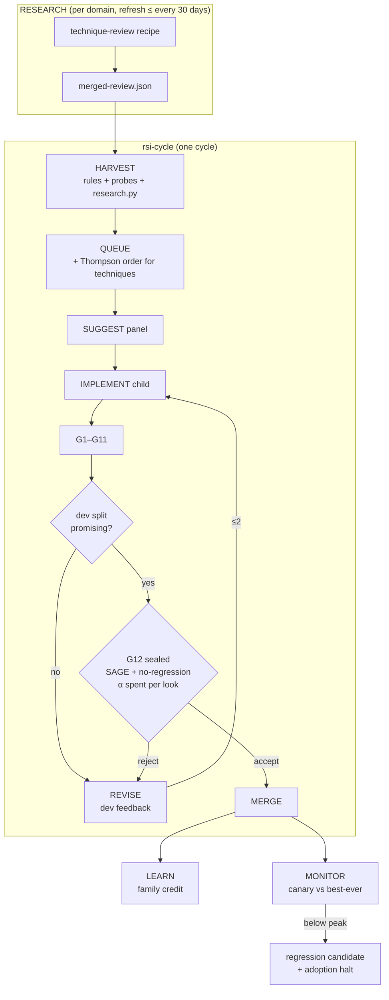

# Research-driven RSI loop — goal → research → adopt → measure → revise, unattended

**Date:** 2026-10-29 · **Research:** [`docs/research/2026-10-29-research-driven-rsi-loop.md`](../research/2026-10-29-research-driven-rsi-loop.md)
· **Builds on:** the RSI cycle ([`2026-10-23-rsi-cycle.md`](2026-10-23-rsi-cycle.md), [`docs/operator/rsi-cycle.md`](../operator/rsi-cycle.md)).

## Goal

The operator names an area ("verification"). Unattended, mini-ork:

1. **researches** it — the domain's technique-review recipe collects ~2000 arXiv papers
   from libwit, extracts techniques, clusters them into 10 families and ranks them;
2. **adopts** the ranked techniques one at a time through the existing `rsi-cycle`
   (SUGGEST panel → framework-edit child in a worktree → gates G1–G11);
3. **measures** each change with a new gate, **G12 impact**: a sealed, paired,
   regression-aware statistical test on a labelled benchmark the child never sees;
4. **revises** a change that shows no gain (≤ 2 revisions, dev-split feedback only);
5. **learns** which technique families pay off and **monitors** main against its
   best-ever score.

**Guarantee, stated precisely:** with probability ≥ 1 − α per epoch, no change the
loop merges lowers the benchmark's sealed score, and no merged change breaks an item
that passed before it. When the loop cannot prove a gain it does not merge; when the
canary falls below the best-ever score it stops adopting and opens a fix-forward
regression candidate. It promises nothing about dimensions no benchmark measures.

## What exists vs what this builds

| Step | Before | After |
|---|---|---|
| Research + cluster | `verification-technique-review` → `merged-review.json` (130 ranked techniques, 2026-10-18), read by nobody | harvested into `rsi_candidates` (`kind=technique_unadopted`, `source=research:<family>`) |
| Implement | `rsi-cycle` IMPLEMENT (framework-edit child) | unchanged |
| Validate | G1–G11; G8 = the gap predicate flips | + **G12 impact** for `bench:` candidates |
| Adjust | rejected → signature parked 30 days | ≤ 2 revisions with dev-split feedback, then park |
| Learn | merge rate by `(source, lens)` | family credit + clade Thompson ordering + collapse override |
| Monitor | collapse detector (merge rate vs probe anchor) | + canary vs best-ever, regression candidate, adoption halt |

## Architecture

### Modules

| Module | Kind | Purpose |
|---|---|---|
| `mini_ork/rsi/impact.py` | pure | paired counts, exact binomial tail, SAGE decision, horizon-free α spending, HMAC stratified split, flaky-item filter, guard vector, ratchet, family collapse, clade Thompson order |
| `mini_ork/rsi/research.py` | reads files | newest `merged-review.json` per domain → `technique_unadopted` candidates pointed at the benchmark's surface |
| `mini_ork/rsi/benchmarks.py` | runs subprocesses | benchmark registry; built-in `verifier-replay` (39 stored patches, hidden ground truth, $0, per-item scores, label + base caches) |
| `mini_ork/rsi/impact_state.py` | state file | epoch, sealed looks spent, canary history, under the cycle lease |
| `mini_ork/rsi/monitor.py` | runs benchmark | post-merge canary, ratchet verdict, regression candidate |

### Sealing (the anti-gaming core)

- The split is `HMAC(secret, epoch:item)`, stratified by `correct` / `hard_negative`.
  The secret lives under the RSI home (simple tier: a 0600 file created on first use;
  secure tier: `secure.secret_store`). The child's worktree never contains it.
- The child, the SUGGEST panel and the revise brief see **dev-split** per-item
  results only. The sealed split returns `accepted` / `rejected` and nothing else.
- Children may not touch the evaluator: `evals/`, `scripts/verifier_replay.py`,
  `scripts/run_heldout.py`, `mini_ork/rsi/` and `tests/unit/test_rsi_*` are refused
  for research candidates (G3).
- The evaluator only changes between epochs. A changed corpus (new patches) starts a
  new epoch with a re-drawn split and a fresh α budget.

## Build steps (one framework-edit kickoff each)

| Step | Deliverable | Files | Depends on |
|---|---|---|---|
| **RRL-1** | `impact.py` statistics core | `mini_ork/rsi/impact.py`, `tests/unit/test_rsi_impact_py.py` | — |
| **RRL-2** | research harvest | `mini_ork/rsi/research.py`, `mini_ork/rsi/candidates.py`, `tests/unit/test_rsi_research_py.py` | — |
| **RRL-3** | benchmark registry + `verifier-replay` | `mini_ork/rsi/benchmarks.py`, `scripts/verifier_replay.py`, `tests/unit/test_rsi_benchmarks_py.py` | — |
| **RRL-4** | config + harvest wiring + G12 + impact state | `mini_ork/rsi/{config,gates,cycle,impact_state}.py`, example config, tests | 1, 2, 3 |
| **RRL-5** | revise loop + Thompson/collapse order + family credit | `mini_ork/rsi/{cycle,learn}.py`, tests | 4 |
| **RRL-6** | monitor + `research` / `impact` CLI verbs + operator docs | `mini_ork/rsi/monitor.py`, `mini_ork/cli/rsi_cycle.py`, `docs/operator/rsi-cycle.md` | 4 |
| **RRL-7** | live: run the loop on `--domain verification` | — | 5, 6 |

RRL-1..3 run in parallel (disjoint files). Kickoffs live in the planning worktree
(`mini-ork-worktrees/rrl-plan/kickoffs/auto/`), launched by `_rsi/dispatch_rrl.py`.

## Two tiers

- **Simple:** everything local — SQLite, the stored patch corpus, a secret file under
  the RSI home, `mode: once` or a launchd cadence. No server, no cloud.
- **Secure:** the sealed secret comes from `secure.secret_store`; `secure.db_path`
  shares the ledger; `runtime_backend` sandboxes the child; the lease makes
  overlapping cycles a no-op. The same `impact:` / `research:` keys in one config file.

## Status

- 2026-10-29 09:50: research done (30 papers); plan written; RRL-1..3 kickoffs authored.
- 2026-10-29, built and merged (each by a framework-edit run, checked by hand against
  its spec, tests re-run, gaming grep) —

  | Step | Commit | Notes |
  |---|---|---|
  | RRL-1 `impact.py` | `8d792bcc` | 46 tests |
  | RRL-3 benchmarks + `verifier-replay` | `a8ab7d79` | salvaged: the run rolled back on 2 defective blind spec tests (missing `import json`; `is_dir()` after the required cleanup); 54/55 pass with the import fixed |
  | RRL-2 research harvest | `d07ffa2a` | hand fix: the run subclassed the frozen `Candidate` to satisfy spec tests asserting an undefined `cand.reach`; removed. 54 of 130 techniques eligible on the 10-18 review |
  | RRL-4a impact state + config | `8065bdb6` | |
  | RRL-6a monitor, CLI verbs, operator doc | `108e8d1e` | |
  | RRL-4b gate G12 wiring | `d9ef99cc` | |
  | RRL-3b practical benchmark | `ad4f23f9` | live smoke found every CLI item skipped (unresolved `--repo`), whole-suite verifier runs timing out, and a whole-tree cache key; fixed with per-item scoped tests, resolved paths, a surface-keyed cache; hand fix: an errored item is never cached as a skip |
  | RRL-5 revise loop + family ordering | `81272738` | |
  | RRL-6b monitor in the cycle | — | running |
  | RRL-5b `research.first` queues techniques | — | a dry run showed `domain_cap` drops every technique behind higher-severity gaps |

- Benchmark calibration (scoped tests, current verifier, 39 stored patches): 36 scored,
  accuracy 0.44 / 0.47 on two runs, 35 stable, 1 flaky; 0 false accepts, 15 false
  rejects, 5 timeouts at 300 s. ~13 min per tree on 4 workers; the surface-keyed cache
  makes a repeat free.
- Incident: the pre-push review's lenses run tests that inherit git's `GIT_DIR` in a
  linked worktree, so fixture commits landed on local `wt/rrl-3b` / `wt/rrl-5`. The
  push sends the pre-hook sha, so `origin/main` stayed correct; the polluted branches
  were discarded. Fix pending in PR #233 (high-risk path, needs approval).
