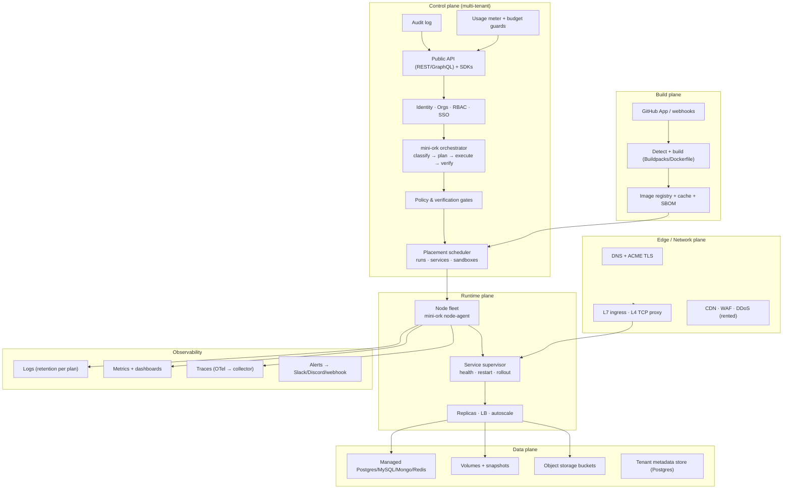

# Railway parity study — what it takes to run Railway's feature set on a mini-ork core

> Analysis date: 2026-10-25. Sources: railway.com (home, features, pricing,
> sandboxes, agents, templates) and docs.railway.com sitemap; mini-ork repo at
> `main` (`20296917`). All Railway limits and prices below are as published on
> that date and will drift.
>
> Scope: public product surface, not Railway internals. "Parity" here means
> *customer-visible capability*, not implementation.

---

## 0. Executive summary

**What Railway is.** An all-in-one, usage-billed cloud for developers: git/image
→ build → deploy → network → scale → observe, plus managed data services,
environments/previews, a template marketplace, and — since 2025-26 — agent
infrastructure (sandboxes, cloud agent sessions, MCP, connectors). It sells
convenience and defaults, not verification. Its 2026 positioning is explicitly
"the all-in-one **intelligent** cloud provider", which puts agents and sandboxes
in the same product as app hosting.

**What mini-ork is.** A task operating system for agents: classify → plan →
execute → verify → reflect → improve. It already has the hard, differentiating
half of the agent story — heterogeneous model routing, deterministic
verification, execution memory, cost governance, sandbox/remote-node placement,
run lineage, and a local control plane with API, SSE events, steering, and
chat intake.

**The strategic finding.** Railway and mini-ork overlap on **exactly one plane**
— agent/sandbox execution. They are complementary on the rest: Railway owns
build, deploy, network, data, scale, billing; mini-ork owns *whether the agent's
work is correct*. Cloning Railway is a multi-year commodity-infrastructure
project. The defensible product is a **verified-deployment cloud**: every
service shipped through an agent run carries proof (verifier results, review
fingerprint, cost, artifact hashes, replay pointer), and the platform refuses to
ship unproven work. Railway cannot match that without becoming mini-ork.

**Recommendation.** Build "MiniOrk Cloud" as a **thin-by-design PaaS** on a
mini-ork control plane: rent compute, buy/embed commodity build/network/data
primitives, and spend the engineering budget on the verification gate, the
agent/sandbox plane, and cost governance. Sequence: deployment contract +
tenancy seams in OSS → build/deploy/network MVP → data + observability →
enterprise + scale. Details in §7–§9.

---

## 1. Railway feature inventory

### 1.1 Core product primitives

| Area | Capability |
|---|---|
| **Services** | Deploy any container image; sources: GitHub repo, Docker image, local repo via CLI; custom Dockerfile; monorepo support; private registries |
| **Builds** | Railpack zero-config detection, Dockerfile builds, build/start commands, skipped builds, build cache, 90-min build timeout (Pro), concurrent builds, staged changes |
| **Deploy lifecycle** | Pre-deploy command, start command, healthcheck endpoint + configurable timeout, restart policy, deployment teardown, GitHub autodeploys, image auto-updates, staged changes |
| **Environments** | Unlimited environments, selective deployments, sync/stage changes, PR preview environments (auto create/delete), one-click rollback to any previous deployment |
| **Config as code** | TOML/JSON config committed with the repo; upstream UI settings |
| **Cron** | Scheduled jobs, crontab expressions, atomic to 5-minute intervals |
| **Serverless** | Serverless execution mode (scale to zero) |
| **Regions** | US East, US West, EU West, Southeast Asia; concurrent regions (Pro+); enterprise dedicated VMs |

### 1.2 Data & storage

| Area | Capability |
|---|---|
| **Databases** | Managed PostgreSQL, MySQL, MongoDB, Redis; High Availability variants; PostgreSQL connection pooling; database view |
| **Backups** | Built-in database + volume backups; PostgreSQL Point-in-Time Recovery; WAL corruption recovery |
| **Volumes** | Persistent volumes up to 5 TB, 100k+ IOPS, disk usage metrics, volume backups |
| **Object storage** | S3-compatible buckets, free Class A/B operations and egress, upload/serve helpers |

### 1.3 Networking

| Area | Capability |
|---|---|
| **Public** | Railway domains, custom domains, wildcard domains, up to 10 Gbps transfer, managed TLS (X.509, auto-renew), HTTP proxy, TCP proxy (L4), multiple IPv6 protocols |
| **Private** | 100 Gbps private networking with zero VPC setup, service discovery by hostname, zero-trust encrypted links |
| **Edge** | CDN, WAF, edge rules, DDoS protection, static outbound IPs, outbound networking controls |
| **Limits** | Per-plan domain counts, service domains, concurrent regions |

### 1.4 Scale

| Area | Capability |
|---|---|
| **Vertical** | CPU/RAM scale-up per replica (up to 48 vCPU / 48 GB standard; 2,400 vCPU / 2.4 TB enterprise) |
| **Horizontal** | Up to 50 replicas per service, automatic load balancing |
| **Global** | Multi-region deploys, concurrent regions |
| **Limits** | Per-plan replicas, CPU/RAM, disk, volumes, buckets, cron jobs |

### 1.5 Observability

| Area | Capability |
|---|---|
| **Logs** | Build/deploy logs, filter/query/forward/share, JSON structured logs, retention 3/7/30/90 days by plan |
| **Metrics** | CPU/RAM/disk/network, custom drag-and-drop dashboards |
| **Tracing** | Distributed tracing, automatic instrumentation, any OpenTelemetry SDK |
| **Alerts** | Metric-threshold alerts via Slack, Discord, email, webhooks; low/high urgency |
| **Usage** | Hard and soft spend limits, email alerts, project usage views, webhooks |

### 1.6 Collaboration, access, compliance

| Area | Capability |
|---|---|
| **Teams** | Workspaces, project members, three roles (Admin/Member/Deployer), unlimited seats on Pro |
| **Enterprise** | SAML SSO, RBAC, audit logs (48 h → 18 months), access groups, environment RBAC |
| **Compliance** | SOC 2, HIPAA BAA ($1,000/mo tier), support SLOs, 99.9/99.99/99.999% availability targets |
| **Placement** | Bring your own cloud (deploy inside customer VPC), dedicated VMs ($10,000/mo tier), Railway Metal |

### 1.7 Developer surfaces

| Area | Capability |
|---|---|
| **API** | GraphQL API, 100+ methods; "same API that powers the console" |
| **CLI** | Rust CLI, 25+ commands (`up`, `deploy`, `logs`, `variables`, `domains`, `scale`, `sandbox`, `ssh`, `templates`, …) |
| **SDK** | TypeScript SDK (notably for sandboxes); no first-class Python SDK advertised |
| **MCP** | Remote MCP server (public testing) |
| **Mobile** | iOS + Android app: deploy, monitor, manage |
| **IDE/agent integrations** | Claude Code, Codex, Cursor, OpenCode, Copilot, Grok Build, Pi, Devin guides/plugins |

### 1.8 AI & agents (the 2026 wedge)

| Area | Capability |
|---|---|
| **Railway Agent** | In-product assistant; per-plan default spend limit ($5/$20/custom) |
| **Cloud agents** | Terminal sessions for Claude Code / Codex / OpenCode, preinstalled in the base image; desktop integrations |
| **Agent connectors** | Slack and Discord surfaces |
| **Sandboxes** | Full Linux VMs, created from CLI/TS/dashboard/API; coding agents + Node + Git preinstalled; exec with durable sessions; Files API; **checkpoints, forks, templates**; private networking; up to 10 public HTTPS domains; SSH + port forwarding; 4 regions; idle timeout; per-second CPU/memory billing (~$50/vCPU-month, $50/GB-month) |
| **Templates** | 2,000+ one-click deployable stacks; sharing, customization, updates; **monetization + kickbacks** for authors |
| **Agent skills/plugins** | MCP server, Claude/ChatGPT/Codex/Cursor/Grok plugins |

### 1.9 Business model mechanics

| Mechanic | Detail |
|---|---|
| **Tiers** | Free ($0, trial credits, 1 vCPU/0.5 GB) → Hobby ($5 minimum) → Pro ($20 minimum, unlimited seats) → Enterprise (custom) |
| **Metering** | Per-second CPU, memory, volumes; egress per GB; object storage per GB-month |
| **Credits** | Included monthly usage credits per tier |
| **Hard caps** | Hard and soft spend limits, per-workspace |
| **Committed spend** | Feature-unlock ladder: $1k HIPAA → $2k RBAC/SSO/audit → $5k support/limits → $10k dedicated VMs |
| **Marketplace** | AWS Marketplace listing |
| **Template kickbacks** | Authors earn a share when their template is deployed |
| **Lock-in posture** | Low: Docker, standard protocols, migrations away from competitors documented |

### 1.10 Railway's actual moat

Not any single primitive. It is the **composition and default quality**:
one canvas, zero config, networking that just works, sensible limits, and a
pricing model developers trust. Every individual primitive is rentable or OSS;
the integration and product polish are the asset.

---

## 2. What mini-ork already has (verified in repo)

| Layer | mini-ork primitive | Where |
|---|---|---|
| **Task lifecycle** | classify → plan → execute → verify → reflect → improve; versioned workflows; artifact contracts | `mini_ork/cli/main.py`, `mini_ork/workflow/`, `recipes/`, `schemas/` |
| **Multi-model routing** | Lane → model-family mapping, 7 provider families, BYO registry, cost-aware routing, escalation ladder | `config/providers.yaml`, `mini_ork/lane_router.py`, `mini_ork/dispatch/` |
| **Verification** | Deterministic verifier registry, 7+ gate types, mutation adversary, minimum-evidence `vacuous` verdict, `mini-ork certify` (PROVEN/REFUTED/UNVERIFIED) | `mini_ork/verify/`, `mini_ork/gates/`, `mini_ork/certify/` |
| **Guardrails** | Scope guards, budget gates, human gates, review panels, autonomy ladder, branch quarantine | `mini_ork/policies/`, `docs/SAFETY.md` |
| **Execution isolation** | `Workspace` protocol: `local`, `docker`, `microvm`; per-node backend selection; reaper | `mini_ork/runtime/sandbox.py`, `mini_ork/runtime/backends/`, `mini_ork/runtime/sandbox_reaper.py` |
| **Remote execution** | Self-hosted `node-agent` (HTTPS+bearer), git-snapshot sync, detached procs, reattach, engine pinning | `mini_ork/remote/`, `mini_ork/cli/node_agent.py`, `docs/architecture/remote-nodes.md` |
| **Cloud placement** | Node providers: static, Daytona, E2B, Modal; `--placement remote --env <profile>` | `mini_ork/remote/providers/`, `docs/architecture/cloud-sandbox-providers.md` |
| **Durable state** | SQLite WAL: runs, traces, gradients, patterns, benchmarks, versions, checkpoints | `.mini-ork/state.db`, `db/migrations/` |
| **Observability** | REST API, SSE run events, DAG forensics, transcripts, cost breakdowns, node events | `mini_ork/web/`, `mini_ork/observability/` |
| **OTel export** | Every finished run exported to Langfuse/OTLP through the vault | `mini_ork/otel_export.py`, `docs/architecture/otel-langfuse.md` |
| **Cost governance** | Per-call `llm_calls` ledger, rolling-24h spend, daily cap, circuit breakers | `mini_ork/cost_ledger.py`, `mini_ork/cost_advisor.py` |
| **Learning loop** | Textual gradients, pattern store, GEPA prompt evolution, bandit routing, promote/rollback | `mini_ork/learning/`, `mini_ork/gepa/` |
| **Intake** | Ticket → thread → run; Linear/Jira/GitHub-style PM providers; signed webhooks; polling tier | `mini_ork/intake/`, `mini_ork/pm/`, `mini_ork/threads/` |
| **Chat** | Telegram/Slack/Discord inbound → launch/steer/continue; channel allowlist; vault secrets | `mini_ork/integrations/`, `docs/operator/chat.md` |
| **Secrets** | Vault: file / sops / command / OpenBao backends; `container_env` allowlist; per-lane scoping | `mini_ork/dispatch/vault*.py`, `mini_ork/remote/secrets_scope.py` |
| **Scheduling** | Multi-epic scheduler, per-project cron automations, launchd/systemd tick | `mini_ork/scheduler.py`, `mini_ork/automations.py` |
| **Surfaces** | CLI (~90 subcommands), Python SDK, MCP context server, ACP, Zed IDE fork, board JSON | `mini_ork/cli/`, `docs/PYTHON-SDK.md`, `mini_ork/mcp_context/`, `mini_ork/acp/`, `docs/UI.md` |
| **Bootstrap** | Node-agent service + cloud-init; agent-node Docker image; OpenBao compose | `deploy/node-agent/`, `docker/agent-node/`, `docker/openbao/` |

**The honest summary:** mini-ork has the *agent execution and proof plane* in
production shape, and a single-tenant local control plane. It has almost none of
the *application hosting plane*.

---

## 3. Coverage matrix — Railway capability vs mini-ork

Legend: **●** present · **◐** partial/seam exists · **○** missing.

### 3.1 Agent, sandbox, verification

| Railway capability | mini-ork | Gap / action |
|---|---|---|
| Sandboxes (full VM, code-created) | ◐ `Workspace` + Daytona/E2B/Modal + node-agent | Add first-class sandbox API (create/exec/files/checkpoint/fork/destroy), durable exec sessions, SSH |
| Checkpoints, forks, templates | ◐ node checkpoints, git worktrees; providers recreate per run | Add disk snapshots + fork-over-running-sandbox; image templates with content-hash cache |
| Coding agents preinstalled | ◐ `docker/agent-node/Dockerfile`, engine pinning | Ship a published base image with agent CLIs; versioned |
| Agent connectors (Slack/Discord) | ● chat intake (one-way today) | Add outbound posting, threads, approvals, per-channel routing |
| MCP server | ◐ `mini-ork mcp-context` (local, read-only) | Remote MCP with OAuth, tool scopes, streamable HTTP |
| Cloud agent sessions | ◐ `mini-ork acp`, ACP orchestrator | Host sessions, multi-tenant session isolation, web terminal, resume |
| **Verification / proof** | ● **unique** | Package as a product surface (evidence bundles, policy, badges) |
| Sandbox regions | ◐ depends on provider | Region catalog + placement policy |
| Idle timeout / reaper | ◐ `sandbox_reaper`, `sandbox-gc` (local only) | Fleet-wide reaper registry, per-tenant TTL, billing stop |

### 3.2 Application hosting

| Railway capability | mini-ork | Gap / action |
|---|---|---|
| Git → build → deploy | ○ | **Largest gap.** GitHub App, webhook, clone, detect, build, push image |
| Zero-config builder (Railpack) | ○ | Adopt Buildpacks/Nixpacks/Railpack externally; do not write a detector from scratch |
| Dockerfile / image deploy | ○ | BuildKit/buildx + registry integration |
| Services / revisions / deployments | ○ | New domain model + deploy state machine |
| Healthchecks / restart / pre-deploy | ○ | Runtime supervisor contract |
| Rollback | ◐ git branch rollback, run checkpoints | Add deploy-revision rollback (independent of git) |
| PR preview environments | ◐ per-run worktrees | Add per-PR environment with isolated services/DB/domain |
| Config as code | ◐ recipe/workflow YAML | Add `miniork.toml` service/env schema |
| Cron | ◐ agent automations | Add service cron (runs a container command, not a recipe) |
| Serverless / scale-to-zero | ○ | Deferred; needs traffic-aware runtime |
| Regions / multi-region | ○ | Placement policy + provider regions |
| Replicas / LB / autoscale | ○ | Runtime scheduler, LB, HPA-equivalent |

### 3.3 Data

| Railway capability | mini-ork | Gap / action |
|---|---|---|
| Managed PG/MySQL/Mongo/Redis | ○ | Provision via operators (CloudNativePG, Redis Operator) or partner (Neon/Upstash) |
| HA + pooling + backups + PITR | ○ | Operator defaults + backup controller |
| Volumes | ◐ `SharedDrive` protocol, local-bind only | Add network drive backend (EBS/CSI, S3, JuiceFS) |
| Object storage buckets | ○ | S3-compatible service (MinIO/Ceph or cloud S3) + signed URLs |
| Team state store | ◐ SQLite only | **Postgres backend** — required for hosting, already a roadmap item |

### 3.4 Network

| Railway capability | mini-ork | Gap / action |
|---|---|---|
| Public domains + TLS | ○ | Ingress controller + cert-manager/ACME |
| Custom/wildcard domains | ○ | Domain registry + DNS challenge |
| TCP proxy / L4 | ○ | Envoy/HAProxy L4 listeners |
| Private networking + discovery | ◐ node-agent HTTPS only | Add per-environment overlay network + DNS |
| CDN / WAF / DDoS / static egress IPs | ○ | Rent (Cloudflare/Fastly) rather than build |
| Edge rules | ○ | Deferred |

### 3.5 Observability

| Railway capability | mini-ork | Gap / action |
|---|---|---|
| Build/deploy logs | ◐ run logs per run | Per-tenant log pipeline with retention |
| Metrics + dashboards | ◐ run/topology metrics | Runtime metrics (cAdvisor/node-exporter) + TSDB + dashboards |
| Distributed tracing | ● OTel exporter | Ship a collector + trace backend (Tempo/Jaeger or Langfuse for agent traces) |
| Alerts | ◐ budget/inbox gates | Threshold alerts to Slack/Discord/webhook |
| Audit logs | ○ | Append-only audit stream per org |

### 3.6 Identity, tenancy, business

| Railway capability | mini-ork | Gap / action |
|---|---|---|
| Orgs / workspaces / projects / members | ○ | New domain model (commercial layer) |
| Roles / RBAC / SSO | ○ (static bearer tokens) | OIDC/SAML, scoped tokens, RBAC middleware |
| Usage metering (CPU-s, GB-s, egress) | ◐ LLM cost only | Infra meter + pricing catalog + invoice export |
| Credits / hard caps / committed spend | ◐ LLM daily cap | Per-org budget guards across all meters |
| Templates marketplace + kickbacks | ◐ recipe catalog | App-template schema, deploy path, attribution + payout ledger |
| Mobile app | ○ | Later; responsive console first |

---

## 4. What "using mini-ork as core" actually means

There are three coherent product shapes. They are not equally good.

### Option A — Verified PaaS (recommended)

mini-ork is the **control plane and the differentiator**; commodity infra is
rented or embedded.

- Every deployment is the output of an agent run with an evidence bundle.
- The platform can enforce policy: *no deploy without a passing verification
  level* (tests, typecheck, differential, suite adequacy, review panel).
- Agent runs and app hosting share one identity, one spend ledger, one audit
  trail.
- Compute comes from node providers (Daytona/E2B/Modal/static VMs), not owned
  metal.

**Why it wins:** it is the only shape where mini-ork's existing moat compounds.
Railway sells "ship fast"; this sells "ship *proven*". The two can coexist —
customers can deploy unverified too, but the verified path is the default.

### Option B — Verification layer on top of Railway/Fly

Fastest to market: mini-ork runs agents and gates, then calls `railway up` /
Fly API. No infra build.

**Why not as the primary:** the user asked for "the same feature set" with
mini-ork as core; here mini-ork is a sidecar and Railway keeps the customer,
the billing, and the compute relationship. Useful as a **bridge/offering** for
customers who already run on Railway, and as a way to validate demand cheaply.

### Option C — Full Railway clone

Own build, runtime, network, data, billing, regions.

**Why not:** 12–24 months of commodity engineering, competing on price against
a company with 2M+ developers and self-owned metal. mini-ork's advantage
(verification, heterogeneity, learning, cost governance) would be buried under
infrastructure parity work.

**Decision:** ship A. Offer B as a migration/on-ramp. Do not start C.

---

## 5. Target architecture

**Plane ownership rule.** mini-ork core owns the control plane, verification,
and the node protocol. The commercial layer owns tenancy, billing, build,
ingress, managed data, and the console. Every new OSS primitive ships with both
tiers (local simple tier + hosted secure tier), matching the repo's delivery
doctrine.

---

## 6. Gap register (prioritized)

Size: S ≈ ≤2 weeks, M ≈ 1–2 months, L ≈ 3–6 months, XL ≈ 6+ months, per
focused pair of engineers.

| ID | Gap | Why it matters | Size | Where |
|---|---|---|---|---|
| **R-01** | Multi-tenant domain model (org/project/environment/service/deployment) | Nothing hosted exists without it | M | commercial |
| **R-02** | Postgres state backend (replace/augment SQLite for hosted) | Concurrent tenants, HA, backups | M | OSS seam + commercial |
| **R-03** | OIDC/SAML SSO + RBAC + scoped tokens | Table stakes for teams; enterprise unlock | M | commercial |
| **R-04** | GitHub App + webhook + repo sync | Entry point for every deploy | M | commercial |
| **R-05** | Build plane: detect → Buildpacks/Dockerfile → image → registry, cached | "Deploy from git" is the core promise | L | commercial, embed OSS builders |
| **R-06** | Service/deployment state machine (revision, rollout, healthcheck, restart, rollback) | Without it there is no hosting | L | OSS contract + commercial runtime |
| **R-07** | Placement scheduler for long-lived services (distinct from per-run sandboxes) | Services are pets-ish; sandboxes are cattle | L | OSS node protocol + commercial scheduler |
| **R-08** | Ingress + TLS + custom domains + L4 proxy | Public reachability | L | commercial (rent/embed Envoy/Caddy) |
| **R-09** | Private network + service discovery per environment | Railway's "zero setup networking" | L | commercial |
| **R-10** | Managed data services + HA + backups + PITR | Every real app needs a DB | L | commercial (operators/partners) |
| **R-11** | Volumes + object storage | Persistence beyond git | M | commercial (CSI/S3) |
| **R-12** | Infra usage metering (vCPU-s, GB-s, egress, storage) + pricing + hard caps | Revenue and trust | M | commercial |
| **R-13** | Per-tenant log/metric/trace pipeline + retention + alerts | Debuggability is a purchase criterion | L | commercial |
| **R-14** | Audit log (append-only, retention tiers) | Enterprise gate | M | commercial |
| **R-15** | PR preview environments (services + DB branch + domain, auto-teardown) | Developer-experience differentiator | M | builds on R-05/06/08 |
| **R-16** | Config as code (`miniork.toml`) + IaC | Teams need reviewable infra | M | OSS schema + commercial API |
| **R-17** | Templates marketplace (schema, one-click, upgrade path, kickback ledger) | Growth loop + supply side | M | commercial |
| **R-18** | Sandbox API productization (checkpoint/fork/files/SSH/durable exec) | Direct Railway-competitor surface; mini-ork is close | M | OSS |
| **R-19** | Remote MCP server with OAuth + tool scopes | Agent integrations are the acquisition channel | M | commercial + OSS |
| **R-20** | Fleet-wide sandbox/service reaper + TTL billing stop | Leaks become invoices | S–M | OSS |
| **R-21** | TypeScript SDK + CLI deploy verbs (`up`, `logs`, `vars`, `domain`, `scale`) | Developer surface parity | M | commercial |
| **R-22** | Console (web) — project canvas, logs, metrics, deploys | The product is the console | L | commercial |
| **R-23** | BYOC + dedicated nodes + region catalog | Enterprise deals | L | commercial |
| **R-24** | Signed evidence bundle ("proof-carrying deploy") | The moat, made legible | M | OSS + commercial |

**Shipped (2026-10-25): R-24, first half.** Attestia issues an Ed25519-signed
`attestia.evidence/v1` payload per `(service, commit)` — verifications, builds,
deployments, `truncated` — deterministic so re-issuing is idempotent and the
history is append-only; `attestia platform evidence-verify` checks it offline,
optionally against a pinned key fingerprint. Still open: verification *levels*
(which evidence a gate requires), and an attestation from the run itself so a
verdict is tied to output the platform did not merely record. Design and known
limits: `hosted-platform-mvp.md` §5 "Signed evidence bundles" (Attestia repo).

---

## 7. What to add to mini-ork (the OSS core)

Keep these generic and single-tenant; the hosted layer consumes them.

### 7.1 Seams to add now (small, unblock everything)

1. **`TenantContext` in `mini_ork.context.RunContext`** — an opaque tenant/org
   id propagated to runs, workspaces, vault lookups, ledger rows, OTel
   attributes. Default `"local"` so nothing changes for laptop users.
2. **Deployment contract schema** — `schemas/deployment.schema.json`: service
   name, build source, start/health/restart, env refs, ports, volumes, replicas,
   placement, verification policy. This is the interface the commercial layer
   compiles into.
3. **Verification policy object** — nameable policy (`none`, `tests`,
   `tests+review`, `certify`) attached to a deployment. Reuses
   `mini_ork/verify/`, `mini_ork/gates/`, `mini_ork/certify/`.
4. **Signed evidence bundle** — extend the run artifacts with a canonical
   `evidence.json` (run id, base/head SHA, diff hash, verifier results,
   panel fingerprint, cost, artifact hashes, replay command) and an optional
   signature. This is the product's "certificate of provenance".
5. **Postgres store backend seam** — abstract the SQLite access already
   centralized in `mini_ork/stores/`, `web/db.py`, `cost_ledger.py`, and
   `trace_store.py`; add a `Store` protocol so a hosted deployment can swap it.
6. **Node protocol v2** — the node-agent already does exec/put/get/stream. Add:
   `service_up(service_spec)`, `service_down`, `service_status`,
   `checkpoint`, `fork`, `files`, `port_forward`. Keep it HTTP and
   provider-agnostic.
7. **`SharedDrive` network backend** — S3-compatible implementation behind the
   existing registry; unlocks remote nodes without a shared POSIX mount.
8. **Fleet reaper registry** — the reaper is single-host today; register
   sandboxes/services by tenant+run so any control-plane replica can reap.
9. **Usage hooks** — emit per-run resource samples (CPU-s, mem-s, egress) into
   the ledger alongside `llm_calls`, so the commercial meter has one source.

### 7.2 Packages to add (medium)

- `mini_ork/deploy/` — service spec → desired state → revision, rollout,
  healthcheck, rollback. Runtime-agnostic; the actual container launch goes
  through the `Workspace`/node protocol.
- `mini_ork/build/` — build-source adapter + builder interface. Do **not**
  implement language detection; wrap Buildpacks/Nixpacks/Railpack and BuildKit.
- `mini_ork/templates/` — template manifest (services, env schema, volumes,
  verification policy, cost estimate) + instantiate/upgrade. Recipes remain
  agent workflows; templates are deployable stacks.
- `mini_ork/sandbox_api/` — public wrapper over `Workspace` with durable exec,
  files, checkpoint/fork, exposure/ports.
- `mini_ork/usage/` — meters + budget guards generalized from `cost_ledger.py`.

### 7.3 Deliberate non-goals for the OSS core

- Tenancy, billing, invoices, SSO, RBAC, console — commercial layer.
- Ingress/TLS/CDN/WAF — buy or embed; not framework code.
- A language detector / buildpack implementation — wrap existing engines.
- Own metal or region build-out — rent until margin justifies otherwise.
- Claiming "PROVEN" for LLM-judged classes — keep the class restriction; the
  oracle has known holes.

---

## 8. Phase plan

### Phase 0 — Seams (weeks 0–6)

Ship in OSS: tenant context, deployment + verification-policy schemas, evidence
bundle, store protocol, node protocol v2 design, fleet reaper. In the commercial
repo: org/project/environment/service/deployment model, OIDC, API keys.

**Exit test:** a local `mini-ork run` can emit a signed evidence bundle and a
deployment spec; a hosted API can create a project and store it in Postgres.

### Phase 1 — "Agent ships an app" MVP (weeks 6–16)

GitHub App → detect → build → image → deploy one stateless service → public
HTTPS domain → logs → rollback. Verification policy gates the rollout. Usage
metering + hard cap from day one.

**Exit test:** connect a repo, let a mini-ork run fix a bug, and the platform
builds, verifies, deploys, and exposes it on a URL; a failing verification
blocks the deploy; a hard cap stops spend.

### Phase 2 — Multi-service + data + previews (months 4–7)

Managed Postgres/Redis, volumes, object storage, private networking, env vars
and secrets, PR preview environments, templates v1, per-tenant observability,
alerting, audit log, TS SDK + deploy CLI.

**Exit test:** a three-service stack (web + worker + Postgres) with a preview
environment per PR, all deployed only through verified runs.

### Phase 3 — Scale + enterprise (months 7–12)

Replicas + LB + autoscale, multi-region placement, sandbox checkpoints/forks,
remote MCP, agent connectors (outbound), SSO/RBAC at enterprise depth, BYOC,
dedicated nodes, SOC 2 readiness, template kickbacks, mobile companion.

**Exit test:** a customer with SSO, RBAC, audit retention, BYOC, and a
99.9% SLO runs production workloads and agent sandboxes on the same platform.

---

## 9. Build vs buy

| Capability | Recommendation | Rationale |
|---|---|---|
| Buildpacks / image build | **Buy/embed** (Buildpacks, Nixpacks, BuildKit) | Commodity; writing a detector is a distractor |
| Container runtime | **Buy** (Docker/containerd, Firecracker/microVM via providers) | Already abstracted by `Workspace` |
| Ingress/TLS/proxy | **Embed** (Envoy/Caddy/cert-manager) | Well-trodden; custom work is waste |
| CDN/WAF/DDoS | **Rent** (Cloudflare/Fastly) | Capital-intensive, no differentiation |
| Managed databases | **Operator or partner** (CloudNativePG, Neon, Upstash) | HA/PITR are deep; operators are mature |
| Object storage | **Rent or MinIO** | S3 API is the contract |
| Metrics/logs/traces | **Embed** (OTel Collector + Prometheus/VictoriaMetrics + Loki/Tempo) or partner | Standard; mini-ork already speaks OTel |
| Billing/metering | **Build thin on Stripe** | Usage-based billing is the product's trust surface |
| **Verification, routing, learning, sandboxes, cost governance** | **Build (mini-ork)** | This is the moat; never outsource |

---

## 10. Differentiation — what Railway structurally cannot copy quickly

1. **Proof-carrying deploys.** Every deploy links to a run with deterministic
   verifier output, a heterogeneous review fingerprint, cost, and a replay
   pointer. "Which model families reviewed this?" is answerable per deployment.
2. **Class-restricted autonomy.** The platform can refuse to auto-promote work
   in classes without an external oracle — a safety property, not a feature
   toggle. (`docs/SAFETY.md`, bounded-autonomy ladder.)
3. **Cost-aware heterogeneity.** Cheap lanes for tactical work, frontier lanes
   for synthesis, with a per-call ledger. Agent runs are structurally cheaper
   than frontier-only harnesses, which protects gross margin on sandbox-heavy
   workloads.
4. **Execution memory.** Runs improve across cycles; the platform can show
   "this class of task got cheaper/faster/more reliable over N runs."
5. **One ledger for agents and infra.** Railway meters CPU; mini-ork meters
   tokens *and* CPU, so a customer sees the true cost of an autonomous change.
6. **Evidence as an export.** Attestation bundles can be consumed by auditors,
   compliance systems, or customers' own CI — a second product surface.

---

## 11. Risks and mitigations

| Risk | Mitigation |
|---|---|
| **Scope explosion** (PaaS is huge) | Rent/embed everything non-differentiating; enforce the build-vs-buy table |
| **Multi-tenant isolation defects** | Tenant id on every row, path, secret, metric; per-tenant namespaces; fail closed; pen-test before GA |
| **Hosted work contaminates OSS** | Keep OSS single-tenant; commercial repo consumes published contracts (matches ROADMAP's "hosted SaaS out of scope") |
| **Verification over-claim** | Keep class restriction; publish false-positive/negative rates; never call LLM-judged classes "PROVEN" |
| **Compute margin** | Price sandboxes per-second like Railway; use idle timeouts + fleet reaper; route cheap work to cheap models |
| **Railway price war** | Do not compete on raw compute; compete on verified outcomes and agent economics |
| **Provider dependency** (Daytona/E2B/Modal) | Node protocol is the seam; add static VMs + own Kubernetes backend for leverage |
| **State migration** (SQLite → Postgres) | Introduce the store protocol early; dual-write/import path; keep SQLite as the simple tier |

---

## 12. Requirement checklist for this analysis

- [x] Railway product surface enumerated: build, deploy, network, scale,
      observe, data, environments, templates, agents, sandboxes, enterprise.
- [x] Pricing/tier mechanics and limits captured.
- [x] mini-ork current capabilities verified against code, not marketing docs.
- [x] Coverage matrix with explicit present/partial/missing classification.
- [x] Product-shape options with a recommendation and rejection rationale.
- [x] Prioritized gap register with sizing and OSS/commercial placement.
- [x] Target architecture and phased delivery with exit tests.
- [x] Build-vs-buy and risk register.
- [ ] Customer validation: willingness to pay for verified deploys (open).
- [ ] Cost model: sandbox + LLM unit economics at target margin (open).

---

## 13. Sources

- Railway home: <https://railway.com/>
- Railway features: <https://railway.com/features>
- Railway pricing: <https://railway.com/pricing>
- Railway sandboxes: <https://railway.com/sandboxes>
- Railway agent directory: <https://railway.com/agents>
- Railway templates: <https://railway.com/templates>
- Railway docs: <https://docs.railway.com/>
- mini-ork: `docs/FEATURES.md`, `docs/ARCHITECTURE.md`,
  `docs/architecture/{cloud-swarm,remote-nodes,cloud-sandbox-providers,otel-langfuse}.md`,
  `mini_ork/runtime/`, `mini_ork/remote/`, `mini_ork/web/`, `mini_ork/cli/`
