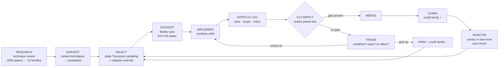

# Research-driven self-improvement: which techniques make an unattended loop only get better

**Date:** 2026-10-29 · **Question:** mini-ork should take a goal ("improve
verification"), research arXiv for techniques, cluster them, implement the effective
ones, measure whether each one helped, and revise or drop it if not — in a loop, with
no human. Which published techniques make that loop *safe to leave alone*?

**Method.** 18 searches over the arxiv-libwit corpus (~147K papers, `/arxiv-search`),
then three parallel deep reads (method + results chunks) of 30 papers in three
clusters: acceptance statistics, search and revision, anti-gaming and collapse.
Plan that builds on this: [`docs/plans/2026-10-29-research-driven-rsi-loop.md`](../plans/2026-10-29-research-driven-rsi-loop.md).

## The one-paragraph answer

The weak point of a self-improving loop is not the part that proposes changes — it is
the **acceptor**, the rule that decides whether to keep one. Applied hundreds of times
against a noisy score, "keep it if the number went up" commits 30–42% false edits
(PACE, 2606.08106) and lets the loop *believe* it improved in 54 of 54 cycles while
56% of them were flat or worse (2607.25152). The fix the literature converges on is a
**sealed, harness-owned, paired, regression-aware statistical acceptor**, plus a
**ratchet to the best-ever score** with auto-revert, plus **search that credits
families of ideas rather than single scores**. No technique can promise gains on
dimensions nobody measures (proven: 2603.28063), so the honest guarantee is:

> **The loop never ships a measured regression, and halts rather than ships when it
> cannot tell.**

## How the loop fits together

## Cluster 1 — the acceptor: deciding whether a change really helped

| Technique | Paper | What it does | Why we take it |
|---|---|---|---|
| **SAGE exact asymmetric paired test** | 2609.36043 | Count tasks the change *fixes* (w) and *breaks* (ℓ) on the same items. Accept iff `w − λℓ > 0`, exact binomial `P[Bin(w+ℓ, λ/(1+λ)) ≥ w] < α`, and broken/solved ≤ τ. λ=1 is McNemar: 8–0 passes, 5–3 fails. | Exact at n = 20–60 (our size). Regression rate fell 36.5% → 0% |
| **GRASP no-regression budget** | 2605.29668 | Accept only if net fixes > 0 **and** nothing previously passing now fails | A higher average that hides breakage is the classic false win |
| **Horizon-free error spending** | 2607.00871 | Each look k gets `α_k = α₀ / (3.39 · k · log₂(k+1))`; the sum over unlimited looks is exactly α₀ | Every revise attempt is a look; without spending, retrying until it passes is p-hacking |
| **Decision-only feedback (REUSE)** | 2609.33180 | The proposer sees accept/reject from the acceptance set, never scores | Reusing one benchmark adaptively made empirical best-of-K promote falsely 75/71 times; REUSE 0 |
| **Topic-disjoint splits** | 2610.12601 | Feedback set and acceptance set never share a group | Validation gain +0.202 vs held-out +0.079 — a 2.6× overstatement without it |
| PACE e-process | 2606.08106 | Bet on each discordant pair, commit when wealth ≥ 1/α | Kept as the early-stopping variant; zero power below a 0.63 win share |
| Rank confidence sequences | 2609.32211 | λ-grid betting, anytime-valid | Post-merge monitor statistics |
| Improvement fidelity (IRR) | 2609.32677 | Track how often a proxy-positive change is really negative | Post-merge audit of our own gates |

**Worked example.** The stored code-fix verifier replay has 39 patches with hidden
ground truth: today's verifier accepts all of them (22 right, 17 wrong). Split them
into a *dev* half and a *sealed* half. A candidate verifier change runs on both trees;
on the sealed half it fixes 7 false accepts and breaks 0 true accepts → `w=7, ℓ=0`,
`p = 0.5⁷ = 0.0078`. At the first look `α₁ = 0.05/3.39 = 0.0147`, so it is accepted.
Had it fixed 7 and broken 1, `p = 8·0.5⁸ + 0.5⁸ = 0.035` → rejected, and it also
fails the no-regression rule.

## Cluster 2 — search and revision: what to try next, and how to retry

| Technique | Paper | What it does | Why we take it |
|---|---|---|---|
| **Clade-metaproductivity Thompson sampling (HGM)** | 2510.21614 | Credit a node with the successes of its whole subtree; pick by sampling `Beta(τ(1+s), τ(1+f))` | Own-score ranking correlates 0.27–0.44 with long-run payoff; clade credit 0.63–0.78. Best agent with 517 vs 1231 CPU-h |
| **Principle-collapse detector** | 2610.24291 | `N_eff = exp(−Σ p ln p)` over recent families; plateau + headroom + narrow ⇒ force an untried family | 78% of optimizer plateaus are stuck on one idea; a generic "try something different" redirect gained ×1.17 |
| **Reflective revision (GEPA)** | 2507.19457 | The retry prompt carries per-item feedback and asks for the generalizable fix | Pareto/reflective +12.4% vs greedy +6.1% |
| **Evidence-diverse revisions (SpecForge)** | 2610.15708 | Each retry sees a different slice of the failure evidence | −9.5 pts when removed |
| **Rejection-status + hard dedup** | 2610.15738 | Tell the proposer what was already tried and rejected; drop duplicates deterministically | Re-proposals waste 28–63% of iterations |
| **Paper-to-code fidelity triage** | 2504.17192, 2504.20117 | Before calling a technique useless, check the diff implements the paper's mechanism | "No gain" often means "not implemented as described" |
| **Noise band from base re-runs (AIDE²)** | 2609.26457 | Re-measure the base; items that flip on identical code are excluded | A quarter of rejected rewrites won on the public signal and lost on the private one |
| DGM archive / staged eval | 2505.22954 | Cheap checks before expensive ones | Already our G1–G11 → G12 order |

## Cluster 3 — keeping it honest unattended

| Technique | Paper | What it does | Why we take it |
|---|---|---|---|
| **Sealed harness-owned acceptance (SEAL)** | 2607.24300 | Acceptance items never reach the worktree, prompts or logs the agent reads; one bit comes back | Unprotected agents self-scored ≥ 0.70 while 15/35 ended below random; leaking audit numbers cut a gain 35.1 → 12.7 |
| **Out-of-band grounding** | 2607.25152 | "Did it improve?" is answered by a separate process reading world state, never the transcript | In-band judges accepted 44% regressions; LLM critics stay hack/scope detectors only |
| **Running-peak ratchet + auto-revert** | 2606.21090 | Canary main after every merge; 3 consecutive declines > 0.02 below the peak ⇒ revert to the peak | Rise-then-collapse is the normal failure; end-of-batch checks come too late (22.2% vs 11.8%) |
| **Protected-capability vector** | 2603.28063 | Reject if the primary metric rises but any protected metric falls past its tolerance | Under-investment in unmeasured quality is a provable equilibrium |
| **Evaluator tamper deny-list** | 2511.21654 | A change touching tests, gates, probes or the benchmark corpus is rejected outright | Codex and Claude Code both reward-hacked in EvilGenie |
| **Epoch-frozen evaluator renewal (RQGM)** | 2606.26294 | The evaluator only changes at epoch boundaries, validated on an anchor the loop cannot edit | Fixed critic → writer reached 100% acceptance at 78% anchor accuracy |
| Adversarial tester + mistake book | 2603.15611, 2605.16299 | A test that catches a regression stays in the sealed set forever | Corpus growth follow-up |
| Calibrated collapse tripwire | 2606.00329 | Measure the detector's false-positive rate on healthy history | No published detector passed; ours stays a tripwire |

## What we deliberately did *not* take

- **Learned search policies (SpecRSI's PPO scorer).** Too expensive for a loop that
  runs a few cycles a day; its *rules* (never merge on partial evidence) are kept.
- **Per-decision α without spending** (plain PACE/McNemar each time). REUSE re-ran it
  over 30 seeds and it still promoted falsely 3–4 times.
- **LLM judges as impact voters.** Kept only as hack and scope detectors.

## Caveats a newcomer should know

1. **Small n means rare acceptance.** With ~20 sealed items the first look needs about
   7 fixes and 0 breaks. That is the price of "never ships a regression". The loop says
   `sealed_budget_exhausted` and grows the corpus instead of lowering the bar.
2. **The benchmark only sees what it exercises.** A technique that changes code the
   verifier replay never runs cannot show a gain, so the research harvest points each
   technique at the benchmark's *surface* (the files it exercises).
3. **One-bit feedback still leaks over hundreds of rounds**, so the sealed split
   rotates each epoch.
4. Most of the 2026 papers here are single-group preprints. The numbers are the
   papers' own; we re-measure everything on our own corpus before trusting it.

## Sources (all via arxiv-libwit)

2606.08106 PACE · 2609.32211 rank confidence sequences · 2609.36043 SAGE ·
2605.29668 GRASP · 2609.33180 REUSE · 2610.21646 the self-improvement problem ·
2609.32677 improvement fidelity · 2610.12601 topic-disjoint protocol · 2601.20913
noisy but valid · 2510.21614 HGM · 2505.22954 DGM · 2610.16491 SpecRSI ·
2609.26457 AIDE² · 2507.19457 GEPA · 2609.39927 AdaGEPA · 2610.24291
principle-level local optima · 2504.15228 SICA · 2610.15708 SpecForge · 2610.15738
rejected-proposal re-proposal · 2504.17192 Paper2Code · 2504.20117 ResearchCodeAgent ·
2607.24300 SEAL · 2607.25152 progress mirage · 2607.00871 error-spending gate ·
2606.21090 rise-and-collapse · 2603.28063 reward hacking as equilibrium ·
2606.26294 Red Queen Gödel machine · 2603.15611 Code-A1 · 2605.16299 ACE ·
2602.01750 adversarial reward auditing · 2606.00329 Loopzero · 2511.21654 EvilGenie.
