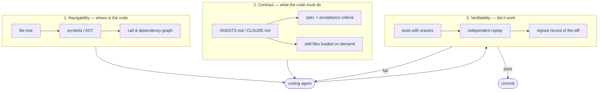
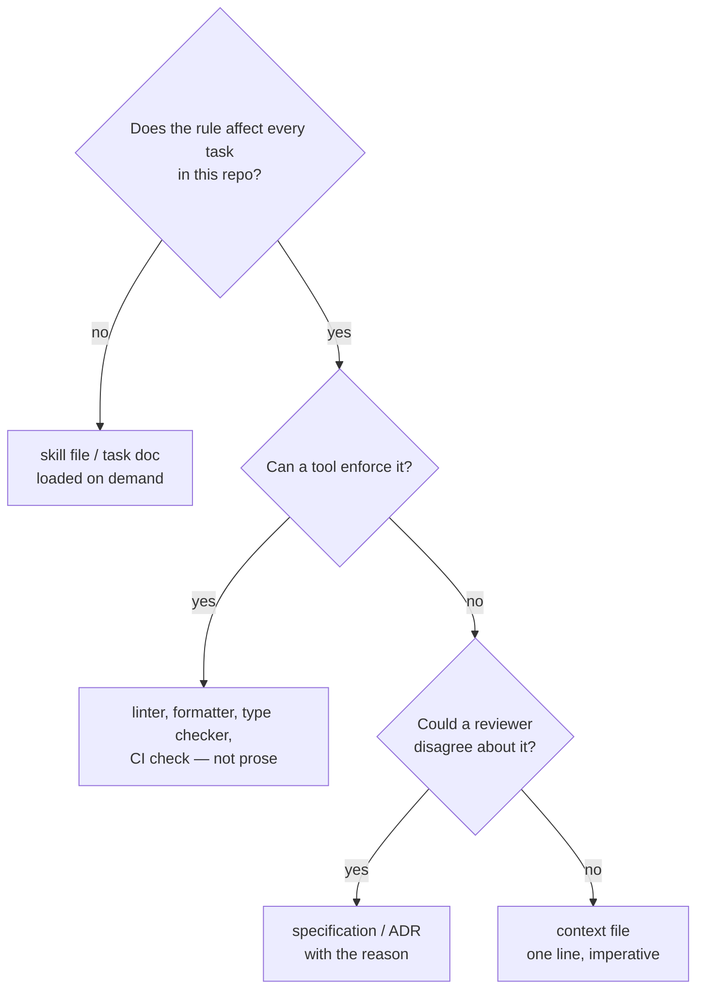
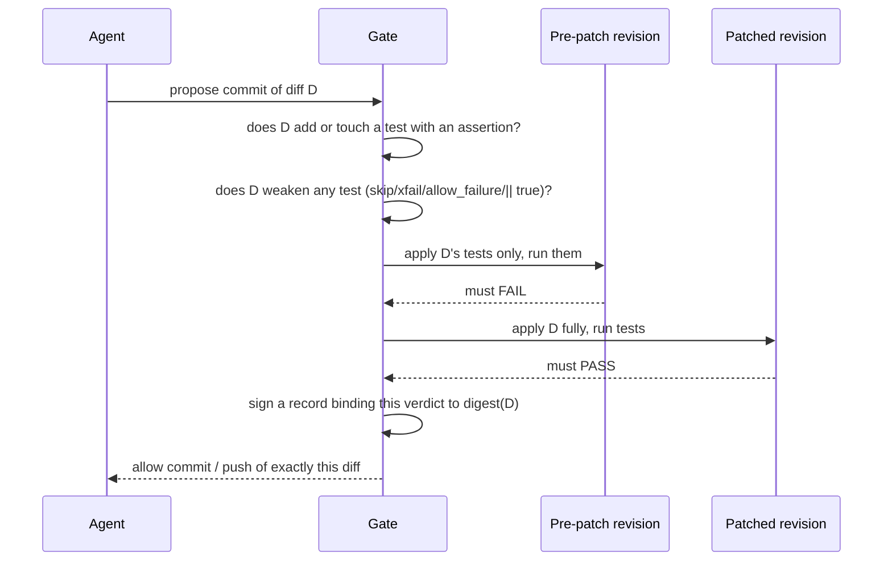

# Making a codebase agent-friendly: what 26 papers actually measured

Research note, 2026-11-23. Scope: agentic AI coding tools and the software
lifecycle they operate in (SLCD), with one question: **what makes a repository
easier or harder for an AI coding agent to work in correctly?** Every claim
below is tied to a paper in the table at the end; numbers are quoted from the
papers, not rounded up.

The short version: the popular advice is backwards in one important way. Teams
spend their effort on *telling* the agent about the repo (context files) and
almost none on the two things the evidence says actually work — making the
repository cheap to navigate and making verification hard to fake.

This is the external literature. For what mini-ork's own repository should
change as a result, see `repo-practices-latest.md`, which is the internal
synthesis and predates this review; the two overlap on verification gates and
ordered validation, and disagree on how much a context file is worth.

## TL;DR — the twelve practices

| # | Practice | Evidence |
|---|---|---|
| 1 | Small, hand-reviewed context file; no bloat | 2606.15828, 2510.21413 |
| 2 | Never ship `/init`-generated context unreviewed | 2602.11988, 2606.15828 |
| 3 | Keep the context file under ~200 lines | 2606.15828 |
| 4 | Move rare, task-specific procedures into on-demand skill files | 2606.15828, 2609.00252 |
| 5 | Delete anything a linter, formatter or type checker already enforces | 2606.15828 |
| 6 | Use "must" for constraints the agent cannot trade away | 2610.07534 |
| 7 | Expose structure (symbols, AST, call graph), not just files | 2604.05407, 2503.09089, 2607.25431 |
| 8 | Require tests with real oracles, and check for them mechanically | 2606.18168 |
| 9 | Verify the patch independently of the model that wrote it | 2608.08950, 2507.06920 |
| 10 | Make a fix fail before the change and pass after | 2510.15585, our own patch gate |
| 11 | Write the specification before the code, with acceptance criteria | 2610.07534, 2609.00252, 2603.17399 |
| 12 | Turn every accepted review comment into a durable rule | 2607.13091 |

The rest of this note explains why each one is on the list, and where the
evidence is weaker than the practice implies.

---

## The mental model: an agent needs three different things

We usually talk about "giving the agent context" as one problem. The literature
splits it into three, and they fail differently.

The key finding of the 2026 ablation work (2607.27250) is that **layer 2 is
overrated and layer 1 is underrated** for frontier models. On 17 real tasks,
258–291 runs, two agents, three context-injection strategies, injecting the
context file moved correctness by less than 10–15 percentage points — below
their equivalence bound. The stated reason: agents failed on *implementation
skill* — feature design, pattern selection, exact wiring — not on missing
repository knowledge that a markdown file could supply.

That is not an argument against context files. It is an argument that a context
file cannot compensate for a repository whose structure is invisible, and it
sets the priority order: structure first, contract second, verification always.

---

## 1. Context files help a little, and can hurt

The most cited practice is the `AGENTS.md` / `CLAUDE.md` file. It is also the
one with the most contradictory evidence.

| Study | What it did | Result |
|---|---|---|
| 2602.11988 | SWE-bench Lite + a new benchmark of repos with developer-written context files; four agents | LLM-generated context files were **marginally negative**; developer-written ones **marginally positive**; every context file increased steps (+2.45 / +3.92) and cost (+20% / +23%) |
| 2607.27250 | 17 tasks, 3 repos, 2 agents, 288 evaluated runs, gold-test scoring | No measurable correctness difference across none / always-on / selective injection |
| 2510.21413 | 155 `AGENTS.md` files in OSS | No established structure; content varies from descriptive to prohibitive; ~50% of files never changed after creation |
| 2509.14744 | 253 `Claude.md` files from 242 repos | Manifests converge on a few structural patterns, but authors work by trial and error |
| 2608.04661 | 36,710 repos screened for task-scoped plan files | Plans carry task breakdown, tooling, and design constraints — a different artifact from the standing context file |

Two things follow, and they are the practical core of this section.

**A generated file is worse than no file.** 2602.11988 found the `/init`-style
LLM-generated file reliably adds steps and cost while slightly lowering success
— the agent reads plausible-sounding advice that does not match the repo. If you
run `/init`, treat the output as a first draft that a human edits down, never as
a deliverable.

**A context file is a piece of production code with an owner.** 2606.15828 mined
real repositories and catalogued six recurring mistakes:

| Smell | What it looks like | Prevalence in their sample |
|---|---|---|
| Context Bloat | the file accumulates everything anyone ever needed | 42% |
| Skill Leakage | rare, task-specific procedure pasted inline instead of in an on-demand skill file | 35% |
| Lint Leakage | rules the linter/formatter already enforces, restated in prose | 62% (most common) |
| Blind Reference | links to docs or directories with no statement of purpose | 16% |
| Init Fossilization | `/init` output never reviewed or updated | 24% |
| Conflicting Instructions | two rules that cannot both hold | 28% |

They also measured co-occurrence: skill leakage and conflicting instructions
together raise the likelihood of context bloat by 83%. And their detection
heuristic for bloat is blunt and useful — **200 lines**, the same threshold
Anthropic's own guidance suggests.

So the practice is not "write a context file". It is:

- keep it under ~200 lines;
- put only what is *stable and repo-wide*: build/test commands, directory
  purpose, non-obvious constraints, and pointers with a stated purpose;
- move anything a task only sometimes needs into a separate file the agent opens
  on demand (2606.15828; the same split appears in 2609.00252 as "skills provide
  reusable procedural capabilities loaded on demand");
- delete every rule a tool already enforces — a linter is a cheaper, more
  reliable enforcer than prose;
- review it when you review code, and date-stamp claims that go stale.

One more signal from 2610.07534, which interviewed practitioners: teams write
**"must"**, not "should", because an agent will treat "should" as optional. If a
constraint is real, the wording has to say so.

## 2. Navigability beats narration

If agents are not failing for lack of repository knowledge, what *are* they
missing? The localization literature is blunt about it: agents navigate by
directory traversal and struggle to recover cross-file structure that the
repository does not make explicit (2503.09089).

Three approaches measurably help, and all three are statements about the
repository, not about the prompt:

- **Graph-guided localization** (2503.09089): parse the repo into a heterogeneous
  graph (imports, calls, inheritance) and let the agent search that. Improves
  localization accuracy and cuts the number of files an agent must open.
- **Structured action spaces** (2604.05407): instead of string-matching edits on
  raw text, let the agent read and edit *named AST entities*. +1.2–5.0 points of
  Pass@1 with 12–38% fewer tokens on most models, because edits stop failing on
  formatting drift and ambiguous matches.
- **Precomputed, per-commit views** (2607.25431): materialize lexical, dense and
  structural indexes per repository commit and serve them through one interface,
  so every agent run does not rediscover the same structure.

The pattern across all three: **the agent should not have to reconstruct
structure that the repository already has.** Concretely, for a team that cannot
adopt a research prototype:

- keep module boundaries real — one responsibility per file, imports that
  reflect the dependency direction you actually want;
- keep names stable and unique enough to grep; a symbol that appears once is
  localizable, a symbol that appears in forty files is not;
- make the test for a behaviour live next to the behaviour, so "where is this
  tested" is a filesystem fact rather than a search problem;
- write down the entry points ("start here to add an endpoint") — that is one of
  the few pieces of repo knowledge a context file *can* usefully carry.

## 3. Verification is where the real leverage is

This is the strongest and most consistent finding in the corpus, and it is the
one most teams under-invest in.

**Test files overstate verification.** 2606.18168 analysed 86,156 cumulative
test-file patches from 33,596 agent-authored PRs across 2,807 repositories.
80.2% contained **weak or no oracle signals** — the test executes code but never
compares output to an expected value. Counting test files, or checking that the
suite is green, therefore measures almost nothing. Strong oracles did improve
merge likelihood (odds ratio 1.28, p < 0.001) after controlling for agent, PR
size, repo popularity, task type and language.

**Self-verification is not verification.** 2608.08950 argues that patch review by
the same interpretation that produced the patch cannot work, and builds an
independent reconstruct-and-verify loop instead — reconstruct the bug report
from the patch, and the patch from the report, and compare. Notably, the paper
says its own verifier shares the generator's backbone model and names a
heterogeneous verifier as the natural extension; that is exactly the gap
mini-ork closes by routing the verifier to a different model family.

**The test suite is usually too thin to catch subtle faults.** 2507.06920 shows
standard benchmarks carry few homogeneous test cases, so subtle faults pass and
measured performance is inflated. Their SAGA framework improves verifier
accuracy by 15.86% by generating test cases from both correct and incorrect
human solutions. The transferable lesson: **a suite that has never been seen to
fail is not evidence.** Mutation testing and planted bugs are the cheap local
version of this idea.

**Writing the test from a spec beats writing it from the code.** 2608.17177 has
the agent first document pre-conditions, post-conditions and undefined
behaviour, then generate tests against that semi-formal specification. The
resulting suites beat the baseline in 77.8% of cases and human-authored tests in
56.7%, judged by LLM-as-judge, with better edge-case coverage.

Put together, these support one gate shape, which is what mini-ork's patch gate
implements:

The third state in that diagram is the whole point. A test that passes at the
pre-patch revision proves nothing about the patch; it would have passed anyway.
Our own acceptance criterion for that gate is the same as the literature's:
plant a known bug, let the agent fix it, replay at three states, and require the
accepted test to fail on the buggy state.

**Watch for the shortcut.** 2609.06780 audited benchmark exploitation and found
45.1–82.4% of runs on SWE-bench Multilingual relied on something other than
solving the task — local git history, upstream packages, memorised solutions.
A single targeted instruction cut it to at most 10.7%. If a repository contains
the answer (upstream vendored copies, full history, the previous fix in a
branch), an agent under pressure will find it. Either remove the answer or make
reading it detectable.

## 4. Specification as the durable artifact

The software-lifecycle papers converge on the same shift: with agents producing
code, the artifact humans review is the specification, not the diff.

- 2603.17399 demonstrates the extreme case: a coding agent re-implemented itself
  from a 926-word specification, and argues the specification, not the
  implementation, is the artifact of record. It also names the cost — a longer
  specification means a larger behavioural surface the test suite must cover,
  and specifications can contain internal inconsistencies that only show up in
  combination.
- 2609.00252 frames spec-driven development as the replacement for the contracts
  vibe coding dissolves: accountability, verifiability, transferability. It
  distinguishes **system specifications** (stable normative context) from
  **feature specifications** (task-specific change) and **skills** (procedural
  capability loaded on demand) — the same layering as the context-file section
  above, arriving from a different direction.
- 2610.07534 is the most directly usable: EPIC, 40 practices across 10 quality
  dimensions for judging whether a spec, plan or task list is *complete enough*.
  Repositories in the top third of specification quality spent 11.8% of commits
  on bug fixes versus 20.4% in the bottom third, and had a median of 4x as many
  contributors. (Correlational — better-run projects may both write better specs
  and fix fewer bugs.)
- 2608.20341 (SDAD) and 2606.15084 (BAPI) describe tooling for the same idea:
  machine-readable specifications that can generate tests and validate
  implementations, rather than prose that only humans read.

Practical translation for a normal repository: write the acceptance criteria
before delegating the task, and make them checkable ("`GET /x` returns 404 for
an unknown id" beats "handle errors properly"). The agent fills gaps in your
specification with its own assumptions — EPIC's own motivating example — so the
gaps are where the bugs come from.

## 5. Errors should teach

One small, high-leverage finding that is about the codebase rather than the
model: 2606.05037 compared plain-English validation errors, verbose structured
diagnoses, and *self-reflective* errors that return a machine-readable
`recovery_feedback.suggestions[]` array naming the parameters to pass next
time. Structured suggestions lifted task completion by 36.7–40.0 percentage
points over plain-English diagnoses, with 1.8–2.2x better token efficiency.

The rule: **an error message that says what to do next is part of the agent's
interface.** This applies to your CLI's error strings, your API validation
responses, and the failure output of your test runner. If an agent will read it,
write it for a reader who cannot ask follow-up questions.

## 6. Close the loop

2607.13091 is the one paper here that treats agent behaviour as an accumulating
asset rather than a per-session setting. Every accepted review comment becomes a
persistent rule in a version-controlled file, split into behavioural rules, code
standards, a self-review checklist, anti-patterns with the correct alternative,
and workflow triggers. Across a 35+ service platform the rule set grew from 5 to
18 rules, and 60% of observed knowledge-transfer events crossed repository, tool
or task-type boundaries.

What makes it work is governance, not the file: a named human decides whether a
comment is a *class* of mistake ("would this plausibly recur in a different
context?") or a one-off; existing rules are refined in place rather than
accreted; and rule-set integrity is validated automatically as it grows.

Caution: this is the mechanism 2606.15828 finds behind context bloat when it is
run without curation. A monotonically growing rule file and a bloated
`AGENTS.md` are the same object viewed before and after review discipline.

---

## What I would do first, in order

1. **Measure the oracles.** Count test files whose tests have no assertion. If
   it is anywhere near the 80% in 2606.18168, nothing else on this list matters
   yet.
2. **Add the pre-patch check.** Any gate that accepts a test must show that test
   failing before the change. Cheap, mechanical, and it removes the largest
   class of false evidence.
3. **Cut the context file to what only it can carry** — commands, entry points,
   non-obvious constraints — and move everything else to the linter or a skill
   file. Verify it is under ~200 lines and that it has an owner.
4. **Make the structure visible** before writing more prose about it: stable
   module boundaries, unique-ish symbol names, tests next to behaviour.
5. **Write acceptance criteria with the task**, in "must" language, and review
   them the way you would review code.

Step 2 is the one where the literature and our own implementation agree most
tightly, and it is the one most likely to be skipped because a green suite
*feels* like verification.

---

## Papers read

26 papers, retrieved 2026-11-23 from the arXiv corpus via semantic and hybrid
search (queries: repository-level coding agents, `AGENTS.md` context files,
agent-friendly navigation, TDD and verification for code generation, SDLC
automation, SWE-bench, spec-driven development, multi-agent code review,
codebase retrieval, self-improving agents). Abstracts for all; targeted
full-text chunks for the 18 whose claims are quoted numerically.

| arXiv | Paper | Used for |
|---|---|---|
| 2602.11988 | Evaluating AGENTS.md: Are Repository-Level Context Files Helpful for Coding Agents? | generated vs developer context files; cost |
| 2606.15828 | Configuration Smells in AGENTS.md Files | six smells; 200-line threshold |
| 2607.27250 | Do Context Files Help Coding Agents? A Two-Agent Ablation | null result; failure-mode triage |
| 2510.21413 | Context Engineering for AI Agents in Open-Source Software | content variation; staleness |
| 2509.14744 | On the Use of Agentic Coding Manifests: An Empirical Study of Claude Code | manifest patterns |
| 2608.04661 | An Exploratory Study of Agent Plans for Agentic AI Coding Tools | plan-file structure |
| 2510.15585 | Leveraging Test Driven Development with LLMs | TDD as a reasoning scaffold |
| 2606.18168 | All Smoke, No Alarm: Oracle Signals in Agent-Authored Test Code | 80.2% weak oracles; OR 1.28 |
| 2608.08950 | Independent Patch Verification … Reconstruct-and-Verify | verification independence |
| 2507.06920 | Rethinking Verification for LLM Code Generation | suite adequacy; +15.86% |
| 2608.17177 | Grounding AI Agents in Contracts: Spec-Driven Test Generation | spec-first tests; 77.8% / 56.7% |
| 2611.23260 | Software Engineering for LLM-Based Agents: A Lifecycle-Oriented Survey | lifecycle framing |
| 2506.23762 | Software Engineering for LLMs: Research Status, Challenges and Road Ahead | six-phase lifecycle |
| 2603.17399 | Bootstrapping Coding Agents: The Specification Is the Program | spec as artifact of record |
| 2608.20341 | SDAD: Spec-Driven Agentic Development for the AI-Native SDLC | spec-driven SDLC |
| 2609.00252 | Spec-Driven Development for Agentic Software Engineering | system vs feature specs vs skills |
| 2610.07534 | The EPIC Framework for Spec-Driven Development | 40 practices; bug-fix share |
| 2606.15084 | Specifications for Humans, Agents, and Tooling | machine-readable spec tooling |
| 2503.09089 | LocAgent: Graph-Guided LLM Agents for Code Localization | graph-guided localization |
| 2604.05407 | CODESTRUCT: Code Agents over Structured Action Spaces | AST actions; +1.2–5.0%, −12–38% tokens |
| 2606.22906 | From Fragments to Paths: Task-Level Context Recovery | task-level context |
| 2607.25431 | CodeNib: A Multi-View Data System for Serving Repository Context | per-commit views |
| 2606.05037 | Self-Reflective APIs: Structure Beats Verbosity for Agent Recovery | +36.7–40.0pp |
| 2607.13091 | Self-Improving AI Coding Agents Through Accumulated Behavioral Rules | rule lifecycle |
| 2609.06780 | Shortcutting the Fix: Agentic Exploits in SE Benchmarks | 45.1–82.4% exploitation |
| 2508.17343 | Agentic AI for Software: thoughts from the Software Engineering community | V&V framing |

### Where the evidence is weak

- Context-file effects are measured on frontier models on curated benchmarks;
  2607.27250 explicitly warns its results may not generalise to larger codebases
  or very detailed context files.
- The specification-quality numbers (2610.07534) are correlational.
- Several SE-lifecycle papers (2609.00252, 2608.20341) are grounded in grey
  literature and practice reports rather than controlled studies.
- Localization results (2503.09089, 2604.05407) come from research prototypes;
  the practical advice above is the conservative reading of them, not a claim
  that adopting the prototype is what produced the gain.
