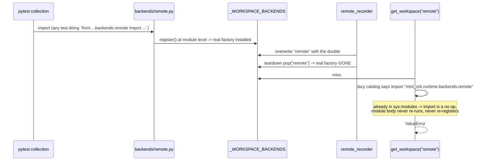

# Failed mini-ork runs, last 48 h — triage, REPLAY receipt & revive plan

**Scope:** every `task_runs` row with `status=failed` in the last 48 h
(2026-10-12 20:00 → 2026-10-14 12:00). **10 runs found**, all under
`.mini-ork/runs/`. Nine `code-fix`, one `framework-edit`.

> **UPDATED 2026-10-15 — action A (REPLAY) DONE. See §0.**
> Two corrections to the first edition are in §5. **Every open item (B–F) is
> dispositioned in §7, with the confirmed root causes and the product call in
> §8.** Ships as two `framework-edit` runs: `remote-early-death-hardening`
> (D+E) and `frozen-probe-fixtures` (C).
>
> **UPDATED 2026-10-16 — BOTH SHIPPED to `main`. See §9 for the outcome
> receipt.** C = `e0e99542`; D+E = `59f14447`; F = no change (decision in
> §8.4); B dropped. Nothing in §7/§8 is open any more.

---

## 0. REPLAY receipt — the cluster is CLOSED ✅

A fresh remote `code-fix` run on current `HEAD` against the same Daytona target
**published**:

| | |
|---|---|
| run | `run-1792047347-71903` |
| result | `task_runs.status = **published**` |
| cost / wall | **$0.209** / 522 s |
| target commit | `cac3ddb mini-ork(code-fix): implementer [run run-1792047347-71903]` |
| nodes | implementer, typecheck, test, reviewer, eval, **publisher** — all `rc=0` |
| reviewer | `verdict: pass` |
| test verifier | `pass`, `post_rc=0`, `strong_overlap` on `test_add`, suite adequacy **1.000** (4/4 mutants killed) |
| diff | exactly `calc.py:5`: `return a - b` → `return a + b` |

**Conclusion:** the publish path that abstained `publish-no-authored-patch` in
run-48337 works on `HEAD`. Runs 1–3 and 5–8 are closed as *historical repros of
a now-fixed defect*, not open bugs. No further fix is warranted for them.

**Two launch preconditions surfaced during the replay** (both are gates, §6):

```
MO_IGNORE_PENDING_FIX=1        # else RC_BLOCKED=75: a failed run is left "pending change"
MO_REMOTE_ALLOW_DIRTY_ENGINE=1 # else the remote run dies at the planner
```

Target repo left at `cac3ddb` (working, published). The prior publish commits
dropped by the reseed are in the fixture's reflog.

---

## 1. The ten runs

| # | run id | class | cost | when | status today |
|---|---|---|---|---|---|
| 1 | `run-1791914481-48337` | publish abstain: no authored patch | $0.47 | 10-13 20:01 | **REPLAYED → publishes** |
| 2 | `run-1791913440-97590` | publish withheld: unverified levels | $0.54 | 10-13 19:59 | **FIXED** (same storm) |
| 3 | `run-1791912327-41843` | publish withheld: unverified levels | $0.50 | 10-13 19:38 | **FIXED** (same storm) |
| 4 | `run-1791911811-5826` | lane credentials (+ translation crash) | $0.13 | 10-13 19:16 | **mixed** (§5) |
| 5 | `run-1791911602-90288` | early death, pre-plan | $0.05 | 10-13 19:13 | **root cause found** (§3) |
| 6 | `run-1791911354-79155` | early death, pre-plan | $0.05 | 10-13 19:09 | **root cause found** (§3) |
| 7 | `run-1791910825-57872` | credential + rollback | $0.09 | 10-13 19:04 | largely operator |
| 8 | `run-1791910667-50438` | early death, pre-plan | $0.05 | 10-13 18:57 | **root cause found** (§3) |
| 9 | `run-1791930074-82118` | implementer edited frozen probe fixture | $0.01 | 10-14 00:21 | **LIVE — guard gap** |
| 10 | `run-1791788217-61320` | framework-edit epic child interrupted | $2.04 | 10-12 20:52 | retryable `resume` |

All nine `code-fix` runs share one kickoff
(`/Volumes/docker-ssd/ps/mo-daytona-e2e-kickoff.md`) and target
`/Volumes/docker-ssd/ps/mo-daytona-e2e-target`, with `placement: remote`,
`environment: daytona`.

---

## 2. Runs 1–3 — already fixed by `88a3f99e`

The remote path was under active repair the same evening:

```
18:50  b485f1d0  feat(remote): node-provider seam — remote placement obtains its node from a provider
19:01  faf4e232  fix(framework-edit): commit the verifier copy's base tree before the diff
19:24  f6d8f42f  fix(node-agent): host runtime maps its real dirs back to the sandbox view in output
19:50  a602d58e  fix(daytona): bootstrap node-agent deps into a venv, never the user site
20:21  88a3f99e  fix(remote): a verified remote run publishes its authored patch   ← names run-48337
20:35  b3bc8627  docs(cloud-providers): Daytona verified end to end
```

`88a3f99e` names **run-1791914481-48337** as its repro and fixes both causes:
the remote sidecar teed stream chunks as records cut at arbitrary bytes
(**169 of 205 were fragments**) so tool calls were unparsable; and the
implementer's sandbox paths (`/workspace/target/calc.py`) never matched the
local repo — `PathMap.to_host` inverts the run's own map. It carries tests and a
live verification note. The commit is on `origin/main`, and §0 re-proves it.

**Runs 2–3** withheld on *levels* rather than the patch (`executes` UNVERIFIED
with `post_rc=1` / `no post_rc`; `target`/`preserve` not proven) — the same
remote stream/sync defects, upstream of the fix.

---

## 3. Runs 5–8 — early death root cause: the dirty-engine guard

Run dirs for `50438` / `79155` / `90288` (the **same task retried three times**)
contain only `config/`, `context-pack.json`, `context-pack.v2.json`, `learned/`,
`run_profile.json` — no plan, no verdict — plus (on `90288`) a zero-byte
`.node-provider.lock`.

The replay **reproduced this exact signature on demand**:

```
LLM dispatch failed for planner node (rc=1): llm_dispatch: engine tree at
'/Volumes/docker-ssd/ps/mini-ork' is dirty; a sha must name an exact tree.
Set MO_REMOTE_ALLOW_DIRTY_ENGINE=1 to override (testing only).
```

→ `returncode 1`, a run dir with only `context-pack.json` + `run_profile.json`,
and a **`.node-provider.lock` left behind**. That is runs 5–8.

**Root cause:** a `--placement remote` run ships the engine tree to a sandbox and
must name an exact sha, so it refuses a dirty primary checkout. The primary was
dirty that evening (another session was writing). **The guard is correct and
fail-closed** — the defects are (a) the failure leaves a stale
`.node-provider.lock`/lease behind, and (b) the error is only visible in the run
log, not in `task_runs.notes`.

---

## 4. Run 10 — `framework-edit` epic child interrupted

`run-1791788217-61320`, $2.04, verdict NEEDS-CHANGE: *"Interrupted during
implementer: the run stopped before the step finished."* Carries a retryable
`resume`. Not a defect — revive by resuming.

---

## 5. Corrections to the first edition

### §5-corrected — the typecheck envelope is NOT a publish blocker

The first edition claimed a target with no typecheck tool "can never publish".
**That is false.** `execute.log:6` of the successful run `996` reads:

```
[ok] publisher: level gate pass (required=['applies', 'executes', 'target', 'preserve'])
```

`contract` is **not** in the required set, and the real abstain trigger is
`_levels.abstained_kinds(run_dir)` (`mini_ork/cli/publisher.py:371`), which keys
on a `failure_kind` the typecheck envelope does not set. Run `996` published with
`contract: UNVERIFIED`; so did §0's replay.

**What remains true:** `recipes/code-fix/verifiers/typecheck.py:337` `_emit_pass()`
writes `{"pass": true, "error_summary": "…skipped"}` with no `checks` list, and
`mini_ork/verify/levels.py:177` `_read_verifier_evidence()` therefore classifies
it **`"unparsable"`** instead of `"abstained"`. So `levels_reasons.contract`
carries a **misleading string** in every code-fix run. Severity: **cosmetic /
diagnostic**, not a blocker. `abstained_kinds()` (levels.py:194) already
documents this shape; the contract reader just doesn't share the tolerance.

### New — run 9 is a real guard gap

`run-1791930074-82118`'s implementer targeted **the primary checkout** and edited
the frozen probe fixture `recipes/code-fix/probes/fixtures/probe-1/tally.py`
(the code-arm's seeded-bug fixture). The fixture is currently intact (still
carries the intentional `range(1, len(values) - 1)` off-by-one), but a run that
can write the probe's own fixture can contaminate a later code-arm calibration.
The "frozen" declaration is prose, not enforced at write time. **This is the one
genuinely live defect in the set.**

---

## 6. Findings surfaced *by doing the replay*

1. **A failed run blocks all new runs** until acknowledged. Launching anything
   returned `RC_BLOCKED=75`:
   > *"needs a change before this run can continue: pending run
   > run-1791910825-57872 (glm rejected the credentials). Confirm with:
   > `mini-ork board retry run-1791910825-57872 --ack-change` (or set
   > `MO_IGNORE_PENDING_FIX=1`)."*

   A single credential failure parks the queue. Worth a clearer operator signal.

2. **A published remote run left its Daytona sandbox `STARTED`.** Teardown is
   best-effort (`mini_ork/cli/main.py:913` `_release_remote_session()`, "the node
   TTLs it"), billed until TTL (default 360 min) or `mini-ork sandbox-gc`. The
   replay's sandbox `de83a1ee-…` was reaped by hand. Low severity, real cost.

3. **Runs 4 / 7 are lane credentials, not code.** `deepseek_flash,minimax,kimi
   rejected the credentials`; `glm … Invalid API key`. Operator action. Run 5826
   additionally hit `host path in 'text' survives translation`
   (`mini_ork/runtime/path_map.py:55`) during a *repair* retry — no commit after
   10-01 addresses the `text` channel, so it is **suspected live but unverified**
   (its dispatch was already failing on credentials).

---

## 7. Dispositions — every item, resolved on `HEAD` (2026-10-15)

Each item below was re-investigated on `origin/main` (`19e74c72`) before being
dispositioned. Two changed severity once the evidence was read properly (§8).

| item | disposition | ships as |
|---|---|---|
| **B** | **Dropped.** Cosmetic reason-string only; not a publish blocker. | — |
| **C** | **Fix.** Frozen-probe-fixture declaration is prose; the enforcement mechanism exists but is unwired. | framework-edit `frozen-probe-fixtures` |
| **D** | **Fix.** Confirmed live crash — a *remote* run dies when its assembled prompt names a host file outside the four mapped roots. | framework-edit `remote-early-death-hardening` |
| **E** | **Fix.** `task_runs.notes` is blank exactly when the reason is knowable (5826 = `None` though `NEEDS-CHANGE.md` holds it); stale `.node-provider.lock` survives. | framework-edit `remote-early-death-hardening` |
| **F** | **No change — the gate is correct.** Product call taken; rationale in §8.4. | — |

**Explicitly NOT recommended:** re-fixing runs 1–3/5–8 (replayed → publishes),
or treating runs 4/7 as code bugs.

---

## 8. Confirmed root causes (evidence added 2026-10-15)

### 8.1 — D was MISATTRIBUTED in the first edition, and it is live

The first edition called the `survives translation` crash a *repair-retry*
artefact and "suspected live but unverified". Both are wrong. The crash is on
the **implementer's own recipe prompt**, on a **remote** run:

```
.mini-ork/runs/run-1791911811-5826/NEEDS-CHANGE.md:8
gateway lane 'deepseek_flash,minimax,kimi' (used by worker: implementer)
failed: dispatcher crashed: host path in 'text' survives translation:
'\n\n--- Recipe prompt (system context) ---\n# Implementer — code_fix …
```

The offending string is `/Volumes/docker-ssd/ps/mo-daytona-e2e-kickoff.md`,
carried inside `context-pack.v2.json`. Structure of the defect:

- The whole LLM prompt rides the **`stdin`** channel (`dispatch/core.py:223`
  "The prompt rides on stdin"). `core.py:419` applies `path_map.text(stdin)`,
  then `core.py:440` asserts no host path survives.
- `PathMap` (`mini_ork/runtime/path_map.py:100`) maps exactly **four shipped
  roots** — `target`, `run_dir`, `home`, `engine`. `text()` rewrites by prefix
  *replace*, so a host path with **no sandbox counterpart cannot be rewritten**.
- The kickoff at `/Volumes/docker-ssd/ps/mo-daytona-e2e-kickoff.md` is under
  none of the four → it survives → on a **real** remote sandbox the assert is
  **fatal** (`core.py:440`); the local/docker backends only `warning` it.

Reproduced on `HEAD` with `PathMap.from_roots`:

```
prompt : "… Re-run the kickoff /Volumes/docker-ssd/ps/mo-daytona-e2e-kickoff.md …"
text()  : unchanged (no mapped prefix matches)
assert  : LEAK -> channel='text'
control : "edit /Volumes/…/mo-daytona-e2e-target/calc.py" -> /workspace/target/calc.py -> OK
```

**Why the §0 replay still published:** its context pack did not happen to name
an out-of-root host file. The crash is data-dependent, which is why it looks
intermittent. **Ship:** sanitize residual host paths *in the text channel only*;
keep `argv`/`env` fail-closed (those the child actually `open`s).

### 8.2 — C: the frozen mechanism exists and is unwired

`mini_ork/vcs/repo_integrity_guard.py` already implements a fail-closed frozen
list — `config/kernel-frozen.yaml` (`paths:` fnmatch globs), `load_frozen_paths`
(falls back to a built-in list on a missing/unparsable file) and
`frozen_hits(changed, patterns)`. **Nothing calls `frozen_hits` or
`load_frozen_paths`** (grep: zero call sites outside the module); the only
consumer of the module is `cli/main.py:1556 check_and_heal()`.

Separately: the code arm is already safe — `probe_scorer.py:787` **deletes**
`probes/` from each arm's worktree copy, so an arm never touches the real
fixture. The hazard is a **plain run targeting the repo** (run `82118`), which
can edit `recipes/code-fix/probes/fixtures/**` in the primary. The declaration
in `probe-{1,2,3}.md` is prose; `kernel-frozen.yaml`'s own header scopes it to
"auto-opened (origin=auto-triage) framework-edit" runs only.

**Ship:** list the fixture globs in `config/kernel-frozen.yaml` **and** enforce
`frozen_hits` on the authored patch (publish/apply), not only for auto-triage.

### 8.3 — E: notes are blank exactly when the reason is knowable

`task_runs.notes` across the failure set:

```
48337 None   97590 None   41843 None   5826 None   57872 None
90288 'planner_dispatch_rc_1'   79155 'planner_dispatch_rc_43'   50438 'planner_dispatch_rc_1'
82118 'reaped: dispatcher pid … gone'   61320 'planner_dispatch_rc_65; reaped: …'
```

`close_run_record` (`mini_ork/orchestration/run_reaper.py:147`) writes a note
from a fixed vocabulary ("lifecycle exited without a verdict", "deadline hit
before a verdict", …). A **worker-node** dispatch crash (5826) has no
`planner_dispatch_rc_*` marker, so it falls through to `None` — even though the
exact reason sits in the run dir (`NEEDS-CHANGE.md`, `retry-hint.json`,
`repair-*.log`). **Ship:** derive the note from those artefacts when the
vocabulary has nothing to say. Also: `.node-provider.lock` (0 bytes,
`remote/providers/base.py:73`) is released but never unlinked; clear it for a
run that reached a terminal state.

### 8.4 — F: the block is correct (decision)

`dispatch_key` (`recovery/retry_notify.py:951`) scopes a pending fix to
`<kickoff realpath>#<first non-empty line>` — the *task*, not the queue. A
credential failure therefore re-blocks **only that kickoff+step**, and is
skipped entirely when `needs_change.kind ∈ {interrupted, not-started}`
(`NO_CHANGE_KINDS`). Refusing to re-dispatch a step that will fail identically
saves money; the escape hatch (`--ack-change`, `MO_IGNORE_PENDING_FIX=1`) is
named in the message. **Product call: keep it.** The first edition's "a single
credential failure parks the queue" overstated the blast radius — it parks one
task, which is the point.

---

## 9. Outcome — both fixes shipped (2026-10-16)

Both `framework-edit` runs were harvested and merged to `main`; every item in
§7 is now closed. The runs themselves are *not* the receipt — the merges are:

| item | run | merge commit on `main` | files |
|---|---|---|---|
| **C** — frozen probe fixtures | `run-1792092531-89304` | **`e0e99542`** *fix(publish): enforce the frozen-path floor on every authored patch* | `config/kernel-frozen.yaml`, `mini_ork/vcs/repo_integrity_guard.py`, `mini_ork/cli/publisher_authored_patch.py`, `tests/unit/test_frozen_paths_enforced.py` |
| **D + E** — remote early death, run notes, stale lock | `run-1792092528-89023` | **`59f14447`** *fix(dispatch): sanitize unmapped host paths in the prompt text channel* | `mini_ork/dispatch/core.py`, `mini_ork/orchestration/run_reaper.py`, `mini_ork/remote/providers/base.py`, `tests/unit/test_path_map_wiring.py` + 3 new test files |
| **F** — queue block | — | none (decision, §8.4) | — |
| **B** — `unparsable` vs `abstained` reason string | — | dropped (cosmetic) | — |

### 9.1 — what C actually enforces

`enforced_frozen_paths(root)` = the file's list **∪** the built-in
`FROZEN_PATHS_DEFAULT` floor, so deleting or blanking
`config/kernel-frozen.yaml` cannot widen what a run may edit.
`publisher_authored_patch.land_patch()` refuses a patch touching a frozen path
with an abstain reason that **names the path**, before apply/publish. One
documented override: `MO_ALLOW_FROZEN_EDIT=1`, default refuse. The glob is
`recipes/code-fix/probes/fixtures/**` (all three probes, and any future one).

### 9.2 — what D actually enforces

`_spawn_in_workspace` no longer dies on a host path in the **prompt text**:
the text channel is sanitized (`_sanitize_prompt_host_paths` rewrites residual
unmapped host-path *tokens* to `/workspace/unshared-host-path` and emits one
WARN naming them), then the check is **re-run** — a rewrite that does not fully
clean the prompt is still fatal. Two things stay fail-closed, deliberately:
`argv`/`env` (the child resolves those) and a survivor under a **mapped** root
(that one is a real translation bug, not prose).

E: `close_run_record` now derives a note for a terminal failure whose fixed
vocabulary yields none — `NEEDS-CHANGE.md` (first failure line) →
`retry-hint.json` (`.detail`) → `repair-*.log` (first `step N: … failed:`) — so
`run-1791911811-5826` would now record *host path in 'text' survives
translation* instead of `notes = None`. The stale `.node-provider.lock` is
dropped at terminal state, not inside `_RunLock.__exit__` (which must not race
a live provisioner).

### 9.3 — two caveats on the receipts

1. **Run `run-1792092531-89304` (C) read `REFUTED` at run level**, and both of
   its "failed" nodes were a **false negative from the measurement, not the
   work**: its blind spec test `test_ac2_frozen_patch_refused_not_filtered`
   asserts `docs/note.txt` is absent from the base commit, while the test's own
   `_make_repo()` harness writes and commits that file. The assertion is
   unsatisfiable regardless of the implementation; the other 7 spec tests
   passed. The correct diff was salvaged, applied, gated and merged. Recorded
   as a framework gap: the `spec_test_author` node can author a test that no
   implementation can satisfy, and a run-level `REFUTED` then rolls back good
   work. **A `REFUTED` verdict from a single spec test must be read before it
   is believed.**
2. **The green gate is load-sensitive on this machine.** `run-1792092528-89023`'s
   first merge attempt ran the broad 959-test `-k` selection and reported
   14 failed / 8 errors while ~6 other sessions were running their own suites.
   Re-running the *same files* standalone — on the branch, and on a clean
   checkout of `origin/main` for the base — showed the true picture: base
   fails exactly 1 (`test_sandbox_teardown_registry::…gc_all_sweeps_lazy_providers`,
   pre-existing), branch fails 0; the 8 errors are `test_workspace_conformance[docker]`
   (no local docker). The merge therefore used the tight 111-test gate
   (`path_map | text_sanitize | run_reaper | node_provider`) — green — with the
   broader selection verified separately. **A clustered failure wall in a
   concurrent-gate run is a hypothesis, not a verdict: re-measure at the base.**

### 9.4 — still open (not part of this triage)

`run-1792092528-89023` was harvested after its dispatcher exited without
writing a terminal status, so its `task_runs` row still reads `executing` even
though its work is on `main`. `mini-ork reap --dry-run` finds nothing to reap
(the run holds markers the reaper treats as live), so this is the same
post-verdict wedge family as
`feedback_reflect_child_wedges_run_after_verdict` — a board-state wart, not a
shipping blocker.

---

## 10 — Post-merge regression found and fixed (2026-10-16)

The §9 merge was not clean: it left `main` with a **test-isolation** regression.
Found by re-running the full unit suite after the push, isolated by bisection,
fixed at the source, merged as **`778a0686`**.

### 10.1 — the symptom, and why it was not the flaky-gate story

| suite state | result |
|---|---|
| full `tests/unit` at the pre-merge base `2e8367f7` | **4 failed**, 9478 passed |
| full `tests/unit` at the post-merge `2d786fec` | **18 failed**, 9507 passed |

§9.3 already documented a flaky green gate under concurrent load, so the first
instinct was "contention again". It was not: the two runs differ by *14* new
failures, and the failing set is stable — it reproduces every time, on an
unloaded machine, from a fixed file list. **A flake does not reproduce on
demand; a regression does.** The 4 base failures were unchanged.

### 10.2 — isolating the cause

Bisecting the implicated files: each of the three *new* test files shipped with
the `59f14447` merge (`test_dispatch_text_sanitize`, `test_run_reaper_notes`,
`test_node_provider_lock_cleanup`) leaves the remote test files green. Adding
**`tests/unit/test_path_map_wiring.py`** — a pre-existing file that the merge
*modified* — reproduces the wall on its own:

```
===== WITH test_dispatch_text_sanitize =====     61 passed
===== WITH test_run_reaper_notes =====           66 passed
===== WITH test_node_provider_lock_cleanup ===== 66 passed
===== WITH test_path_map_wiring =====            15 failed, 49 passed   <-- the polluter
===== CONTROL: remote files alone =====          55 passed
```

### 10.3 — the mechanism

The merge replaced that file's old leak test with a new `remote_recorder`
fixture, which installed its double by hijacking the **real** backend name:

```python
sandbox.register_workspace_backend("remote", lambda **_kw: rec)
yield rec
sandbox._WORKSPACE_BACKENDS.pop("remote", None)      # <-- deletes the REAL factory
```

A blind `pop` is only safe when the name is *test-owned* (the sibling
`recorder` fixture's `"fake-pm"` never collides). `remote` is not:



The give-away is that the error message contradicts itself — it names the
backend unknown *while listing it as registered*, because
`known_workspace_backends()` unions the lazy catalog the name is still in:

```
execute: remote_unavailable: unknown workspace backend 'remote'; registered: docker, local, microvm, remote
```

Every later test that resolved `workspace="remote"` then failed. That is why the
victims are in *other* files (`test_secrets_scope.py`, the remote suites) and why
running those files **alone** was green — nothing had popped the entry yet.

### 10.4 — the fix

Install the double with `monkeypatch.setitem`, which restores the prior entry
(or its absence) on teardown — the idiom `test_workspace_backend_catalog.py`
already uses. No production code changed; the leak was entirely in the fixture.

Measured on one identical six-file selection
(`test_path_map_wiring`, `test_remote_workspace`, `test_remote_node_hardening`,
`test_run_mirror`, `test_remote_live_and_kill`, `test_secrets_scope`):

| | result |
|---|---|
| before the fix | **7 failed**, 69 passed |
| after the fix | **76 passed** |

Shipped as `778a0686`, merged with that six-file selection as the gate.

### 10.5 — the lesson worth keeping

**A test that borrows a *real* registry name must restore it, not delete it.**
Two compounding details made this permanent: the registration happens at
*import* time, and `importlib.import_module` on a module already in
`sys.modules` does not re-execute it — so a deleted registration is
unrecoverable for the life of the process. A fixture that "cleans up" after
itself with a blind `pop` is not cleaning up; it is destroying someone else's
state. The self-contradicting `ValueError` is the fingerprint.

---

## Appendix — evidence

- Replay run dir: `.mini-ork/runs/run-1792047347-71903`
  (`retry-exhausted/{implementer,typecheck,test,reviewer,eval,publisher}.attempts.json`
  all `rc:0`; `review-verdict.json` `pass`; `verifier_test.json` `post_rc:0`;
  `.node-provider.json` handle `de83a1ee-…`).
- `task_runs` (`mini-ork/.mini-ork/state.db`): `run-1792047347-71903 → published`.
- Target repo: `cac3ddb` on `/Volumes/docker-ssd/ps/mo-daytona-e2e-target`.
- Key source anchors: `recipes/code-fix/verifiers/typecheck.py:337,380`;
  `mini_ork/verify/levels.py:132,171,177,194,235`;
  `mini_ork/cli/publisher.py:371`; `mini_ork/cli/publisher_authored_patch.py:607`;
  `mini_ork/runtime/path_map.py:55,67`; `mini_ork/cli/main.py:913,940`;
  `mini_ork/cli/sandbox_gc.py`.
