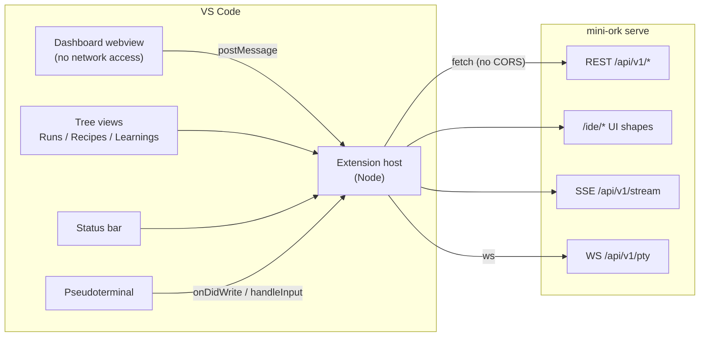

# mini-ork for VS Code

Launch, steer, and observe [mini-ork](../../README.md) runs without leaving the
editor.

The extension is a **thin client**: it does not reimplement any orchestration.
It finds a `mini-ork` binary, supervises `mini-ork serve` as a background
process, and drives that server's 111 REST operations and its event streams
from VS Code surfaces.

The main surface is the **Dispatch Console** — a full IDE built from the
backend's page spec (`/ide/page?key=…&spec=2`), so every page the Zed surface
draws is drawn here too: Dispatch (the orchestrator), Inbox, Board, Runs,
Threads, Changes, Verify & safety, Recipes & epics, Automations, Lanes & cost,
Learning & memory, Context, Nodes, DAGs, Setup & health, Features.

## Architecture



The webview is deliberately isolated: its `vscode-webview://` origin cannot be
named in the server's CORS allow-list, so **the webview never makes HTTP calls**.
Every request is proxied by the extension host and the render comes back over
`postMessage`. The bearer token therefore never enters the rendered page.

## Quick start (simple tier)

No server to start, no config to write:

1. Install the extension.
2. Open a folder that has a `mini-ork` checkout (or put `mini-ork` on `PATH`).
3. `mini-ork: Initialize Project` if the folder has no `.mini-ork` yet.
4. The status bar shows `mini-ork` and the backend starts on a free port.

Everything runs locally on `127.0.0.1`. The extension allocates a port, spawns
`mini-ork serve`, probes `/api/v1/health` until it answers, and kills the child
on deactivate. If a healthy server already listens on the configured port, the
extension **attaches** instead of spawning a second one, and never kills a
process it did not start.

## Secure / shared tier

For a shared or remote deployment, point the extension at a server that is not
on your laptop:

- Bind the server deliberately: `mini-ork serve --host 0.0.0.0 --port 7090`
  behind TLS (a reverse proxy), never plain HTTP over a network.
- Create operator tokens and put them in `<home>/auth-tokens.txt`
  (`<token>  <operator-label>`), or set `miniOrk.authToken`.
- Set `miniOrk.serverHost` / `miniOrk.binaryPath` to empty and provide
  `miniOrk.home` pointing at the project you want to observe.

Write endpoints are **fail-closed**: with no token, launches, steering, and
cost controls return 401 and the extension says so. It never sends an empty
bearer.

## What it exposes

| Surface | Commands |
|---|---|
| Lifecycle | start / stop / restart backend, show log, init project, pick home |
| Runs | grouped tree (Needs You / Working / Failed / Done), launch from selection, file, or typed kickoff |
| Steering | steer, pause cost, resume cost |
| Inspection | trajectory (page + DAG), artifacts, recovery view |
| Terminal | attach to a run's PTY as a real terminal tab |
| Dispatch Console | every `/ide/page` page rendered from the engine's spec, with tabs, chips and inline actions |
| Orchestrator | start a run from a sentence (recipe + lane + workspace are page-level chips), pick a saved kickoff, answer what is blocked |
| Actions | the page spec's own `do` payloads: `cli`, `page`, `run`, `path`, `terminal`, `thread`, `copy`, `pick_files`, `project` |
| Dashboard | board KPIs, lanes, runs table, learning counters, recipe catalogue |

## The console renders a spec, not a hardcoded app

`mini_ork/ide_pages/` builds each page as plain JSON — sections of type `table`,
`list`, `kv`, `bars`, `flow`, `code`, `markdown`, `pills`, `chips`, `dag`,
`inspector`, `hero`, `triage`, `callout`, `story`, `files`, `findings`,
`checks`, `levels`, `agents`, `composer`, `columns`, `document`. `media/main.js`
has one renderer per type and a fallback that shows an unknown type's JSON
rather than dropping it, so a page the engine adds tomorrow appears without an
extension release.

Colours are names (`blue`, `green`, `fam:opus`), never hex, and the theme
follows VS Code's own light/dark body classes.

### Writes

Every button carries the argv the engine would run (`{"cli": ["board",
"retry", "<id>"]}`). `ActionDispatcher` executes it through one function,
`runCli`, which:

- never uses a shell, so a run title containing `$(…)` is an argument;
- appends `--home` and also exports `MINI_ORK_HOME`, so a subcommand whose own
  parser rejects the flag still reads the right project;
- **confirms anything destructive or costly even when the page forgot to.** A
  `board stop`, `board discard`, `run`, `race`, `retry`, or `certify` always
  shows the exact command and the cap it spends against before it runs.

## Settings

| Setting | Default | Meaning |
|---|---|---|
| `miniOrk.binaryPath` | `""` | Explicit `mini-ork` binary; empty means discover |
| `miniOrk.home` | `""` | `.mini-ork` home; empty means `${workspaceFolder}/.mini-ork` |
| `miniOrk.autoStart` | `true` | Spawn and supervise the backend on activation |
| `miniOrk.attachToExisting` | `true` | Attach to a healthy server instead of spawning |
| `miniOrk.serverPort` | `0` | `0` auto-selects a free port |
| `miniOrk.serverHost` | `127.0.0.1` | Bind address |
| `miniOrk.startupTimeoutMs` | `30000` | Health-probe budget before declaring failure |
| `miniOrk.refreshIntervalMs` | `5000` | Poll interval; `0` disables polling |
| `miniOrk.authToken` | `""` | Bearer token; empty reads `auth-tokens.txt` |

## Development

```bash
npm install
npm run typecheck     # tsc --noEmit
npm test              # sse + discovery suites
npm run build         # dist/extension.js
npm run package       # produces mini-ork-<version>.vsix
```

Press `F5` in this directory to launch an Extension Development Host.

## Known limits

- **Read-heavy, not real-time.** Tree views poll; only the dashboard's run
  events use SSE. A push-driven tree is a later change.
- **PTY needs the server to allow it.** `/api/v1/pty` answers
  `[pty disabled]` unless the server runs with `MO_PTY_ENABLED=1`.
- **No marketplace publish yet.** The VSIX is produced and installable; the
  listing does not exist.
- **No agent chat sidebar yet.** The design's left panel is an ACP conversation
  surface (`/api/conversations` + `WS /sockets/events/{id}`). The console ships
  the Threads page (read-only thread browser) but not in-panel chat; that needs
  the conversation socket, which is a separate feature.
- **The console reads `/ide/page`, so it needs a live server.** With the
  backend down the pages show their error state; the tree views and status bar
  still work.
